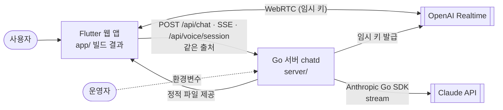
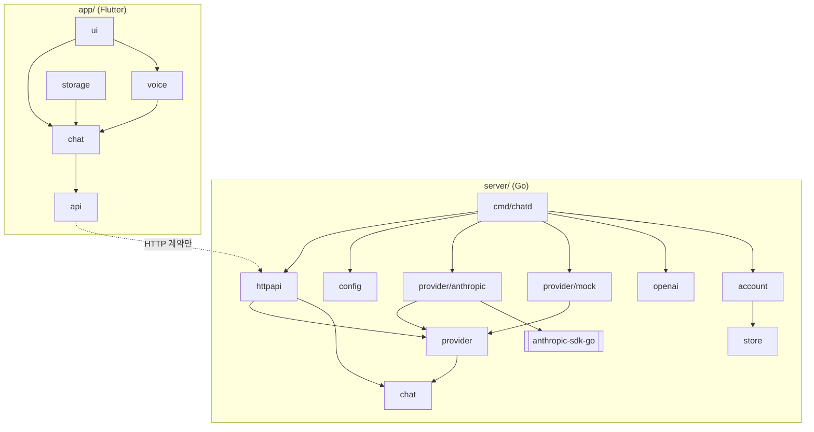
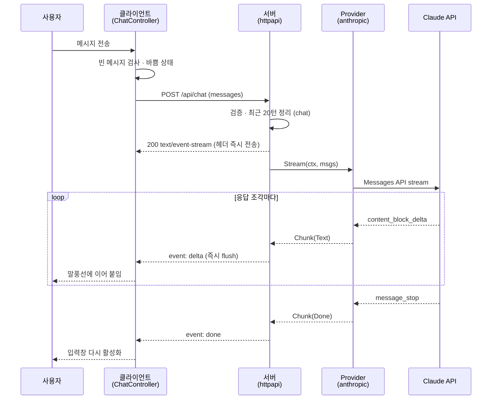
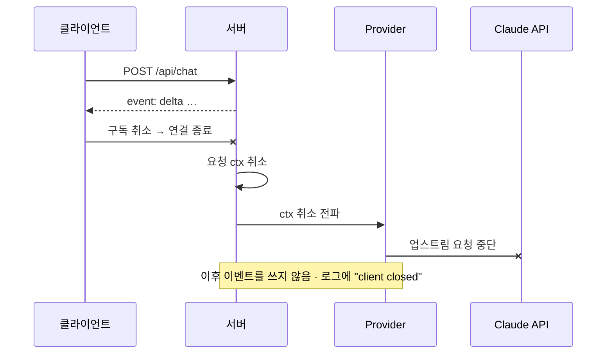
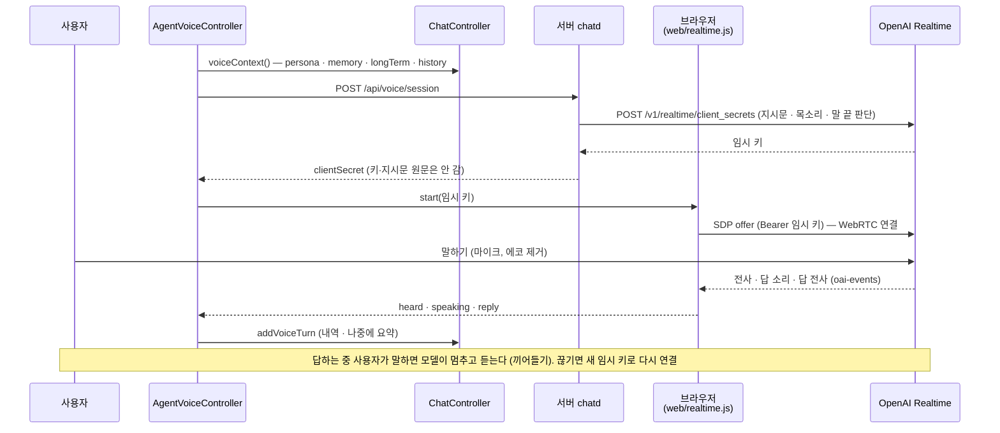
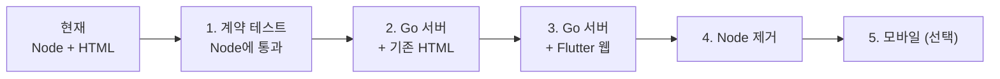

# AI Agent Chat — 아키텍처 명세 (ARCHITECTURE)

> **에이전트 읽기 규칙**: 이 파일은 세션마다 읽지 않습니다. 아래 작업을 할 때 **해당 절만** 읽습니다.
>
> | 이런 작업을 할 때 | 읽을 절 |
> |---|---|
> | 라이브러리·도구를 추가하거나 버전을 바꿀 때 | §2 기술 스택 |
> | 새 폴더·모듈을 만들거나, 다른 모듈의 코드를 불러올 때 | §3 시스템 구성 |
> | 모듈·서비스 사이의 인터페이스를 바꿀 때 | §4 인터페이스 계약 |
> | 설정·환경변수·배포 방식을 바꿀 때 | §6 배포 구성 |
> | 오류 처리·로깅·인증 같은 공통 처리를 건드릴 때 | §7 횡단 관심사 |
> | 기존 결정과 다른 방식을 쓰고 싶을 때 | §9 ADR (뒤집기 전에 사용자에게 제안) |
> | Go·Flutter 코드를 처음 작성할 때 | §10 진화 계획 (해당 단계가 SPEC에 등록됐는지 먼저 확인) |

| 항목 | 내용 |
|---|---|
| 문서 버전 | v1.18 |
| 상태 | 검토 중 — 현재 MVP 기록은 확정, 목표 아키텍처 ADR-005~015 승인 |
| 작성자 | kimtaesung98 |
| 최종 수정일 | 2026-11-13 |
| 관련 문서 | [`SPEC.md`](./SPEC.md) · [`README.md`](./README.md) |

---

## 목차

1. [개요](#1-개요)
2. [기술 스택](#2-기술-스택)
3. [시스템 구성](#3-시스템-구성)
4. [인터페이스 계약](#4-인터페이스-계약)
5. [런타임 시나리오](#5-런타임-시나리오)
6. [배포 구성](#6-배포-구성)
7. [횡단 관심사](#7-횡단-관심사)
8. [품질 속성 대응](#8-품질-속성-대응)
9. [설계 결정 기록 (ADR)](#9-설계-결정-기록-adr)
10. [진화 계획](#10-진화-계획)
11. [기술 부채와 아키텍처 리스크](#11-기술-부채와-아키텍처-리스크)
12. [변경 이력](#12-변경-이력)

---

## 1. 개요

### 1.1 아키텍처 한 줄 요약

**무상태 Go API 서버가 Claude의 스트리밍 응답을 SSE로 중계하고, Flutter 클라이언트(웹 우선, 같은 코드로 모바일)가 이를 실시간으로 표시한다.**  
처음 만든 Node.js 프로토타입(MVP)은 §10 단계 4(F-013)에서 제거했고, 지금은 Go 서버와 Flutter 클라이언트만 있다.

| | 지금 | 앞으로 |
|---|---|---|
| 서버 | Go 1.27, 표준 라이브러리 + 공식 Anthropic Go SDK | 같음 |
| 클라이언트 | Flutter 웹, 폰 홈 화면에 설치하는 PWA (ADR-027) | 같음 — 네이티브 빌드 없음 |
| 둘 사이 계약 | SPEC.md §9 API-001 · API-002 | **동일** |

### 1.2 아키텍처 원칙

원칙끼리 충돌하면 위에 있는 것이 우선합니다.

1. **계약 우선** — 클라이언트와 서버는 SPEC.md §9의 HTTP·SSE 계약으로만 연결된다. 전환은 계약을 고정한 채 한쪽씩 교체한다.
2. **비밀값은 서버에만** — API 키는 서버 환경변수에만 존재한다. Flutter 앱 번들·웹 빌드에는 절대 들어가지 않는다.
3. **외부 서비스는 어댑터 뒤에** — Claude 연동은 `Provider` 인터페이스 뒤에 두어 모의 제공자로 교체·테스트할 수 있게 한다.
4. **도메인 규칙은 순수 코드로** — 입력 검증·맥락 정리 같은 규칙은 HTTP·UI와 분리해 단위 테스트한다.
5. **표준 라이브러리 우선** — 표준 기능으로 충분하면 프레임워크·패키지를 추가하지 않는다.

### 1.3 품질 목표 (우선순위 순)

| 순위 | 품질 속성 | 목표 | SPEC 근거 |
|---|---|---|---|
| 1 | 응답성 | 전송 → 첫 글자 표시 1초 이내 (모의 모드) — 서버·클라이언트 어디서도 버퍼링하지 않음 | §1.3, §5 성능 |
| 2 | 보안 | API 키가 클라이언트·로그·응답에 노출되지 않음 | §11 |
| 3 | 이식성 | 하나의 클라이언트 코드로 웹·모바일 지원, 서버는 단일 바이너리 | §1.4, ADR-005 · 006 |

---

## 2. 기술 스택

> 이 절이 기술 스택의 원본입니다. 루트 `README.md`의 Tech Stack은 이름만 적은 요약입니다.

### 2.1 구성 요소별 스택

| 영역 | 기술 | 버전 | 상태 | 근거 ADR |
|---|---|---|---|---|
| 서버 (목표) | Go — `net/http`, `log/slog`, `context`, `iter`, `os.Root` | `go.mod`: 1.25 (최신 stable 권장) | 구현됨 (F-010) — 단계 3에서 기본 서버가 됨 | ADR-005, ADR-013 |
| Claude 연동 (목표) | `github.com/anthropics/anthropic-sdk-go/v2` | v2.6.0 (`go.mod`로 고정, Go 1.25 이상) | 구현됨 (F-010) | ADR-008 |
| 클라이언트 (목표) | Flutter · Dart | Flutter 3.47.9 stable (Dart 3.13.7) — CI에서 고정 | 구현됨 (F-011) | ADR-006 |
| HTTP·스트리밍 (목표) | `package:http` (`AbortableRequest`로 중단) + 웹 전용 `fetch_client` (`RequestMode.cors`) | http 1.6 · fetch_client 1.2 (`pubspec.lock`) | 구현됨 (F-011) | ADR-009 |
| 상태 관리 (목표) | Flutter 내장 `ChangeNotifier` | Flutter 번들 | 구현됨 (F-011) | ADR-010 |
| 실시간 음성 대화 (F-024) | OpenAI GPT Realtime (WebRTC) — 브라우저는 `app/web/realtime.js` + `dart:js_interop`, 서버는 임시 키 발급(표준 라이브러리 `internal/openai`) | 모델 `gpt-realtime` (환경변수로 변경) | 구현됨 — F-022(ElevenLabs)·F-012(기기 음성)를 대체, 둘 다 지움 | ADR-026 |
| 배포 형태 (F-025) | Flutter 웹 PWA (매니페스트·서비스 워커) — 네이티브 Android·iOS 빌드 대체, 지움 | — | 구현됨 | ADR-027 |
| 음성 답 말투 | API-001 `mode: "voice"` → 서버가 말하기용 시스템 프롬프트를 붙임 | — | 구현됨 (F-012) | ADR-015 |
| 페르소나 (F-005) | API-001 `persona`(이름·역할·말투·지시·사용자 정보) → 서버가 정해진 틀로 시스템 프롬프트를 만듦. 화면은 Material 3 위젯 (새 패키지 없음) | — | 구현 중 (F-005) | ADR-016 |
| 외부 서비스 | Claude Messages API (`stream: true`) | `anthropic-version: 2023-06-01` | 사용 중 | ADR-003 |
| 기본 모델 | `claude-sonnet-5-5` (환경변수로 변경) | — | 사용 중 | — |
| 데이터 저장 | 없음 (대화는 클라이언트 메모리) | — | F-007 착수 시 결정 | ADR-004 |
| 호스팅 | AWS 서울 EC2(t4g.small, Docker) + Cloudflare Tunnel·Access, 이미지는 ECR | — | F-014 | ADR-011, 018, 019 |
| C / C++ | 사용하지 않음 | — | 제외 | ADR-007 |

### 2.2 허용 라이브러리 (Allowlist)

여기 없는 라이브러리를 추가하려면 먼저 사용자에게 제안하고, 승인되면 이 표와 §9 ADR을 갱신합니다.

| 영역 | 라이브러리 | 용도 | 비고 |
|---|---|---|---|
| Go (목표) | 표준 라이브러리 | 전부 | |
| Go (목표) | `anthropic-sdk-go/v2` | Claude 호출 | `internal/provider/anthropic` 안에서만 import |
| Go 테스트 (목표) | `testing`, `net/http/httptest` | 단위·계약 테스트 | 표준 라이브러리 |
| Flutter (목표) | `flutter` SDK, `package:http` | UI, HTTP | |
| Flutter (목표) | `fetch_client` | 웹 스트리밍 응답 | 웹 빌드에서만 사용 (조건부 import) |
| Flutter (F-008, **보류**) | `google_sign_in` (+ 웹 구현 `google_sign_in_web`) | Google 로그인 → ID 토큰 | ADR-017 승인 전에는 추가하지 않음. 승인되면 `app/lib/auth/google_auth.dart`에서만 import |
| Go (F-015·F-016, 승인) | `aws-sdk-go-v2` (`config`, `service/polly`, `service/transcribestreaming`) | Polly·Transcribe 호출 | 해당 단계에서 추가. `internal/speech` 안에서만 import — ADR-020·021 |
| Go (F-016, 승인) | WebSocket 라이브러리 1개 (착수 때 선정, 순수 Go) | `/api/stt` 중계 | `httpapi`의 `/api/stt` 처리에서만 — ADR-021 |
| Flutter (F-016, 승인) | `record`, WebSocket 패키지 | 마이크 PCM 스트림, `/api/stt` 연결 | `voice/` 안에서만 — ADR-021 |
| Flutter (Q-005) | `shared_preferences` | 페르소나·내 프로필·기억·설정 기기 저장 (웹 localStorage) | `app/lib/storage/prefs_store.dart`에서만 import (의존 규칙 테스트) — ADR-023. 간접 의존: `shared_preferences_*` 플랫폼 구현, `jni`·`jni_util`(Android), `path_provider_*`·`xdg_directories`(데스크톱) |
| Go (F-026, 승인) | `modernc.org/sqlite` (`database/sql` 드라이버, 순수 Go) | 서버 DB | `internal/store/sqlite`에서만 import (의존 규칙 테스트) — ADR-028. 간접 의존 `modernc.org/libc`·`mathutil`·`memory` 등 순수 Go |
| Flutter 개발 (목표) | `flutter_test`, `flutter_lints` | 테스트, 린트 | dev_dependencies |

> F-024·F-025(ADR-026·027)는 새 패키지를 넣지 않는다. WebRTC는 브라우저 API를 `dart:js_interop`(SDK 내장)과 `app/web/realtime.js`로 부르고, Go 서버는 표준 라이브러리로 OpenAI를 부른다. `elevenlabs_agents`·`speech_to_text`·`flutter_tts`는 6-④에서 이 표와 `pubspec.yaml`에서 지웠다 (다시 넣으려면 제안 먼저).

**금지:**
- Go 웹 프레임워크(gin, echo, fiber 등) — ADR-013
- Flutter 상태 관리 패키지(Riverpod, Bloc, Provider 등) — ADR-010
- 채팅 응답용 WebSocket — ADR-002 (단방향 SSE로 충분). 음성 인식 중계(`/api/stt`)만 예외 — ADR-021. 실시간 음성(F-024)은 브라우저 ↔ OpenAI WebRTC라 우리 서버의 채팅 스트림과는 별개
- 앱에 OpenAI API 키·지시문 틀을 넣는 것 — 앱은 API-007 임시 키만 쓴다 (원칙 2, ADR-026)
- C/C++ 코드, cgo (`CGO_ENABLED=0`으로 빌드) — ADR-007
- 클라이언트에서 Claude API를 직접 호출하는 모든 패키지 — 원칙 2

### 2.3 개발 도구

| 용도 | Go (`server/`) | Flutter (`app/`) |
|---|---|---|
| 실행 | `STATIC_DIR=../app/build/web go run ./cmd/chatd` | 웹 빌드를 Go 서버로 제공 (같은 출처) |
| 빌드 | `CGO_ENABLED=0 go build ./cmd/chatd` | `flutter build web --no-web-resources-cdn` (CanvasKit를 CDN 대신 빌드에 포함) |
| 테스트 | `go test ./...` (단위 + 계약 테스트) | `flutter test` |
| 정적 분석·포맷 | `gofmt`, `go vet` | `dart format`, `flutter analyze` |
| 계약 테스트 | `go test ./contract` — 모의 모드 `chatd`를 직접 띄움. 떠 있는 서버에는 `-base-url=…` (§4.1, F-013) | — |
| CI | `.github/workflows/ci.yml` `test` 작업: `gofmt`·`go vet`·`go test ./...`·정적 빌드 | `flutter` 작업: `flutter analyze` · `flutter test` · `flutter build web` |

---

## 3. 시스템 구성

### 3.1 구성도 (컨테이너 수준)



이 구성은 루트 README Level 0 DFD의 외부 액터(방문자 · 운영자 · Claude API · OpenAI Realtime)와 일치합니다. `Web`은 폰 홈 화면에 설치한 PWA도 같다 (ADR-027).

### 3.2 모듈 맵

모듈이 담당하는 기능 ID는 루트 README의 Sub-folder Map이 정의합니다.

| 모듈 | 폴더 | 책임 | 의존 가능 모듈 |
|---|---|---|---|
| cmd/chatd | `/server/cmd/chatd` | 진입점: 설정 → 제공자 → HTTP 조립 | 모두 |
| config | `/server/internal/config` | 환경변수 읽기·검증 | (없음) |
| chat | `/server/internal/chat` | 도메인: `Message`, 입력 검증, 최근 20턴 정리, 페르소나·지난 대화 기억·요약 프롬프트 (순수 함수) | (없음) |
| provider | `/server/internal/provider` | `Provider` 인터페이스, `Chunk`, 사용자용 오류 | chat |
| provider/anthropic | `/server/internal/provider/anthropic` | Claude 어댑터 (SDK 사용) | provider, chat |
| provider/mock | `/server/internal/provider/mock` | 모의 제공자 | provider, chat |
| httpapi | `/server/internal/httpapi` | 라우팅, 요청 파싱, SSE 쓰기, 정적 파일. 실시간 음성 임시 키(API-007)는 `RealtimeSessions` 인터페이스로 (F-024). 계정·로그인·관리 API와 AI 경로 보호(`auth.go`, F-026·F-029·F-030) | chat, provider, account, usage, store |
| openai | `/server/internal/openai` | OpenAI Realtime 임시 키 발급 어댑터 (표준 라이브러리만, 키는 밖으로 안 나감) — F-024, ADR-026 | (없음) |
| store (F-026) | `/server/internal/store` | `Store` 인터페이스와 도메인 행 타입(User·Session·Profile·Persona·Conversation·Summary·LongTermMemory). 모든 메서드가 `userID`를 받는다 | chat |
| store/sqlite (F-026) | `/server/internal/store/sqlite` | SQLite 구현, 마이그레이션(`embed`) — ADR-028 | store, chat |
| account (F-026·F-029) | `/server/internal/account` | 로그인 코드·Google ID 토큰 확인·세션 만들기·확인·만료, 역할 계층 권한 검사 `Can` — ADR-029·032 | store |
| usage (F-030) | `/server/internal/usage` | 사용량 상한 확인·증가(게스트·사용자·전체), 게스트 세션 — ADR-033 | store |
| contract | `/server/contract` | HTTP 수준 계약 테스트 (어느 서버에나 실행) | (표준 라이브러리만) |
| archtest | `/server/internal/archtest` | §3.3 의존 규칙 검사 테스트 (모듈 맵에 없는 패키지도 실패) | (표준 라이브러리만) |
| app/api | `/app/lib/api` | `/api/chat`·API-003·004·007 호출, SSE 파싱 (웹 `fetch_client` · 테스트 VM `package:http` 분기) | (없음) |
| app/chat | `/app/lib/chat` | `ChatController` (`ChangeNotifier`): 내역·바쁨 상태. `PersonaController`: 페르소나 목록·선택·내 프로필 (F-005). `MemoryController`·`AuthController`·설정 | api |
| app/voice | `/app/lib/voice` | `VoiceSession`(화면이 쓰는 모양), `RealtimeAgent` 인터페이스와 OpenAI Realtime 구현(`openai_realtime.dart` + 웹 다리), `AgentVoiceController`(임시 키 → 연결, 다시 연결, 안 되면 알리고 끔) — F-024 | chat, api 모델 |
| app/storage | `/app/lib/storage` | 기기 저장: `KeyValueStore` 인터페이스, `PrefsStore`(`shared_preferences`), 페르소나·기억·설정 불러오기·저장 (Q-005, ADR-023) | chat |
| app/ui | `/app/lib/ui` | 위젯: 대화 목록, 입력창, 모드 배지, 마이크 버튼, 페르소나 사이드바·편집 화면(F-005) | chat, voice |

### 3.3 의존 규칙



- `chat`(서버)은 어떤 모듈도 import하지 않는다 — 순수 도메인
- `httpapi`는 `provider` **인터페이스**만 안다. `anthropic`·`mock` 구현을 import하지 않는다 (조립은 `cmd/chatd`)
- `anthropic-sdk-go`는 `provider/anthropic`에서만 import한다
- `openai`(서버)는 표준 라이브러리만 쓰고 `cmd/chatd`만 import한다. `httpapi`는 `RealtimeSessions` 인터페이스만 안다 (F-024)
- Flutter `chat`은 `package:flutter/foundation.dart`까지만 import한다 — `material`·`widgets` 금지 (위젯 없이 단위 테스트)
- Flutter `api`는 `chat`·`ui`를 import하지 않는다
- Flutter `voice`는 `chat`을 쓰고 `ui`를 import하지 않는다. `chat`·`api`는 `voice`를 모른다. `voice`도 `foundation.dart`까지만 (위젯 없이 단위 테스트). `dart:js_interop`은 `*_web.dart`와 `voice/openai_realtime_agent.dart`에서만 쓴다(F-024). `voice`는 `api`에서 `models.dart`만 쓴다 — 임시 키는 `main.dart`가 함수(`api.voiceSession`)로 넘긴다. 조립은 `main.dart`
- Flutter `storage`는 `chat`만 쓰고, 다른 모듈은 `storage`를 모른다. `shared_preferences`는 `storage/prefs_store.dart`에서만 import한다. 조립은 `main.dart` (ADR-023)
- 앱과 서버는 코드를 공유하지 않는다 — HTTP 계약으로만 연결
- 검사 방법: Go는 `go vet` + import 검사 테스트(`internal/archtest`, F-010), Flutter는 `flutter analyze` + import 검사 테스트(`app/test/architecture_test.dart`)

---

## 4. 인터페이스 계약

### 4.1 외부 API 계약

- **원본**: SPEC.md §9 (API-001 `POST /api/chat`, API-002 `GET /api/config`, API-003 `POST /api/summary`)
- **고정 사항**: SSE 이벤트 이름(`delta`, `done`, `error`)과 `data` JSON 형식, 오류 응답 JSON 형식, 상태 코드(400·404·405·413)
- **선택 필드 (F-012, ADR-015)**: 요청 본문의 `mode` — `"text"`(기본) · `"voice"`. 하위 호환(생략하면 지금과 같음). 계약 테스트에 `mode` 시나리오
- **선택 필드 (F-005, ADR-016)**: 요청 본문의 `persona` — `name`·`role`·`tones`·`base`(F-019)·`instructions`·`about`. 하위 호환. 계약 테스트에 `persona` 시나리오
- **선택 필드 (F-019, ADR-024)**: 요청 본문의 `memory` — 지난 대화 요약 0~5개. 하위 호환. API-003 `POST /api/summary`는 JSON으로 답한다(SSE 아님). 계약 테스트에 `memory`·요약 시나리오
- **버전 정책**: MVP 동안 경로 버전 없음. 하위 호환을 깨는 변경이 필요하면 `/api/v2/…`를 추가하고 기존 경로는 한 단계 동안 유지
- **계약 검증**: `server/contract` 계약 테스트를 모의 모드 Go 서버에 실행 (ADR-012, F-013). `go test ./...`에 포함되어 CI에서 매번 돈다

| SSE 이벤트 | data | 순서 규칙 |
|---|---|---|
| `delta` | `{"text": string}` | 0개 이상, 도착 순서대로 이어 붙임 |
| `done` | `{"stopReason": string}` | 정상 종료 시 마지막 1회 |
| `error` | `{"message": string}` | 실패 시 마지막 1회 (`done` 대신). `message`는 화면에 그대로 보여도 안전한 문장 |

### 4.2 내부 인터페이스

| 경계 | 인터페이스 | 정의 위치 | 규칙 |
|---|---|---|---|
| 서버 ↔ AI 제공자 | 아래 `Provider` | `server/internal/provider` | `ctx` 취소 시 즉시 반환, 실패는 `*provider.Error` |
| 컨트롤러 ↔ 화면 | `ChatController extends ChangeNotifier` | `app/lib/chat` | 위젯은 `ListenableBuilder`로 구독만 |
| 컨트롤러 ↔ 통신 | `ChatApi.stream(List<Message>, {mode, persona, memory, longTerm}) → Stream<ChatEvent>`, `ChatApi.summarize(List<Message>, {persona}) → Future<Map>`, `ChatApi.consolidate(sessions, {persona, longTerm}) → Future<Map>` (F-020) | `app/lib/api` | 구독 취소 = 요청 중단. `mode`는 F-012, `persona`(`Persona` 값 객체, `api/models.dart`)는 F-005, `memory`(`SessionSummary`)·`summarize`는 F-019 — 실패는 `SummaryFailed` |
| 음성 컨트롤러 ↔ 음성 엔진 (F-012) | `VoiceEngine` — `prepare()`, `startListening()` → `heard` 스트림(중간 · 확정 · 끝남 · 실패), `speak(문장)` → 다 읽거나 멈추면 완료되는 Future, `cancelSpeech()`, `stopListening()` | `app/lib/voice` | 테스트는 가짜 엔진. 패키지는 `PluginVoiceEngine`만 사용 |
| 서버 ↔ AI 제공자 시스템 프롬프트 (F-012, F-005) | `Stream(ctx, system string, msgs)` — `system`이 비면 지금과 같음 | `server/internal/provider` | 말하기용 지시·페르소나 틀 문구는 `chat` 패키지(도메인)가 가진다 (`Request.SystemPrompt()` = 페르소나 + 지난 대화 기억 + 음성 지시). 요약은 `SummarySystemPrompt` + 기록 한 덩어리(`SummaryRequest.Transcript()`) |

```go
// server/internal/provider
type Provider interface {
    Name() string  // "mock" | "anthropic"
    Model() string // 표시용 모델 이름
    // Stream은 응답 조각을 순서대로 내보낸다. ctx가 취소되면 즉시 끝난다.
    // 실패하면 *Error(UserMessage 포함)를 마지막 값으로 내보낸다.
    Stream(ctx context.Context, system string, msgs []chat.Message) iter.Seq2[Chunk, error]
}

type Chunk struct {
    Text       string // delta일 때
    Done       bool
    StopReason string // Done일 때
}

type Error struct {
    UserMessage string // 화면에 보여도 안전한 문장. 키·업스트림 원문 금지
    Status      int
    Code        string
}
```

---

## 5. 런타임 시나리오

### 5.1 스트리밍 응답 (F-001)



### 5.2 사용자 중단 (F-003 — 서버 쪽은 구현됨)



### 5.3 음성 대화 한 턴 (F-024)



---

## 6. 배포 구성

### 6.1 환경

| 환경 | 용도 | 위치 | 배포 방식 |
|---|---|---|---|
| 로컬 | 개발 · 시연 | 개발자 PC | `flutter build web` + `go run ./cmd/chatd` (또는 `flutter run`) |
| 스테이징 | 공개 전 확인 | 따로 두지 않음 — 운영과 같은 EC2에 배포 전 CI가 이미지로 계약 테스트 (F-014 AC1) | 컨테이너 이미지 |
| 운영 | 허용한 사람만 (Cloudflare Access) | AWS 서울 EC2 1대 + Cloudflare (ADR-018·019). 일반 공개 전 F-008 로그인 필요 | ECR 이미지, `deploy.yml`(OIDC) → SSM Run Command |

### 6.2 배포도 (목표)


- 리버스 프록시는 SSE 응답을 **버퍼링하지 않도록** 설정 (서버가 `X-Accel-Buffering: no` 헤더를 보냄)
- 서버가 무상태라 인스턴스를 늘려도 세션 고정(sticky)이 필요 없음 (ADR-004)

### 6.3 설정과 환경변수

| 이름 | 필수 | 기본값 | 비밀값 | 설명 | 현재 / 목표 |
|---|---|---|---|---|---|
| `PORT` | N | `3000` | N | 서버 포트 | 둘 다 |
| `ANTHROPIC_API_KEY` | N | (없음 → 모의 모드) | **Y** | Claude API 키 | 둘 다 |
| `ANTHROPIC_MODEL` | N | `claude-sonnet-5-5` | N | 사용할 모델 | 둘 다 |
| `STATIC_DIR` | N | `./web` | N | 정적 파일 위치 — Flutter 웹 빌드(`../app/build/web`) | Go |
| `OPENAI_API_KEY` | N | (없음 → API-007 503, 실시간 음성 꺼짐) | **Y** | OpenAI Realtime 임시 키 발급용. 앱에 가지 않는다 | Go (F-024) |
| `OPENAI_REALTIME_MODEL` · `OPENAI_REALTIME_VOICE` | N | `gpt-realtime` · `marin` | N | 실시간 모델·목소리 | Go (F-024) |
| `OPENAI_TRANSCRIBE_MODEL` | N | `gpt-4o-transcribe` | N | 자막용 입력 전사 모델 | Go (F-024) |
| `OPENAI_API_BASE` | N | `https://api.openai.com` | N | 테스트용 가짜 서버 주소 | Go (F-024) |
| `DATA_DIR` | N | (없음 → 메모리 DB, 재시작하면 사라짐) | N | 서버 DB 폴더 — `chatd.db`를 둔다 (ADR-028) | Go (F-026, 목표) |
| `GOOGLE_CLIENT_ID` | N | (없음 → Google 로그인 꺼짐) | N | Google ID 토큰의 `aud` 확인 (ADR-029) | Go (F-026, 목표) |
| `CARE_SETTING` | N | `daycare` | N | 배포 유형 — `daycare`(노치원)·`nursing_home`·`home_alone` (ADR-035) | Go (F-031, 목표) |
| `GUEST_MODE` | N | `off` | N | `on`이면 게스트 체험 (ADR-033) | Go (F-030, 목표) |
| `REQUIRE_LOGIN` | N | `off` | N | `on`이면 실제 모드에서 세션 없는 AI 경로(API-001·003·004·007)를 닫는다. 앱 로그인 화면(단계 7-⑤) 뒤 켬 (ADR-033) | Go (F-030) |
| `BOOTSTRAP_ADMIN_CODE` · `BOOTSTRAP_ADMIN_NAME` | N | (없음) · `최고 관리자` | **Y** · N | 최고 관리자가 없을 때 이 10자리 코드로 첫 최고 관리자를 만든다(계약 테스트·처음 설치). 보통은 `chatd admin bootstrap -name 원장` | Go (F-026) |
| `CLIENT_IP_HEADER` | N | (없음 → 연결 주소) | N | 프록시가 넣는 진짜 IP 헤더(예 `CF-Connecting-IP`) — IP별 상한에 씀 | Go (F-030) |
| `GUEST_TURNS` · `GUEST_PER_IP_HOURLY` · `GUEST_DAILY_TOTAL` | N | `10` · `3` · `300` | N | 게스트 상한 | Go (F-030, 목표) |
| `USER_DAILY_TURNS` · `ADMIN_DAILY_TURNS` · `VOICE_DAILY_MINUTES` · `DAILY_GLOBAL_LIMIT` | N | `300` · `500` · `60` · `5000` | N | 로그인 사용자·서버 전체 상한 | Go (F-030, 목표) |
| `API_BASE_URL` | N | (비움 = 같은 출처) | N | 개발 때 다른 주소의 `chatd`를 부를 때만 **빌드 시** `--dart-define`으로 주입. 키는 절대 주입 금지 | Flutter |

---

## 7. 횡단 관심사

| 관심사 | 처리 위치 | 방식 |
|---|---|---|
| 오류 처리 | 제공자 어댑터 → httpapi | 업스트림 오류는 어댑터에서 사용자용 문장(`UserMessage`)으로 바꾼다. 스트림 시작 전 오류는 JSON + 상태 코드, 시작 후 오류는 SSE `error` 이벤트. 원문·키는 노출하지 않는다 |
| 로깅·관측성 | httpapi (요청 단위 1줄) | 현재: `METHOD 경로 상태 소요ms`. 목표: `log/slog` JSON 핸들러, 같은 필드 + 요청 ID. **메시지 본문·키는 기록 금지** |
| 설정·비밀값 | config (시작 시 1회) | 환경변수를 시작 시 읽어 검증, 잘못되면 기동 중단. 키 유무로 제공자 선택. 시작 로그에는 모드만 (키 금지) |
| 인증·인가 | httpapi 미들웨어 → account | MVP 없음 (내부 시연). 목표(F-026, ADR-029): `sid` 쿠키 → `account`가 사용자 id를 `context`에 넣고, 개인 데이터 핸들러는 그 id로만 `store`를 부른다. 상태 변경은 JSON 전용 + `Origin` 검사. Google은 F-008 |
| 동시성·취소 | httpapi → provider | 요청마다 하나의 취소 범위: 현재 `AbortController`, 목표 `r.Context()`를 SDK 호출까지 전달. 클라이언트 연결 종료 = 취소 |
| 스트림 전송 | httpapi | 이벤트마다 즉시 flush (현재 `res.write`, 목표 `http.Flusher`). 응답 압축 미사용 |
| 접근성 | 클라이언트 | 현재 `aria-live="polite"`. 목표 Flutter: 응답 말풍선에 `Semantics(liveRegion: true)` |
| 테스트 구조 | 각 모듈 | 단위(도메인·컨트롤러, 네트워크 없음) / 계약(HTTP, 모의 제공자) / 화면(현재 가짜 `ui`, 목표 위젯 테스트). 실제 Claude 호출 테스트 금지 — 기준은 SPEC §12 |

---

## 8. 품질 속성 대응

| SPEC §5 요구사항 | 대응 장치 | 검증 방법 |
|---|---|---|
| 첫 글자 1초 이내 | 헤더 즉시 전송 + 이벤트마다 flush, 클라이언트는 조각 단위로 그림. Flutter 웹은 `fetch_client`로 스트리밍 수신 (ADR-009) | 현재 `F-001 AC1 첫 delta는…` 테스트. 목표: 계약 테스트에 같은 시나리오 + 웹 빌드 수동 측정 |
| 설치 없이 사용 | 현재 의존성 0개. 목표: 단일 정적 바이너리 + 웹 빌드를 한 이미지로 | 깨끗한 환경에서 실행 확인 |
| 외부 의존성 최소 | §2.2 허용 목록 | 의존성 파일 변경은 PR에서 ADR과 함께 검토 |
| 키보드만으로 사용, 스트리밍 영역 안내 | 현재 `aria-live`, Enter/Shift+Enter. 목표 `Semantics(liveRegion)`, 키보드 단축키 동일 | 화면 테스트 + 스크린 리더 수동 확인 |
| 지원 브라우저 최신 2개 버전 | 현재 표준 API만. 목표 Flutter 웹 지원 브라우저 범위 | 단계 3 완료 기준에 포함 |
| 동시 대화 10명 내외 | 무상태 서버, 요청당 goroutine (목표) | 단계 2에서 간단한 부하 확인 |

---

## 9. 설계 결정 기록 (ADR)

상태: 제안 / 승인 / 대체됨(→ ADR-xxx) / 폐기. 새 ADR과 상태 변경은 사용자의 결정이며, 에이전트는 "제안"으로만 추가합니다.

| ID | 결정 | 검토한 대안 | 이유 | 상태 | 날짜 |
|---|---|---|---|---|---|
| ADR-001 | MVP는 외부 패키지 없이 Node.js 22 기본 모듈(`http`, `fetch`, `node:test`)만 사용 | Express, Next.js, Anthropic SDK | 시연 환경에서 패키지 설치 불가, 설치 없이 바로 실행, 구조가 단순해 프레임워크 흐름을 보여 주기 좋음 | **대체됨** — ADR-005·006 (F-013에서 Node MVP 제거, 2026-11-10) | 2026-11-02 |
| ADR-002 | 스트리밍은 `POST` + SSE 형식 응답을 스트림으로 읽음 | `EventSource`, WebSocket | `EventSource`는 GET만 지원해 대화 내역을 본문으로 보낼 수 없음. 단방향 스트림이라 WebSocket은 과함. Go·Flutter 전환 후에도 유지 | 승인 | 2026-11-02 |
| ADR-003 | AI 제공자를 인터페이스로 분리 (`anthropic`, `mock`). 키가 없으면 `mock` | Claude만 지원 | API 키 없이 시연·테스트 가능, 테스트가 외부 네트워크에 의존하지 않음. Go에서도 같은 구조 | 승인 | 2026-11-02 |
| ADR-004 | 대화 내역은 클라이언트가 보관하고 매 요청마다 전송, 서버는 무상태 | 서버 세션 저장 | MVP 단순화, 수평 확장 쉬움. F-007(기록 저장) 착수 시 재검토 | 승인 | 2026-11-02 |
| ADR-005 | 목표 서버 언어는 **Go** | C++ (Drogon · Boost.Beast), Node 유지 | 사용자 선호 언어. goroutine과 `context`로 스트림 중계·취소가 자연스러움. 정적 단일 바이너리 배포. 공식 Anthropic Go SDK 존재 | 승인 (사용자 선호, 2026-11-04) | 2026-11-04 |
| ADR-006 | 목표 클라이언트는 **Flutter** — 웹 우선, 같은 코드로 iOS·Android | 현재 HTML/JS 유지, React | 사용자 선호. 한 코드베이스로 웹·모바일 지원. 단, SPEC §1.4 비목표에 "모바일 앱은 만들지 않는다"가 있으므로 모바일 빌드(§10 단계 5)는 SPEC 변경 후에만 | 승인 (사용자 선호, 2026-11-04) | 2026-11-04 |
| ADR-007 | **C/C++는 사용하지 않음**, Go는 `CGO_ENABLED=0`으로 빌드 | 서버 일부를 C++로, cgo 확장 | 병목은 AI API 대기(I/O)라 C/C++의 성능 이점이 없음. 네트워크에 노출되는 서버에서 메모리 안전성 위험만 늘어남. 정적 빌드가 깨짐. 기기 내 처리(로컬 오디오·토크나이저 등)가 필요해지면 Flutter의 Dart FFI 플러그인으로 재검토 | 승인 (사용자, 2026-11-05) | 2026-11-04 |
| ADR-008 | Claude 호출은 공식 Go SDK `anthropic-sdk-go/v2`를 `provider/anthropic` 어댑터 안에서만 사용 | `net/http`로 직접 구현 (Node MVP 방식) | 공식 유지보수, 타입과 재시도 지원, 스트리밍 API(`Messages.NewStreaming`) 제공. 어댑터로 격리해 SDK 메이저 변경 영향을 한 폴더로 제한 | 승인 (사용자, 2026-11-05) | 2026-11-04 |
| ADR-009 | Flutter 웹은 `fetch_client`, 모바일·데스크톱은 `package:http` 기본 클라이언트 (조건부 import) | `package:http`만 사용, WebSocket, `EventSource` | `package:http`의 웹 클라이언트는 응답을 다 받은 뒤 한 번에 돌려줘 스트리밍이 안 됨 → F-001 실패. `fetch_client`는 Fetch API 기반으로 웹에서 스트리밍·취소 지원. WebSocket은 ADR-002와 충돌 | 승인 (사용자, 2026-11-05) | 2026-11-04 |
| ADR-010 | Flutter 상태 관리는 내장 `ChangeNotifier` | Riverpod, Bloc | 화면 1개 규모, 의존성 최소. 현재 `chat-controller.js` 구조(상태 + 화면 인터페이스 분리)를 그대로 옮길 수 있음. 화면이 늘어 상태가 복잡해지면 재검토 | 승인 (사용자, 2026-11-05) | 2026-11-04 |
| ADR-011 | 웹은 **같은 출처** 배포: Go 서버가 Flutter 웹 빌드를 정적 파일로 제공 | 웹을 CDN에 따로 배포 + CORS | CORS 설정 불필요, 배포 단위 1개. 모바일 앱은 `API_BASE_URL`로 같은 API 호출 | 승인 (사용자, 2026-11-05) | 2026-11-04 |
| ADR-012 | HTTP 수준 계약 테스트(`server/contract`)를 Go로 작성해 **Node·Go 서버 모두에** 실행 | 서버마다 따로 테스트, Node 테스트 재사용 | 전환 중 계약이 바뀌지 않았음을 같은 테스트로 증명. 기존 Node 테스트 시나리오(F-001·F-002 AC)를 옮김 | 승인 (사용자가 전환 1단계 착수 승인, 2026-11-04). F-013부터 Go 서버에만 실행하고, `-base-url`이 없으면 테스트가 모의 모드 `chatd`를 직접 띄움 | 2026-11-04 |
| ADR-013 | Go 서버는 표준 라이브러리 우선 — `net/http` ServeMux 패턴 라우팅, `log/slog`, 웹 프레임워크 없음 | gin, echo, chi | 엔드포인트 2개 + 정적 파일, 표준 라우팅(메서드·경로 패턴)으로 충분. 원칙 5 | 승인 (사용자, 2026-11-05) | 2026-11-04 |
| ADR-014 | 음성 인식·합성은 **`speech_to_text` · `flutter_tts` 패키지**로 하고, `VoiceEngine` 인터페이스 뒤(`PluginVoiceEngine`)에 둔다 | ① 브라우저 Web Speech API를 `package:web`로 직접 호출 (새 패키지 없음, 웹 전용) ② 서버를 거치는 클라우드 STT·TTS (더 자연스러운 목소리, 별도 키·비용·지연) | 웹에서는 같은 브라우저 엔진을 쓰고, 같은 코드로 모바일(§10 단계 5)의 OS 음성 엔진도 쓸 수 있음. 키·비용 없이 기기 안에서 바로 읽기 시작해 지연이 짧음. 인터페이스 뒤에 두어 목소리 품질이 부족하면 ②로 바꿀 수 있음. 단점: Firefox는 음성 인식 미지원, 목소리 품질은 브라우저·OS에 따라 다름(자연 음성 우선 선택), 웹 구현의 동작 특이점(R-A11) | **대체됨 → ADR-026** (2026-11-13, 기기 음성 엔진은 6-④에서 지움). 이전: 승인 (사용자 선택, 2026-11-07) | 2026-11-07 |
| ADR-015 | 음성 답 말투는 서버가 정한다 — API-001 `mode: "voice"`면 말하기용 시스템 프롬프트(마크다운 없이 짧은 구어체)를 붙인다 | ① 클라이언트가 읽기 전에 마크다운만 제거 ② F-005 페르소나를 먼저 만들고 그 안에서 처리 ③ 클라이언트가 시스템 프롬프트를 보냄 | 자연스러운 대화는 **짧은 구어체 답**이 핵심이라 읽기 전 정리(①)만으로는 길고 목록 많은 답이 그대로 남음. ③은 클라이언트가 프롬프트를 조작할 수 있어 원칙 2(비밀·제어는 서버)에 어긋남. 하위 호환 선택 필드라 기존 화면 영향 없음. F-005 페르소나가 생기면 페르소나 + 음성 지시를 합침 | 승인 (사용자, 2026-11-07 — F-012와 함께) | 2026-11-07 |
| ADR-016 | 페르소나는 API-001 `persona`에 **구조화된 필드**(이름·역할·말투·추가 지시·사용자 정보)로 보내고, 시스템 프롬프트 **틀은 서버(`chat` 도메인)가 만든다**. 음성이면 페르소나 뒤에 ADR-015 말하기 지시를 붙인다. 이번 단계는 앱 메모리에만 두고 저장 유지는 SPEC Q-005로 미룬다 | ① 운영자가 환경변수로 시스템 프롬프트 지정 (원래 F-005) ② 클라이언트가 완성된 시스템 프롬프트 문자열을 보냄 ③ 서버에 페르소나 저장 | 프로젝트 목표가 "사용자 페르소나 설정을 통한 맥락 대화"라 사용자가 화면에서 골라야 함(①은 운영자만 바꿈). ②는 ADR-015와 같은 이유로 틀을 클라이언트가 바꿀 수 있어 원칙 2에 어긋남 — 필드마다 길이 제한을 두고 틀은 서버가 쥔다. ③은 로그인(F-008)·저장(F-007) 없이 만들 수 없음(ADR-004 무상태 유지). 하위 호환 선택 필드 | 승인 (사용자가 진행 판단을 맡김, 2026-11-10) | 2026-11-10 |
| ADR-017 | 로그인은 **Google ID 토큰 → Go 서버 확인 → 서명한 세션 쿠키**. 앱은 `google_sign_in`으로 ID 토큰만 받고, 서버는 표준 라이브러리(`crypto/rsa`, `encoding/json`)로 Google 공개 키(JWKS, 캐시)에 대해 RS256 서명·`iss`·`aud`·`exp`를 확인한다. 세션은 HMAC 서명 쿠키(`SESSION_SECRET`)로 서버에 저장소를 두지 않는다. `GOOGLE_CLIENT_ID`가 없으면 로그인 없이 동작 | ① 서버가 OAuth 코드 흐름(리다이렉트·클라이언트 비밀값)을 직접 처리 ② `google.golang.org/api/idtoken`·`golang.org/x/oauth2` 사용 ③ Firebase Auth | 웹과 나중의 네이티브 앱(iOS·Android)이 같은 경로(ID 토큰 → 서버)를 쓴다 — ①은 웹 리다이렉트 전용이라 네이티브에서 다시 만들어야 함. ②는 Go 의존이 크게 늘고 확인 로직은 표준 라이브러리로 충분. ③은 외부 서비스·SDK가 추가됨. 쿠키 세션은 ADR-004 무상태를 지킴 | **보류** — Phase 3 그대로 (사용자 결정, 2026-11-10, Q-006). 착수할 때 다시 승인받음 | 2026-11-10 |
| ADR-018 | 호스팅은 **AWS 서울(ap-northeast-2) EC2 1대**(t4g.small, Docker로 chatd 이미지 실행), 앞단은 **Cloudflare 프록시 + Tunnel**(`cloudflared`, 바깥으로만 연결). 보안 그룹 인바운드 포트 없음, 관리 접속은 SSM Session Manager, `ANTHROPIC_API_KEY`는 SSM Parameter Store(SecureString) | ① ECS Fargate + ALB ② Lightsail ③ App Runner ④ Lambda ⑤ Cloudflare Pages로 웹 분리 | 가장 싸고 단순(월 약 18달러). IAM 인스턴스 역할로 Polly·Transcribe를 키 없이 호출(②는 역할 불가 → 장기 키 필요). ③은 2026년부터 신규 고객 불가. ④는 SSE·양방향 음성 스트림과 맞지 않음. ⑤는 출처가 둘로 나뉘어 ADR-011과 충돌. 무상태(ADR-004)라 늘어나면 ①로 이동 쉬움 | 승인 (사용자 "추천안 전체", 2026-11-10) | 2026-11-10 |
| ADR-019 | 공개 전 접근 제어는 **Cloudflare Access**(Zero Trust, 허용 이메일 목록, 일회용 코드)로 사이트 전체를 막는다. F-008 로그인 전까지의 임시 장치 | ① 막지 않음 ② F-008을 앞당김 ③ 서버에 기본 인증 | 코드 변경 없이 Claude·AWS 요금 남용을 막음, 50명까지 무료. 단 브라우저 쿠키 방식이라 모바일 앱(§10 단계 5)에는 F-008 필요 | 승인 (사용자 "추천안 전체", 2026-11-10) | 2026-11-10 |
| ADR-020 | TTS는 **Amazon Polly**: 서버 `POST /api/tts`(문장·목소리 → `audio/mpeg`), 앱은 `VoiceEngine` 새 구현이 문장마다 호출해 재생. AWS 권한이 없으면 지금처럼 `flutter_tts`. ADR-014 대안 ②를 읽기 쪽에 채택(부분 대체) | 브라우저·OS TTS 유지, 다른 클라우드 TTS | 사용자 요청(AWS 음성 서비스). 목소리 품질·브라우저 간 일관성. 호출은 서버만 하므로 키가 클라이언트로 가지 않음. 새 의존: `aws-sdk-go-v2`(config·polly) — 새 모듈 `internal/speech` 안에서만 import | 승인 (사용자 "추천안 전체", 2026-11-10) | 2026-11-10 |
| ADR-021 | STT는 **Amazon Transcribe 스트리밍**, 서버 중계: 앱 마이크 PCM → WebSocket `/api/stt` → chatd → Transcribe(HTTP/2) → 중간·최종 결과를 같은 WebSocket으로. ADR-002(WebSocket 불필요)는 **채팅 응답 스트림**에 한정한다 | ② 서버가 서명 URL을 주고 앱이 Transcribe에 직접 연결 ③ 발화가 끝나면 녹음 파일을 POST | AWS 호출이 서버 한 곳, 웹·모바일 동일, 미리 보기 유지, 사용량 제한을 서버에서. ②는 앱이 AWS 이벤트 스트림을 다루고 임시 자격 증명이 클라이언트로 나감, ③은 미리 보기 없음·지연. 새 의존: Go WebSocket 라이브러리 1개, Flutter `record`·WebSocket 패키지 | 승인 (사용자 "추천안 전체", 2026-11-10) | 2026-11-10 |
| ADR-022 | 모바일 앱(F-017)의 서버 주소는 **빌드 때 `API_BASE_URL`**(앱 안 설정이 있으면 그것 — ADR-023), 비우면 에뮬레이터·시뮬레이터에서 개발 컴퓨터(`10.0.2.2`·`localhost`의 3000번). 평문 HTTP는 **Android debug·profile 빌드와 iOS 로컬 네트워크(`NSAllowsLocalNetworking`)** 에만 허용하고, Android release는 HTTPS만 | ① 빌드 주소만 ② release에도 평문 허용 ③ 모든 빌드 HTTPS만 | ①은 ADR-023(Q-005)으로 함께 넣음 — 빌드 주소가 기본, 앱 설정 > 서버 주소로 덮어쓴다. ②는 배포 뒤 키 없는 트래픽이 평문으로 나갈 수 있음. ③은 같은 Wi-Fi의 개발용 `chatd`(http)로 실제 폰 확인이 안 됨 | **대체됨 → ADR-027** (2026-11-13). 이전: 적용 (F-017 구현, 사용자 "모바일 진행" 2026-11-11 — PR 검토로 확인) | 2026-11-11 |
| ADR-023 | 페르소나·내 프로필·(앱) 서버 주소는 **`shared_preferences`** 로 기기에 저장한다 (Android SharedPreferences · iOS NSUserDefaults · 웹 localStorage). 패키지는 `app/lib/storage/prefs_store.dart`에서만 import, `KeyValueStore` 인터페이스 뒤에 둔다. 대화 내용은 저장하지 않는다 (F-007) | ① 앱 메모리만 (지금까지) ② 서버 저장 ③ 파일·SQLite 패키지 | ①은 앱을 다시 열 때마다 페르소나를 다시 만들어야 함. ②는 로그인(F-008)이 먼저. ③은 키 몇 개에 비해 무거움. 단점: Android 구현이 `jni`(네이티브 C 코드를 빌드하는 간접 의존)를 끌고 옴 — 우리 코드의 C/C++ 금지(ADR-007)와는 별개, NDK는 Flutter Android 빌드에 원래 필요 | 승인 (사용자 선택, 2026-11-11, Q-005) | 2026-11-11 |
| ADR-024 | **대화 요약 기억은 앱 기기에, 요약은 서버가 만든다**: 세션이 끝나면 앱이 `POST /api/summary`(API-003)로 요약 JSON(`summary`·`facts`·`followUps`)을 받아 `shared_preferences`(`memory.v1`, ADR-023)에 페르소나별로 저장하고, 다음 대화 요청에 최근 5개를 `memory`로 싣는다. 서버는 요약도 기억도 저장하지 않는다(ADR-004 무상태). 페르소나 지시는 `persona.base`(기본, 탑재 페르소나는 앱 고정) + `persona.instructions`(사용자 요구 사항) 두 필드로 보내고 틀은 서버가 만든다(ADR-016 유지). 모의 제공자는 요약 시스템 프롬프트를 알아보고 정해진 요약 JSON을 답한다. F-020: 최근 5개 밖으로 밀린 요약은 `POST /api/consolidate`(API-004)로 페르소나별 장기 기억 하나에 묶어 `longTerm`으로 싣는다 (같은 원칙: 앱 저장, 서버 무상태) | ① 대화 전체를 저장해 다음에 다시 보냄(F-007) ② 서버 DB에 기억 저장 ③ 앱이 기기 안에서 요약(규칙 기반) ④ 탑재 페르소나 기본 지시를 서버가 id로 가짐 | ①은 요청이 커지고(20턴 제한) 대화 원문을 남김 — 요약이 짧고 지울 수 있어 개인정보에 덜 무겁다. ②는 로그인(F-008)이 먼저. ③은 품질이 낮음. ④는 앱·서버 배포가 묶여 페르소나를 바꿀 때마다 서버를 바꿔야 함 — 대신 앱이 저장된 탑재 페르소나의 기본 지시를 늘 앱 것으로 맞춘다. 단점: 요약 때 대화가 제공자로 한 번 더 감(비용), 기억은 그 기기에만 있음 | 적용 (F-019 구현, 사용자 요청 2026-11-11 — PR 검토로 확인). ADR-030·031이 승인되면 **대체됨**(프리셋 `base`·기억 저장을 서버로) | 2026-11-11 |

| ADR-025 | **실시간 음성 대화는 ElevenLabs Agents, 답은 우리 서버가 Custom LLM으로 Claude에서 만든다**: ① 앱이 `POST /api/voice/token`(API-005)으로 짧게 쓰는 WebRTC 토큰을 받고(서버가 `xi-api-key`로 발급, 키는 서버에만) `elevenlabs_agents`로 연결한다. ② 연결할 때 앱은 API-001과 같은 `persona`·`memory`·`longTerm`과 대화 `history`를 `custom_llm_extra_body`로 넘긴다. ③ ElevenLabs는 사용자 말이 끝날 때마다 우리 chatd `POST /v1/chat/completions`(API-006, OpenAI 형식, Bearer 비밀값)를 부르고, chatd는 `chat` 도메인으로 시스템 프롬프트를 만들어(ADR-016·024, 에이전트 설정 프롬프트는 무시) Claude 답을 OpenAI 조각으로 스트리밍한다. ④ 웹·설정 없음·토큰 실패·연결 3번 실패면 기기 음성(ADR-014)으로. 앱은 `RealtimeAgent` 인터페이스 뒤에 두고 패키지는 `voice/elevenlabs_agent.dart`에서만 import | ① ElevenLabs 내장 Claude(서버가 만든 프롬프트를 앱이 override로 넘김) ② ADR-020·021 AWS Polly·Transcribe ③ 기기 음성 유지 ④ 앱이 WebSocket 서명 URL로 직접 연결 | 사용자 요청("ElevenLabs Agents를 이용")과 선택("우리 서버 Custom LLM", 2026-11-12). 말 끝 판단·끼어들기·자연스러운 목소리를 한 서비스가 맡아 어르신 대화가 자연스러워짐. Custom LLM이라 Anthropic 키·프롬프트 틀·모의 모드·요약 기억이 그대로 서버에 있음(원칙 2). ①은 공개 주소가 필요 없고 지연이 조금 짧지만 프롬프트를 클라이언트가 보냄(ADR-016과 충돌), Claude 요금이 ElevenLabs로. ④는 공식 Flutter SDK가 WebRTC 토큰 방식. 단점: chatd가 **공개 HTTPS 주소**여야 함(로컬은 터널), 목소리·대화가 ElevenLabs를 거침(개인정보 §11), 분당 요금, 새 의존 `elevenlabs_agents`(livekit·WebRTC 네이티브) | **대체됨 → ADR-026** (2026-11-13, 코드는 6-④에서 지움). 이전: 적용 (F-022 구현, 사용자 요청 2026-11-12 — PR 검토로 확인) | 2026-11-12 |
| ADR-026 | **실시간 음성 대화는 OpenAI GPT Realtime, 브라우저가 WebRTC로 직접 연결하고 서버는 지시문을 담은 임시 키만 준다** (F-024): ① 앱이 `POST /api/voice/session`(API-007)에 페르소나·기억·대화 내역을 보낸다 ② 서버(`internal/openai`, 표준 라이브러리)가 `chat` 패키지의 지금 프롬프트 틀로 지시문을 만들고 OpenAI 임시 키 발급 요청의 세션 설정에 넣는다 ③ 브라우저는 임시 키로 SDP를 교환해 WebRTC를 열고(마이크 에코 제거 켬), 데이터 채널의 전사 이벤트로 자막·내역을 채운다 ④ 끝내면 전사를 API-003으로 요약. WebRTC는 `app/web/realtime.js` 작은 JS 파일 + `dart:js_interop`(새 패키지 없음), Dart 쪽은 `RealtimeAgent` 인터페이스 뒤 `voice/openai_realtime_agent.dart`에서만 | ① ADR-025 ElevenLabs 유지 ② 서버가 WebSocket으로 중계(오디오가 서버를 지남) ③ 브라우저가 지시문을 직접 넣음(`session.update`) ④ 공식 JS SDK(Agents SDK) 사용 | 사용자 요청("openai gpt realtime을 사용할거야", 2026-11-13). 말 → 말 모델 하나라 지연이 짧고 끼어들기·말 끝 판단이 자연스럽다. WebRTC라 브라우저 에코 제거가 소리에서 자기 답을 지운다(PR #26 글자 거르기 불필요). 임시 키에 지시문을 담으면 키·프롬프트 틀이 서버에만 있다(원칙 2, ADR-016). ②는 서버 부하·지연, ③은 ADR-016과 충돌, ④는 npm 빌드 도구가 생김. 단점: Claude가 음성 답에서 빠짐(Q-008), 목소리·대화가 OpenAI를 거침(§11), 오디오 분당 과금, iPhone PWA 마이크 제약(R-A15) | 적용 (F-024 구현 PR #28, 사용자가 실제 키로 웹에서 확인 2026-11-13 "원하는 수준의 상호작용". 실패하면 알리고 글 채팅 — 6-④) | 2026-11-13 |
| ADR-027 | **앱은 Flutter 웹 그대로 PWA로 낸다** (F-025): 매니페스트·서비스 워커(화면 파일만 캐시), 홈 화면 추가 안내, 웹 Wake Lock. `android/`·`ios/`, 기기 음성 엔진(`speech_to_text`·`flutter_tts`), `elevenlabs_agents`, 앱 서버 주소 설정(ADR-022)을 뺀다. 화면·컨트롤러·기기 저장(ADR-023)은 그대로 | ① TypeScript 등 가벼운 웹으로 새로 ② 네이티브 앱 유지 + 웹 추가 | 사용자 요청("웹, 즉 pwa")과 결정 카드 선택("Flutter 웹 그대로", 2026-11-13). 화면·테스트를 살리고 선호 스택(ADR-006)과 맞다. 단점: 첫 로딩이 무겁고(R-A02) 한글 입력이 약할 수 있음(R-A16) — 1단계 iPhone 실측에서 나쁘면 다시 본다 | 적용 (F-025 구현 PR #29 + 6-④ 정리: 네이티브·기기 음성·ElevenLabs·앱 서버 주소 설정 제거) | 2026-11-13 |
| ADR-028 | **서버 저장소는 SQLite 파일 하나, 순수 Go 드라이버 `modernc.org/sqlite`** (`database/sql`, WAL, `CGO_ENABLED=0` 그대로). 위치는 `DATA_DIR/chatd.db`, 없으면 메모리 DB. DB 형식은 `internal/store/sqlite/migrations/NNN_*.sql`을 `embed`로 넣고 시작할 때 차례로 적용(`schema_migrations`). 도메인은 `store.Store` 인터페이스만 알고, 구현은 `internal/store/sqlite`에만 둔다. 백업은 `VACUUM INTO` 파일 복사 | ① PostgreSQL(`pgx`) ② JSON 파일 ③ `mattn/go-sqlite3` ④ 클라우드 DB(DynamoDB·Firestore) | 로컬 우선(F-014 정지)·서버 1대(ADR-018)에 가장 맞다: 설치할 DB 서버가 없고, 테스트가 네트워크 없이 임시 파일·메모리로 돈다(CLAUDE.md 테스트 규칙). ③은 cgo라 ADR-007 위반. ①은 서버가 여러 대가 될 때 — `store` 인터페이스 뒤라 구현만 바꾸면 된다. ②는 동시 쓰기·조회가 약함. ④는 로컬 시연이 안 됨. 단점: 쓰기가 한 번에 하나(이 규모에선 충분), 새 의존(간접 의존 `modernc.org/libc` 등 순수 Go, 바이너리 약 +6MB) | 승인 (사용자 "db 라이브러리 추가", 2026-11-13) | 2026-11-13 |
| ADR-029 | **계정은 위에서 만들고, 로그인은 관리자 발급 코드 또는 연결된 Google 계정** (F-026): 스스로 가입은 없다. 상위 관리자가 계정을 만들면 서버가 한 번 쓰는 로그인 코드(10자리, 72시간, DB엔 해시)를 만들고 관리자가 전한다. Google은 ADR-017의 확인 방식(표준 라이브러리로 JWKS RS256·`iss`·`aud`·`exp`)으로 ID 토큰을 확인하되, **이미 연결된 계정만** 들어간다(코드로 들어간 뒤 연결, 또는 관리자가 적어 둔 이메일로 첫 연결). 세션은 서버가 만든 무작위 토큰(32바이트)을 `HttpOnly`·`SameSite=Lax` 쿠키 `sid`로, DB엔 SHA-256만(정지·로그아웃 즉시 무효). 첫 최고 관리자는 `chatd admin bootstrap` 명령. 코드 로그인은 IP별 시도 제한. 새 모듈 `internal/account` | ① 이름만으로 만드는 게스트 계정(PR #30 첫 제안) ② 비밀번호 ③ ADR-017 HMAC 서명 쿠키(무상태) ④ 외부 인증(Firebase·Cognito) ⑤ 누구나 Google로 가입 | 사용자 결정("관리자 발송 코드 또는 Google 로그인", 2026-11-13). 어르신은 비밀번호를 외우기 어렵고, 요양사가 코드를 건네는 흐름이 기관 운영과 맞다. ①·⑤는 아무나 계정을 만들어 AI 요금을 쓸 수 있다(R-001). ③은 정지·강제 로그아웃이 어렵다. ④는 외부 서비스·SDK. Google 확인은 새 패키지 없이(`google_sign_in`은 앱 쪽에서 ADR-017대로 — 앱 단계에서 다시 확인). 단점: 코드를 잃으면 관리자가 다시 만들어야 함 | 승인 (사용자, 2026-11-13, Q-010) | 2026-11-13 |
| ADR-030 | **페르소나 형식 v1을 앱·서버·DB 공통 계약으로** (SPEC §7.2): `schema`·`kind`(`preset`·`custom`)·`presetId`·`name`·`role`·`tones`·`instructions`·`revision`. 탑재 프리셋 카탈로그(`base` 포함)는 **서버 `chat` 패키지**가 갖고 `GET /api/presets`로 준다 — 프롬프트를 만들 때 `base`는 카탈로그에서 찾고 앱 값은 쓰지 않는다. 동시 수정은 `revision` 낙관적 잠금(409). 같은 예시 JSON을 Go·Flutter 테스트가 함께 읽어 형식이 어긋나지 않게 한다 | ① 지금처럼 앱이 `base`까지 보냄(ADR-024 ④를 그대로) ② JSON Schema 파일 + 코드 생성 ③ 자유 형식 JSON 칸 하나 | ADR-024 ④에서 프리셋을 서버에 두지 않은 이유(앱·서버 배포가 묶임)는 PWA를 같은 서버가 내는 지금(ADR-011·027) 사라졌다. 서버가 `base`를 쥐면 원칙 2(틀은 서버)가 완전해지고 프리셋 문구를 고치면 모든 사람에게 바로 간다. ②는 생성 도구가 늘고 필드가 열 개 남짓이라 손으로 맞추고 테스트로 묶는 편이 싸다. ③은 검증·프롬프트 틀을 잃음. ADR-016(필드 → 서버 틀)은 그대로 | 승인 (설계 PR #30 머지, 2026-11-13) | 2026-11-13 |
| ADR-031 | **대화·요약·기억은 서버가 처리하고 저장한다**: 앱은 대화를 열고(`/api/conversations`) 끝낸다(`/end`). 채팅·음성 세션은 `conversationId`로 서버가 DB에서 페르소나·프로필·기억을 붙인다. 끝내면 서버가 API-003·004 로직으로 요약·장기 기억을 만들어 저장한다(실패하면 다음 끝내기·서버 시작 때 다시). 대화 내역(`messages`)은 지금처럼 앱이 보낸다(ADR-004 유지). 원문은 서버에 저장하지 않는다 — 앱이 기기에 계속 보관하고 끝낼 때 한 번 보낸다(Q-009 결정). ADR-024의 "기기 저장·앱이 요약 순서를 정함"을 대체한다 | ① ADR-024 그대로(앱이 요약을 부르고 서버에 저장만) ② 원문을 DB에서 다시 읽어 `messages`도 안 보냄 | ①은 앱이 닫히면 요약이 빠지고 같은 순서를 앱·서버 두 곳이 알아야 함. ②는 ADR-004를 깨고 API-001 계약이 크게 바뀜 — 지금 단계에선 필요 없다. 단점: 요약 실패 재시도를 서버가 맡아야 함 | 승인 (설계 PR #30 머지, 2026-11-13) | 2026-11-13 |
| ADR-032 | **역할 계층은 고정 4역할·3등급 + 관계 표로 범위를 정한다** (F-029): `super_admin`(3) > `caregiver`(2) > `elder`·`guardian`(1). 만들기·역할 부여·정지·삭제·코드 재발급은 **낮은 등급에게만**(super_admin은 super_admin도), 자기 자신·마지막 super_admin 보호. 보는 범위는 `care_assignments`(요양사↔어르신)·`guardian_links`(보호자↔어르신)로 정한다. 권한 검사는 `account.Can(actor, action, target)` 한 함수에 모으고 모든 관리·조회 핸들러가 부른다(역할 × 동작 표 테스트). 역할은 세션에 담지 않고 요청마다 DB에서 읽는다. 권한 동작은 `audit_log`. 서버 하나 = 기관 하나 | ① 권한(permission)을 자유롭게 조합하는 RBAC 표 ② 기관(tenant) 테이블부터 ③ 역할을 세션·토큰에 담음 | 사용자가 정한 개체 4개와 "상위에서 하위로" 규칙이 고정 등급으로 그대로 표현된다. ①은 지금 규모에 비해 화면·검증이 무겁고 실수 여지가 큼 — 필요해지면 `Can` 안만 바꾼다. ②는 여러 기관이 생길 때(R-A18) `org_id` 열을 더하는 마이그레이션으로. ③은 강등·정지가 늦게 반영됨 | 승인 (사용자 요청, 2026-11-13 — 보는 범위 세부는 Q-011 추천안) | 2026-11-13 |
| ADR-033 | **AI 사용량은 요청 전에 DB 상한으로 막는다** (F-030): `usage_daily`(주체·서울 날짜)에 질문 수·음성 초·추정 토큰을 세고, 제공자를 부르기 **전에** 한 트랜잭션으로 확인·증가한다. 상한은 게스트 세션·IP별 게스트 만들기·역할별 사용자·서버 전체 네 겹. 게스트는 `GUEST_MODE=on`일 때만, DB 계정 없이 24시간 세션, 글 채팅만(질문 10번·답 400토큰·6턴). 음성 임시 키는 남은 분만큼 세션 길이를 줄여 발급. 서버 DB가 켜지면 세션 없는 AI 경로(API-001·003·004·007)를 닫는다(모의 모드는 열어 둠). 새 모듈 `internal/usage`(`store` 인터페이스만) | ① 게스트 없음 ② IP 기반 메모리 속도 제한만 ③ 제공자 쪽 지출 한도만(Anthropic·OpenAI 콘솔) ④ 실제 토큰 수로 사후 차감 | 사용자 요구("게스트가 많은 토큰을 발생시켜 누수를 일으키면 안 돼"). ②는 재시작하면 풀리고 IP를 바꾸면 뚫림 — 그래도 게스트 만들기에는 IP 제한을 함께 둔다. ③은 마지막 안전망으로 같이 쓰라고 운영 문서에 적되, 넘으면 모든 사용자가 멈춤. ④는 동시 요청으로 상한을 넘길 수 있음 — 미리 세고, 정확한 토큰은 나중에 기록만 | 승인 (사용자 요청, 2026-11-13) | 2026-11-13 |
| ADR-034 | **어르신 페르소나 = 사람이 정하는 기본 설정 + 서버가 대화에서 쌓는 `learned`** (F-031): 관리자·보호자는 정해진 몇 칸(호칭·대화 상대·관심사·피할 이야기·일과·건강 한 줄)만 고르고, 자유 지시문은 쓰지 않는다. 대화를 끝낼 때 서버가 요약과 같은 제공자 호출 하나로 `learned` 후보를 뽑아 규칙(확인 횟수·오래됨·지움 표시)으로 합친다. 프롬프트 틀은 `chat`이 쥔다(ADR-016). 원문은 기기 IndexedDB에 계속 보관하고 서버는 받은 원문을 처리만 한다 — 알고리즘 판(`algoVersion`)이 오르면 기기 원문을 다시 올려 새로 만든다 | ① 관리자가 자유 지시문을 직접 씀(지금 F-027 편집기) ② 서버가 원문을 오래 보관하고 다시 처리 ③ 임베딩·벡터 DB | 사용자 방향("설정 수준은 높지 않게, 데이터가 쌓이며 알고리즘 페르소나가 완성", "원문은 모바일에 지속 보관"). ①은 요양사·보호자에게 어렵고 결과가 들쭉날쭉. ②는 서버에 민감한 원문이 쌓임. ③은 지금 규모에 무거움 — `learned`가 커지면 다시 본다. 단점: 폰을 잃으면 원문이 사라짐(Q-013), 기기 원문 저장은 IndexedDB가 필요(웹 `dart:js_interop`, 새 패키지 없이 — 앱 단계에서 확인) | 승인 — 방향 (사용자, 2026-11-13). 세부는 노치원 기획서(Q-014) 뒤 | 2026-11-13 |
| ADR-035 | **배포 유형 `CARE_SETTING`** (`daycare`·`nursing_home`·`home_alone`): 서버 하나가 한 유형으로 돈다. 유형별 값(추천 프리셋·기본 설정 칸·일과 틀·대화 상대 기본 지시 보충)은 `chat` 패키지 안 Go 값으로 두고, 앱은 `GET /api/config`로 받는다. 이번에는 `daycare`(노치원)만 채운다 | ① 유형마다 앱·서버를 따로 ② DB에 유형 설정 화면 | 사용자 계획(노치원 먼저, 요양원·자택 홀로 확장). 코드 하나로 값만 갈아 끼우면 확장이 싸다. ②는 운영 화면이 늘어 지금은 과함. 여러 유형을 한 서버에서 쓰려면 R-A18(기관)과 함께 | 승인 — 방향 (사용자, 2026-11-13) | 2026-11-13 |
---

## 10. 진화 계획

Node MVP → Go + Flutter. 단계 1~4 완료 (2026-11-10). **각 단계는 따로 배포 가능하고, 끝날 때마다 계약 테스트가 통과해야 합니다.**  
단계를 실제로 시작할 때는 SPEC.md에 기능 ID로 등록하고 Tracker로 관리합니다. 단계 1 = F-009 (2026-11-04 등록), 단계 2 = F-010 (2026-11-05 등록), 단계 3 = F-011 (2026-11-05 등록), 단계 4 = F-013 (2026-11-10 등록).

| 단계 | 내용 | 완료 기준 | 관련 ADR |
|---|---|---|---|
| 1 | **계약 테스트 분리** — `server/contract`에 F-001·F-002 수용 기준을 HTTP 시나리오로 작성, CI 도입 | 계약 테스트가 **현재 Node 서버**에 대해 통과 | ADR-012 |
| 2 | **Go 서버** — `server/` 모듈 구현 (모의·Claude 제공자, 검증, 20턴 정리, SSE, 정적 파일) | 계약 테스트가 Go 서버에 통과, `go test ./...` 통과, 기존 `public/` 화면이 Go 서버로 동작 | ADR-005, 008, 013 |
| 3 | **Flutter 웹 클라이언트** — `app/` 구현 (S-001 화면 동등 기능) | F-001·F-002 화면 수용 기준을 위젯·단위 테스트로 통과, 웹에서 실시간 스트리밍 확인, Go 서버가 웹 빌드 제공 | ADR-006, 009, 010, 011 |
| 4 | **Node MVP 제거** — `src/`, `public/`, `package.json`, Node 테스트 삭제 | 단계 1~3 완료 기준 유지, 루트 README·폴더 README·DFD를 새 구조로 갱신, ADR-001 "대체됨" | ADR-001 |
| 6 | **전향: OpenAI Realtime + PWA** = F-024·F-025 (2026-11-13 등록, 사용자 요청). ① 서버 API-007 + 가짜 OpenAI 계약 테스트 + 최소 음성 화면 → iPhone 실측 ② 음성 화면 연결(자막·파형·끼어들기·끝내기 → 요약) ③ PWA 마무리(매니페스트·서비스 워커·설치 안내·Wake Lock) ④ ElevenLabs·기기 음성·네이티브 제거, 문서·DFD (①~④ 완료, 남은 것: 폰 확인) | F-024·F-025 수용 기준, 실제 iPhone 홈 화면 앱에서 음성 대화 | ADR-026, 027 |
| 7 | **서비스화: 사용자별 서버 데이터** = F-026~F-030 (2026-11-13 승인). ① 문서(SPEC §7·API-010~022, ADR-028~033) ② 서버 `store`·`account`·`usage` (**완료, 2026-11-13** — `REQUIRE_LOGIN`은 앱 로그인 화면 전까지 꺼짐): 코드·Google 로그인·세션·`chatd admin bootstrap`·역할 계층·관리 API·사용량 상한·게스트 + 격리·권한 계약 테스트 ③ 페르소나 형식 v1·프리셋 카탈로그·`/api/personas` ④ 대화·요약·기억 서버 처리(`/api/conversations`, `conversationId`) + 어르신 페르소나 `learned`(F-031) ⑤ 앱: 서버 저장소로 전환 + 기기 데이터 옮기기(`/api/import`) + 기기 원문 보관(IndexedDB) + 로그인·관리·기본 통합 설정 화면(노치원) ⑥ 옛 경로 정리(앱의 API-003·004 호출, `personas.v1`·`memory.v1`) | 단계마다 `go test ./...`·`flutter test` 통과, 계약 테스트는 메모리 DB로 네트워크 없이. ⑤ 뒤 iPhone PWA에서 F-026 AC8 | ADR-028~033 |
| 5 | **모바일 빌드** — iOS·Android = F-017 (2026-11-11 등록, 사용자가 SPEC §1.4 비목표 해제) | 같은 코드로 빌드, `API_BASE_URL` 주입, 실제 기기에서 스트리밍 확인 | ADR-006, 022 |

**남은 MVP 기능(F-003·F-004)과 음성 대화는 전환 뒤에 만듭니다** (SPEC §16 Q-004 결정). F-003은 단계 3에서 구현합니다.



---

## 11. 기술 부채와 아키텍처 리스크

| ID | 내용 | 영향 | 대응 계획 |
|---|---|---|---|
| TD-001 | SSE 파서가 `src/agent/sse.js`와 `public/chat-client.js`에 두 벌 존재 | 한쪽만 고치면 동작이 어긋남 | **해소** (F-013) — Go는 SDK, Flutter는 `app/lib/api` 한 곳 |
| TD-002 | 화면(`public/app.js`) DOM 동작은 자동 테스트 없음 (컨트롤러만 테스트) | 화면 회귀를 놓칠 수 있음 | **해소** — Flutter 위젯 테스트 (F-011), `public/`은 F-013에서 제거 |
| R-A01 | Flutter 웹에서 스트리밍이 동작하지 않을 위험 (`package:http` 웹 클라이언트 버퍼링) | F-001 핵심 수용 기준 실패 | ADR-009 `fetch_client` 사용, 단계 3 완료 기준에 "웹에서 실시간 스트리밍 확인" 포함 |
| R-A02 | Flutter 웹 첫 로딩이 현재 HTML보다 무거움 (엔진·번들 다운로드) | 첫 화면 표시가 늦어짐 (첫 **글자** 목표와는 별개) | 단계 3에서 첫 화면 시간 측정, 필요하면 로딩 화면·캐시 설정 |
| R-A03 | Flutter 웹 접근성은 Semantics를 명시해야 함 | SPEC §5 접근성 미충족 | 응답 영역 `Semantics(liveRegion: true)`, 단계 3에서 스크린 리더 확인 |
| R-A04 | Anthropic Go SDK 메이저 버전 변경 | 어댑터 수정 필요 | ADR-008 어댑터 격리, 버전 고정 |
| R-A05 | 리버스 프록시가 SSE를 버퍼링 | 스트리밍이 한 번에 몰려 옴 | `X-Accel-Buffering: no`, 호스팅 결정(Q-003) 시 프록시 설정 확인 |
| TD-003 | 입력 검증·턴 정리·모의 응답·사용자용 오류 문장이 Node(`src/`)와 Go(`server/internal`)에 두 벌 존재 | 한쪽만 고치면 서버마다 동작이 다름 | **해소** (F-013) — Node 제거, Go 한 벌만 남음 |
| R-A06 | Go SDK v2가 끌고 오는 간접 의존성 16개 (`tidwall/gjson`·`sjson`, OpenTelemetry API, `invopop/jsonschema`, `go.yaml.in/yaml/v4` RC, `golang.org/x/sync` 등) | 공급망·업데이트 부담, 바이너리 크기 | 직접 의존은 SDK 하나, `go.sum`으로 고정. SDK 업데이트 때 `go mod tidy` 결과 검토. OpenTelemetry는 설정하지 않으면 no-op |
| R-A07 | Claude 제공자는 가짜 업스트림으로만 자동 테스트 (실제 API 호출 금지) | 실제 API와의 차이를 놓칠 수 있음 | 실제 키로 수동 확인(운영자), SDK 버전 고정 |
| R-A08 | Flutter 웹은 한글 글리프가 없어 브라우저가 실행 중에 `fonts.gstatic.com`에서 Noto Sans KR 조각을 받음 | 외부 요청(개인정보·오프라인 동작), 첫 글자 표시 지연 | 공개 배포(Q-001) 전에 한글 폰트를 앱 자산으로 포함할지 결정 — 제안 필요 |
| R-A09 | 스피커로 읽는 답을 마이크가 다시 듣고 사용자 말로 착각 (에코) | 끼어들기가 저절로 일어나 답이 끊김 | 읽는 중 인식된 문장이 지금 읽는 문장과 비슷하면 무시, 브라우저 에코 제거에 의존. 그래도 잦으면 "읽는 중에는 버튼으로만 끼어들기" 설정 — F-012 AC8 수동 확인에서 판단 |
| R-A10 | 브라우저 음성 인식은 브라우저 회사 서버로 음성을 보낼 수 있음 (Chrome → Google), Firefox 미지원 | 개인정보 안내 필요, 일부 브라우저에서 음성 불가 | 미지원 시 텍스트로 계속 (F-012 AC7), 공개 배포(Q-001) 전 안내 문구. 필요하면 ADR-014 대안 ②로 |
| R-A11 | **해소 — 6-④에서 해당 코드 제거.** `speech_to_text` 웹 구현의 특이점: ① 결과를 항상 '중간'으로 주고 멈춘 뒤 `finalTimeout`(기본 2초)이 지나야 확정 ② 상태 알림 안에서 바로 다시 `listen`하면 새 세션의 끝 알림이 오지 않음 ③ 플러그인 생성자가 Flutter 바인딩을 씀 | 말을 마치고 2초 늦게 전송, 조용한 뒤 듣기가 멈춤, 앱 시작 실패 | `PluginVoiceEngine`에서 웹은 `finalTimeout` 150ms, 다시 듣기는 다음 이벤트 차례에, 플러그인은 처음 쓸 때 생성. 패키지를 올릴 때 브라우저 확인(가짜 음성 API로 실제 웹 빌드 구동)을 다시 함 |
| R-A12 | 모바일 앱은 Cloudflare Access(ADR-019)의 브라우저 쿠키 로그인을 통과하지 못함 | F-014 배포 주소를 앱에서 부를 수 없음 | 지금은 같은 Wi-Fi의 개발용 `chatd`로만 씀. 배포 주소를 앱에서 쓰려면 F-008 로그인 또는 Access 서비스 토큰 — 배포 재개 때 결정 |
| R-A14 | **해소 — 6-④에서 해당 코드 제거.** 실시간 음성(F-022)은 ElevenLabs가 chatd API-006을 부르므로 chatd가 공개 HTTPS로 열려 있어야 함. 비밀값이 새면 남이 우리 Claude 키로 답을 받음 | 비용 남용, 로컬 개발에 터널 필요 | API-006은 Bearer 비밀값(16자 이상, 상수 시간 비교)이 없으면 404·틀리면 401. 로컬은 `cloudflared tunnel --url`(일회용 주소), 배포 때는 Cloudflare Tunnel에서 `/v1/chat/completions`만 Access 예외. 비밀값은 SSM에 |
| R-A15 | iPhone Safari·홈 화면 PWA의 마이크·소리 제약: HTTPS 필수, 홈 화면 앱에서 권한을 자주 다시 물음, 화면 꺼짐·앱 뒤로 가면 WebRTC가 끊김, 통화 중 소리가 수화기 쪽으로 작게 나올 수 있음 | F-024 음성 대화가 iPhone에서 불편하거나 안 됨 | 단계 6-①에서 실제 iPhone으로 먼저 확인, Wake Lock·재연결(F-024 6), 안 되면 ADR-027 다시 보기 |
| R-A16 | Flutter 웹의 한글 입력(IME)·첫 로딩 무게가 폰 PWA에서 두드러질 수 있음 | 글 채팅이 불편, 첫 화면이 늦음 | 음성 우선 화면이라 영향은 작음. 단계 6-①에서 측정, 나쁘면 ADR-027 대안 ① |
| R-A17 | 로그인 코드는 사람이 전하는 값이라 새어 나가면 남이 그 계정으로 들어갈 수 있다 | 한 번만 쓰고 72시간, 재발급하면 이전 것 무효, IP별 시도 제한, 관리자가 정지하면 세션 즉시 무효. 로그인한 뒤 Google 연결 권장 |
| R-A18 | 서버 하나 = 기관 하나(ADR-032). 여러 요양 기관이 한 서버를 쓰려면 `org_id`와 기관 관리자 역할이 필요 | 필요해질 때 마이그레이션으로 열 추가, `account.Can`에 기관 조건 |
| R-A13 | **해소 — 6-④에서 해당 코드 제거.** 모바일 OS 음성 엔진은 기기마다 다름 (Android 인식기가 읽는 소리를 다시 듣거나, 읽는 중 듣기가 멈출 수 있음, iOS 오디오 세션 전환) | 끼어들기·자동 재듣기가 웹과 다르게 동작 | iOS는 `playAndRecord`+스피커 공유 세션, F-017 AC6 실제 기기 확인에서 판단 |

---

## 12. 변경 이력

| 버전 | 날짜 | 작성자 | 변경 내용 |
|---|---|---|---|
| v1.0 | 2026-11-04 | kimtaesung98 | 최초 작성 — 현재 Node MVP 기록, SPEC §8 ADR-001~004 이관, Go + Flutter 목표 아키텍처와 전환 계획 |
| v1.1 | 2026-11-04 | kimtaesung98 | ADR-012 승인, §10 단계 1을 F-009로 등록, Q-004 결정 반영 |
| v1.2 | 2026-11-05 | kimtaesung98 | ADR-007·008·013 승인, §10 단계 2를 F-010으로 등록 |
| v1.3 | 2026-11-05 | kimtaesung98 | ADR-009·010·011 승인, §10 단계 3을 F-011로 등록, Flutter 스택·도구·위험(R-A08) 반영 |
| v1.4 | 2026-11-07 | kimtaesung98 | F-012 음성 대화 — ADR-014(`speech_to_text`·`flutter_tts`)·015 승인, `app/voice` 모듈·의존 규칙·인터페이스·시나리오 §5.3, 위험 R-A09·R-A10·R-A11 |
| v1.5 | 2026-11-10 | kimtaesung98 | F-005 페르소나 — ADR-016 제안, `persona` 선택 필드, `PersonaController`·페르소나 화면을 모듈 맵에 추가 |
| v1.6 | 2026-11-10 | kimtaesung98 | ADR-016 승인. F-008 Google 로그인 — ADR-017 제안, `google_sign_in` 허용 후보(§2.2) |
| v1.7 | 2026-11-10 | kimtaesung98 | §10 단계 4(F-013) — Node MVP 제거: ADR-001 대체됨, ADR-012 Go만, ADR-017 보류(사용자 결정), 스택·모듈 맵·개발 도구·인터페이스에서 Node 제거, TD-001~003 해소 |
| v1.8 | 2026-11-10 | kimtaesung98 | ADR-018~021 승인 (사용자 "추천안 전체") — AWS EC2 + Cloudflare 배포, Cloudflare Access, Polly TTS, Transcribe STT. 허용 목록·§6 환경 갱신, F-014 등록 |
| v1.9 | 2026-11-11 | kimtaesung98 | §10 단계 5 착수(F-017 모바일 앱): ADR-022 서버 주소·평문 HTTP 범위, §6.3 `API_BASE_URL` 기본값, R-A12·R-A13. ADR-023 `shared_preferences` 승인(Q-005), `app/storage` 모듈 |
| v1.13 | 2026-11-13 | kimtaesung98 | 전향(사용자 요청): ADR-026 OpenAI GPT Realtime(ADR-025 대체)·ADR-027 Flutter 웹 PWA(ADR-022 대체) 제안, §2.1·§2.2·§10 단계 6, R-A15·R-A16 |
| v1.14 | 2026-11-13 | kimtaesung98 | 서비스화 제안(F-026~028): ADR-028 SQLite(`modernc.org/sqlite`, 제안 허용 목록), ADR-029 게스트 계정·서버 세션, ADR-030 페르소나 형식 v1·서버 프리셋 카탈로그(ADR-024 ④ 재검토), ADR-031 대화·요약·기억 서버 처리(ADR-024 대체 예정). 모듈 `store`·`store/sqlite`·`account`(목표), `DATA_DIR`, §10 단계 7, R-A17 |
| v1.15 | 2026-11-13 | kimtaesung98 | 사용자 결정: ADR-028 승인(DB 라이브러리), ADR-029 개정(관리자 발급 코드 · 연결된 Google, 이름만 계정 없앰), ADR-030·031 승인, ADR-032 역할 계층, ADR-033 사용량 상한·게스트. 모듈 `usage`, 환경변수 `GOOGLE_CLIENT_ID`·`GUEST_*`·상한, R-A17 개정·R-A18 |
| v1.17 | 2026-11-13 | kimtaesung98 | 단계 7-② 완료: `usage` 모듈, httpapi `auth.go`(→ account·usage·store), `cmd/chatd` 계정 조립·`admin bootstrap`, 환경변수 `REQUIRE_LOGIN`·`BOOTSTRAP_ADMIN_*`·`CLIENT_IP_HEADER` |
| v1.16 | 2026-11-13 | kimtaesung98 | 사용자 방향: ADR-031 원문 기기 보관, ADR-034 어르신 페르소나(기본 설정 + learned), ADR-035 배포 유형(노치원 먼저), `CARE_SETTING`. 단계 7-② 첫 코드: `internal/store`·`store/sqlite`·`account` |
| v1.18 | 2026-11-13 | kimtaesung98 | 6-④ 정리(사용자 "남은일을 마무리 짓자, 코드를 걷어내고"): ADR-026·027 적용, ADR-014 대체됨. §2.1·§2.2에서 `speech_to_text`·`flutter_tts`·`elevenlabs_agents` 제거, §3.1 구성도(OpenAI Realtime, 모바일 앱 없음), §3.2 모듈 맵(`elevenlabs` 제거·`openai` 확정), §3.3 의존 규칙, §5.3 음성 시나리오를 Realtime으로, §6.3 `ELEVENLABS_*` 제거·`API_BASE_URL` |
| v1.12 | 2026-11-12 | kimtaesung98 | F-022: ADR-025(ElevenLabs Agents 실시간 음성, 우리 서버 Custom LLM), `internal/elevenlabs` 모듈, `elevenlabs_agents` 허용, §6.3 환경변수, R-A14 |
| v1.11 | 2026-11-11 | kimtaesung98 | F-020: ADR-024에 장기 기억(API-004 `/api/consolidate`, API-001 `longTerm`) 추가 |
| v1.10 | 2026-11-11 | kimtaesung98 | F-019: ADR-024(대화 요약 기억 — 앱 기기 저장, 서버 요약 API-003, 페르소나 지시 `base`·`instructions` 두 층), §4.1·§4.2 인터페이스 갱신 |
