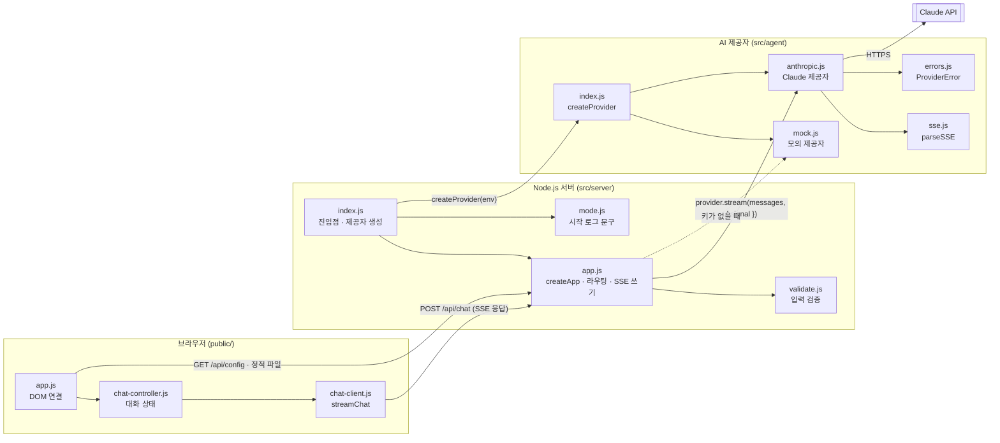
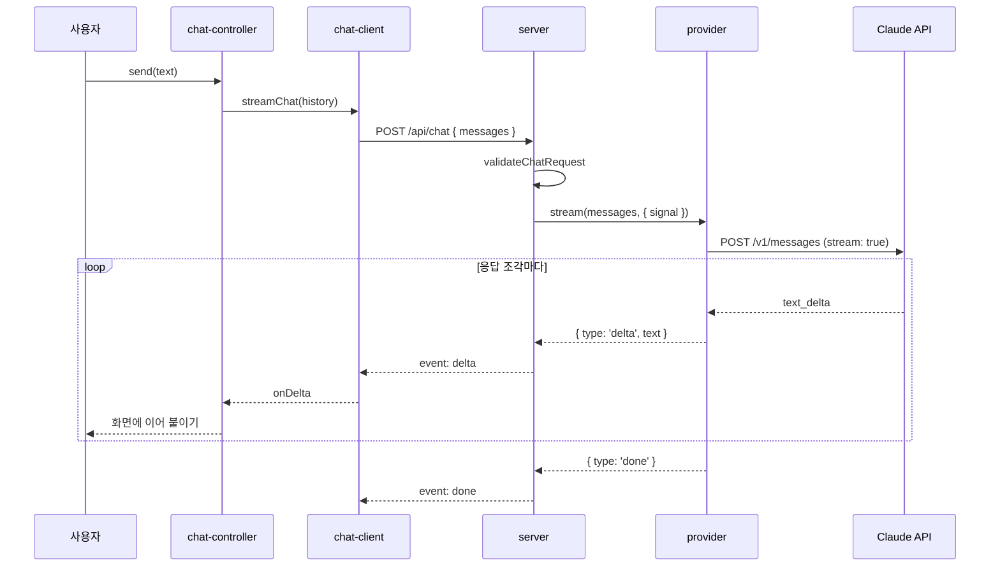

# AI Agent Chat — 아키텍처 명세 (ARCHITECTURE)

> **이 문서가 답하는 질문**: 무엇으로 만들었나? 시스템은 어떤 부품으로 나뉘고 어떻게 연결되나? 왜 그렇게 정했나?  
> 기능과 수용 기준은 `SPEC.md`, 진행 상태는 루트 `README.md`, 폴더 내부 데이터 흐름은 각 폴더 `README.md` DFD가 원본입니다.

| 항목 | 내용 |
|---|---|
| 문서 버전 | v1.0 |
| 작성자 | kimtaesung98 |
| 최종 수정일 | 2026-11-04 |

---

## 목차

1. [문서 규칙](#1-문서-규칙)
2. [기술 스택](#2-기술-스택)
3. [시스템 구성도](#3-시스템-구성도)
4. [핵심 실행 흐름](#4-핵심-실행-흐름)
5. [모듈 경계와 의존 규칙](#5-모듈-경계와-의존-규칙)
6. [설계 결정 (ADR)](#6-설계-결정-adr)
7. [변경 이력](#7-변경-이력)

---

## 1. 문서 규칙

### 1.1 이 문서에 쓰는 것과 쓰지 않는 것

| 정보 | 여기에 쓰는가? | 원본 위치 |
|---|---|---|
| 기술 스택 (언어 · 런타임 · 브라우저 API · 외부 서비스) | ✅ | 이 문서 §2 |
| 시스템 구성도 (부품과 연결) · 실행 흐름 | ✅ | 이 문서 §3 · §4 |
| 모듈 경계 · 의존 방향 규칙 | ✅ | 이 문서 §5 |
| 설계 결정 (ADR) | ✅ | 이 문서 §6 |
| 기능 정의 · 수용 기준 · API 계약 | ❌ | `SPEC.md` |
| 외부 서비스 비용 · 장애 대응 · 개인정보 | ❌ | `SPEC.md` §10 · §11 |
| 진행 상태 · 다음 작업 | ❌ | 루트 `README.md` Tracker · Roadmap |
| 시스템 경계 (Level 0 DFD) · 폴더 내부 흐름 (Level 1 DFD) | ❌ | 루트 · 각 폴더 `README.md` |

> DFD는 상위 → 하위로 분해되는 Blueprint 구조라 README에 남겨 둡니다.  
> 이 문서의 구성도는 **부품(모듈)과 의존 관계**를, DFD는 **데이터가 흐르는 경로**를 보여 줍니다.

### 1.2 갱신 규칙

- 새 기술(브라우저 API, 외부 서비스 등)을 쓰기 전에 §6에 ADR을 추가하고 사용자 승인을 받은 뒤 §2에 반영합니다.
- 외부 npm 패키지 추가는 ADR-001을 바꾸는 결정이므로 반드시 사용자에게 먼저 제안합니다.
- 모듈을 추가하거나 의존 방향이 바뀌면 §3 · §5를 고치고, 해당 폴더 README DFD도 함께 맞춥니다.
- 폴더 README의 `Tech Stack`에는 이 문서 §2 외에 **그 폴더에서만 추가로 쓰는 것**만 적습니다.
- ADR ID는 재사용하지 않습니다. 결정을 뒤집을 때는 새 ADR을 추가하고 이전 ADR의 상태를 `대체됨 (ADR-xxx)`으로 바꿉니다.

---

## 2. 기술 스택

| 계층 | 기술 | 쓰는 곳 | 근거 |
|---|---|---|---|
| 런타임 | Node.js 22+ (ES Modules) | `src/` | ADR-001 |
| 서버 | `node:http`, `node:fs/promises`, `node:path` | `src/server` | ADR-001 |
| AI 호출 | 전역 `fetch` + 직접 구현한 SSE 파서 (`parseSSE`) | `src/agent` | ADR-001, ADR-002 |
| 화면 | HTML · CSS · JavaScript (빌드 도구 없음) | `public/` | ADR-001 |
| 브라우저 API | `fetch`, `ReadableStream`, `TextDecoder`, `AbortController` | `public/` | ADR-002 |
| 테스트 | `node:test` (모의 제공자 · 가짜 업스트림 서버) | `tests/` | ADR-001, ADR-003 |
| 외부 서비스 | Claude API (Messages API, `stream: true`) | `src/agent` | ADR-003 |
| 외부 npm 패키지 | 없음 | - | ADR-001 |

**실행 방법**: `npm start` (키가 없으면 모의 모드) · `npm test` (네트워크 없이 통과)

---

## 3. 시스템 구성도



| 부품 | 책임 | 상태 보관 |
|---|---|---|
| 브라우저 (`public/`) | 입력 받기, 대화 내역 보관, 스트림을 화면에 그리기 | 대화 내역 (메모리) |
| 서버 (`src/server`) | 정적 파일 제공, 요청 검증, 제공자 응답을 SSE로 중계 | 없음 (ADR-004) |
| AI 제공자 (`src/agent`) | Claude 또는 모의 모드를 같은 스트리밍 인터페이스로 감싸기 | 없음 |

---

## 4. 핵심 실행 흐름

### 4.1 메시지 보내기와 스트리밍 응답



### 4.2 취소

브라우저 연결이 끊기면 서버의 `AbortController`가 `signal`을 제공자에 전달하고, 제공자는 Claude API 요청을 중단합니다.

### 4.3 제공자 인터페이스

모든 제공자는 같은 모양을 지킵니다. 새 제공자를 추가할 때 서버 코드는 바꾸지 않습니다.

```js
provider.name   // 'anthropic' | 'mock'
provider.model  // 모델 ID
provider.stream(messages, { signal }) // AsyncIterable<{ type: 'delta', text } | { type: 'done', stopReason }>
                                  // 실패 시 ProviderError를 던짐
```

---

## 5. 모듈 경계와 의존 규칙

```
public/  ──HTTP──▶  src/server  ──함수 호출──▶  src/agent  ──HTTPS──▶  Claude API
```

- 의존은 화살표 방향으로만 흐릅니다. `src/agent`는 `src/server`를, `src/server`는 `public/`의 코드를 가져오지 않습니다.
- `public/`과 서버 사이의 계약은 `SPEC.md` §9 API 명세뿐입니다. 코드를 공유하지 않습니다.
- `src/server`가 `src/agent`에서 가져오는 것은 `createProvider`와 `ProviderError`뿐입니다.
- `src/agent`는 HTTP 요청·응답 객체를 모릅니다. 대화 내역과 `signal`만 받고 이벤트만 돌려줍니다.
- `public/`에서 DOM은 `app.js`만 만집니다. `chat-controller.js` · `chat-client.js`는 DOM 없이 테스트할 수 있어야 합니다.
- 비밀값(`ANTHROPIC_API_KEY`)은 `src/agent`에서만 읽고, 브라우저로 보내거나 로그에 쓰지 않습니다.

---

## 6. 설계 결정 (ADR)

| ID | 결정 | 검토한 대안 | 이유 | 상태 | 날짜 |
|---|---|---|---|---|---|
| ADR-001 | 외부 패키지 없이 Node.js 22 기본 모듈(`http`, `fetch`, `node:test`)만 사용 | Express, Next.js, Anthropic SDK | 시연 환경에서 패키지 설치 불가, 설치 없이 바로 실행, 구조가 단순해 프레임워크 흐름을 보여 주기 좋음 | 채택 | 2026-11-02 |
| ADR-002 | 스트리밍은 `POST` + SSE 형식 응답을 `fetch`의 `ReadableStream`으로 읽음 | `EventSource`, WebSocket | `EventSource`는 GET만 지원해 대화 내역을 본문으로 보낼 수 없음. 단방향 스트림이라 WebSocket은 과함 | 채택 | 2026-11-02 |
| ADR-003 | AI 제공자를 인터페이스로 분리 (`anthropic`, `mock`). 키가 없으면 `mock` | Claude만 지원 | API 키 없이 시연·테스트 가능, 테스트가 외부 네트워크에 의존하지 않음 | 채택 | 2026-11-02 |
| ADR-004 | 대화 내역은 클라이언트가 보관하고 매 요청마다 전송, 서버는 무상태 | 서버 세션 저장 | MVP 단순화, 수평 확장 쉬움 | 채택 | 2026-11-02 |
| ADR-005 | 기술 스택 · 구성도 · 설계 결정을 `ARCHITECTURE.md` 한 곳에서 관리 (DFD는 README에 유지) | README Tech Stack + SPEC §8에 나눠 쓰기 | 스택과 그 선택 이유를 한 문서에서 함께 보고 갱신하기 위해 (사용자 결정) | 채택 | 2026-11-04 |

---

## 7. 변경 이력

| 버전 | 날짜 | 작성자 | 변경 내용 |
|---|---|---|---|
| v1.0 | 2026-11-04 | kimtaesung98 | 최초 작성. 루트 README Tech Stack과 SPEC.md §8 ADR을 이 문서로 옮김 |
