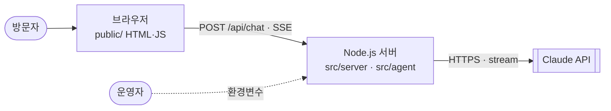
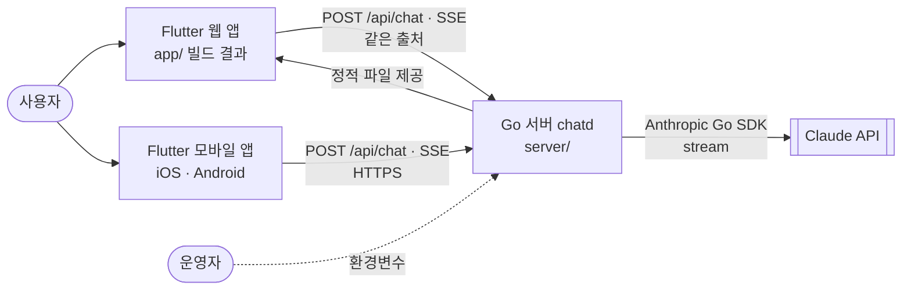
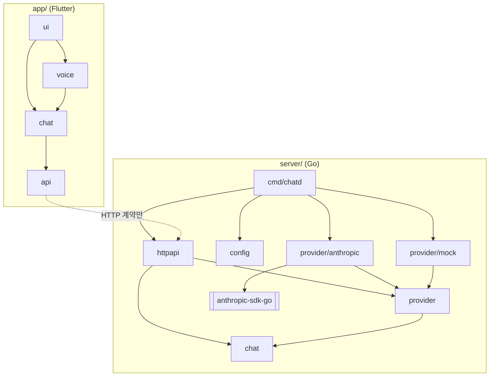
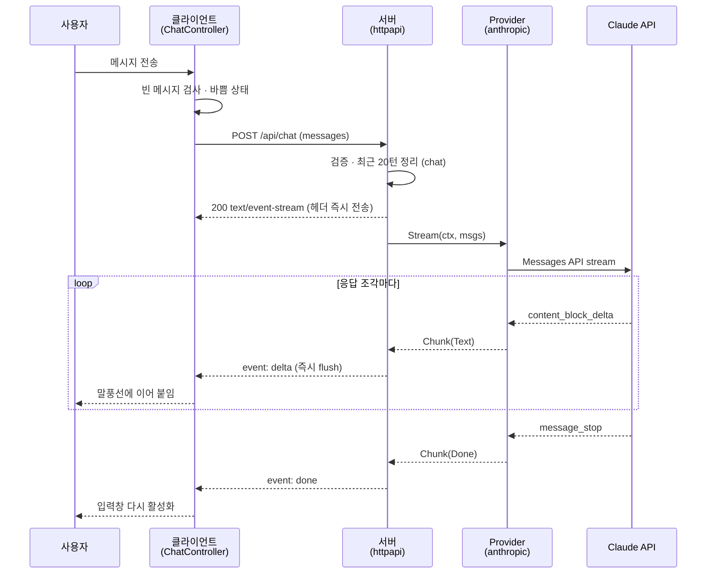
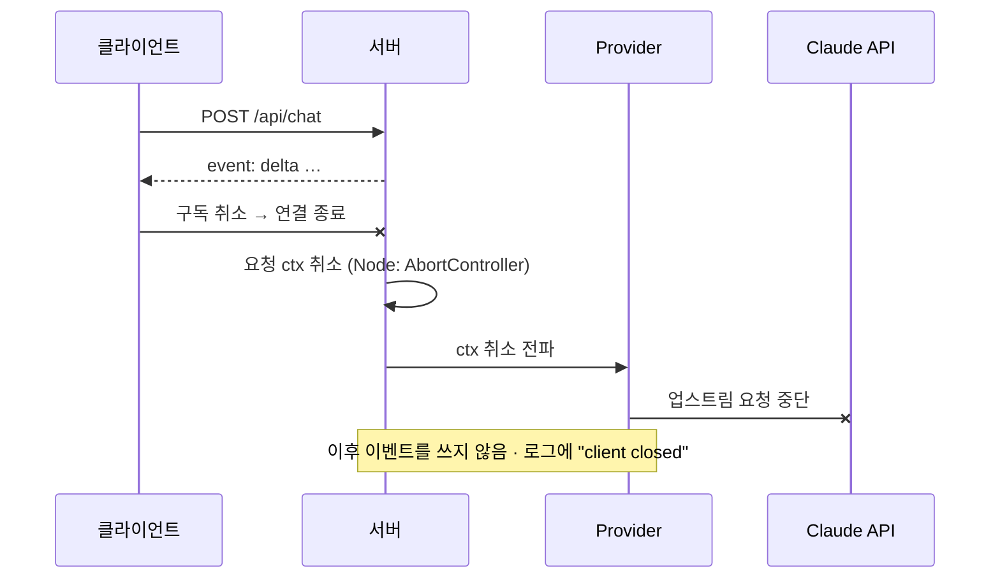
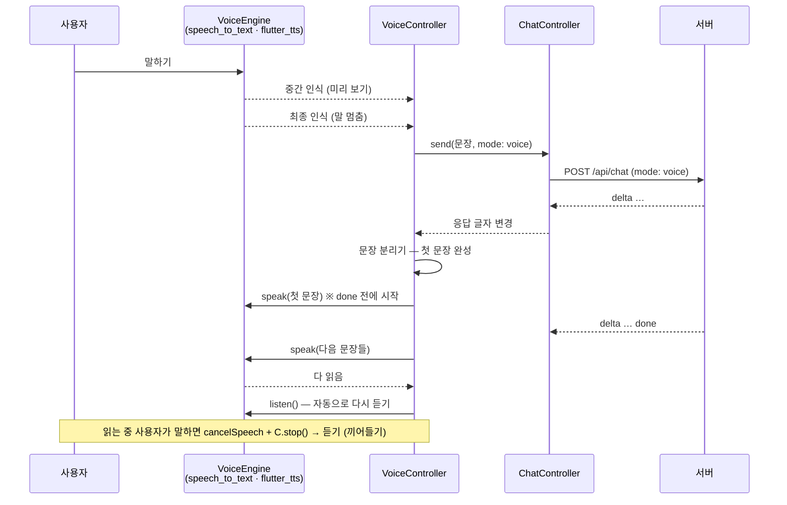
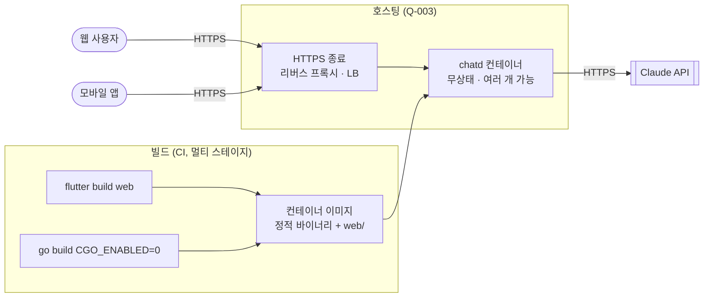
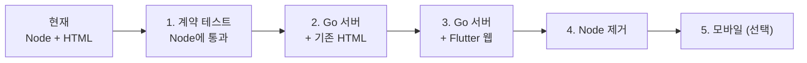

# AI Agent Chat — 아키텍처 명세 (ARCHITECTURE)

> **에이전트 읽기 규칙**: 이 파일은 세션마다 읽지 않습니다. 아래 작업을 할 때 **해당 절만** 읽습니다.
>
> | 이런 작업을 할 때 | 읽을 절 |
> |---|---|
> | 라이브러리·도구를 추가하거나 버전을 바꿀 때 | §2 기술 스택 |
> | 새 폴더·모듈을 만들거나, 다른 모듈의 코드를 불러올 때 | §3 시스템 구성 |
> | 모듈·서비스 사이의 인터페이스를 바꿀 때 | §4 인터페이스 계약 |
> | 설정·환경변수·배포 방식을 바꿀 때 | §6 배포 구성 |
> | 오류 처리·로깅·인증 같은 공통 처리를 건드릴 때 | §7 횡단 관심사 |
> | 기존 결정과 다른 방식을 쓰고 싶을 때 | §9 ADR (뒤집기 전에 사용자에게 제안) |
> | Go·Flutter 코드를 처음 작성할 때 | §10 진화 계획 (해당 단계가 SPEC에 등록됐는지 먼저 확인) |

| 항목 | 내용 |
|---|---|
| 문서 버전 | v1.5 |
| 상태 | 검토 중 — 현재 MVP 기록은 확정, 목표 아키텍처 ADR-005~015 승인 |
| 작성자 | kimtaesung98 |
| 최종 수정일 | 2026-11-10 |
| 관련 문서 | [`SPEC.md`](./SPEC.md) · [`README.md`](./README.md) |

---

## 목차

1. [개요](#1-개요)
2. [기술 스택](#2-기술-스택)
3. [시스템 구성](#3-시스템-구성)
4. [인터페이스 계약](#4-인터페이스-계약)
5. [런타임 시나리오](#5-런타임-시나리오)
6. [배포 구성](#6-배포-구성)
7. [횡단 관심사](#7-횡단-관심사)
8. [품질 속성 대응](#8-품질-속성-대응)
9. [설계 결정 기록 (ADR)](#9-설계-결정-기록-adr)
10. [진화 계획](#10-진화-계획)
11. [기술 부채와 아키텍처 리스크](#11-기술-부채와-아키텍처-리스크)
12. [변경 이력](#12-변경-이력)

---

## 1. 개요

### 1.1 아키텍처 한 줄 요약

**무상태 Go API 서버가 Claude의 스트리밍 응답을 SSE로 중계하고, Flutter 클라이언트(웹 우선, 같은 코드로 모바일)가 이를 실시간으로 표시한다.**  
현재는 같은 API 계약을 지키는 Node.js 프로토타입(MVP)이 동작 중이며, §10 단계에 따라 Go + Flutter로 전환한다.

| | 현재 (MVP 프로토타입) | 목표 |
|---|---|---|
| 서버 | Node.js 22, 기본 모듈만 | Go 1.27, 표준 라이브러리 + 공식 Anthropic Go SDK |
| 클라이언트 | HTML · CSS · JavaScript (빌드 없음) | Flutter (웹 → iOS · Android) |
| 둘 사이 계약 | SPEC.md §9 API-001 · API-002 | **동일** (전환 중에도 바뀌지 않음) |

### 1.2 아키텍처 원칙

원칙끼리 충돌하면 위에 있는 것이 우선합니다.

1. **계약 우선** — 클라이언트와 서버는 SPEC.md §9의 HTTP·SSE 계약으로만 연결된다. 전환은 계약을 고정한 채 한쪽씩 교체한다.
2. **비밀값은 서버에만** — API 키는 서버 환경변수에만 존재한다. Flutter 앱 번들·웹 빌드에는 절대 들어가지 않는다.
3. **외부 서비스는 어댑터 뒤에** — Claude 연동은 `Provider` 인터페이스 뒤에 두어 모의 제공자로 교체·테스트할 수 있게 한다.
4. **도메인 규칙은 순수 코드로** — 입력 검증·맥락 정리 같은 규칙은 HTTP·UI와 분리해 단위 테스트한다.
5. **표준 라이브러리 우선** — 표준 기능으로 충분하면 프레임워크·패키지를 추가하지 않는다.

### 1.3 품질 목표 (우선순위 순)

| 순위 | 품질 속성 | 목표 | SPEC 근거 |
|---|---|---|---|
| 1 | 응답성 | 전송 → 첫 글자 표시 1초 이내 (모의 모드) — 서버·클라이언트 어디서도 버퍼링하지 않음 | §1.3, §5 성능 |
| 2 | 보안 | API 키가 클라이언트·로그·응답에 노출되지 않음 | §11 |
| 3 | 이식성 | 하나의 클라이언트 코드로 웹·모바일 지원, 서버는 단일 바이너리 | §1.4, ADR-005 · 006 |

---

## 2. 기술 스택

> 이 절이 기술 스택의 원본입니다. 루트 `README.md`의 Tech Stack은 이름만 적은 요약입니다.

### 2.1 구성 요소별 스택

| 영역 | 기술 | 버전 | 상태 | 근거 ADR |
|---|---|---|---|---|
| 서버 (현재) | Node.js — `node:http`, 전역 `fetch`, `node:test` | 22 이상 | 사용 중 → §10 단계 4에서 폐기 | ADR-001 |
| 클라이언트 (현재) | HTML · CSS · JavaScript (ES Modules) | — | 사용 중 (Node 서버용) → §10 단계 4에서 제거 | ADR-001 |
| 서버 (목표) | Go — `net/http`, `log/slog`, `context`, `iter`, `os.Root` | `go.mod`: 1.25 (최신 stable 권장) | 구현됨 (F-010) — 단계 3에서 기본 서버가 됨 | ADR-005, ADR-013 |
| Claude 연동 (목표) | `github.com/anthropics/anthropic-sdk-go/v2` | v2.6.0 (`go.mod`로 고정, Go 1.25 이상) | 구현됨 (F-010) | ADR-008 |
| 클라이언트 (목표) | Flutter · Dart | Flutter 3.47.9 stable (Dart 3.13.7) — CI에서 고정 | 구현됨 (F-011) | ADR-006 |
| HTTP·스트리밍 (목표) | `package:http` (`AbortableRequest`로 중단) + 웹 전용 `fetch_client` (`RequestMode.cors`) | http 1.6 · fetch_client 1.2 (`pubspec.lock`) | 구현됨 (F-011) | ADR-009 |
| 상태 관리 (목표) | Flutter 내장 `ChangeNotifier` | Flutter 번들 | 구현됨 (F-011) | ADR-010 |
| 음성 인식·합성 (STT·TTS) | `speech_to_text` · `flutter_tts` 패키지 — 웹은 브라우저 Web Speech API, 모바일은 OS 음성 엔진 | speech_to_text 7.5.0 · flutter_tts 4.2.5 (`pubspec.lock`) | 구현됨 (F-012) | ADR-014 |
| 음성 답 말투 | API-001 `mode: "voice"` → 서버가 말하기용 시스템 프롬프트를 붙임 | — | 구현됨 (F-012) | ADR-015 |
| 페르소나 (F-005) | API-001 `persona`(이름·역할·말투·지시·사용자 정보) → 서버가 정해진 틀로 시스템 프롬프트를 만듦. 화면은 Material 3 위젯 (새 패키지 없음) | — | 구현 중 (F-005) | ADR-016 (제안) |
| 외부 서비스 | Claude Messages API (`stream: true`) | `anthropic-version: 2023-06-01` | 사용 중 | ADR-003 |
| 기본 모델 | `claude-sonnet-5-5` (환경변수로 변경) | — | 사용 중 | — |
| 데이터 저장 | 없음 (대화는 클라이언트 메모리) | — | F-007 착수 시 결정 | ADR-004 |
| 호스팅 | 미정 | — | 검토 중 — SPEC §16 Q-003 | ADR-011 |
| C / C++ | 사용하지 않음 | — | 제외 | ADR-007 |

### 2.2 허용 라이브러리 (Allowlist)

여기 없는 라이브러리를 추가하려면 먼저 사용자에게 제안하고, 승인되면 이 표와 §9 ADR을 갱신합니다.

| 영역 | 라이브러리 | 용도 | 비고 |
|---|---|---|---|
| Node (현재) | (없음 — 기본 모듈만) | | ADR-001 |
| Go (목표) | 표준 라이브러리 | 전부 | |
| Go (목표) | `anthropic-sdk-go/v2` | Claude 호출 | `internal/provider/anthropic` 안에서만 import |
| Go 테스트 (목표) | `testing`, `net/http/httptest` | 단위·계약 테스트 | 표준 라이브러리 |
| Flutter (목표) | `flutter` SDK, `package:http` | UI, HTTP | |
| Flutter (목표) | `fetch_client` | 웹 스트리밍 응답 | 웹 빌드에서만 사용 (조건부 import) |
| Flutter (F-012) | `speech_to_text`, `flutter_tts` | 음성 인식(STT) · 음성 합성(TTS) | `app/lib/voice/plugin_voice_engine.dart`에서만 import (의존 규칙 테스트로 검사) — ADR-014. 간접 의존: `speech_to_text_platform_interface`, `speech_to_text_windows`, `plugin_platform_interface`, `json_annotation`, `flutter_web_plugins` |
| Flutter 개발 (목표) | `flutter_test`, `flutter_lints` | 테스트, 린트 | dev_dependencies |

**금지:**
- Go 웹 프레임워크(gin, echo, fiber 등) — ADR-013
- Flutter 상태 관리 패키지(Riverpod, Bloc, Provider 등) — ADR-010
- WebSocket 라이브러리 — ADR-002 (단방향 SSE로 충분)
- C/C++ 코드, cgo (`CGO_ENABLED=0`으로 빌드) — ADR-007
- 클라이언트에서 Claude API를 직접 호출하는 모든 패키지 — 원칙 2

### 2.3 개발 도구

| 용도 | 현재 (Node) | 목표 (Go) | 목표 (Flutter) |
|---|---|---|---|
| 실행 | `npm start` | `STATIC_DIR=../app/build/web go run ./cmd/chatd` (`server/`에서, 기존 화면은 `../public`) | 웹 빌드를 Go 서버로 제공 (같은 출처) |
| 빌드 | (없음) | `CGO_ENABLED=0 go build ./cmd/chatd` | `flutter build web --no-web-resources-cdn` (CanvasKit를 CDN 대신 빌드에 포함) |
| 테스트 | `npm test` | `go test ./...` | `flutter test` |
| 정적 분석·포맷 | (없음) | `gofmt`, `go vet` | `dart format`, `flutter analyze` |
| 계약 테스트 | `npm run test:contract` (Node 서버를 모의 모드로 띄워 실행) | `go test ./contract -base-url=…` (§4.1) | — |
| CI | GitHub Actions `.github/workflows/ci.yml` — `npm test` + 계약 테스트 (F-009) | 같은 워크플로: `gofmt`·`go vet`·`go test ./...`·정적 빌드·Go 서버 계약 테스트 (F-010) | `flutter` 작업: `flutter analyze` · `flutter test` · `flutter build web` (F-011) |

---

## 3. 시스템 구성

### 3.1 구성도 (컨테이너 수준)

**현재 (MVP)**



**목표**



두 구성 모두 루트 README Level 0 DFD의 외부 액터(방문자 · 운영자 · Claude API)와 일치합니다.

### 3.2 모듈 맵

모듈이 담당하는 기능 ID는 루트 README의 Sub-folder Map이 정의합니다.

**현재 (Node MVP)**

| 모듈 | 폴더 | 책임 | 의존 가능 모듈 |
|---|---|---|---|
| server | `/src/server` | HTTP 라우팅, 입력 검증, 맥락 정리, SSE 쓰기, 정적 파일 | agent |
| agent | `/src/agent` | Provider 인터페이스, Claude·모의 제공자, SSE 파서 | (없음) |
| web | `/public` | 채팅 화면, 컨트롤러, 스트림 클라이언트 | (서버와는 HTTP로만) |

**목표 (Go · Flutter)**

| 모듈 | 폴더 | 책임 | 의존 가능 모듈 | 대응하는 현재 코드 |
|---|---|---|---|---|
| cmd/chatd | `/server/cmd/chatd` | 진입점: 설정 → 제공자 → HTTP 조립 | 모두 | `src/server/index.js` |
| config | `/server/internal/config` | 환경변수 읽기·검증 | (없음) | `src/agent/index.js` 일부 |
| chat | `/server/internal/chat` | 도메인: `Message`, 입력 검증, 최근 20턴 정리 (순수 함수) | (없음) | `validate.js`, `context.js` |
| provider | `/server/internal/provider` | `Provider` 인터페이스, `Chunk`, 사용자용 오류 | chat | `src/agent/errors.js` |
| provider/anthropic | `/server/internal/provider/anthropic` | Claude 어댑터 (SDK 사용) | provider, chat | `src/agent/anthropic.js` |
| provider/mock | `/server/internal/provider/mock` | 모의 제공자 | provider, chat | `src/agent/mock.js` |
| httpapi | `/server/internal/httpapi` | 라우팅, 요청 파싱, SSE 쓰기, 정적 파일 | chat, provider | `src/server/app.js` |
| contract | `/server/contract` | HTTP 수준 계약 테스트 (어느 서버에나 실행) | (표준 라이브러리만) | `tests/server.test.js` 일부 |
| archtest | `/server/internal/archtest` | §3.3 의존 규칙 검사 테스트 (모듈 맵에 없는 패키지도 실패) | (표준 라이브러리만) | — |
| app/api | `/app/lib/api` | `/api/chat` 호출, SSE 파싱 (웹·모바일 클라이언트 분기) | (없음) | `public/chat-client.js` |
| app/chat | `/app/lib/chat` | `ChatController` (`ChangeNotifier`): 내역·바쁨 상태. `PersonaController`: 페르소나 목록·선택·내 프로필 (F-005) | api | `public/chat-controller.js` |
| app/voice | `/app/lib/voice` | `VoiceEngine` 인터페이스(듣기·읽기)와 패키지 구현(`PluginVoiceEngine`), 문장 분리기, `VoiceController` (듣기 → 자동 전송 → 문장별 읽기 → 끼어들기) | chat | — |
| app/ui | `/app/lib/ui` | 위젯: 대화 목록, 입력창, 모드 배지, 마이크 버튼, 페르소나 사이드바·편집 화면(F-005) | chat, voice | `public/app.js`, `index.html` |

### 3.3 의존 규칙



- `chat`(서버)은 어떤 모듈도 import하지 않는다 — 순수 도메인
- `httpapi`는 `provider` **인터페이스**만 안다. `anthropic`·`mock` 구현을 import하지 않는다 (조립은 `cmd/chatd`)
- `anthropic-sdk-go`는 `provider/anthropic`에서만 import한다
- Flutter `chat`은 `package:flutter/foundation.dart`까지만 import한다 — `material`·`widgets` 금지 (위젯 없이 단위 테스트)
- Flutter `api`는 `chat`·`ui`를 import하지 않는다
- Flutter `voice`는 `chat`을 쓰고 `ui`를 import하지 않는다. `chat`·`api`는 `voice`를 모른다. `voice`도 `foundation.dart`까지만 (위젯 없이 단위 테스트). `speech_to_text`·`flutter_tts`는 `voice/plugin_voice_engine.dart`에서만 import한다. 조립은 `main.dart`
- 앱과 서버는 코드를 공유하지 않는다 — HTTP 계약으로만 연결
- 현재 Node: `src/agent`는 `src/server`를 import하지 않는다, `public/`은 서버 코드를 import하지 않는다
- 검사 방법: Go는 `go vet` + import 검사 테스트(`internal/archtest`, F-010), Flutter는 `flutter analyze` + import 검사 테스트(단계 3에서 추가)

---

## 4. 인터페이스 계약

### 4.1 외부 API 계약

- **원본**: SPEC.md §9 (API-001 `POST /api/chat`, API-002 `GET /api/config`)
- **고정 사항**: SSE 이벤트 이름(`delta`, `done`, `error`)과 `data` JSON 형식, 오류 응답 JSON 형식, 상태 코드(400·404·405·413)
- **선택 필드 (F-012, ADR-015)**: 요청 본문의 `mode` — `"text"`(기본) · `"voice"`. 하위 호환(생략하면 지금과 같음). 계약 테스트에 `mode` 시나리오를 추가해 Node·Go 모두 검사
- **선택 필드 (F-005, ADR-016)**: 요청 본문의 `persona` — `name`·`role`·`tones`·`instructions`·`about`. 하위 호환. 계약 테스트에 `persona` 시나리오를 추가해 Node·Go 모두 검사
- **버전 정책**: MVP 동안 경로 버전 없음. 하위 호환을 깨는 변경이 필요하면 `/api/v2/…`를 추가하고 기존 경로는 한 단계 동안 유지
- **계약 검증**: `server/contract` 계약 테스트를 **Node 서버와 Go 서버에 똑같이** 실행 (ADR-012). 둘 다 통과해야 전환 단계 완료

| SSE 이벤트 | data | 순서 규칙 |
|---|---|---|
| `delta` | `{"text": string}` | 0개 이상, 도착 순서대로 이어 붙임 |
| `done` | `{"stopReason": string}` | 정상 종료 시 마지막 1회 |
| `error` | `{"message": string}` | 실패 시 마지막 1회 (`done` 대신). `message`는 화면에 그대로 보여도 안전한 문장 |

### 4.2 내부 인터페이스

| 경계 | 인터페이스 | 정의 위치 | 규칙 |
|---|---|---|---|
| 서버 ↔ AI 제공자 (현재) | `provider.stream(messages, { signal })` → async generator | `src/agent/README.md` | 중단 신호 시 즉시 멈춤, 실패는 `ProviderError` |
| 서버 ↔ AI 제공자 (목표) | 아래 `Provider` | `server/internal/provider` | 같은 규칙. `ctx` 취소 시 즉시 반환 |
| 컨트롤러 ↔ 화면 (현재) | `ui` 객체 (`appendDelta`, `setBusy`, `clear` …) | `public/chat-controller.js` | 컨트롤러는 DOM을 직접 만지지 않음 |
| 컨트롤러 ↔ 화면 (목표) | `ChatController extends ChangeNotifier` | `app/lib/chat` | 위젯은 `ListenableBuilder`로 구독만 |
| 컨트롤러 ↔ 통신 (목표) | `ChatApi.stream(List<Message>, {mode, persona}) → Stream<ChatEvent>` | `app/lib/api` | 구독 취소 = 요청 중단. `mode`는 F-012, `persona`(`Persona` 값 객체, `api/models.dart`)는 F-005 |
| 음성 컨트롤러 ↔ 음성 엔진 (F-012) | `VoiceEngine` — `prepare()`, `startListening()` → `heard` 스트림(중간 · 확정 · 끝남 · 실패), `speak(문장)` → 다 읽거나 멈추면 완료되는 Future, `cancelSpeech()`, `stopListening()` | `app/lib/voice` | 테스트는 가짜 엔진. 패키지는 `PluginVoiceEngine`만 사용 |
| 서버 ↔ AI 제공자 시스템 프롬프트 (F-012, F-005) | `Stream(ctx, system string, msgs)` — `system`이 비면 지금과 같음 | `server/internal/provider` | 말하기용 지시·페르소나 틀 문구는 `chat` 패키지(도메인)가 가진다 (`Request.SystemPrompt()` = 페르소나 + 음성 지시). Node도 `stream(messages, { signal, system })` (`src/server/persona.js`) |

```go
// server/internal/provider — 목표 인터페이스 (현재 Node 인터페이스를 그대로 옮김)
type Provider interface {
    Name() string  // "mock" | "anthropic"
    Model() string // 표시용 모델 이름
    // Stream은 응답 조각을 순서대로 내보낸다. ctx가 취소되면 즉시 끝난다.
    // 실패하면 *Error(UserMessage 포함)를 마지막 값으로 내보낸다.
    Stream(ctx context.Context, msgs []chat.Message) iter.Seq2[Chunk, error]
}

type Chunk struct {
    Text       string // delta일 때
    Done       bool
    StopReason string // Done일 때
}

type Error struct {
    UserMessage string // 화면에 보여도 안전한 문장. 키·업스트림 원문 금지
    Status      int
    Code        string
}
```

---

## 5. 런타임 시나리오

### 5.1 스트리밍 응답 (F-001)



### 5.2 사용자 중단 (F-003 — 서버 쪽은 구현됨)



### 5.3 음성 대화 한 턴 (F-012)



---

## 6. 배포 구성

### 6.1 환경

| 환경 | 용도 | 위치 | 배포 방식 |
|---|---|---|---|
| 로컬 | 개발 · 시연 | 개발자 PC | 현재 `npm start` / 목표 `go run` + `flutter run` |
| 스테이징 | 공개 전 확인 | 미정 (Q-003) | 목표: 컨테이너 이미지 |
| 운영 | 공개 서비스 | 미정 (Q-003) — 공개 전 F-008 로그인 필요 | 목표: 컨테이너 이미지 |

### 6.2 배포도 (목표)



- 리버스 프록시는 SSE 응답을 **버퍼링하지 않도록** 설정 (서버가 `X-Accel-Buffering: no` 헤더를 보냄)
- 서버가 무상태라 인스턴스를 늘려도 세션 고정(sticky)이 필요 없음 (ADR-004)

### 6.3 설정과 환경변수

| 이름 | 필수 | 기본값 | 비밀값 | 설명 | 현재 / 목표 |
|---|---|---|---|---|---|
| `PORT` | N | `3000` | N | 서버 포트 | 둘 다 |
| `ANTHROPIC_API_KEY` | N | (없음 → 모의 모드) | **Y** | Claude API 키 | 둘 다 |
| `ANTHROPIC_MODEL` | N | `claude-sonnet-5-5` | N | 사용할 모델 | 둘 다 |
| `STATIC_DIR` | N | `./web` | N | 정적 파일 위치 — Flutter 웹 빌드(`../app/build/web`) 또는 기존 화면(`../public`) | Go |
| `API_BASE_URL` | N | (웹: 같은 출처) | N | 모바일 앱이 호출할 서버 주소 — **빌드 시** `--dart-define`으로 주입, 키는 절대 주입 금지 | 목표 (Flutter) |

---

## 7. 횡단 관심사

| 관심사 | 처리 위치 | 방식 |
|---|---|---|
| 오류 처리 | 제공자 어댑터 → httpapi | 업스트림 오류는 어댑터에서 사용자용 문장(`UserMessage`)으로 바꾼다. 스트림 시작 전 오류는 JSON + 상태 코드, 시작 후 오류는 SSE `error` 이벤트. 원문·키는 노출하지 않는다 |
| 로깅·관측성 | httpapi (요청 단위 1줄) | 현재: `METHOD 경로 상태 소요ms`. 목표: `log/slog` JSON 핸들러, 같은 필드 + 요청 ID. **메시지 본문·키는 기록 금지** |
| 설정·비밀값 | config (시작 시 1회) | 환경변수를 시작 시 읽어 검증, 잘못되면 기동 중단. 키 유무로 제공자 선택. 시작 로그에는 모드만 (키 금지) |
| 인증·인가 | — | MVP 없음 (내부 시연). F-008에서 결정 — 공개 배포 전 필수 |
| 동시성·취소 | httpapi → provider | 요청마다 하나의 취소 범위: 현재 `AbortController`, 목표 `r.Context()`를 SDK 호출까지 전달. 클라이언트 연결 종료 = 취소 |
| 스트림 전송 | httpapi | 이벤트마다 즉시 flush (현재 `res.write`, 목표 `http.Flusher`). 응답 압축 미사용 |
| 접근성 | 클라이언트 | 현재 `aria-live="polite"`. 목표 Flutter: 응답 말풍선에 `Semantics(liveRegion: true)` |
| 테스트 구조 | 각 모듈 | 단위(도메인·컨트롤러, 네트워크 없음) / 계약(HTTP, 모의 제공자) / 화면(현재 가짜 `ui`, 목표 위젯 테스트). 실제 Claude 호출 테스트 금지 — 기준은 SPEC §12 |

---

## 8. 품질 속성 대응

| SPEC §5 요구사항 | 대응 장치 | 검증 방법 |
|---|---|---|
| 첫 글자 1초 이내 | 헤더 즉시 전송 + 이벤트마다 flush, 클라이언트는 조각 단위로 그림. Flutter 웹은 `fetch_client`로 스트리밍 수신 (ADR-009) | 현재 `F-001 AC1 첫 delta는…` 테스트. 목표: 계약 테스트에 같은 시나리오 + 웹 빌드 수동 측정 |
| 설치 없이 사용 | 현재 의존성 0개. 목표: 단일 정적 바이너리 + 웹 빌드를 한 이미지로 | 깨끗한 환경에서 실행 확인 |
| 외부 의존성 최소 | §2.2 허용 목록 | 의존성 파일 변경은 PR에서 ADR과 함께 검토 |
| 키보드만으로 사용, 스트리밍 영역 안내 | 현재 `aria-live`, Enter/Shift+Enter. 목표 `Semantics(liveRegion)`, 키보드 단축키 동일 | 화면 테스트 + 스크린 리더 수동 확인 |
| 지원 브라우저 최신 2개 버전 | 현재 표준 API만. 목표 Flutter 웹 지원 브라우저 범위 | 단계 3 완료 기준에 포함 |
| 동시 대화 10명 내외 | 무상태 서버, 요청당 goroutine (목표) | 단계 2에서 간단한 부하 확인 |

---

## 9. 설계 결정 기록 (ADR)

상태: 제안 / 승인 / 대체됨(→ ADR-xxx) / 폐기. 새 ADR과 상태 변경은 사용자의 결정이며, 에이전트는 "제안"으로만 추가합니다.

| ID | 결정 | 검토한 대안 | 이유 | 상태 | 날짜 |
|---|---|---|---|---|---|
| ADR-001 | MVP는 외부 패키지 없이 Node.js 22 기본 모듈(`http`, `fetch`, `node:test`)만 사용 | Express, Next.js, Anthropic SDK | 시연 환경에서 패키지 설치 불가, 설치 없이 바로 실행, 구조가 단순해 프레임워크 흐름을 보여 주기 좋음 | 승인 — §10 단계 4 완료 시 ADR-005·006으로 대체 예정 | 2026-11-02 |
| ADR-002 | 스트리밍은 `POST` + SSE 형식 응답을 스트림으로 읽음 | `EventSource`, WebSocket | `EventSource`는 GET만 지원해 대화 내역을 본문으로 보낼 수 없음. 단방향 스트림이라 WebSocket은 과함. Go·Flutter 전환 후에도 유지 | 승인 | 2026-11-02 |
| ADR-003 | AI 제공자를 인터페이스로 분리 (`anthropic`, `mock`). 키가 없으면 `mock` | Claude만 지원 | API 키 없이 시연·테스트 가능, 테스트가 외부 네트워크에 의존하지 않음. Go에서도 같은 구조 | 승인 | 2026-11-02 |
| ADR-004 | 대화 내역은 클라이언트가 보관하고 매 요청마다 전송, 서버는 무상태 | 서버 세션 저장 | MVP 단순화, 수평 확장 쉬움. F-007(기록 저장) 착수 시 재검토 | 승인 | 2026-11-02 |
| ADR-005 | 목표 서버 언어는 **Go** | C++ (Drogon · Boost.Beast), Node 유지 | 사용자 선호 언어. goroutine과 `context`로 스트림 중계·취소가 자연스러움. 정적 단일 바이너리 배포. 공식 Anthropic Go SDK 존재 | 승인 (사용자 선호, 2026-11-04) | 2026-11-04 |
| ADR-006 | 목표 클라이언트는 **Flutter** — 웹 우선, 같은 코드로 iOS·Android | 현재 HTML/JS 유지, React | 사용자 선호. 한 코드베이스로 웹·모바일 지원. 단, SPEC §1.4 비목표에 "모바일 앱은 만들지 않는다"가 있으므로 모바일 빌드(§10 단계 5)는 SPEC 변경 후에만 | 승인 (사용자 선호, 2026-11-04) | 2026-11-04 |
| ADR-007 | **C/C++는 사용하지 않음**, Go는 `CGO_ENABLED=0`으로 빌드 | 서버 일부를 C++로, cgo 확장 | 병목은 AI API 대기(I/O)라 C/C++의 성능 이점이 없음. 네트워크에 노출되는 서버에서 메모리 안전성 위험만 늘어남. 정적 빌드가 깨짐. 기기 내 처리(로컬 오디오·토크나이저 등)가 필요해지면 Flutter의 Dart FFI 플러그인으로 재검토 | 승인 (사용자, 2026-11-05) | 2026-11-04 |
| ADR-008 | Claude 호출은 공식 Go SDK `anthropic-sdk-go/v2`를 `provider/anthropic` 어댑터 안에서만 사용 | `net/http`로 직접 구현 (Node MVP 방식) | 공식 유지보수, 타입과 재시도 지원, 스트리밍 API(`Messages.NewStreaming`) 제공. 어댑터로 격리해 SDK 메이저 변경 영향을 한 폴더로 제한 | 승인 (사용자, 2026-11-05) | 2026-11-04 |
| ADR-009 | Flutter 웹은 `fetch_client`, 모바일·데스크톱은 `package:http` 기본 클라이언트 (조건부 import) | `package:http`만 사용, WebSocket, `EventSource` | `package:http`의 웹 클라이언트는 응답을 다 받은 뒤 한 번에 돌려줘 스트리밍이 안 됨 → F-001 실패. `fetch_client`는 Fetch API 기반으로 웹에서 스트리밍·취소 지원. WebSocket은 ADR-002와 충돌 | 승인 (사용자, 2026-11-05) | 2026-11-04 |
| ADR-010 | Flutter 상태 관리는 내장 `ChangeNotifier` | Riverpod, Bloc | 화면 1개 규모, 의존성 최소. 현재 `chat-controller.js` 구조(상태 + 화면 인터페이스 분리)를 그대로 옮길 수 있음. 화면이 늘어 상태가 복잡해지면 재검토 | 승인 (사용자, 2026-11-05) | 2026-11-04 |
| ADR-011 | 웹은 **같은 출처** 배포: Go 서버가 Flutter 웹 빌드를 정적 파일로 제공 | 웹을 CDN에 따로 배포 + CORS | CORS 설정 불필요, 배포 단위 1개. 모바일 앱은 `API_BASE_URL`로 같은 API 호출 | 승인 (사용자, 2026-11-05) | 2026-11-04 |
| ADR-012 | HTTP 수준 계약 테스트(`server/contract`)를 Go로 작성해 **Node·Go 서버 모두에** 실행 | 서버마다 따로 테스트, Node 테스트 재사용 | 전환 중 계약이 바뀌지 않았음을 같은 테스트로 증명. 기존 Node 테스트 시나리오(F-001·F-002 AC)를 옮김 | 승인 (사용자가 전환 1단계 착수 승인, 2026-11-04) | 2026-11-04 |
| ADR-013 | Go 서버는 표준 라이브러리 우선 — `net/http` ServeMux 패턴 라우팅, `log/slog`, 웹 프레임워크 없음 | gin, echo, chi | 엔드포인트 2개 + 정적 파일, 표준 라우팅(메서드·경로 패턴)으로 충분. 원칙 5 | 승인 (사용자, 2026-11-05) | 2026-11-04 |
| ADR-014 | 음성 인식·합성은 **`speech_to_text` · `flutter_tts` 패키지**로 하고, `VoiceEngine` 인터페이스 뒤(`PluginVoiceEngine`)에 둔다 | ① 브라우저 Web Speech API를 `package:web`로 직접 호출 (새 패키지 없음, 웹 전용) ② 서버를 거치는 클라우드 STT·TTS (더 자연스러운 목소리, 별도 키·비용·지연) | 웹에서는 같은 브라우저 엔진을 쓰고, 같은 코드로 모바일(§10 단계 5)의 OS 음성 엔진도 쓸 수 있음. 키·비용 없이 기기 안에서 바로 읽기 시작해 지연이 짧음. 인터페이스 뒤에 두어 목소리 품질이 부족하면 ②로 바꿀 수 있음. 단점: Firefox는 음성 인식 미지원, 목소리 품질은 브라우저·OS에 따라 다름(자연 음성 우선 선택), 웹 구현의 동작 특이점(R-A11) | 승인 (사용자 선택, 2026-11-07) | 2026-11-07 |
| ADR-015 | 음성 답 말투는 서버가 정한다 — API-001 `mode: "voice"`면 말하기용 시스템 프롬프트(마크다운 없이 짧은 구어체)를 붙인다 | ① 클라이언트가 읽기 전에 마크다운만 제거 ② F-005 페르소나를 먼저 만들고 그 안에서 처리 ③ 클라이언트가 시스템 프롬프트를 보냄 | 자연스러운 대화는 **짧은 구어체 답**이 핵심이라 읽기 전 정리(①)만으로는 길고 목록 많은 답이 그대로 남음. ③은 클라이언트가 프롬프트를 조작할 수 있어 원칙 2(비밀·제어는 서버)에 어긋남. 하위 호환 선택 필드라 기존 화면 영향 없음. F-005 페르소나가 생기면 페르소나 + 음성 지시를 합침 | 승인 (사용자, 2026-11-07 — F-012와 함께) | 2026-11-07 |
| ADR-016 | 페르소나는 API-001 `persona`에 **구조화된 필드**(이름·역할·말투·추가 지시·사용자 정보)로 보내고, 시스템 프롬프트 **틀은 서버(`chat` 도메인)가 만든다**. 음성이면 페르소나 뒤에 ADR-015 말하기 지시를 붙인다. 이번 단계는 앱 메모리에만 두고 저장 유지는 SPEC Q-005로 미룬다 | ① 운영자가 환경변수로 시스템 프롬프트 지정 (원래 F-005) ② 클라이언트가 완성된 시스템 프롬프트 문자열을 보냄 ③ 서버에 페르소나 저장 | 프로젝트 목표가 "사용자 페르소나 설정을 통한 맥락 대화"라 사용자가 화면에서 골라야 함(①은 운영자만 바꿈). ②는 ADR-015와 같은 이유로 틀을 클라이언트가 바꿀 수 있어 원칙 2에 어긋남 — 필드마다 길이 제한을 두고 틀은 서버가 쥔다. ③은 로그인(F-008)·저장(F-007) 없이 만들 수 없음(ADR-004 무상태 유지). 하위 호환 선택 필드 | 제안 (F-005 구현과 함께, 2026-11-10) | 2026-11-10 |

---

## 10. 진화 계획

현재 Node MVP → 목표 Go + Flutter. **각 단계는 따로 배포 가능하고, 끝날 때마다 계약 테스트가 통과해야 합니다.**  
단계를 실제로 시작할 때는 SPEC.md에 기능 ID로 등록하고 Tracker로 관리합니다. 단계 1 = F-009 (2026-11-04 등록), 단계 2 = F-010 (2026-11-05 등록), 단계 3 = F-011 (2026-11-05 등록).

| 단계 | 내용 | 완료 기준 | 관련 ADR |
|---|---|---|---|
| 1 | **계약 테스트 분리** — `server/contract`에 F-001·F-002 수용 기준을 HTTP 시나리오로 작성, CI 도입 | 계약 테스트가 **현재 Node 서버**에 대해 통과 | ADR-012 |
| 2 | **Go 서버** — `server/` 모듈 구현 (모의·Claude 제공자, 검증, 20턴 정리, SSE, 정적 파일) | 계약 테스트가 Go 서버에 통과, `go test ./...` 통과, 기존 `public/` 화면이 Go 서버로 동작 | ADR-005, 008, 013 |
| 3 | **Flutter 웹 클라이언트** — `app/` 구현 (S-001 화면 동등 기능) | F-001·F-002 화면 수용 기준을 위젯·단위 테스트로 통과, 웹에서 실시간 스트리밍 확인, Go 서버가 웹 빌드 제공 | ADR-006, 009, 010, 011 |
| 4 | **Node MVP 제거** — `src/`, `public/`, `package.json`, Node 테스트 삭제 | 단계 1~3 완료 기준 유지, 루트 README·폴더 README·DFD를 새 구조로 갱신, ADR-001 "대체됨" | ADR-001 |
| 5 | (선택) **모바일 빌드** — iOS·Android. **SPEC §1.4 비목표를 사용자가 바꾼 뒤에만** | 같은 코드로 빌드, `API_BASE_URL` 주입, 실제 기기에서 스트리밍 확인 | ADR-006 |

**남은 MVP 기능(F-003·F-004)과 음성 대화는 전환 뒤에 만듭니다** (SPEC §16 Q-004 결정). F-003은 단계 3에서 구현합니다.



---

## 11. 기술 부채와 아키텍처 리스크

| ID | 내용 | 영향 | 대응 계획 |
|---|---|---|---|
| TD-001 | SSE 파서가 `src/agent/sse.js`와 `public/chat-client.js`에 두 벌 존재 | 한쪽만 고치면 동작이 어긋남 | 단계 4에서 둘 다 제거 (Go는 SDK, Flutter는 `app/lib/api` 한 곳) |
| TD-002 | 화면(`public/app.js`) DOM 동작은 자동 테스트 없음 (컨트롤러만 테스트) | 화면 회귀를 놓칠 수 있음 | 단계 3에서 Flutter 위젯 테스트로 해소 |
| R-A01 | Flutter 웹에서 스트리밍이 동작하지 않을 위험 (`package:http` 웹 클라이언트 버퍼링) | F-001 핵심 수용 기준 실패 | ADR-009 `fetch_client` 사용, 단계 3 완료 기준에 "웹에서 실시간 스트리밍 확인" 포함 |
| R-A02 | Flutter 웹 첫 로딩이 현재 HTML보다 무거움 (엔진·번들 다운로드) | 첫 화면 표시가 늦어짐 (첫 **글자** 목표와는 별개) | 단계 3에서 첫 화면 시간 측정, 필요하면 로딩 화면·캐시 설정 |
| R-A03 | Flutter 웹 접근성은 Semantics를 명시해야 함 | SPEC §5 접근성 미충족 | 응답 영역 `Semantics(liveRegion: true)`, 단계 3에서 스크린 리더 확인 |
| R-A04 | Anthropic Go SDK 메이저 버전 변경 | 어댑터 수정 필요 | ADR-008 어댑터 격리, 버전 고정 |
| R-A05 | 리버스 프록시가 SSE를 버퍼링 | 스트리밍이 한 번에 몰려 옴 | `X-Accel-Buffering: no`, 호스팅 결정(Q-003) 시 프록시 설정 확인 |
| TD-003 | 입력 검증·턴 정리·모의 응답·사용자용 오류 문장이 Node(`src/`)와 Go(`server/internal`)에 두 벌 존재 | 한쪽만 고치면 서버마다 동작이 다름 | 계약 테스트(F-009)로 두 서버를 같이 검사, 단계 4에서 Node 제거 |
| R-A06 | Go SDK v2가 끌고 오는 간접 의존성 16개 (`tidwall/gjson`·`sjson`, OpenTelemetry API, `invopop/jsonschema`, `go.yaml.in/yaml/v4` RC, `golang.org/x/sync` 등) | 공급망·업데이트 부담, 바이너리 크기 | 직접 의존은 SDK 하나, `go.sum`으로 고정. SDK 업데이트 때 `go mod tidy` 결과 검토. OpenTelemetry는 설정하지 않으면 no-op |
| R-A07 | Claude 제공자는 가짜 업스트림으로만 자동 테스트 (실제 API 호출 금지) | 실제 API와의 차이를 놓칠 수 있음 | 실제 키로 수동 확인(운영자), SDK 버전 고정 |
| R-A08 | Flutter 웹은 한글 글리프가 없어 브라우저가 실행 중에 `fonts.gstatic.com`에서 Noto Sans KR 조각을 받음 | 외부 요청(개인정보·오프라인 동작), 첫 글자 표시 지연 | 공개 배포(Q-001) 전에 한글 폰트를 앱 자산으로 포함할지 결정 — 제안 필요 |
| R-A09 | 스피커로 읽는 답을 마이크가 다시 듣고 사용자 말로 착각 (에코) | 끼어들기가 저절로 일어나 답이 끊김 | 읽는 중 인식된 문장이 지금 읽는 문장과 비슷하면 무시, 브라우저 에코 제거에 의존. 그래도 잦으면 "읽는 중에는 버튼으로만 끼어들기" 설정 — F-012 AC8 수동 확인에서 판단 |
| R-A10 | 브라우저 음성 인식은 브라우저 회사 서버로 음성을 보낼 수 있음 (Chrome → Google), Firefox 미지원 | 개인정보 안내 필요, 일부 브라우저에서 음성 불가 | 미지원 시 텍스트로 계속 (F-012 AC7), 공개 배포(Q-001) 전 안내 문구. 필요하면 ADR-014 대안 ②로 |
| R-A11 | `speech_to_text` 웹 구현의 특이점: ① 결과를 항상 '중간'으로 주고 멈춘 뒤 `finalTimeout`(기본 2초)이 지나야 확정 ② 상태 알림 안에서 바로 다시 `listen`하면 새 세션의 끝 알림이 오지 않음 ③ 플러그인 생성자가 Flutter 바인딩을 씀 | 말을 마치고 2초 늦게 전송, 조용한 뒤 듣기가 멈춤, 앱 시작 실패 | `PluginVoiceEngine`에서 웹은 `finalTimeout` 150ms, 다시 듣기는 다음 이벤트 차례에, 플러그인은 처음 쓸 때 생성. 패키지를 올릴 때 브라우저 확인(가짜 음성 API로 실제 웹 빌드 구동)을 다시 함 |

---

## 12. 변경 이력

| 버전 | 날짜 | 작성자 | 변경 내용 |
|---|---|---|---|
| v1.0 | 2026-11-04 | kimtaesung98 | 최초 작성 — 현재 Node MVP 기록, SPEC §8 ADR-001~004 이관, Go + Flutter 목표 아키텍처와 전환 계획 |
| v1.1 | 2026-11-04 | kimtaesung98 | ADR-012 승인, §10 단계 1을 F-009로 등록, Q-004 결정 반영 |
| v1.2 | 2026-11-05 | kimtaesung98 | ADR-007·008·013 승인, §10 단계 2를 F-010으로 등록 |
| v1.3 | 2026-11-05 | kimtaesung98 | ADR-009·010·011 승인, §10 단계 3을 F-011로 등록, Flutter 스택·도구·위험(R-A08) 반영 |
| v1.4 | 2026-11-07 | kimtaesung98 | F-012 음성 대화 — ADR-014(`speech_to_text`·`flutter_tts`)·015 승인, `app/voice` 모듈·의존 규칙·인터페이스·시나리오 §5.3, 위험 R-A09·R-A10·R-A11 |
| v1.5 | 2026-11-10 | kimtaesung98 | F-005 페르소나 — ADR-016 제안, `persona` 선택 필드, `PersonaController`·페르소나 화면을 모듈 맵에 추가 |
