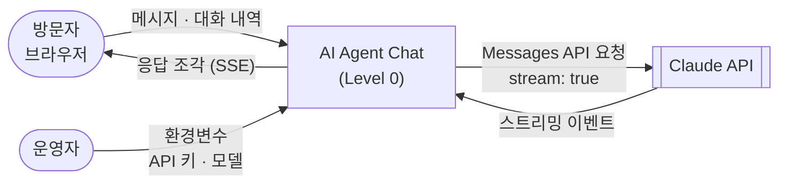

# AI Agent Chat — Overview

이 시스템은 **브라우저에서 AI 에이전트(Claude)와 실시간 스트리밍으로 대화하는 웹 서비스**를 담당합니다.  
API 키가 없으면 모의 모드로 동작해, 설치나 키 없이도 전체 흐름을 시연할 수 있습니다.

> 📄 기능 명세: [`SPEC.md`](./SPEC.md) — 기능 ID(F-xxx)와 수용 기준은 SPEC.md가 정의합니다.  
> 📐 아키텍처: [`ARCHITECTURE.md`](./ARCHITECTURE.md) — 기술 스택, 모듈 구조, 설계 결정(ADR), Go + Flutter 전환 계획.  
> 🧭 이 저장소는 [Project Blueprint Framework](https://github.com/kimtaesung98/Project-Blueprint-Framework) v2.1을 따릅니다.

## 빠른 실행

```bash
npm start                                   # 모의 모드 (키 불필요)
ANTHROPIC_API_KEY=sk-ant-... npm start      # 실제 Claude와 대화
npm test                                    # 테스트
npm run test:contract                       # 서버 계약 테스트 — Node 서버 (Go 1.25 이상 필요)
npm run test:contract:go                    # 서버 계약 테스트 — Go 서버
```

**Go 서버 + Flutter 웹으로 실행** (같은 API — `server/README.md`, `app/README.md`)

```bash
cd app && flutter build web --no-web-resources-cdn && cd ..   # Flutter 3.47.9
cd server
STATIC_DIR=../app/build/web go run ./cmd/chatd   # Flutter 화면, 모의 모드
STATIC_DIR=../public go run ./cmd/chatd          # 기존 HTML 화면
go test ./...                                    # Go 테스트 (네트워크 없음)
cd ../app && flutter test                        # Flutter 테스트
```

브라우저에서 `http://localhost:3000`을 엽니다. 외부 패키지가 없어서 `npm install`이 필요 없습니다 (Node.js 22 이상).

| 환경변수 | 기본값 | 설명 |
|---|---|---|
| `PORT` | `3000` | 서버 포트 |
| `ANTHROPIC_API_KEY` | (없음) | 있으면 Claude 모드, 없으면 모의 모드 |
| `ANTHROPIC_MODEL` | `claude-sonnet-5-5` | Claude 모드에서 쓸 모델 |
| `STATIC_DIR` | `./web` | Go 서버만: 화면 파일 폴더 (`../app/build/web` 또는 `../public`) |

---

## DFD — Level 0 (Context Diagram)

> 시스템 전체를 단일 버블로 표현합니다. 외부 액터와 시스템 경계만 나타냅니다.  
> 하위 폴더의 DFD는 이 버블을 순차적으로 분해(Decompose)합니다.



---

## Tech Stack

> 원본: [`ARCHITECTURE.md`](./ARCHITECTURE.md) §2 — 버전·상태·허용 라이브러리·선택 이유는 거기에만 적습니다.

- 현재 (MVP): Node.js 기본 모듈 · HTML/CSS/JavaScript · 외부 패키지 없음
- 목표: Go 서버 · Flutter 클라이언트 (웹 우선) — 전환 계획은 ARCHITECTURE.md §10
- 외부 서비스: Claude API (Messages API, 스트리밍)

---

## Agent Control

> 이 규칙은 전체 시스템에 적용되는 최상위 제약입니다. 하위 폴더는 이 규칙을 위반할 수 없습니다.

### 허용 (Allow)

- Node.js 기본 모듈과 브라우저 표준 API
- `node:test` 기반 테스트 추가

### 금지 (Prohibit)

- ARCHITECTURE.md §2.2 허용 목록 밖의 의존성 추가 금지 (필요하면 ADR을 "제안"으로 추가하고 사용자에게 먼저 묻기)
- ARCHITECTURE.md §10 단계가 SPEC.md에 등록되기 전에 Go·Flutter 코드 작성 금지
- `ANTHROPIC_API_KEY` 등 비밀값을 코드·로그·클라이언트 응답에 포함 금지
- 대화 메시지 본문을 서버 로그에 기록 금지
- SPEC.md에 없는 기능을 임의로 구현 금지 (먼저 사용자에게 제안)

### 필수 (Required)

- 기능 작업 전 SPEC.md에서 해당 기능 ID의 수용 기준 확인
- 의존성 추가·모듈 구조 변경 전 ARCHITECTURE.md §2.2 허용 목록 · §3.3 의존 규칙 확인
- 수용 기준은 가능한 한 `tests/`의 자동 테스트로 옮기고, 테스트 이름에 기능 ID와 AC 번호 포함 (예: `F-001 AC3`)
- 모든 하위 폴더 작업 완료 시 이 파일의 **Progress Tracker** 업데이트
- 작업할 폴더에 README.md가 없으면 `templates/README_TEMPLATE_SUB.md` 기반으로 생성
- 구조 변경 시 관련 레벨의 DFD를 하위→상위 순서로 업데이트

---

## Sub-folder Map

<!-- /src는 묶음 폴더라 README가 없습니다 → 레벨을 소비하지 않으므로 /src/server, /src/agent가 Level 1입니다.
     모듈 경계·의존 규칙은 ARCHITECTURE.md §3.2·§3.3 (목표 구조의 폴더는 전환 단계에서 이 표에 추가) -->

| 폴더 | DFD 레벨 | 담당 기능 ID | 설명 |
|------|----------|--------------|------|
| `/src/server` | Level 1 | F-001 ~ F-004 | HTTP 서버, 입력 검증, SSE 응답 |
| `/src/agent` | Level 1 | F-001, F-003, F-004 | AI 제공자 (Claude · 모의 모드) |
| `/public` | Level 1 | F-001 ~ F-004 | 채팅 화면 (브라우저) |
| `/server` | Level 1 | F-009, F-010, F-011 | Go 서버 `chatd` (Node와 같은 API, Flutter 웹 빌드 제공) · HTTP 계약 테스트(`contract/`) |
| `/app` | Level 1 | F-011, F-003, F-001 · F-002 화면 | Flutter 웹 클라이언트 (S-001) |

---

## Progress Tracker

<!-- 상태 이모지: ✅ Done | 🔄 In Progress | ⏳ Pending | ❌ Blocked -->

| ID | Feature | Status | Owner Folder | Last Updated | Notes |
|----|---------|--------|--------------|--------------|-------|
| F-001 | 실시간 스트리밍 채팅 | ✅ Done | `/src/server`, `/src/agent`, `/public` | 2026-11-02 | AC1~AC5 자동 테스트 통과 (28개). 화면 렌더링은 브라우저에서 수동 확인 |
| F-002 | 대화 맥락 유지 | ✅ Done | `/src/server`, `/public` | 2026-11-02 | AC1~AC3 자동 테스트 통과. 응답 중 새 대화 버튼은 비활성 (중단은 F-003) |
| F-003 | 응답 중단 | ✅ Done | `/app`, `/server` | 2026-11-05 | Flutter에서 구현 (Q-004). AC1·AC3 위젯·단위 테스트, AC2 서버 취소는 Go·Node 모두 테스트. PR #5 CI 통과 |
| F-004 | 오류 처리와 재시도 | ⏳ Pending | `/src/server`, `/src/agent`, `/public` | - | |
| F-005 | 에이전트 페르소나 설정 | ⏳ Pending | - | - | Phase 2 |
| F-006 | 도구 사용 (Tool use) | ⏳ Pending | - | - | Phase 2 |
| F-007 | 대화 기록 저장 | ⏳ Pending | - | - | Phase 2 |
| F-008 | 사용자 로그인 | ⏳ Pending | - | - | Phase 3 |
| F-009 | 서버 계약 테스트 (전환 단계 1) | ✅ Done | `/server` | 2026-11-04 | AC1~AC5 통과. 계약 시나리오 17개가 Node 서버에 통과, 모의 모드 아니면 실패, 표준 라이브러리만, GitHub Actions CI 초록 (PR #3) |
| F-010 | Go 서버 (전환 단계 2) | ✅ Done | `/server` | 2026-11-05 | AC1~AC6 통과: 계약 테스트 Go 서버 통과, `go test ./...` 통과, 기존 화면이 Go 서버로 동작(브라우저 확인), 취소·오류 처리·의존 규칙 테스트, CI 초록 (PR #4). 실제 키로 Claude 모드 수동 확인은 남음 |
| F-011 | Flutter 웹 클라이언트 (전환 단계 3) | ✅ Done | `/app`, `/server` | 2026-11-05 | `flutter test` 33개, `flutter analyze` 경고 0, 의존 규칙 테스트, Go 서버가 웹 빌드 제공·브라우저에서 스트리밍 확인, PR #5 CI(flutter 작업) 통과 |

---

## Next Roadmap

<!-- SPEC §16 Q-004 결정 (2026-11-04): 남은 MVP 기능과 음성 대화는 Go + Flutter 전환 뒤에 만든다 -->

1. 음성 대화 (SPEC 등록과 STT/TTS ADR 먼저) → `/app`
2. F-004 오류 처리와 재시도 → 전환 뒤 `/server`, `/app`
