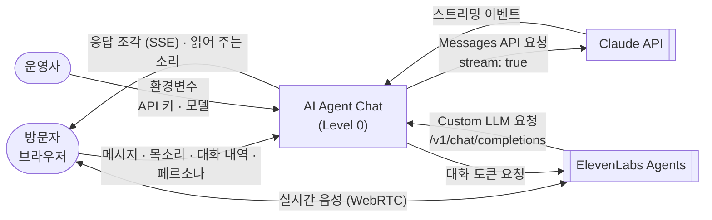

# AI Agent Chat — Overview

이 시스템은 **브라우저에서 AI 에이전트(Claude)와 실시간 스트리밍으로 대화하는 웹 서비스**를 담당합니다.  
API 키가 없으면 모의 모드로 동작해, 설치나 키 없이도 전체 흐름을 시연할 수 있습니다.

> 📄 기능 명세: [`SPEC.md`](./SPEC.md) — 기능 ID(F-xxx)와 수용 기준은 SPEC.md가 정의합니다.  
> 📐 아키텍처: [`ARCHITECTURE.md`](./ARCHITECTURE.md) — 기술 스택(Go 서버 + Flutter), 모듈 구조, 설계 결정(ADR).  
> 🧭 이 저장소는 [Project Blueprint Framework](https://github.com/kimtaesung98/Project-Blueprint-Framework) v2.1을 따릅니다.

## 빠른 실행

> 🧪 내 Mac에서 알파테스트하는 단계별 방법·체크리스트: [`docs/ALPHA_TEST_LOCAL.md`](./docs/ALPHA_TEST_LOCAL.md)

필요한 것: Go 1.25 이상, Flutter 3.47.9 (`server/README.md`, `app/README.md`)

```bash
cd app && flutter build web --no-web-resources-cdn && cd ..   # 화면 빌드
cd server
STATIC_DIR=../app/build/web go run ./cmd/chatd                        # 모의 모드 (키 불필요)
ANTHROPIC_API_KEY=sk-ant-... STATIC_DIR=../app/build/web go run ./cmd/chatd   # 실제 Claude와 대화
go test ./...                     # Go 단위 + 계약 테스트 (네트워크·키 없이, 모의 모드 서버를 직접 띄움)
cd ../app && flutter analyze && flutter test   # Flutter 분석·테스트
```

브라우저에서 `http://localhost:3000`을 엽니다.

| 환경변수 | 기본값 | 설명 |
|---|---|---|
| `PORT` | `3000` | 서버 포트 |
| `ANTHROPIC_API_KEY` | (없음) | 있으면 Claude 모드, 없으면 모의 모드 |
| `ANTHROPIC_MODEL` | `claude-sonnet-5-5` | Claude 모드에서 쓸 모델 |
| `STATIC_DIR` | `./web` | 화면 파일 폴더 (보통 `../app/build/web`) |
| `ELEVENLABS_API_KEY` · `ELEVENLABS_AGENT_ID` | (없음) | 있으면 앱 음성 대화가 ElevenLabs Agents 실시간 음성 (F-022). 설정 방법: [`docs/ELEVENLABS_SETUP.md`](./docs/ELEVENLABS_SETUP.md) |
| `ELEVENLABS_LLM_SECRET` | (없음) | ElevenLabs가 Custom LLM(`/v1/chat/completions`)을 부를 때의 Bearer 비밀값 (16자 이상) |
| `OPENAI_API_KEY` | (없음) | 있으면 웹 음성 대화가 OpenAI GPT Realtime (F-024). 설정·폰 확인: [`docs/OPENAI_REALTIME_SETUP.md`](./docs/OPENAI_REALTIME_SETUP.md) |
| `OPENAI_REALTIME_MODEL` · `OPENAI_REALTIME_VOICE` | `gpt-realtime` · `marin` | 실시간 모델·목소리 |

---

## DFD — Level 0 (Context Diagram)

> 시스템 전체를 단일 버블로 표현합니다. 외부 액터와 시스템 경계만 나타냅니다.  
> 하위 폴더의 DFD는 이 버블을 순차적으로 분해(Decompose)합니다.



---

## Tech Stack

> 원본: [`ARCHITECTURE.md`](./ARCHITECTURE.md) §2 — 버전·상태·허용 라이브러리·선택 이유는 거기에만 적습니다.

- 서버: Go (`chatd`, 표준 라이브러리 + 공식 Anthropic Go SDK)
- 클라이언트: Flutter (웹 우선, 같은 코드로 모바일은 ARCHITECTURE.md §10 단계 5)
- 처음 Node.js MVP는 F-013에서 제거 (ADR-001 대체됨)
- 음성: ElevenLabs Agents 실시간 음성 (`elevenlabs_agents`, 앱 — F-022). 안 되면 `speech_to_text` · `flutter_tts` (기기 음성 엔진, 키 없음)
- 외부 서비스: Claude API (Messages API, 스트리밍), ElevenLabs Agents (WebRTC 음성 · 우리 서버를 Custom LLM으로 부름)

---

## Agent Control

> 이 규칙은 전체 시스템에 적용되는 최상위 제약입니다. 하위 폴더는 이 규칙을 위반할 수 없습니다.

### 허용 (Allow)

- Go 표준 라이브러리, ARCHITECTURE.md §2.2 허용 목록의 Go·Flutter 패키지
- Go `testing` · `flutter_test` 기반 테스트 추가 (모의 제공자·가짜 업스트림만)

### 금지 (Prohibit)

- ARCHITECTURE.md §2.2 허용 목록 밖의 의존성 추가 금지 (필요하면 ADR을 "제안"으로 추가하고 사용자에게 먼저 묻기)
- `ANTHROPIC_API_KEY` 등 비밀값을 코드·로그·클라이언트 응답에 포함 금지
- 대화 메시지 본문을 서버 로그에 기록 금지
- SPEC.md에 없는 기능을 임의로 구현 금지 (먼저 사용자에게 제안)

### 필수 (Required)

- 기능 작업 전 SPEC.md에서 해당 기능 ID의 수용 기준 확인
- 의존성 추가·모듈 구조 변경 전 ARCHITECTURE.md §2.2 허용 목록 · §3.3 의존 규칙 확인
- 수용 기준은 가능한 한 자동 테스트(`server/` Go, `app/test/` Flutter)로 옮기고, 테스트 이름에 기능 ID와 AC 번호 포함 (예: `F-001 AC3`)
- 모든 하위 폴더 작업 완료 시 이 파일의 **Progress Tracker** 업데이트
- 작업할 폴더에 README.md가 없으면 `templates/README_TEMPLATE_SUB.md` 기반으로 생성
- 구조 변경 시 관련 레벨의 DFD를 하위→상위 순서로 업데이트

---

## Sub-folder Map

<!-- 모듈 경계·의존 규칙은 ARCHITECTURE.md §3.2·§3.3 -->

| 폴더 | DFD 레벨 | 담당 기능 ID | 설명 |
|------|----------|--------------|------|
| `/server` | Level 1 | F-001 ~ F-004 서버, F-009, F-010, F-013 · F-005 · F-012 · F-019 · F-022 서버 | Go 서버 `chatd` (API-001·002, Flutter 웹 빌드 제공, 페르소나·음성 프롬프트) · HTTP 계약 테스트(`contract/`) |
| `/app` | Level 1 | F-011, F-001 ~ F-005 화면, F-012, F-017, F-018, F-019, F-022 | Flutter 클라이언트 (S-001·S-002·S-003) — 웹 · Android·iOS 앱 (`android/`·`ios/`) · 음성 대화 · 음성 전용 화면 |
| `/deploy` | Level 1 | F-014 | AWS·Cloudflare 배포: EC2 설정 스크립트(`provision.sh`), 컨테이너 실행(`run-chatd.sh`), IAM 정책. 이미지는 루트 `Dockerfile`, 실행은 `deploy.yml` |

---

## Progress Tracker

<!-- 상태 이모지: ✅ Done | 🔄 In Progress | ⏳ Pending | ❌ Blocked -->

| ID | Feature | Status | Owner Folder | Last Updated | Notes |
|----|---------|--------|--------------|--------------|-------|
| F-001 | 실시간 스트리밍 채팅 | ✅ Done | `/server`, `/app` | 2026-11-02 | AC1~AC5 자동 테스트 통과 (28개). 화면 렌더링은 브라우저에서 수동 확인. Node 구현은 F-013에서 제거 — 서버는 계약 테스트(Go), 화면은 Flutter 테스트로 유지 |
| F-002 | 대화 맥락 유지 | ✅ Done | `/server`, `/app` | 2026-11-02 | AC1~AC3 자동 테스트 통과. 응답 중 새 대화 버튼은 비활성 (중단은 F-003). Node 구현은 F-013에서 제거 — 서버는 계약 테스트(Go), 화면은 Flutter 테스트로 유지 |
| F-003 | 응답 중단 | ✅ Done | `/app`, `/server` | 2026-11-05 | Flutter에서 구현 (Q-004). AC1·AC3 위젯·단위 테스트, AC2 서버 취소는 Go·Node 모두 테스트. PR #5 CI 통과 |
| F-004 | 오류 처리와 재시도 | ✅ Done | `/server`, `/app` | 2026-11-10 | AC1·AC3 Go 테스트(업스트림 오류 → 사용자용 문장, 원문·키 숨김, 서버 계속 동작), AC2 Flutter 단위·위젯 테스트(다시 시도 → 같은 질문 재요청). `flutter test` 84개 |
| F-005 | 페르소나 설정 | 🔄 In Progress | `/app`, `/server` | 2026-11-10 | AC1~AC7 자동 테스트 통과 (Flutter 81개, Go 단위, 계약 테스트). 피그마 시안 A·C를 Material 3로 구현, 웹 빌드 화면 캡처 확인. ADR-016 승인. Q-005 결정: 페르소나·내 프로필 기기 저장(`shared_preferences`, ADR-023, 2026-11-11). 기본 페르소나에 노인복지사 추가(2026-11-11). **AC8 실제 Claude 모드 확인(사용자) 남음** |
| F-006 | 도구 사용 (Tool use) | ⏳ Pending | - | - | Phase 2 |
| F-007 | 대화 기록 저장 | ⏳ Pending | - | - | Phase 2 |
| F-008 | 사용자 로그인 | ⏳ Pending | `/server`, `/app` | 2026-11-10 | Phase 3 그대로 (Q-006 사용자 결정). Google 로그인 상세·AC 초안과 ADR-017(보류)만 작성, MVP 디자인 01 화면에 반영 |
| F-009 | 서버 계약 테스트 (전환 단계 1) | ✅ Done | `/server` | 2026-11-04 | AC1~AC5 통과. 계약 시나리오 17개가 Node 서버에 통과, 모의 모드 아니면 실패, 표준 라이브러리만, GitHub Actions CI 초록 (PR #3) |
| F-010 | Go 서버 (전환 단계 2) | ✅ Done | `/server` | 2026-11-05 | AC1~AC6 통과: 계약 테스트 Go 서버 통과, `go test ./...` 통과, 기존 화면이 Go 서버로 동작(브라우저 확인), 취소·오류 처리·의존 규칙 테스트, CI 초록 (PR #4). 실제 키로 Claude 모드 수동 확인은 남음 |
| F-011 | Flutter 웹 클라이언트 (전환 단계 3) | ✅ Done | `/app`, `/server` | 2026-11-05 | `flutter test` 33개, `flutter analyze` 경고 0, 의존 규칙 테스트, Go 서버가 웹 빌드 제공·브라우저에서 스트리밍 확인, PR #5 CI(flutter 작업) 통과 |
| F-012 | 음성 대화 | 🔄 In Progress | `/app`, `/server` | 2026-11-07 | AC1~AC7 자동 테스트 통과 (Flutter 65개, Go·Node 단위, 계약 테스트 Node·Go). 실제 웹 빌드에 가짜 음성 API를 넣어 4턴·끼어들기 확인. **AC8 실제 마이크 확인(Chrome·Edge) 남음** |
| F-013 | Node MVP 제거 (전환 단계 4) | ✅ Done | `/server`, 루트 | 2026-11-10 | AC1 `src/`·`public/`·`tests/`·`scripts/`·`package.json` 삭제, AC2 `go test ./...`가 모의 모드 `chatd`를 띄워 계약 테스트 통과, AC3 CI Node 작업 제거, AC4 README·DFD·CLAUDE.md·ARCHITECTURE 갱신 |
| F-014 | 클라우드 배포 (AWS + Cloudflare) | 🔄 In Progress | `/deploy`, 루트 | 2026-11-10 | 사용자 "추천안 전체" 선택(ADR-018~021 승인). `Dockerfile`(22.6MB, 비root, arm64 교차 빌드), CI `image` 작업(이미지에 계약 테스트 — AC1), `deploy.yml`(OIDC → ECR → SSM), `provision.sh`. **사용자 준비(AWS·Cloudflare 계정·도메인) 후 첫 배포와 AC2~AC5 확인 남음** |
| F-015 | Polly 음성 답 | ⏳ Pending | `/server`, `/app` | 2026-11-10 | F-014 뒤 (ADR-020) |
| F-016 | Transcribe 음성 인식 | ⏳ Pending | `/server`, `/app` | 2026-11-10 | F-015 뒤, 서버 중계 (ADR-021) |
| F-018 | 음성 전용 화면 | 🔄 In Progress | `/app` | 2026-11-11 | 사용자 "음성 전용 화면 만들자". MVP HTML 디자인의 음성 대화 화면(S-003)을 Flutter로 구현(PR #14). 사용자 피드백(어르신은 토글·버튼이 불편)으로 개정: 모드 버튼 제거, 화면 누르기 끼어들기, 끊김 자동 복구, 쉼 2초, 큰 글씨. 이어서 "상시로 마이크를 듣는 것이 목표" → 끊김 무한 재시도, 화면 꺼짐 막기(네이티브 채널·Wake Lock), 앱 복귀 시 다시 듣기. AC1~AC9 위젯·단위 테스트 통과(`flutter test` 127개), 모의 모드 웹 빌드 + 가짜 음성 API로 캡처·Wake Lock 확인. 2026-11-13 사용자 "파장이 움직이는 시각 효과" → 소리 파형(AC11). **AC10 실제 폰·마이크 확인(사용자) 남음** |
| F-021 | 켜면 바로 음성 대화 | 🔄 In Progress | `/app` | 2026-11-11 | 사용자 "추천대로 진행"(다음 계획 2). 서랍 스위치 → 앱을 열면 음성 대화 화면으로 시작, 기기 저장 `start.voice`. AC1~AC3 위젯·저장 테스트(`flutter test` 164개). **AC4 실제 폰 확인(사용자) 남음** |
| F-020 | 장기 기억 (기억 압축) | 🔄 In Progress | `/app`, `/server` | 2026-11-11 | 사용자 "추천대로 진행"(다음 계획 1). 최근 5개 밖으로 밀린 요약을 API-004 `/api/consolidate`로 페르소나별 장기 기억에 묶어 `longTerm`으로 싣기, 편집 화면 표시·지우기. AC1~AC4 Go·계약·Flutter 테스트(`flutter test` 159개). **AC5 실제 Claude 확인(사용자) 남음** |
| F-019 | 페르소나 지시 두 층 · 대화 요약 기억 | 🔄 In Progress | `/app`, `/server` | 2026-11-11 | 사용자 "추가 지시를 탑재 기본 + 사용자 요구로 나누고, 대화 세션이 끝나면 요약해 다음 세션의 기반으로". `persona.base`(탑재 페르소나 고정)·`instructions`(내 요구 사항), API-003 `/api/summary`, API-001 `memory`(최근 5개), 기기 저장 `memory.v1`, 편집 화면 기억 보기·지우기. AC1~AC7 Go 단위·계약 테스트, `flutter test` 152개, 모의 모드 웹 빌드로 요약 → 다음 요청 `memory` 확인. **AC8 실제 Claude 모드 확인(사용자) 남음** |
| F-022 | 실시간 음성 대화 (ElevenLabs Agents) | ❌ Blocked | `/app`, `/server` | 2026-11-13 | **대체됨 → F-024** (사용자 전향, 2026-11-13). 코드는 F-024 정리 단계에서 지움. 이전: 사용자 "ElevenLabs Agents를 이용", Claude 연결은 "우리 서버 Custom LLM" 선택(ADR-025). 서버 API-005 토큰 발급(`internal/elevenlabs`)·API-006 OpenAI 호환 `/v1/chat/completions`(Bearer), 앱 `elevenlabs_agents`(`RealtimeAgent`)·`AgentVoiceController`(안 되면 기기 음성, 끊기면 다시 연결). AC1~AC7 Go 단위·httpapi·계약(가짜 ElevenLabs)·Flutter 테스트. **AC8 ElevenLabs 에이전트 만들기·실제 폰 확인(사용자, `docs/ELEVENLABS_SETUP.md`) 남음** |
| F-023 | 앱 화면 기반 · 로그인 화면 | 🔄 In Progress | `/app` | 2026-11-12 | 사용자 "로그인 화면 UI 제작, 이외 기능 UI도 web 수준에서 기획·제작해 네이티브 앱 기반으로". 화면 기획 `docs/SCREEN_PLAN.md`. S-004 로그인(Google 모의 · 이름만 적고 시작), S-005 첫 실행 대화 상대 고르기, S-006 설정(서랍의 시작 방식·서버 주소를 옮김, 글자 크기·로그아웃), S-007 지난 대화 기억. AC1~AC6 단위·위젯·저장 테스트(`flutter test` 197개), 모의 모드 웹 빌드 캡처. **AC7 실제 폰 확인(사용자) 남음, 진짜 Google 로그인은 F-008** |
| F-017 | 모바일 네이티브 앱 (Android·iOS) | ❌ Blocked | `/app` | 2026-11-13 | **대체됨 → F-025 PWA** (사용자 전향, 2026-11-13). 이전: 사용자 "모바일 진행"(SPEC §1.4 비목표 해제). AC2~AC5·AC7 자동 테스트 통과(`flutter test` 108개: 서버 주소·앱 안 주소 설정·저장, dart:io 스트리밍·중단, 매니페스트·Info.plist), AC1 Android APK 클라우드 빌드·CI `android` 작업. **iOS 빌드(Mac)·AC6 실제 폰 확인(사용자) 남음** |
| F-024 | 실시간 음성 대화 (OpenAI GPT Realtime) | 🔄 In Progress | `/app`, `/server` | 2026-11-13 | 단계 6-①: 서버 API-007(`internal/openai`, 지시문 담은 임시 키) + 웹 `web/realtime.js`(WebRTC) + `OpenAiRealtimeAgent`. AC1~AC6 자동 테스트(`go test ./...` 계약 포함 · `flutter test` 218개). 웹 빌드 + 가짜 OpenAI로 브라우저에서 세션 → 임시 키로 SDP 요청 → 실패 시 기기 음성까지 확인. 남은 것: 실제 키로 iPhone·Android 확인(AC7, 사용자 — `docs/OPENAI_REALTIME_SETUP.md`) |
| F-025 | 웹앱 (PWA) | 🔄 In Progress | `/app` | 2026-11-13 | 단계 6-③: 매니페스트("AI 말벗", 새 아이콘·maskable·iOS 아이콘), `web/sw.js`(화면 파일만, 네트워크 먼저, /api 제외), Flutter 기본 SW 끔, `web/pwa.js` + `InstallBanner`(Android 설치 창·iPhone 공유 안내), Wake Lock 미지원 안내. AC1~AC4 자동 테스트(`flutter test` 226개), 모바일 에뮬레이션에서 설치 가능(Chrome 설치 오류 0)·SW 캐시 확인. 남은 것: 정리(AC5, 6-④), 폰 설치 확인(AC6, 사용자) |
| F-026 | 사용자 계정 · 로그인 · 서버 데이터 저장소 | 🔄 In Progress | `/server`, `/app` | 2026-11-13 | 승인 — 로그인은 관리자 발급 코드 또는 연결된 Google(Q-010), SQLite `modernc.org/sqlite` v1.59.0(ADR-028). 7-② 일부: `internal/store`·`store/sqlite`(마이그레이션)·`account`(코드·Google·세션·역할 계층) + Go 테스트 통과. 남은 것: HTTP API 연결·`usage`·계약 테스트·`chatd admin bootstrap` |
| F-027 | 페르소나 형식 v1 (앞뒤 공통 계약) | ⏳ Pending | `/server`, `/app` | 2026-11-13 | 승인 (PR #30) — 사용자 "백엔드에 맞물리게 프론트의 페르소나 형식을 명료화". SPEC §7.2 Persona v1, API-015·016, ADR-030(프리셋 카탈로그는 서버) |
| F-028 | 대화 · 요약 · 기억의 서버 처리 | ⏳ Pending | `/server`, `/app` | 2026-11-13 | 승인 (PR #30) — API-017·018, ADR-031(ADR-024 대체 예정). 원문은 Q-009 추천안(30일)으로 |
| F-029 | 역할 계층 · 권한 부여 | 🔄 In Progress | `/server`, `/app` | 2026-11-13 | 승인 — 사용자 "최고 관리자(개발자·원장) > 요양사 > 어르신·보호자, 상위가 하위를 추가·권한 부여". ADR-032, 보는 범위 Q-011 추천안 |
| F-030 | 게스트 체험 · 사용량 제한 | ⏳ Pending | `/server`, `/app` | 2026-11-13 | 승인 — 사용자 "게스트가 많은 토큰을 발생시켜 누수를 일으키면 안 돼". ADR-033, 게스트 기본 꺼짐 |
| F-031 | 어르신 페르소나 (기본 설정 + 대화로 강화) | ⏳ Pending | `/server`, `/app` | 2026-11-13 | 승인 — 방향. 사용자 "원문은 모바일에 지속 보관, 이를 바탕으로 노인의 페르소나 강화, 보호자·요양사는 기초 통합 설정, 노치원 먼저". ADR-034·035, 노치원 기획서(Q-014) 뒤 세부 |

---

## Next Roadmap

<!-- SPEC §16 Q-004 결정 (2026-11-04): 남은 MVP 기능과 음성 대화는 Go + Flutter 전환 뒤에 만든다 -->

00. **서비스화 (2026-11-13 승인)**: F-026~F-031 (노치원 먼저) — ARCHITECTURE §10 단계 7. ① 문서(완료) → ② 서버 저장소·계정·코드/Google 로그인·역할 계층·사용량 상한 → ③ 페르소나 v1 → ④ 대화·기억 서버 처리 → ⑤ 앱 전환·기기 데이터 옮기기 → ⑥ 정리 → `/server`, `/app`
0. **전향 (2026-11-13)**: F-024 OpenAI Realtime + F-025 PWA — ARCHITECTURE §10 단계 6 순서: ① 서버 API-007 + 가짜 OpenAI 계약 테스트 + 최소 음성 화면 → 실제 iPhone 확인 ② 음성 화면 연결·요약 ③ PWA 마무리 ④ ElevenLabs·기기 음성·네이티브 제거. Q-008(글 채팅·요약을 Claude로 둘지) 사용자 결정 → `/server`, `/app`
0-1. F-019 마무리 — 실제 Claude 모드에서 미소와 대화 → 대화 끝내기 → 다음 대화가 이어지는지(AC8, 사용자). 다음 후보: 오래된 요약을 묶어 장기 기억으로 압축, 앱 시작을 음성 대화로(어르신용) → `/app`, `/server`
1. ~~F-017 모바일 앱~~ — F-025로 대체
2. F-005 페르소나 마무리 — 실제 Claude 모드에서 말투 확인(AC8, 사용자). 저장 유지(Q-005)는 결정·구현됨 → `/app`
3. MVP HTML 디자인을 Flutter 화면에 반영 — 음성 전용 화면은 F-018로 구현(실제 폰 확인 AC8 남음). 다음은 첫 실행(페르소나 고르기) 등 디자인에 있고 앱에 없는 것부터 SPEC 제안 → `/app`
4. F-012 음성 대화 마무리 — 실제 마이크로 Chrome·Edge·폰 확인(AC8, 사용자), 필요하면 끝맺음 시간·에코 조정 → `/app`
5. F-014 클라우드 배포 — **정지** (사용자, 2026-11-11). 재개 때 `deploy/README.md` 순서대로 → AC2~AC5. 앱에서 배포 주소를 쓰려면 R-A12 결정 → `/deploy`. 그 뒤 F-015 Polly → F-016 Transcribe
6. F-006 도구 사용 · F-007 대화 기록 저장 (Phase 2). F-008 Google 로그인은 Phase 3 (Q-006)
