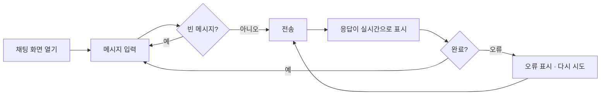

# AI Agent Chat — 기능 명세 (SPEC)

> **에이전트 읽기 규칙**: 이 파일은 세션마다 전체를 읽지 않습니다.  
> 작업할 기능 ID의 **§4.2 기능 상세** 블록과, 그 블록이 참조하는 화면·데이터·API 항목만 읽습니다.

| 항목 | 내용 |
|---|---|
| 문서 버전 | v1.8 |
| 상태 | 승인됨 (MVP 범위) |
| 작성자 | kimtaesung98 |
| 최종 수정일 | 2026-11-10 |

---

## 목차

1. [프로젝트 개요](#1-프로젝트-개요)
2. [범위](#2-범위)
3. [사용자와 페르소나](#3-사용자와-페르소나)
4. [기능 요구사항](#4-기능-요구사항)
5. [비기능 요구사항](#5-비기능-요구사항)
6. [화면 및 사용자 흐름](#6-화면-및-사용자-흐름)
7. [데이터 모델](#7-데이터-모델)
8. [설계 결정 (ADR)](#8-설계-결정-adr)
9. [API 명세](#9-api-명세)
10. [외부 연동](#10-외부-연동)
11. [보안 및 개인정보](#11-보안-및-개인정보)
12. [테스트 전략](#12-테스트-전략)
13. [배포 및 운영](#13-배포-및-운영)
14. [마일스톤](#14-마일스톤)
15. [리스크](#15-리스크)
16. [미결 사항](#16-미결-사항)
17. [용어집](#17-용어집)
18. [변경 이력](#18-변경-이력)

---

## 1. 프로젝트 개요

### 1.1 한 줄 요약
브라우저에서 AI 에이전트(Claude)와 **실시간 스트리밍으로 대화**할 수 있는 웹 서비스.

### 1.2 배경과 문제
- 현재 상황: AI API를 써 보려면 코드나 API 콘솔을 직접 다뤄야 한다.
- 문제점: 응답이 다 만들어질 때까지 기다리면 체감 속도가 느리고, 비개발자는 접근하기 어렵다.
- 해결하지 않으면 생기는 일: 팀 내부에서 AI 에이전트를 업무에 활용하기 어렵다.

### 1.3 목표
| 목표 | 성공 지표 | 목표값 |
|---|---|---|
| 응답이 즉시 보이기 시작 | 전송 → 첫 글자 표시까지 시간 (모의 모드 기준) | 1초 이내 |
| 설치 없이 사용 | 브라우저 외 필요한 프로그램 | 0개 |
| 키 없이 시연 가능 | API 키 없이 전체 흐름 동작 | 모의 모드 제공 |

### 1.4 비목표 (Non-goals)
- ~~모바일 앱은 만들지 않는다 (반응형 웹으로 대응)~~ → 사용자 결정으로 바뀜 (2026-11-11): 같은 Flutter 코드로 Android·iOS 앱을 만든다 (F-017). 앱스토어 출시는 아직 비목표
- 여러 AI 회사의 모델을 동시에 지원하지 않는다 (Claude + 모의 모드만)
- MVP에서는 회원가입·결제를 하지 않는다

---

## 2. 범위

### 2.1 MVP (최소 기능 제품)
- F-001 실시간 스트리밍 채팅
- F-002 대화 맥락 유지
- F-003 응답 중단
- F-004 오류 처리와 재시도

### 2.2 이후 단계
| 단계 | 포함 기능 ID |
|---|---|
| Phase 2 | F-006 도구 사용(Tool use), F-007 대화 기록 저장 |
| Phase 3 | F-008 사용자 로그인 |

### 2.3 전제 조건과 제약
- 전제: 사용자는 최신 브라우저(Chrome, Safari, Edge, Firefox 최신 2개 버전)를 쓴다.
- 제약: 서버는 Go(`server/`), 클라이언트는 Flutter(`app/`)다 (ARCHITECTURE.md §2, ADR-005·006). 처음 Node.js MVP는 F-013(전환 단계 4)에서 제거했다.

---

## 3. 사용자와 페르소나

### 3.1 사용자 유형
| 유형 | 설명 | 주요 권한 |
|---|---|---|
| 방문자 | 웹 페이지에서 에이전트와 대화하는 사람 | 대화 |
| 운영자 | 서버를 실행하고 API 키·모델을 설정하는 사람 | 환경변수 설정 |

### 3.2 페르소나
**김지은 / 32세 / 기획자**
- 목표: 기획서 초안 아이디어를 AI와 빠르게 주고받고 싶다.
- 불편한 점: 긴 답변을 기다리는 동안 화면이 멈춘 것처럼 보인다.
- 사용 환경: 회사 노트북 브라우저, 하루 여러 번

---

## 4. 기능 요구사항

### 4.1 기능 목록

| ID | 기능명 | 설명 | 우선순위 | 단계 |
|---|---|---|---|---|
| F-001 | 실시간 스트리밍 채팅 | 메시지를 보내면 응답이 생성되는 대로 화면에 표시 | P0 | MVP |
| F-002 | 대화 맥락 유지 | 이전 대화를 기억하고, 길어지면 오래된 턴을 정리, 새 대화 시작 | P0 | MVP |
| F-003 | 응답 중단 | 생성 중인 응답을 사용자가 멈출 수 있음 | P1 | MVP |
| F-004 | 오류 처리와 재시도 | AI API 오류를 사용자에게 알리고 다시 시도 | P1 | MVP |
| F-005 | 페르소나 설정 | 사용자가 화면에서 대화 상대 페르소나(역할·말투·지시)를 고르고 편집하고, 나에 대해 알려 주면 에이전트가 그 맥락으로 답함 | P1 | 전환 뒤 (2026-11-10 앞당김) |
| F-006 | 도구 사용 (Tool use) | 에이전트가 정의된 도구(예: 시간 조회)를 호출 | P2 | Phase 2 |
| F-007 | 대화 기록 저장 | 새로고침해도 대화가 남음 | P2 | Phase 2 |
| F-008 | 사용자 로그인 | 사용자별 대화 분리 | P2 | Phase 3 |
| F-009 | 서버 계약 테스트 | HTTP 수준 계약 테스트로 Node·Go 서버가 같은 API를 지키는지 검증 (ARCHITECTURE §10 단계 1) | P0 | 전환 |
| F-010 | Go 서버 | Node 서버와 같은 API를 Go로 구현 (ARCHITECTURE §10 단계 2) | P0 | 전환 |
| F-011 | Flutter 웹 클라이언트 | S-001 채팅 화면을 Flutter 웹으로 구현, Go 서버가 제공 (ARCHITECTURE §10 단계 3) | P0 | 전환 |
| F-013 | Node MVP 제거 | `src/`·`public/`·Node 테스트를 지우고 Go + Flutter만 남김 (ARCHITECTURE §10 단계 4) | P0 | 전환 |
| F-012 | 음성 대화 | 말로 묻고 음성으로 답을 듣는다. 말이 끝나면 자동 전송, 답은 문장 단위로 바로 읽기, 끼어들기 | P0 | 전환 뒤 (Q-004) |
| F-014 | 클라우드 배포 (AWS + Cloudflare) | 컨테이너 이미지로 AWS 서울 EC2에 올리고 Cloudflare Tunnel·Access로 HTTPS 주소에서 허용한 사람만 쓰게 함 (ADR-018·019) | P0 | 배포 |
| F-015 | Polly 음성 답 | 음성 답을 Amazon Polly 목소리로 읽음, 서버 `POST /api/tts` (ADR-020) | P1 | 배포 뒤 |
| F-016 | Transcribe 음성 인식 | 말을 Amazon Transcribe 스트리밍으로 인식, 서버 중계 WebSocket `/api/stt` (ADR-021) | P1 | 배포 뒤 |
| F-017 | 모바일 네이티브 앱 (Android·iOS) | 같은 Flutter 코드로 Android·iOS 앱 빌드, 텍스트·음성 대화 (ARCHITECTURE §10 단계 5, ADR-022) | P0 | 모바일 |

### 4.2 기능 상세

#### F-001. 실시간 스트리밍 채팅
- **사용자 스토리**: 방문자로서, 나는 메시지를 보내면 답이 만들어지는 대로 바로 읽고 싶다. 왜냐하면 긴 답변을 멍하니 기다리고 싶지 않기 때문이다.
- **상세 동작**:
  1. 사용자가 입력창에 메시지를 쓰고 전송 버튼 또는 Enter를 누른다 (Shift+Enter는 줄바꿈).
  2. 사용자 메시지가 대화 영역에 즉시 표시되고, 입력창과 전송 버튼이 비활성화된다.
  3. 브라우저가 `POST /api/chat`으로 대화 내역을 보낸다.
  4. 서버는 AI 제공자(Claude 또는 모의 모드)의 응답을 SSE `delta` 이벤트로 조각조각 전달한다.
  5. 화면은 받은 조각을 순서대로 이어 붙여 에이전트 말풍선에 표시한다.
  6. `done` 이벤트를 받으면 입력창이 다시 활성화된다.
- **수용 기준 (Acceptance Criteria)**:
  - [ ] AC1. Given 서버가 실행 중, When 메시지를 전송, Then 응답 완료(`done`) 전에 `delta` 이벤트가 2개 이상 도착하고 화면에 순서대로 이어 붙여진다
  - [ ] AC2. Given 응답 스트리밍 완료, When `done` 이벤트 수신, Then 입력창과 전송 버튼이 다시 활성화된다
  - [ ] AC3. Given 빈 메시지 또는 공백만 있는 메시지, When 전송, Then 브라우저는 요청을 보내지 않고, 서버에 직접 보내도 400을 반환한다
  - [ ] AC4. Given `ANTHROPIC_API_KEY` 미설정, When 서버 시작, Then 모의 모드로 동작하며 시작 로그와 화면 상단에 현재 모드가 표시된다
  - [ ] AC5. Given 4,000자를 넘는 메시지, When 서버에 전송, Then 400을 반환한다
- **예외 처리**:
  - 잘못된 JSON, 형식이 틀린 messages → 400 + 오류 JSON
  - 스트리밍 중 AI 오류 → `error` 이벤트 (상세 처리는 F-004)
- **관련 항목**: 화면 S-001 · 데이터 `ChatMessage` · API API-001, API-002
- **Owner Folder**: `/server`, `/app` (처음 구현은 Node `/src`·`/public` — F-013에서 제거)

#### F-002. 대화 맥락 유지
- **사용자 스토리**: 방문자로서, 나는 앞에서 한 말을 에이전트가 기억하길 원한다. 왜냐하면 매번 처음부터 설명하고 싶지 않기 때문이다.
- **수용 기준**:
  - [ ] AC1. Given 이전 대화가 있음, When 새 메시지 전송, Then 이전 user/assistant 메시지가 순서대로 AI 제공자에 전달된다
  - [ ] AC2. Given 대화가 최근 20턴을 초과, When 전송, Then 서버는 가장 오래된 턴부터 잘라 최근 20턴만 전달한다
  - [ ] AC3. Given "새 대화" 버튼 클릭, Then 대화 영역과 내역이 비워진다
- **Owner Folder**: `/server`, `/app` (처음 구현은 Node `/src`·`/public` — F-013에서 제거)

#### F-003. 응답 중단
- **사용자 스토리**: 방문자로서, 나는 원하지 않는 방향의 답변을 중간에 멈추고 싶다.
- **수용 기준**:
  - [ ] AC1. Given 응답 스트리밍 중, When "중단" 클릭, Then 화면 갱신이 즉시 멈추고 입력창이 활성화된다
  - [ ] AC2. Given 클라이언트 연결 종료, Then 서버는 AI 제공자 요청을 취소한다
  - [ ] AC3. Given 중단된 응답, Then 그때까지 받은 내용은 대화에 남고 "중단됨" 표시가 붙는다
- **Owner Folder**: `/app` (화면 — Q-004 결정에 따라 Flutter에서 구현), `/server` (취소 전달)

#### F-004. 오류 처리와 재시도
- **사용자 스토리**: 방문자로서, 나는 오류가 나면 무엇이 잘못됐는지 알고 다시 시도하고 싶다.
- **수용 기준**:
  - [ ] AC1. Given AI API가 오류 응답(인증 실패, 과부하 등), When 스트리밍 중, Then `error` 이벤트로 사용자용 메시지가 전달되고 서버는 계속 동작한다
  - [ ] AC2. Given 오류 메시지 표시, When "다시 시도" 클릭, Then 마지막 사용자 메시지로 다시 요청한다
  - [ ] AC3. Given 오류, Then API 키 등 비밀값이 화면·응답에 노출되지 않는다
- **화면 (Flutter)**: 마지막 답이 오류일 때만 그 말풍선 아래에 "다시 시도" 버튼(높이 44px 이상)을 보인다. 누르면 실패한 질문과 오류 말풍선을 지우고 같은 질문을 글 모드로 다시 보낸다. 응답 중에는 버튼이 없다. 음성 대화 중에는 다시 말하면 된다
- **Owner Folder**: `/server` (오류 문장·비밀값 숨김), `/app` (오류 말풍선·다시 시도) — Q-004에 따라 Go + Flutter에서 구현

#### F-009. 서버 계약 테스트
> F-013 이후: Node 서버는 없다. 계약 테스트는 `server/`에서 `go test ./...`로 모의 모드 Go 서버에 실행한다. 아래 `npm` 명령은 완료 당시 기록이다

- **사용자 스토리**: 개발자로서, 나는 서버를 Go로 바꿔도 화면이 보는 API가 그대로인지 같은 테스트로 확인하고 싶다. 왜냐하면 전환 중에 동작이 몰래 바뀌면 안 되기 때문이다.
- **상세 동작**:
  1. `server/contract`의 Go 테스트가 `-base-url`로 받은 서버에 실제 HTTP 요청을 보낸다.
  2. 서버는 모의 모드로 떠 있어야 한다. 테스트는 `/api/config`로 모의 모드인지 먼저 확인하고, 아니면 실패한다 (실제 Claude 호출 방지).
  3. `npm run test:contract`가 Node 서버를 모의 모드로 띄워 계약 테스트를 실행하고 서버를 내린다.
- **수용 기준**:
  - [ ] AC1. Given `server/contract`, Then API-001·API-002 계약(SSE 이벤트 이름·`data` 형식·순서, 오류 JSON 형식, 상태 코드 400·404·405)과 F-001 AC1·AC3·AC4·AC5, F-002 AC1·AC2를 HTTP 시나리오로 검사하는 테스트가 있고, 테스트 이름에 해당 기능 ID와 AC 번호가 들어 있다
  - [ ] AC2. Given Node 서버, When `npm run test:contract` 실행, Then 계약 테스트가 모두 통과한다
  - [ ] AC3. Given 모의 모드가 아닌 서버, When 계약 테스트 실행, Then `/api/config` 확인 뒤 채팅 요청을 보내기 전에 실패한다
  - [ ] AC4. Given GitHub에 push 또는 PR, Then CI가 `npm test`와 계약 테스트를 실행한다
  - [ ] AC5. Given 네트워크 없음, Then 계약 테스트는 외부 네트워크 없이 통과한다 (Go 표준 라이브러리만 사용)
- **참고**: F-002 AC1·AC2는 모의 제공자가 답에 "이 대화의 N번째 질문"을 넣는 동작으로 확인한다. 이 문구는 모의 제공자 계약으로 보고 Go 모의 제공자도 똑같이 만든다.
- **관련 항목**: API API-001, API-002 · ARCHITECTURE.md §4.1, ADR-012
- **Owner Folder**: `/server`

#### F-010. Go 서버
- **사용자 스토리**: 운영자로서, 나는 지금 화면을 그대로 쓰면서 서버를 Go 단일 바이너리로 바꾸고 싶다. 왜냐하면 Flutter 클라이언트와 앞으로의 기능(음성 대화)을 Go 서버 위에 쌓기 위해서다.
- **상세 동작**:
  1. `server/cmd/chatd`가 환경변수(`PORT`, `ANTHROPIC_API_KEY`, `ANTHROPIC_MODEL`, `STATIC_DIR`)를 읽고, 키가 없으면 모의 제공자, 있으면 Claude 제공자로 서버를 띄운다.
  2. API-001·API-002, 입력 검증, 최근 20턴 정리, SSE 전송, 정적 파일 제공을 Node 서버와 같은 동작으로 처리한다.
  3. 클라이언트가 연결을 끊으면 요청 `context`가 취소되고 Claude 요청도 멈춘다.
- **수용 기준**:
  - [ ] AC1. Given Go 서버를 모의 모드로 실행, When 계약 테스트(F-009) 실행, Then 모두 통과한다 (`npm run test:contract:go`)
  - [ ] AC2. Given `server/`, When `go test ./...` 실행, Then 네트워크 없이 통과한다. Claude 제공자는 가짜 업스트림 서버로 테스트한다
  - [ ] AC3. Given `STATIC_DIR=../public`로 Go 서버 실행, When 브라우저로 접속, Then 기존 채팅 화면(S-001)이 Go 서버로 동작한다
  - [ ] AC4. Given 클라이언트가 스트리밍 중 연결을 끊음, Then 제공자에 취소가 전달되고 이후 이벤트를 쓰지 않는다
  - [ ] AC5. Given 업스트림 오류(인증 실패, 과부하 등), Then SSE `error` 이벤트로 Node와 같은 사용자용 문장이 전달되고, 업스트림 원문·API 키는 응답과 로그에 나오지 않는다
  - [ ] AC6. Given `CGO_ENABLED=0 go build ./cmd/chatd`, Then 빌드되고, ARCHITECTURE §3.3 의존 규칙을 검사하는 테스트가 통과한다
- **관련 항목**: API API-001, API-002 · ARCHITECTURE.md §3.2·§3.3·§4.2·§6.3·§7, ADR-005·007·008·013
- **Owner Folder**: `/server`

#### F-011. Flutter 웹 클라이언트
- **사용자 스토리**: 방문자로서, 나는 지금과 같은 채팅 화면을 Flutter 앱으로 쓰고 싶다. 왜냐하면 같은 코드로 웹과 (나중에) 모바일, 그리고 음성 대화를 붙이기 위해서다.
- **상세 동작**:
  1. `app/`의 Flutter 웹 앱이 S-001 화면(헤더 · 모드 배지 · 새 대화 · 대화 영역 · 입력창 · 전송)을 그린다.
  2. `POST /api/chat`을 같은 출처로 호출하고, 응답 조각을 받는 대로 말풍선에 이어 붙인다 (웹은 `fetch_client`, ADR-009).
  3. Go 서버가 `flutter build web` 결과를 정적 파일로 제공한다 (ADR-011, `STATIC_DIR`).
- **수용 기준**:
  - [ ] AC1. Given 위젯·단위 테스트, Then F-001 AC1·AC2·AC3·AC4와 F-002 AC1·AC3의 화면 쪽 동작, F-003 AC1·AC3을 검사하고 `flutter test`가 네트워크 없이 통과한다
  - [ ] AC2. Given Go 서버가 웹 빌드를 제공, When 브라우저에서 메시지 전송, Then 응답이 한 번에 몰려 오지 않고 조각조각 표시된다 (실시간 스트리밍)
  - [ ] AC3. Given `flutter analyze`, Then 경고 없이 통과하고, ARCHITECTURE §3.3 Flutter 의존 규칙(`chat`은 위젯 import 금지, `api`는 `chat`·`ui` import 금지)을 테스트가 검사한다
  - [ ] AC4. Given 응답 영역, Then 스트리밍 중인 말풍선이 `Semantics(liveRegion: true)`로 스크린 리더에 알려진다
  - [ ] AC5. Given CI, Then `flutter analyze`·`flutter test`·`flutter build web`이 실행된다
- **관련 항목**: 화면 S-001 · API API-001, API-002 · ARCHITECTURE.md §3.2·§3.3·§4.2, ADR-006·009·010·011
- **Owner Folder**: `/app`, `/server` (정적 파일 제공)

#### F-012. 음성 대화
> 상태: 승인 (사용자, 2026-11-07 — 음성은 `speech_to_text`·`flutter_tts` 패키지, ARCHITECTURE.md ADR-014·015)

- **사용자 스토리**: 방문자로서, 나는 타이핑 없이 말로 묻고 음성으로 답을 듣고 싶다. 사람과 대화하듯 끊김 없이 주고받고, 답이 길면 중간에 끼어들고 싶다.
- **상세 동작**:
  1. 입력창 옆 마이크 버튼으로 **음성 모드**를 켜고 끈다. 상태는 `듣는 중` · `생각 중` · `말하는 중` 세 가지로 화면에 보인다.
  2. 듣는 동안 인식 중인 문장을 입력창 자리에 보여 준다. 사용자가 말을 멈추면(인식 엔진이 최종 결과를 주면) **버튼 없이 자동 전송**한다.
  3. 응답 조각을 받는 대로 **문장 단위로 잘라, 첫 문장이 완성되면 바로 읽기 시작**한다. 답이 다 올 때까지 기다리지 않는다. 화면 말풍선에는 F-001과 같이 글자가 흘러나온다.
  4. 다 읽으면 **자동으로 다시 듣는다** — 손을 대지 않아도 대화가 이어진다.
  5. **끼어들기**: 읽는 중 사용자가 말하기 시작하거나 마이크 버튼을 누르면 읽기를 멈추고 응답 생성도 중단(F-003)한 뒤 듣기로 바뀐다. 그때까지 받은 답은 "중단됨"으로 내역에 남는다.
  6. 음성 모드의 요청은 `mode: "voice"`로 보낸다. 서버는 **말하기용 답 지시**(마크다운 없이, 짧은 구어체 1~3문장, 더 원하면 이어서 말함)를 시스템 프롬프트로 붙인다 (API-001, ADR-015). 읽을 때는 마크다운 기호·코드 블록·URL을 빼고 읽는다.
  7. 브라우저가 음성 인식을 지원하지 않거나 마이크 권한이 거부되면 마이크 버튼에 이유를 안내하고, 텍스트 채팅은 그대로 동작한다.
- **수용 기준**:
  - [ ] AC1. Given 음성 모드, When 사용자가 말하고 멈춤, Then 버튼을 누르지 않아도 인식된 문장이 전송된다 (가짜 음성 엔진 단위 테스트)
  - [ ] AC2. Given 응답 스트리밍 중, When 첫 문장이 완성됨, Then `done` 전에 그 문장을 읽기 시작한다 (가짜 엔진 테스트: 첫 읽기 호출이 `done`보다 앞섬)
  - [ ] AC3. Given 문장 분리기, Then `. ? ! … 。`·줄바꿈 기준으로 자르되 소수점·약어에서는 자르지 않고, 마크다운 기호·코드 블록·URL은 읽을 문장에서 뺀다 (단위 테스트)
  - [ ] AC4. Given 답을 다 읽음, Then 자동으로 다시 듣기 시작한다. Given 음성 모드를 끔, Then 듣기·읽기·진행 중인 요청이 모두 멈춘다
  - [ ] AC5. Given 읽는 중, When 사용자가 말하기 시작하거나 마이크 버튼을 누름, Then 읽기를 멈추고 요청을 중단하고 듣기로 바뀌며, 받은 부분까지 "중단됨"으로 남는다 (가짜 엔진 테스트)
  - [ ] AC6. Given `mode: "voice"` 요청, Then 서버가 말하기용 시스템 프롬프트를 붙여 Claude에 보낸다 (가짜 업스트림 테스트로 `system` 확인). `mode`가 없거나 `"text"`면 지금과 같고, 그 밖의 값은 400 (계약 테스트 — Node·Go 모두)
  - [ ] AC7. Given 음성 인식 미지원 브라우저 또는 마이크 거부, Then 안내가 보이고 텍스트 채팅은 그대로 동작한다 (위젯 테스트)
  - [ ] AC8. 수동 확인: Chrome·Edge에서 실제 마이크로 한국어 3턴 이상을 손대지 않고 이어 가고, 읽는 중 말로 끼어들 수 있다
- **관련 항목**: 화면 S-001 · API API-001 · ARCHITECTURE.md §3.2·§3.3, ADR-014·015, R-A09·R-A10
- **Owner Folder**: `/app` (음성), `/server` (`mode` 처리)

#### F-013. Node MVP 제거
> 상태: 승인 (사용자, 2026-11-10 — Google 로그인 보류를 고르며 "다음 순서인 Node MVP 제거(§10 단계 4)를 먼저 진행"을 선택). ARCHITECTURE.md §10 단계 4

- **사용자 스토리**: 개발자로서, 나는 서버와 화면이 한 벌만 있기를 원한다. 왜냐하면 같은 규칙(검증·오류 문장·프롬프트)을 Node와 Go에 두 번 고치면 어긋나기 때문이다 (TD-001·TD-003).
- **상세 동작**:
  1. `src/`, `public/`, `tests/`, `scripts/`, `package.json`을 지운다. 서버는 Go `chatd`, 화면은 Flutter 웹 빌드만 남는다.
  2. 계약 테스트(`server/contract`)는 `-base-url`이 없으면 `chatd`를 빌드해 **API 키 없이**(모의 모드) 빈 포트에 직접 띄우고 실행한다. 그래서 `go test ./...`만으로 계약 테스트까지 돈다. `-base-url`을 주면 지금처럼 떠 있는 서버에 실행한다.
  3. CI에서 Node 작업을 빼고, Go 작업(`go test ./...` = 단위 + 계약)과 Flutter 작업만 남긴다.
  4. 루트·폴더 README, DFD, CLAUDE.md 실행 방법, ARCHITECTURE(ADR-001 "대체됨", 허용 목록, 모듈 맵, 기술 부채)를 새 구조로 고친다.
- **수용 기준**:
  - [ ] AC1. Given 저장소, Then `src/`·`public/`·`tests/`·`scripts/`·`package.json`이 없고, 코드에 Node 파일을 가리키는 주석이 없다
  - [ ] AC2. Given `server/`에서 `go test ./...`, Then 계약 테스트가 모의 모드 `chatd`를 직접 띄워 모두 통과한다 (네트워크·API 키 없이)
  - [ ] AC3. Given GitHub에 push 또는 PR, Then CI가 Node 없이 Go(정적 검사·테스트·빌드)와 Flutter(분석·테스트·웹 빌드)를 실행하고 초록이다
  - [ ] AC4. Given 문서, Then 실행·테스트 방법이 Go·Flutter 명령으로 바뀌고, DFD에 Node 폴더가 없다
- **관련 항목**: ARCHITECTURE.md §10 단계 4, ADR-001(대체됨), ADR-012, TD-001, TD-003
- **Owner Folder**: `/server` (계약 테스트 실행 방식), 루트 (문서·CI)

#### F-014. 클라우드 배포 (AWS + Cloudflare)
> 상태: 승인 (사용자, 2026-11-10 — "추천안 전체" 선택: EC2 + Cloudflare Access 배포 → Polly → Transcribe). ARCHITECTURE.md ADR-018·019

- **사용자 스토리**: 운영자로서, 나는 내 PC를 켜 두지 않아도 HTTPS 주소에서 에이전트와 대화하고 싶다. 허용한 사람만 들어와서 Claude·AWS 요금이 새지 않기를 원한다.
- **상세 동작**:
  1. 저장소 루트 `Dockerfile`이 Go `chatd`(cgo 없음)와 Flutter 웹 빌드(`app/build/web`, CI가 만든 것)를 비root 정적 이미지 하나로 묶는다. 이미지에는 키가 없다.
  2. 배포 워크플로(`.github/workflows/deploy.yml`, 수동 실행)가 GitHub OIDC로 AWS 역할을 받아(장기 키 없음) arm64 이미지를 ECR에 올리고, SSM Run Command로 EC2에서 `chatd`·`cloudflared` 컨테이너를 다시 띄운다.
  3. EC2(서울, t4g.small)는 보안 그룹 인바운드 규칙이 없고, 관리 접속은 SSM Session Manager다. `ANTHROPIC_API_KEY`와 Cloudflare Tunnel 토큰은 SSM Parameter Store(SecureString)에서 컨테이너를 띄울 때 읽는다.
  4. Cloudflare Tunnel이 도메인 주소를 `chatd`로 잇고, Cloudflare Access가 허용 목록 이메일만 들여보낸다.
  5. AWS·Cloudflare 리소스는 `deploy/provision.sh`(AWS CLI)와 `deploy/README.md`의 순서대로 만든다. 사용자가 로그인한 PC에서 실행한다.
- **수용 기준**:
  - [ ] AC1. Given `Dockerfile`, When CI가 이미지를 빌드, Then 비root·정적 바이너리이고, 그 컨테이너를 모의 모드로 띄워 계약 테스트(`go test ./contract -base-url=…`)가 통과한다 (CI)
  - [ ] AC2. Given 저장소·이미지·워크플로, Then AWS 액세스 키·API 키·터널 토큰이 없다. 배포는 OIDC 역할로만 한다 (검토 + 첫 배포 확인)
  - [ ] AC3. Given EC2, Then 보안 그룹 인바운드 규칙이 0개이고 SSM으로만 접속된다 (수동 확인)
  - [ ] AC4. Given 허용된 이메일로 HTTPS 주소 접속, Then 웹이 열리고 첫 응답 글자가 1초 안에 흐르기 시작하며, 1분 넘게 이어지는 답도 끊기지 않는다 (수동 확인, R-A05)
  - [ ] AC5. Given 허용 목록에 없는 이메일, Then Cloudflare Access에서 막혀 앱·API에 닿지 않는다 (수동 확인)
- **사용자가 할 일**: AWS 계정·Cloudflare 계정·도메인 준비, PC에서 AWS CLI 로그인 후 `deploy/provision.sh` 실행, SSM에 키 넣기, Cloudflare에서 Tunnel·Access 만들기 (`deploy/README.md`)
- **관련 항목**: ARCHITECTURE.md §6, ADR-011·018·019, R-A05 · Q-001 · Q-003
- **Owner Folder**: `/deploy`, 루트 (`Dockerfile`, CI)

#### F-015. Polly 음성 답
> 상태: 승인 (사용자, 2026-11-10 — "추천안 전체"). ARCHITECTURE.md ADR-020. 상세·수용 기준은 F-014 배포 뒤 착수할 때 확정한다

- **수용 기준 (초안)**: 첫 문장 음성이 `done` 전에 시작(F-012 AC2 유지) · 끼어들기 유지 · `POST /api/tts`는 가짜 Polly 업스트림으로 테스트 · AWS 권한이 없으면 `flutter_tts`로 대체 · 읽을 문장 외 내용은 서버 로그에 남기지 않음
- **Owner Folder**: `/server` (`internal/speech`, `/api/tts`), `/app` (`voice`)

#### F-016. Transcribe 음성 인식
> 상태: 승인 (사용자, 2026-11-10 — "추천안 전체", 서버 중계 방식). ARCHITECTURE.md ADR-021. 상세·수용 기준은 F-015 뒤 착수할 때 확정한다

- **수용 기준 (초안)**: 말하는 동안 미리 보기 · 말을 멈추면 자동 전송(F-012 AC1 유지) · Firefox에서도 동작 · 에이전트가 말하는 동안과 음성 모드가 꺼진 동안에는 소리를 보내지 않음 · `/api/stt`는 가짜 Transcribe 업스트림으로 테스트
- **Owner Folder**: `/server` (`internal/speech`, `/api/stt`), `/app` (`voice`)

#### F-017. 모바일 네이티브 앱 (Android·iOS)
> 상태: 승인 (사용자, 2026-11-11 — "웹서비스 동작을 완료했으니 모바일 네이티브 앱을 진행하자". AWS·Cloudflare 작업은 정지). ARCHITECTURE.md §10 단계 5, ADR-022

- **사용자 스토리**: 사용자로서, 나는 브라우저 대신 폰에 설치한 앱으로 에이전트와 글·목소리로 대화하고 싶다. 왜냐하면 폰에서는 앱이 마이크·스피커를 쓰기 편하고 바로 열 수 있기 때문이다.
- **상세 동작**:
  1. `app/android`·`app/ios`를 추가해 웹과 **같은 Dart 코드**로 빌드한다. 화면·컨트롤러·음성 진행은 웹과 같다.
  2. 서버 주소는 빌드할 때 `--dart-define=API_BASE_URL=...`로 넣고, 앱 사이드바의 "서버 주소"에서 바꿔 저장할 수 있다 (AC7, ADR-023). 비우면 Android 에뮬레이터는 `http://10.0.2.2:3000`, iOS 시뮬레이터는 `http://localhost:3000`(개발 컴퓨터의 `chatd`)을 부른다. 실제 폰은 같은 Wi-Fi의 개발 컴퓨터 주소(`http://192.168.x.x:3000`)를 넣는다. 키는 앱에 넣지 않는다.
  3. 모바일은 `package:http` 기본(dart:io) 클라이언트로 SSE를 받는다 (ADR-009). 조각마다 바로 화면에 보이고, 중단하면 연결을 끊는다.
  4. 음성은 OS 엔진(`speech_to_text`·`flutter_tts`, ADR-014). Android는 마이크·인터넷 권한과 음성 인식·합성 엔진 조회(queries)를, iOS는 마이크·음성 인식 사용 이유를 선언한다. 처음 마이크 버튼을 누르면 OS가 권한을 묻는다. iOS는 듣는 중에도 답을 스피커로 읽는다.
  5. 개발용 평문 HTTP는 Android debug·profile 빌드와 iOS 로컬 네트워크에서만 허용한다. Android release 빌드는 HTTPS 서버만 부른다 (ADR-022).
- **수용 기준**:
  - [ ] AC1. Given `app/`, When `flutter build apk --debug`(Android)·`flutter build ios --no-codesign`(Mac), Then 빌드가 성공하고 앱 이름은 "AI Agent Chat"이다 (Android: CI·클라우드 빌드, iOS: Mac에서 사용자)
  - [ ] AC2. Given `API_BASE_URL`, Then 있으면 그 주소, 없으면 웹은 같은 출처·Android 에뮬레이터는 `10.0.2.2:3000`·iOS 시뮬레이터는 `localhost:3000`을 부른다 (단위 테스트)
  - [ ] AC3. Given 모바일 HTTP 클라이언트, When 서버가 SSE를 조금씩 보냄, Then 응답이 끝나기 전에 첫 조각이 보이고, 중단하면 TCP 연결이 끊긴다 (로컬 소켓 서버 테스트)
  - [ ] AC4. Given 매니페스트·Info.plist, Then 마이크·음성 인식 권한과 한국어 사용 이유가 있고, 권한 거부·미지원 안내는 브라우저가 아닌 기기 설정을 가리킨다 (설정 파일 검사·단위 테스트)
  - [ ] AC5. Given Android release 매니페스트, Then 평문 HTTP 허용이 없다. iOS는 로컬 네트워크 예외만 둔다 (설정 파일 검사)
  - [ ] AC6. Given 실제 Android 폰·iPhone과 같은 Wi-Fi의 `chatd`, Then 텍스트 스트리밍·중단·다시 시도·페르소나가 웹과 같이 동작하고, 음성 4턴(듣기 → 자동 전송 → 읽기 → 끼어들기)이 된다 (수동 확인, 사용자)
  - [ ] AC7. Given 모바일 앱, When 사이드바 "서버 주소"에서 주소를 넣고 저장, Then 다음 요청부터 그 서버를 부르고, 앱을 다시 열어도 남는다. 틀린 주소는 안내하고 받지 않으며, 비우면 빌드 주소로 돌아간다. 웹에는 이 항목이 없다 (단위·위젯 테스트)
- **사용자가 할 일**: 실제 폰으로 AC6 확인. iOS는 Mac의 Xcode에서 Apple ID로 서명(개인 팀 무료)해 설치 — `app/README.md` "모바일 실행"
- **관련 항목**: ARCHITECTURE.md §6.3 `API_BASE_URL`, §10 단계 5, ADR-006·009·014·019·022, R-A12
- **Owner Folder**: `/app`

#### F-005. 페르소나 설정
> 상태: 승인 (사용자, 2026-11-10 — "사용자 편의 GUI"로 피그마 시안 A(페르소나 사이드바)·C(페르소나 편집)를 Flutter Material 3로 구현하기로 선택). 서버 쪽 형식은 ARCHITECTURE.md ADR-016(승인)

- **사용자 스토리**: 사용자로서, 나는 대화 상대의 역할과 말투를 고르고 나에 대해 알려 주어, 에이전트가 내 맥락에 맞는 말투와 내용으로 답하게 하고 싶다. 왜냐하면 매번 "나는 기획자고 짧게 답해 줘"라고 다시 말하고 싶지 않기 때문이다.
- **상세 동작**:
  1. 화면 왼쪽 **사이드바**(폭 900px 미만은 메뉴 버튼으로 여는 서랍)에 페르소나 목록이 있다. 기본 3개(기획 파트너 지은 · 영어 회화 코치 · 다정한 친구)와 사용자가 만든 것. 선택한 페르소나는 강조되고, 상단 바에 이름과 역할·말투 요약이 보인다.
  2. 다른 페르소나를 고르면 **새 대화로 시작**한다. 응답 중에는 고를 수 없다.
  3. **페르소나 편집 화면**(S-002): 이름(필수, 40자), 역할(추천 칩 또는 직접 입력, 40자), 말투(추천 칩에서 여러 개, 최대 6개), 추가 지시(1,000자). 저장하면 바로 적용되고 목록·상단에 반영된다. 취소하면 바뀌지 않는다. "페르소나 만들기"는 빈 편집 화면으로 열고, 저장하면 목록에 추가되고 선택된다.
  4. **내 프로필**(나에 대해, 1,000자)은 사이드바 아래에서 편집한다. 모든 페르소나에 공통으로 쓰인다.
  5. 요청마다 선택한 페르소나와 내 프로필을 `persona`로 보낸다 (API-001). 서버가 정해진 틀로 시스템 프롬프트를 만든다. 음성 모드(F-012)면 말하기 지시를 뒤에 붙인다.
  6. 페르소나 목록·선택·내 프로필은 기기에 저장해 새로고침·앱 재실행 뒤에도 남는다 (Q-005 결정, ADR-023). 저장된 값이 깨졌으면 기본값으로 시작한다.
- **수용 기준**:
  - [ ] AC1. Given 페르소나 목록, When 다른 페르소나를 고름, Then 상단 이름이 바뀌고 대화가 비워지며 다음 요청의 `persona`에 그 페르소나가 실린다. 응답 중에는 고를 수 없다 (위젯·컨트롤러 테스트)
  - [ ] AC2. Given 편집 화면, When 이름·역할·말투·추가 지시를 바꾸고 저장, Then 목록·상단에 반영되고 다음 요청에 실린다. 취소하면 바뀌지 않는다. 이름이 비면 저장할 수 없다. 새로 만든 페르소나는 목록에 추가되고 선택된다 (위젯 테스트)
  - [ ] AC3. Given 내 프로필 입력, Then 다음 요청의 `persona.about`에 실린다 (컨트롤러 테스트)
  - [ ] AC4. Given `persona`가 있는 요청, Then 서버가 이름·역할·말투·추가 지시·사용자 정보를 담은 시스템 프롬프트를 제공자에 넘기고, `mode: "voice"`면 말하기 지시가 뒤에 붙는다 (Go·Node 단위 테스트)
  - [ ] AC5. Given `persona` 형식 오류(객체가 아님, 문자열이 아닌 필드, 길이 초과, 말투 7개 이상, 이름 없음), Then 400 `INVALID_INPUT`. `persona`를 생략하면 지금과 같다 (계약 테스트 — Node·Go 모두)
  - [ ] AC6. `persona` 내용은 서버 로그에 남기지 않는다 (§7.3)
  - [ ] AC7. 화면은 Material 3 위젯으로 그리고, 폭 900px 이상은 사이드바 고정, 미만은 서랍이다 (위젯 테스트로 두 폭 확인)
  - [ ] AC8. 수동 확인: 실제 Claude 모드에서 페르소나를 바꾸면 말투·역할이 바뀌고, 내 프로필 내용을 맥락으로 쓴다
- **관련 항목**: 화면 S-001 · S-002 · API API-001 · ARCHITECTURE.md ADR-015·016 · 피그마 시안 "AI 에이전트 채팅 — GUI 제안"
- **Owner Folder**: `/app` (화면·상태), `/server` (`persona` 처리)

#### F-008. 사용자 로그인 (Google)
> 상태: **보류 — Phase 3 그대로** (사용자 결정, 2026-11-10, Q-006). 사용자가 MVP HTML 디자인에서 "로그인은 구글"로 정해 아래 초안을 남겨 둔다. 착수할 때 ARCHITECTURE.md ADR-017(보류)을 다시 승인받는다

- **사용자 스토리**: 사용자로서, 나는 Google 계정으로 한 번에 로그인해서 내 이름으로 대화하고 싶다. 운영자로서, 나는 로그인한 사람만 Claude 사용량을 쓰게 하고 싶다 (R-001).
- **상세 동작 (MVP 범위)**:
  1. 첫 화면은 Google 로그인 버튼 하나다 (Google 브랜드 지침의 버튼). 로그인하면 첫 실행 화면(페르소나 고르기)으로, 이미 로그인했으면 바로 채팅으로 간다.
  2. 앱은 Google에서 받은 **ID 토큰**을 `POST /api/auth/google`로 서버에 보낸다. 서버는 Google 공개 키로 서명·발급자·대상(`GOOGLE_CLIENT_ID`)·만료를 확인하고, 이름·이메일·사진만 담은 **세션 쿠키**(HttpOnly, Secure, SameSite=Lax, 서명, 7일)를 준다. 서버는 사용자를 저장하지 않는다 (ADR-004 무상태 유지).
  3. `GOOGLE_CLIENT_ID`가 설정되면 `POST /api/chat`은 세션이 없을 때 401 `UNAUTHENTICATED`. 설정이 없으면 지금처럼 로그인 없이 동작한다 (모의 모드·테스트·로컬 시연).
  4. 서랍(사이드바) 아래 내 프로필에 Google 이름·사진, 그 아래 로그아웃. 로그아웃하면 쿠키를 지우고 로그인 화면으로 간다.
  5. 사용자별 대화 분리·저장은 F-007(대화 기록 저장)과 함께 한다. 이번 범위는 로그인과 사용량 보호까지다.
- **수용 기준 (초안)**:
  - [ ] AC1. Given 올바른 Google ID 토큰, When `POST /api/auth/google`, Then 세션 쿠키를 주고 `GET /api/me`가 이름·이메일·사진을 돌려준다 (가짜 공개 키로 Go 테스트)
  - [ ] AC2. Given 서명·발급자·대상·만료 중 하나라도 틀린 토큰, Then 401이고 쿠키를 주지 않는다
  - [ ] AC3. Given `GOOGLE_CLIENT_ID` 설정, When 세션 없이 `POST /api/chat`, Then 401 `UNAUTHENTICATED`. 설정이 없으면 지금 계약 테스트가 그대로 통과한다
  - [ ] AC4. Given 로그인 화면, When 로그인 성공, Then 페르소나 고르기(첫 실행) 또는 채팅으로 간다. 로그아웃하면 로그인 화면으로 돌아간다 (위젯 테스트, 가짜 로그인)
  - [ ] AC5. ID 토큰·쿠키 값·이메일은 서버 로그에 남기지 않는다 (§7.3)
  - [ ] AC6. 수동 확인: 실제 Google 계정으로 웹에서 로그인·로그아웃
- **사용자가 할 일**: Google Cloud 콘솔에서 OAuth 클라이언트 ID(웹) 만들기, 승인된 JavaScript 출처에 앱 주소 등록
- **관련 항목**: 화면 S-003 로그인 · MVP HTML 디자인 "AI 에이전트 채팅 MVP 디자인" · ARCHITECTURE.md ADR-017(제안) · Q-001 · Q-006
- **Owner Folder**: `/server` (토큰 확인·세션), `/app` (로그인 화면·상태)

<!-- F-006 · F-007은 Phase 2 착수 시 상세를 작성한다 -->

---

## 5. 비기능 요구사항

| 분류 | 요구사항 | 기준 |
|---|---|---|
| 성능 | 첫 글자 표시 | 모의 모드 1초 이내 |
| 확장성 | 동시 대화 | 시연 수준 (10명 내외) |
| 접근성 | 키보드만으로 사용 가능, 스트리밍 영역 `aria-live` | WCAG 2.1 AA 지향 |
| 호환성 | 지원 브라우저 | 최신 2개 버전 |
| 국제화 | 지원 언어 | 한국어 UI |
| 유지보수 | 외부 의존성 | ARCHITECTURE.md §2.2 허용 목록 안에서만 (현재 MVP는 0개) |

---

## 6. 화면 및 사용자 흐름

### 6.1 화면 목록
| ID | 화면명 | 설명 | 접근 권한 | 관련 기능 ID | 디자인 링크 |
|---|---|---|---|---|---|
| S-001 | 채팅 화면 | 페르소나 사이드바, 상단 바(페르소나 · 모드 배지), 대화 영역, 하단 입력창, 마이크 버튼 | 방문자 | F-001 ~ F-005, F-012 | 피그마 "AI 에이전트 채팅 — GUI 제안" 시안 A |
| S-002 | 페르소나 편집 | 이름 · 역할 · 말투 · 추가 지시 편집, 저장 · 취소 | 방문자 | F-005 | 같은 파일 시안 C |

### 6.2 핵심 사용자 흐름


### 6.3 화면 상세
#### S-001. 채팅 화면
- 목적: 에이전트와 대화
- 주요 구성 요소: 헤더(서비스명 · 모드 배지), 대화 영역(사용자/에이전트 말풍선), 입력창, 전송 버튼
- 상태별 화면: 빈 상태(안내 문구) / 응답 중(입력 비활성, 커서 표시) / 오류(빨간 안내) / 정상
- 음성 모드 (F-012): 마이크 버튼 + 상태 표시(듣는 중 · 생각 중 · 말하는 중), 인식 중인 문장 미리 보기, 미지원·권한 거부 안내
- 페르소나 (F-005): 사이드바(페르소나 목록 · 페르소나 만들기 · 내 프로필), 상단 바에 선택한 페르소나 이름 · 요약 · 편집 버튼

#### S-002. 페르소나 편집
- 목적: 대화 상대의 성격을 정한다
- 주요 구성 요소: 이름 입력, 역할 선택 칩 + 직접 입력, 말투 선택 칩(여러 개), 추가 지시 입력, 저장 · 취소
- 상태: 이름이 비면 저장 비활성

---

## 7. 데이터 모델

### 7.1 ERD
해당 없음 — MVP는 DB를 쓰지 않는다. 대화 내역은 브라우저 메모리에만 있다 (F-007에서 저장 도입).

### 7.2 엔티티 상세
#### ChatMessage
| 필드 | 타입 | 필수 | 설명 | 제약 |
|---|---|---|---|---|
| role | string | Y | 말한 주체 | `user` 또는 `assistant` |
| content | string | Y | 메시지 본문 | 1~4,000자, 공백만은 불가 |

### 7.3 데이터 보존 정책
- 서버는 대화 내용을 저장하지 않는다. 로그에도 메시지 본문과 페르소나·내 프로필(`persona`)을 남기지 않는다.

---

## 8. 설계 결정 (ADR)

설계 결정(ADR)과 기술 스택은 [`ARCHITECTURE.md`](./ARCHITECTURE.md) §9 · §2에서 관리합니다. (v1.1에서 ADR-001~004를 이동)

---

## 9. API 명세

### 9.1 공통 규칙
- Base URL: `http://localhost:3000`
- 인증 방식: 없음 (MVP, 내부 시연용)
- 오류 형식:
```json
{
  "error": {
    "code": "INVALID_INPUT",
    "message": "메시지를 입력해 주세요."
  }
}
```

### 9.2 엔드포인트 목록
| ID | 메서드 | 경로 | 설명 | 인증 | 관련 기능 ID |
|---|---|---|---|---|---|
| API-001 | POST | `/api/chat` | 대화를 보내고 응답을 SSE로 스트리밍 | 없음 | F-001, F-002, F-005, F-012 |
| API-002 | GET | `/api/config` | 현재 모드(mock/anthropic)와 모델 이름 | 없음 | F-001 |

### 9.3 엔드포인트 상세
#### API-001. 채팅 스트리밍
- **요청**
```json
{
  "messages": [
    { "role": "user", "content": "안녕하세요" }
  ],
  "mode": "voice",
  "persona": {
    "name": "기획 파트너 지은",
    "role": "기획 파트너",
    "tones": ["차분하게", "존댓말"],
    "instructions": "질문으로 생각을 먼저 끌어내 줘",
    "about": "32살 기획자예요"
  }
}
```
- `mode` (선택, F-012): `"text"`(기본, 생략과 같음) 또는 `"voice"`. `"voice"`면 서버가 말하기용 답 지시를 시스템 프롬프트로 붙인다. 그 밖의 값은 400 `INVALID_INPUT`
- `persona` (선택, F-005, ADR-016): 객체. `name`(필수, 1~40자), `role`(0~40자), `tones`(문자열 배열, 0~6개, 각 1~20자), `instructions`(0~1,000자), `about`(0~1,000자, 사용자 정보). 길이는 UTF-16 코드 단위, 앞뒤 공백 제거 후. 모르는 필드는 무시. 형식이 틀리면 400 `INVALID_INPUT`. 서버가 정해진 틀로 시스템 프롬프트를 만들고, `mode: "voice"`면 말하기 지시를 뒤에 붙인다
- **응답 (200, `Content-Type: text/event-stream`)**
```
event: delta
data: {"text":"안녕"}

event: delta
data: {"text":"하세요!"}

event: done
data: {"stopReason":"end_turn"}
```
- **스트림 중 오류**
```
event: error
data: {"message":"AI 서비스에 일시적인 문제가 있어요. 잠시 후 다시 시도해 주세요."}
```
- **오류 코드**: 400 (형식 오류, 빈 메시지, 4,000자 초과), 404, 405

#### API-002. 설정 조회
- **응답 (200)**
```json
{ "provider": "mock", "model": "mock-echo" }
```

---

## 10. 외부 연동

| 서비스 | 용도 | 연동 방식 | 비용 | 장애 시 대응 |
|---|---|---|---|---|
| Claude API (Anthropic) | 에이전트 응답 생성 | REST `POST /v1/messages`, `stream: true` | 토큰 사용량 기준 과금 | `error` 이벤트로 사용자 안내 (F-004), 모의 모드로 시연 지속 가능 |
| 기기 음성 엔진 (F-012) | 음성 인식(STT) · 음성 합성(TTS) | `speech_to_text` · `flutter_tts` 패키지 — 웹은 브라우저 Web Speech API, 모바일은 OS 엔진 (ADR-014) | 무료 | 미지원·권한 거부 시 텍스트 채팅으로 계속 (F-012 AC7) |

---

## 11. 보안 및 개인정보

- **인증/인가**: MVP 없음 — 내부 네트워크 시연용. 공개 배포 전 F-008 필요
- **수집하는 개인정보와 목적**: 수집·저장하지 않음
- **음성 (F-012)**: 앱과 서버는 음성을 녹음·전송·저장하지 않는다. 단, 브라우저 음성 인식은 브라우저 회사 서버에서 처리될 수 있다 (예: Chrome은 Google 서버). 공개 배포 전 안내 문구 필요 (ARCHITECTURE R-A10)
- **암호화**: 운영 배포 시 HTTPS 리버스 프록시 뒤에서 실행
- **비밀값 관리**: `ANTHROPIC_API_KEY`는 환경변수로만. 코드·저장소·로그·클라이언트 응답에 절대 포함 금지
- **관련 법규**: 개인정보 보호법 (대화 저장 도입 시 재검토)
- **감사 로그**: 요청 시각·상태 코드만 기록, 메시지 본문 기록 금지

---

## 12. 테스트 전략

| 종류 | 범위 | 도구 | 기준 |
|---|---|---|---|
| 단위 테스트 (서버) | 입력 검증, 턴 정리, 페르소나·음성 프롬프트, 제공자(가짜 업스트림), HTTP 핸들러 | Go `testing`, `httptest` | 모든 분기 |
| 계약 테스트 | `chatd`를 모의 모드로 띄워 API-001·API-002를 HTTP 시나리오로 검사 (`go test ./...`에 포함) | Go `testing` (ARCHITECTURE.md ADR-012) | API-001·API-002 계약 |
| 단위·위젯 테스트 (앱) | 컨트롤러, SSE 파서, 화면, 의존 규칙 | `flutter_test` | 화면 관련 수용 기준 |
| 수동 확인 | 실제 Claude 모드, 실제 마이크 | 브라우저 (Chrome·Edge) | 자동화할 수 없는 수용 기준 |

---

## 13. 배포 및 운영

- **환경**: 로컬 (MVP)
- **실행**: `app/`에서 `flutter build web` → `server/`에서 `STATIC_DIR=../app/build/web go run ./cmd/chatd` (환경변수 `PORT`, `ANTHROPIC_API_KEY`, `ANTHROPIC_MODEL`, `STATIC_DIR`)
- **브랜치 전략**: GitHub Flow (기능별 브랜치 → PR → main)
- **롤백 절차**: 이전 커밋으로 되돌려 재실행
- **모니터링/알림**: 해당 없음 (MVP)
- **백업**: 해당 없음 (저장 데이터 없음)

---

## 14. 마일스톤

| 마일스톤 | 포함 기능 ID | 목표일 |
|---|---|---|
| M1 MVP | F-001 ~ F-004 | 2026-11-16 |
| M2 에이전트 기능 | F-005 ~ F-007 | 2026-12-14 |

---

## 15. 리스크

| ID | 리스크 | 가능성 | 영향도 | 대응 방안 |
|---|---|---|---|---|
| R-001 | API 사용량 증가로 비용 초과 | 중간 | 중간 | 메시지 길이·턴 수 제한(F-001, F-002), 공개 배포 전 로그인(F-008) |
| R-002 | API 키 유출 | 낮음 | 높음 | 환경변수만 사용, 응답·로그 노출 금지 (§11) |
| R-003 | AI 서비스 장애 | 중간 | 중간 | 오류 안내·재시도(F-004), 모의 모드 |

---

## 16. 미결 사항

| ID | 질문 | 관련 기능 ID | 담당자 | 결정 (날짜) |
|---|---|---|---|---|
| Q-001 | 공개 배포 여부와 시점 | F-008 | kimtaesung98 | |
| Q-002 | 기본 페르소나(시스템 프롬프트) 문구 | F-005 | kimtaesung98 | 사용자가 화면에서 고른다. 기본 3개(기획 파트너 지은 · 영어 회화 코치 · 다정한 친구)를 앱에 넣고, 시스템 프롬프트 틀은 서버가 정한다 (2026-11-10) |
| Q-005 | 페르소나·내 프로필을 새로고침 뒤에도 남길지, 어디에 둘지 (브라우저 저장소 패키지 추가 필요 — ARCHITECTURE §2.2) | F-005, F-007 | kimtaesung98 | 기기에 남긴다: `shared_preferences`(웹 localStorage, 앱 기기 저장소) — 사용자 선택 2026-11-11, ADR-023. 대화 내용은 저장하지 않음(F-007) |
| Q-006 | F-008 Google 로그인을 Phase 3에서 MVP로 앞당길지, 새 패키지(`google_sign_in`)를 허용할지 | F-008 | kimtaesung98 | 보류 — Phase 3 그대로 (사용자 결정, 2026-11-10). 로그인은 디자인에만 두고 Node MVP 제거(F-013)를 먼저 한다 |
| Q-003 | 호스팅 환경 (클라우드 컨테이너 / 사내 서버 등) | ARCHITECTURE §6 | kimtaesung98 | AWS 서울 EC2 + Cloudflare Tunnel·Access (사용자 "추천안 전체" 선택, 2026-11-10) — ADR-018·019, F-014 |
| Q-004 | 남은 MVP 기능 F-003·F-004를 현재 Node MVP에서 먼저 만들지, Go + Flutter 전환(ARCHITECTURE §10) 뒤에 만들지 | F-003, F-004 | kimtaesung98 | 전환 뒤에 만든다. F-003은 §10 단계 3(Flutter 웹)에서 구현. 음성 대화도 Flutter 전환 뒤에 만든다 (2026-11-04) |
| Q-007 | AWS 음성 서비스로 바꿀 범위와 순서 — 제안: F-014 클라우드 배포 → F-015 Polly TTS → F-016 Transcribe STT(서버 중계). 새 의존성 `aws-sdk-go-v2`·Go WebSocket·Flutter `record` 허용 여부 (ADR-020·021) | F-012 | kimtaesung98 | 추천안 전체: F-014 → F-015 → F-016, 새 의존성 허용 — 각 단계에서 추가 (사용자, 2026-11-10) |

---

## 17. 용어집

| 용어 | 정의 |
|---|---|
| 스트리밍 | 응답을 한 번에 보내지 않고 만들어지는 대로 조각 단위로 보내는 방식 |
| SSE | Server-Sent Events. 서버가 `event:`/`data:` 줄 형식으로 이벤트를 연속으로 보내는 텍스트 프로토콜 |
| 모의 모드 | 실제 AI 대신 정해진 문장을 조각내 흘려보내는 개발·시연용 제공자 |
| 턴 | 사용자 메시지 1개와 그에 대한 에이전트 응답 1개 |

---

## 18. 변경 이력

| 버전 | 날짜 | 작성자 | 변경 내용 |
|---|---|---|---|
| v1.0 | 2026-11-02 | kimtaesung98 | 최초 작성, MVP 범위 확정 |
| v1.1 | 2026-11-04 | kimtaesung98 | ADR을 ARCHITECTURE.md로 이동, 목표 스택(Go + Flutter) 반영, 계약 테스트 추가, Q-003·Q-004 추가 |
| v1.2 | 2026-11-04 | kimtaesung98 | F-009 서버 계약 테스트(전환 단계 1) 등록, Q-004 결정 기록 |
| v1.3 | 2026-11-05 | kimtaesung98 | F-010 Go 서버(전환 단계 2) 등록 |
| v1.4 | 2026-11-05 | kimtaesung98 | F-011 Flutter 웹 클라이언트(전환 단계 3) 등록, F-003 담당 폴더를 `/app`으로 |
| v1.5 | 2026-11-07 | kimtaesung98 | F-012 음성 대화 등록(사용자 승인), API-001 `mode` 필드, 기기 음성 엔진 연동·개인정보 항목 추가 |
| v1.6 | 2026-11-10 | kimtaesung98 | F-005를 사용자 페르소나 설정으로 바꿔 상세·수용 기준 작성(사용자 승인), S-002 화면, API-001 `persona` 필드, Q-002 결정, Q-005 추가 |
| v1.7 | 2026-11-10 | kimtaesung98 | F-004을 Go + Flutter에서 완료(다시 시도 화면 동작 추가). F-008 Google 로그인 상세·수용 기준 초안(제안), Q-006 추가 |
| v1.8 | 2026-11-10 | kimtaesung98 | F-008·Q-006 보류(사용자 결정). F-013 Node MVP 제거(전환 단계 4) 등록, 테스트 전략·실행 방법을 Go + Flutter로 |
| v1.9 | 2026-11-10 | kimtaesung98 | Q-003·Q-007 결정(추천안 전체), F-014 클라우드 배포 · F-015 Polly · F-016 Transcribe 등록 |
| v1.10 | 2026-11-11 | kimtaesung98 | §1.4 비목표 '모바일 앱 없음' 해제(사용자 결정), F-017 모바일 네이티브 앱 등록. Q-005 결정(기기 저장), F-005 상세 동작 6 갱신 |
