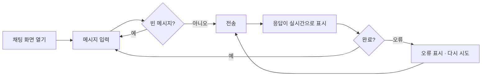

# AI Agent Chat — 기능 명세 (SPEC)

> **에이전트 읽기 규칙**: 이 파일은 세션마다 전체를 읽지 않습니다.  
> 작업할 기능 ID의 **§4.2 기능 상세** 블록과, 그 블록이 참조하는 화면·데이터·API 항목만 읽습니다.

| 항목 | 내용 |
|---|---|
| 문서 버전 | v1.5 |
| 상태 | 승인됨 (MVP 범위) |
| 작성자 | kimtaesung98 |
| 최종 수정일 | 2026-11-07 |

---

## 목차

1. [프로젝트 개요](#1-프로젝트-개요)
2. [범위](#2-범위)
3. [사용자와 페르소나](#3-사용자와-페르소나)
4. [기능 요구사항](#4-기능-요구사항)
5. [비기능 요구사항](#5-비기능-요구사항)
6. [화면 및 사용자 흐름](#6-화면-및-사용자-흐름)
7. [데이터 모델](#7-데이터-모델)
8. [설계 결정 (ADR)](#8-설계-결정-adr)
9. [API 명세](#9-api-명세)
10. [외부 연동](#10-외부-연동)
11. [보안 및 개인정보](#11-보안-및-개인정보)
12. [테스트 전략](#12-테스트-전략)
13. [배포 및 운영](#13-배포-및-운영)
14. [마일스톤](#14-마일스톤)
15. [리스크](#15-리스크)
16. [미결 사항](#16-미결-사항)
17. [용어집](#17-용어집)
18. [변경 이력](#18-변경-이력)

---

## 1. 프로젝트 개요

### 1.1 한 줄 요약
브라우저에서 AI 에이전트(Claude)와 **실시간 스트리밍으로 대화**할 수 있는 웹 서비스.

### 1.2 배경과 문제
- 현재 상황: AI API를 써 보려면 코드나 API 콘솔을 직접 다뤄야 한다.
- 문제점: 응답이 다 만들어질 때까지 기다리면 체감 속도가 느리고, 비개발자는 접근하기 어렵다.
- 해결하지 않으면 생기는 일: 팀 내부에서 AI 에이전트를 업무에 활용하기 어렵다.

### 1.3 목표
| 목표 | 성공 지표 | 목표값 |
|---|---|---|
| 응답이 즉시 보이기 시작 | 전송 → 첫 글자 표시까지 시간 (모의 모드 기준) | 1초 이내 |
| 설치 없이 사용 | 브라우저 외 필요한 프로그램 | 0개 |
| 키 없이 시연 가능 | API 키 없이 전체 흐름 동작 | 모의 모드 제공 |

### 1.4 비목표 (Non-goals)
- 모바일 앱은 만들지 않는다 (반응형 웹으로 대응)
- 여러 AI 회사의 모델을 동시에 지원하지 않는다 (Claude + 모의 모드만)
- MVP에서는 회원가입·결제를 하지 않는다

---

## 2. 범위

### 2.1 MVP (최소 기능 제품)
- F-001 실시간 스트리밍 채팅
- F-002 대화 맥락 유지
- F-003 응답 중단
- F-004 오류 처리와 재시도

### 2.2 이후 단계
| 단계 | 포함 기능 ID |
|---|---|
| Phase 2 | F-005 에이전트 페르소나 설정, F-006 도구 사용(Tool use), F-007 대화 기록 저장 |
| Phase 3 | F-008 사용자 로그인 |

### 2.3 전제 조건과 제약
- 전제: 사용자는 최신 브라우저(Chrome, Safari, Edge, Firefox 최신 2개 버전)를 쓴다.
- 제약: 현재 MVP는 외부 패키지 없이 Node.js 22 기본 기능만 사용한다. 목표 스택은 Go 서버 + Flutter 클라이언트 (ARCHITECTURE.md §2, ADR-001·005·006).

---

## 3. 사용자와 페르소나

### 3.1 사용자 유형
| 유형 | 설명 | 주요 권한 |
|---|---|---|
| 방문자 | 웹 페이지에서 에이전트와 대화하는 사람 | 대화 |
| 운영자 | 서버를 실행하고 API 키·모델을 설정하는 사람 | 환경변수 설정 |

### 3.2 페르소나
**김지은 / 32세 / 기획자**
- 목표: 기획서 초안 아이디어를 AI와 빠르게 주고받고 싶다.
- 불편한 점: 긴 답변을 기다리는 동안 화면이 멈춘 것처럼 보인다.
- 사용 환경: 회사 노트북 브라우저, 하루 여러 번

---

## 4. 기능 요구사항

### 4.1 기능 목록

| ID | 기능명 | 설명 | 우선순위 | 단계 |
|---|---|---|---|---|
| F-001 | 실시간 스트리밍 채팅 | 메시지를 보내면 응답이 생성되는 대로 화면에 표시 | P0 | MVP |
| F-002 | 대화 맥락 유지 | 이전 대화를 기억하고, 길어지면 오래된 턴을 정리, 새 대화 시작 | P0 | MVP |
| F-003 | 응답 중단 | 생성 중인 응답을 사용자가 멈출 수 있음 | P1 | MVP |
| F-004 | 오류 처리와 재시도 | AI API 오류를 사용자에게 알리고 다시 시도 | P1 | MVP |
| F-005 | 에이전트 페르소나 설정 | 운영자가 시스템 프롬프트로 에이전트 성격·역할 지정 | P2 | Phase 2 |
| F-006 | 도구 사용 (Tool use) | 에이전트가 정의된 도구(예: 시간 조회)를 호출 | P2 | Phase 2 |
| F-007 | 대화 기록 저장 | 새로고침해도 대화가 남음 | P2 | Phase 2 |
| F-008 | 사용자 로그인 | 사용자별 대화 분리 | P2 | Phase 3 |
| F-009 | 서버 계약 테스트 | HTTP 수준 계약 테스트로 Node·Go 서버가 같은 API를 지키는지 검증 (ARCHITECTURE §10 단계 1) | P0 | 전환 |
| F-010 | Go 서버 | Node 서버와 같은 API를 Go로 구현 (ARCHITECTURE §10 단계 2) | P0 | 전환 |
| F-011 | Flutter 웹 클라이언트 | S-001 채팅 화면을 Flutter 웹으로 구현, Go 서버가 제공 (ARCHITECTURE §10 단계 3) | P0 | 전환 |
| F-012 | 음성 대화 | 말로 묻고 음성으로 답을 듣는다. 말이 끝나면 자동 전송, 답은 문장 단위로 바로 읽기, 끼어들기 | P0 | 전환 뒤 (Q-004) |

### 4.2 기능 상세

#### F-001. 실시간 스트리밍 채팅
- **사용자 스토리**: 방문자로서, 나는 메시지를 보내면 답이 만들어지는 대로 바로 읽고 싶다. 왜냐하면 긴 답변을 멍하니 기다리고 싶지 않기 때문이다.
- **상세 동작**:
  1. 사용자가 입력창에 메시지를 쓰고 전송 버튼 또는 Enter를 누른다 (Shift+Enter는 줄바꿈).
  2. 사용자 메시지가 대화 영역에 즉시 표시되고, 입력창과 전송 버튼이 비활성화된다.
  3. 브라우저가 `POST /api/chat`으로 대화 내역을 보낸다.
  4. 서버는 AI 제공자(Claude 또는 모의 모드)의 응답을 SSE `delta` 이벤트로 조각조각 전달한다.
  5. 화면은 받은 조각을 순서대로 이어 붙여 에이전트 말풍선에 표시한다.
  6. `done` 이벤트를 받으면 입력창이 다시 활성화된다.
- **수용 기준 (Acceptance Criteria)**:
  - [ ] AC1. Given 서버가 실행 중, When 메시지를 전송, Then 응답 완료(`done`) 전에 `delta` 이벤트가 2개 이상 도착하고 화면에 순서대로 이어 붙여진다
  - [ ] AC2. Given 응답 스트리밍 완료, When `done` 이벤트 수신, Then 입력창과 전송 버튼이 다시 활성화된다
  - [ ] AC3. Given 빈 메시지 또는 공백만 있는 메시지, When 전송, Then 브라우저는 요청을 보내지 않고, 서버에 직접 보내도 400을 반환한다
  - [ ] AC4. Given `ANTHROPIC_API_KEY` 미설정, When 서버 시작, Then 모의 모드로 동작하며 시작 로그와 화면 상단에 현재 모드가 표시된다
  - [ ] AC5. Given 4,000자를 넘는 메시지, When 서버에 전송, Then 400을 반환한다
- **예외 처리**:
  - 잘못된 JSON, 형식이 틀린 messages → 400 + 오류 JSON
  - 스트리밍 중 AI 오류 → `error` 이벤트 (상세 처리는 F-004)
- **관련 항목**: 화면 S-001 · 데이터 `ChatMessage` · API API-001, API-002
- **Owner Folder**: `/src/server`, `/src/agent`, `/public`

#### F-002. 대화 맥락 유지
- **사용자 스토리**: 방문자로서, 나는 앞에서 한 말을 에이전트가 기억하길 원한다. 왜냐하면 매번 처음부터 설명하고 싶지 않기 때문이다.
- **수용 기준**:
  - [ ] AC1. Given 이전 대화가 있음, When 새 메시지 전송, Then 이전 user/assistant 메시지가 순서대로 AI 제공자에 전달된다
  - [ ] AC2. Given 대화가 최근 20턴을 초과, When 전송, Then 서버는 가장 오래된 턴부터 잘라 최근 20턴만 전달한다
  - [ ] AC3. Given "새 대화" 버튼 클릭, Then 대화 영역과 내역이 비워진다
- **Owner Folder**: `/src/server`, `/public`

#### F-003. 응답 중단
- **사용자 스토리**: 방문자로서, 나는 원하지 않는 방향의 답변을 중간에 멈추고 싶다.
- **수용 기준**:
  - [ ] AC1. Given 응답 스트리밍 중, When "중단" 클릭, Then 화면 갱신이 즉시 멈추고 입력창이 활성화된다
  - [ ] AC2. Given 클라이언트 연결 종료, Then 서버는 AI 제공자 요청을 취소한다
  - [ ] AC3. Given 중단된 응답, Then 그때까지 받은 내용은 대화에 남고 "중단됨" 표시가 붙는다
- **Owner Folder**: `/app` (화면 — Q-004 결정에 따라 Flutter에서 구현), `/server` · `/src/server` (취소 전달은 구현됨)

#### F-004. 오류 처리와 재시도
- **사용자 스토리**: 방문자로서, 나는 오류가 나면 무엇이 잘못됐는지 알고 다시 시도하고 싶다.
- **수용 기준**:
  - [ ] AC1. Given AI API가 오류 응답(인증 실패, 과부하 등), When 스트리밍 중, Then `error` 이벤트로 사용자용 메시지가 전달되고 서버는 계속 동작한다
  - [ ] AC2. Given 오류 메시지 표시, When "다시 시도" 클릭, Then 마지막 사용자 메시지로 다시 요청한다
  - [ ] AC3. Given 오류, Then API 키 등 비밀값이 화면·응답에 노출되지 않는다
- **Owner Folder**: `/src/server`, `/src/agent`, `/public`

#### F-009. 서버 계약 테스트
- **사용자 스토리**: 개발자로서, 나는 서버를 Go로 바꿔도 화면이 보는 API가 그대로인지 같은 테스트로 확인하고 싶다. 왜냐하면 전환 중에 동작이 몰래 바뀌면 안 되기 때문이다.
- **상세 동작**:
  1. `server/contract`의 Go 테스트가 `-base-url`로 받은 서버에 실제 HTTP 요청을 보낸다.
  2. 서버는 모의 모드로 떠 있어야 한다. 테스트는 `/api/config`로 모의 모드인지 먼저 확인하고, 아니면 실패한다 (실제 Claude 호출 방지).
  3. `npm run test:contract`가 Node 서버를 모의 모드로 띄워 계약 테스트를 실행하고 서버를 내린다.
- **수용 기준**:
  - [ ] AC1. Given `server/contract`, Then API-001·API-002 계약(SSE 이벤트 이름·`data` 형식·순서, 오류 JSON 형식, 상태 코드 400·404·405)과 F-001 AC1·AC3·AC4·AC5, F-002 AC1·AC2를 HTTP 시나리오로 검사하는 테스트가 있고, 테스트 이름에 해당 기능 ID와 AC 번호가 들어 있다
  - [ ] AC2. Given Node 서버, When `npm run test:contract` 실행, Then 계약 테스트가 모두 통과한다
  - [ ] AC3. Given 모의 모드가 아닌 서버, When 계약 테스트 실행, Then `/api/config` 확인 뒤 채팅 요청을 보내기 전에 실패한다
  - [ ] AC4. Given GitHub에 push 또는 PR, Then CI가 `npm test`와 계약 테스트를 실행한다
  - [ ] AC5. Given 네트워크 없음, Then 계약 테스트는 외부 네트워크 없이 통과한다 (Go 표준 라이브러리만 사용)
- **참고**: F-002 AC1·AC2는 모의 제공자가 답에 "이 대화의 N번째 질문"을 넣는 동작으로 확인한다. 이 문구는 모의 제공자 계약으로 보고 Go 모의 제공자도 똑같이 만든다.
- **관련 항목**: API API-001, API-002 · ARCHITECTURE.md §4.1, ADR-012
- **Owner Folder**: `/server`

#### F-010. Go 서버
- **사용자 스토리**: 운영자로서, 나는 지금 화면을 그대로 쓰면서 서버를 Go 단일 바이너리로 바꾸고 싶다. 왜냐하면 Flutter 클라이언트와 앞으로의 기능(음성 대화)을 Go 서버 위에 쌓기 위해서다.
- **상세 동작**:
  1. `server/cmd/chatd`가 환경변수(`PORT`, `ANTHROPIC_API_KEY`, `ANTHROPIC_MODEL`, `STATIC_DIR`)를 읽고, 키가 없으면 모의 제공자, 있으면 Claude 제공자로 서버를 띄운다.
  2. API-001·API-002, 입력 검증, 최근 20턴 정리, SSE 전송, 정적 파일 제공을 Node 서버와 같은 동작으로 처리한다.
  3. 클라이언트가 연결을 끊으면 요청 `context`가 취소되고 Claude 요청도 멈춘다.
- **수용 기준**:
  - [ ] AC1. Given Go 서버를 모의 모드로 실행, When 계약 테스트(F-009) 실행, Then 모두 통과한다 (`npm run test:contract:go`)
  - [ ] AC2. Given `server/`, When `go test ./...` 실행, Then 네트워크 없이 통과한다. Claude 제공자는 가짜 업스트림 서버로 테스트한다
  - [ ] AC3. Given `STATIC_DIR=../public`로 Go 서버 실행, When 브라우저로 접속, Then 기존 채팅 화면(S-001)이 Go 서버로 동작한다
  - [ ] AC4. Given 클라이언트가 스트리밍 중 연결을 끊음, Then 제공자에 취소가 전달되고 이후 이벤트를 쓰지 않는다
  - [ ] AC5. Given 업스트림 오류(인증 실패, 과부하 등), Then SSE `error` 이벤트로 Node와 같은 사용자용 문장이 전달되고, 업스트림 원문·API 키는 응답과 로그에 나오지 않는다
  - [ ] AC6. Given `CGO_ENABLED=0 go build ./cmd/chatd`, Then 빌드되고, ARCHITECTURE §3.3 의존 규칙을 검사하는 테스트가 통과한다
- **관련 항목**: API API-001, API-002 · ARCHITECTURE.md §3.2·§3.3·§4.2·§6.3·§7, ADR-005·007·008·013
- **Owner Folder**: `/server`

#### F-011. Flutter 웹 클라이언트
- **사용자 스토리**: 방문자로서, 나는 지금과 같은 채팅 화면을 Flutter 앱으로 쓰고 싶다. 왜냐하면 같은 코드로 웹과 (나중에) 모바일, 그리고 음성 대화를 붙이기 위해서다.
- **상세 동작**:
  1. `app/`의 Flutter 웹 앱이 S-001 화면(헤더 · 모드 배지 · 새 대화 · 대화 영역 · 입력창 · 전송)을 그린다.
  2. `POST /api/chat`을 같은 출처로 호출하고, 응답 조각을 받는 대로 말풍선에 이어 붙인다 (웹은 `fetch_client`, ADR-009).
  3. Go 서버가 `flutter build web` 결과를 정적 파일로 제공한다 (ADR-011, `STATIC_DIR`).
- **수용 기준**:
  - [ ] AC1. Given 위젯·단위 테스트, Then F-001 AC1·AC2·AC3·AC4와 F-002 AC1·AC3의 화면 쪽 동작, F-003 AC1·AC3을 검사하고 `flutter test`가 네트워크 없이 통과한다
  - [ ] AC2. Given Go 서버가 웹 빌드를 제공, When 브라우저에서 메시지 전송, Then 응답이 한 번에 몰려 오지 않고 조각조각 표시된다 (실시간 스트리밍)
  - [ ] AC3. Given `flutter analyze`, Then 경고 없이 통과하고, ARCHITECTURE §3.3 Flutter 의존 규칙(`chat`은 위젯 import 금지, `api`는 `chat`·`ui` import 금지)을 테스트가 검사한다
  - [ ] AC4. Given 응답 영역, Then 스트리밍 중인 말풍선이 `Semantics(liveRegion: true)`로 스크린 리더에 알려진다
  - [ ] AC5. Given CI, Then `flutter analyze`·`flutter test`·`flutter build web`이 실행된다
- **관련 항목**: 화면 S-001 · API API-001, API-002 · ARCHITECTURE.md §3.2·§3.3·§4.2, ADR-006·009·010·011
- **Owner Folder**: `/app`, `/server` (정적 파일 제공)

#### F-012. 음성 대화
> 상태: **제안 — 사용자 승인 대기** (ARCHITECTURE.md ADR-014·015와 함께 승인)

- **사용자 스토리**: 방문자로서, 나는 타이핑 없이 말로 묻고 음성으로 답을 듣고 싶다. 사람과 대화하듯 끊김 없이 주고받고, 답이 길면 중간에 끼어들고 싶다.
- **상세 동작**:
  1. 입력창 옆 마이크 버튼으로 **음성 모드**를 켜고 끈다. 상태는 `듣는 중` · `생각 중` · `말하는 중` 세 가지로 화면에 보인다.
  2. 듣는 동안 인식 중인 문장을 입력창 자리에 보여 준다. 사용자가 말을 멈추면(인식 엔진이 최종 결과를 주면) **버튼 없이 자동 전송**한다.
  3. 응답 조각을 받는 대로 **문장 단위로 잘라, 첫 문장이 완성되면 바로 읽기 시작**한다. 답이 다 올 때까지 기다리지 않는다. 화면 말풍선에는 F-001과 같이 글자가 흘러나온다.
  4. 다 읽으면 **자동으로 다시 듣는다** — 손을 대지 않아도 대화가 이어진다.
  5. **끼어들기**: 읽는 중 사용자가 말하기 시작하거나 마이크 버튼을 누르면 읽기를 멈추고 응답 생성도 중단(F-003)한 뒤 듣기로 바뀐다. 그때까지 받은 답은 "중단됨"으로 내역에 남는다.
  6. 음성 모드의 요청은 `mode: "voice"`로 보낸다. 서버는 **말하기용 답 지시**(마크다운 없이, 짧은 구어체 1~3문장, 더 원하면 이어서 말함)를 시스템 프롬프트로 붙인다 (API-001, ADR-015). 읽을 때는 마크다운 기호·코드 블록·URL을 빼고 읽는다.
  7. 브라우저가 음성 인식을 지원하지 않거나 마이크 권한이 거부되면 마이크 버튼에 이유를 안내하고, 텍스트 채팅은 그대로 동작한다.
- **수용 기준**:
  - [ ] AC1. Given 음성 모드, When 사용자가 말하고 멈춤, Then 버튼을 누르지 않아도 인식된 문장이 전송된다 (가짜 음성 엔진 단위 테스트)
  - [ ] AC2. Given 응답 스트리밍 중, When 첫 문장이 완성됨, Then `done` 전에 그 문장을 읽기 시작한다 (가짜 엔진 테스트: 첫 읽기 호출이 `done`보다 앞섬)
  - [ ] AC3. Given 문장 분리기, Then `. ? ! … 。`·줄바꿈 기준으로 자르되 소수점·약어에서는 자르지 않고, 마크다운 기호·코드 블록·URL은 읽을 문장에서 뺀다 (단위 테스트)
  - [ ] AC4. Given 답을 다 읽음, Then 자동으로 다시 듣기 시작한다. Given 음성 모드를 끔, Then 듣기·읽기·진행 중인 요청이 모두 멈춘다
  - [ ] AC5. Given 읽는 중, When 사용자가 말하기 시작하거나 마이크 버튼을 누름, Then 읽기를 멈추고 요청을 중단하고 듣기로 바뀌며, 받은 부분까지 "중단됨"으로 남는다 (가짜 엔진 테스트)
  - [ ] AC6. Given `mode: "voice"` 요청, Then 서버가 말하기용 시스템 프롬프트를 붙여 Claude에 보낸다 (가짜 업스트림 테스트로 `system` 확인). `mode`가 없거나 `"text"`면 지금과 같고, 그 밖의 값은 400 (계약 테스트 — Node·Go 모두)
  - [ ] AC7. Given 음성 인식 미지원 브라우저 또는 마이크 거부, Then 안내가 보이고 텍스트 채팅은 그대로 동작한다 (위젯 테스트)
  - [ ] AC8. 수동 확인: Chrome·Edge에서 실제 마이크로 한국어 3턴 이상을 손대지 않고 이어 가고, 읽는 중 말로 끼어들 수 있다
- **관련 항목**: 화면 S-001 · API API-001 · ARCHITECTURE.md §3.2·§3.3, ADR-014·015, R-A09·R-A10
- **Owner Folder**: `/app` (음성), `/server` · `/src/server` (`mode` 처리 — Node는 §10 단계 4까지 같이 유지)

<!-- F-005 ~ F-008은 Phase 2 이후 착수 시 상세를 작성한다 -->

---

## 5. 비기능 요구사항

| 분류 | 요구사항 | 기준 |
|---|---|---|
| 성능 | 첫 글자 표시 | 모의 모드 1초 이내 |
| 확장성 | 동시 대화 | 시연 수준 (10명 내외) |
| 접근성 | 키보드만으로 사용 가능, 스트리밍 영역 `aria-live` | WCAG 2.1 AA 지향 |
| 호환성 | 지원 브라우저 | 최신 2개 버전 |
| 국제화 | 지원 언어 | 한국어 UI |
| 유지보수 | 외부 의존성 | ARCHITECTURE.md §2.2 허용 목록 안에서만 (현재 MVP는 0개) |

---

## 6. 화면 및 사용자 흐름

### 6.1 화면 목록
| ID | 화면명 | 설명 | 접근 권한 | 관련 기능 ID | 디자인 링크 |
|---|---|---|---|---|---|
| S-001 | 채팅 화면 | 상단 모드 표시, 대화 영역, 하단 입력창, 마이크 버튼 | 방문자 | F-001 ~ F-004, F-012 | 해당 없음 |

### 6.2 핵심 사용자 흐름


### 6.3 화면 상세
#### S-001. 채팅 화면
- 목적: 에이전트와 대화
- 주요 구성 요소: 헤더(서비스명 · 모드 배지), 대화 영역(사용자/에이전트 말풍선), 입력창, 전송 버튼
- 상태별 화면: 빈 상태(안내 문구) / 응답 중(입력 비활성, 커서 표시) / 오류(빨간 안내) / 정상
- 음성 모드 (F-012): 마이크 버튼 + 상태 표시(듣는 중 · 생각 중 · 말하는 중), 인식 중인 문장 미리 보기, 미지원·권한 거부 안내

---

## 7. 데이터 모델

### 7.1 ERD
해당 없음 — MVP는 DB를 쓰지 않는다. 대화 내역은 브라우저 메모리에만 있다 (F-007에서 저장 도입).

### 7.2 엔티티 상세
#### ChatMessage
| 필드 | 타입 | 필수 | 설명 | 제약 |
|---|---|---|---|---|
| role | string | Y | 말한 주체 | `user` 또는 `assistant` |
| content | string | Y | 메시지 본문 | 1~4,000자, 공백만은 불가 |

### 7.3 데이터 보존 정책
- 서버는 대화 내용을 저장하지 않는다. 로그에도 메시지 본문을 남기지 않는다.

---

## 8. 설계 결정 (ADR)

설계 결정(ADR)과 기술 스택은 [`ARCHITECTURE.md`](./ARCHITECTURE.md) §9 · §2에서 관리합니다. (v1.1에서 ADR-001~004를 이동)

---

## 9. API 명세

### 9.1 공통 규칙
- Base URL: `http://localhost:3000`
- 인증 방식: 없음 (MVP, 내부 시연용)
- 오류 형식:
```json
{
  "error": {
    "code": "INVALID_INPUT",
    "message": "메시지를 입력해 주세요."
  }
}
```

### 9.2 엔드포인트 목록
| ID | 메서드 | 경로 | 설명 | 인증 | 관련 기능 ID |
|---|---|---|---|---|---|
| API-001 | POST | `/api/chat` | 대화를 보내고 응답을 SSE로 스트리밍 | 없음 | F-001, F-002, F-012 |
| API-002 | GET | `/api/config` | 현재 모드(mock/anthropic)와 모델 이름 | 없음 | F-001 |

### 9.3 엔드포인트 상세
#### API-001. 채팅 스트리밍
- **요청**
```json
{
  "messages": [
    { "role": "user", "content": "안녕하세요" }
  ],
  "mode": "voice"
}
```
- `mode` (선택, F-012 — 제안): `"text"`(기본, 생략과 같음) 또는 `"voice"`. `"voice"`면 서버가 말하기용 답 지시를 시스템 프롬프트로 붙인다. 그 밖의 값은 400 `INVALID_INPUT`
- **응답 (200, `Content-Type: text/event-stream`)**
```
event: delta
data: {"text":"안녕"}

event: delta
data: {"text":"하세요!"}

event: done
data: {"stopReason":"end_turn"}
```
- **스트림 중 오류**
```
event: error
data: {"message":"AI 서비스에 일시적인 문제가 있어요. 잠시 후 다시 시도해 주세요."}
```
- **오류 코드**: 400 (형식 오류, 빈 메시지, 4,000자 초과), 404, 405

#### API-002. 설정 조회
- **응답 (200)**
```json
{ "provider": "mock", "model": "mock-echo" }
```

---

## 10. 외부 연동

| 서비스 | 용도 | 연동 방식 | 비용 | 장애 시 대응 |
|---|---|---|---|---|
| Claude API (Anthropic) | 에이전트 응답 생성 | REST `POST /v1/messages`, `stream: true` | 토큰 사용량 기준 과금 | `error` 이벤트로 사용자 안내 (F-004), 모의 모드로 시연 지속 가능 |
| 브라우저 음성 엔진 (Web Speech API, F-012 — 제안) | 음성 인식(STT) · 음성 합성(TTS) | 브라우저 내장 `SpeechRecognition` · `speechSynthesis` (ADR-014) | 무료 | 미지원·권한 거부 시 텍스트 채팅으로 계속 (F-012 AC7) |

---

## 11. 보안 및 개인정보

- **인증/인가**: MVP 없음 — 내부 네트워크 시연용. 공개 배포 전 F-008 필요
- **수집하는 개인정보와 목적**: 수집·저장하지 않음
- **음성 (F-012)**: 앱과 서버는 음성을 녹음·전송·저장하지 않는다. 단, 브라우저 음성 인식은 브라우저 회사 서버에서 처리될 수 있다 (예: Chrome은 Google 서버). 공개 배포 전 안내 문구 필요 (ARCHITECTURE R-A10)
- **암호화**: 운영 배포 시 HTTPS 리버스 프록시 뒤에서 실행
- **비밀값 관리**: `ANTHROPIC_API_KEY`는 환경변수로만. 코드·저장소·로그·클라이언트 응답에 절대 포함 금지
- **관련 법규**: 개인정보 보호법 (대화 저장 도입 시 재검토)
- **감사 로그**: 요청 시각·상태 코드만 기록, 메시지 본문 기록 금지

---

## 12. 테스트 전략

| 종류 | 범위 | 도구 | 기준 |
|---|---|---|---|
| 단위 테스트 | 입력 검증, SSE 파서, 모의 제공자 | `node:test` | 모든 분기 |
| 통합 테스트 | 실제 서버를 띄워 `/api/chat` 스트리밍 검증 | `node:test` + `fetch` | 각 기능의 수용 기준 |
| 계약 테스트 (목표) | 같은 HTTP 시나리오를 Node·Go 서버 모두에 실행 | Go `testing` (ARCHITECTURE.md ADR-012) | API-001·API-002 계약 |
| 수동 확인 | 브라우저 화면 동작 | 브라우저 | 화면 관련 수용 기준 |

---

## 13. 배포 및 운영

- **환경**: 로컬 (MVP)
- **실행**: `npm start` (환경변수 `PORT`, `ANTHROPIC_API_KEY`, `ANTHROPIC_MODEL`)
- **브랜치 전략**: GitHub Flow (기능별 브랜치 → PR → main)
- **롤백 절차**: 이전 커밋으로 되돌려 재실행
- **모니터링/알림**: 해당 없음 (MVP)
- **백업**: 해당 없음 (저장 데이터 없음)

---

## 14. 마일스톤

| 마일스톤 | 포함 기능 ID | 목표일 |
|---|---|---|
| M1 MVP | F-001 ~ F-004 | 2026-11-16 |
| M2 에이전트 기능 | F-005 ~ F-007 | 2026-12-14 |

---

## 15. 리스크

| ID | 리스크 | 가능성 | 영향도 | 대응 방안 |
|---|---|---|---|---|
| R-001 | API 사용량 증가로 비용 초과 | 중간 | 중간 | 메시지 길이·턴 수 제한(F-001, F-002), 공개 배포 전 로그인(F-008) |
| R-002 | API 키 유출 | 낮음 | 높음 | 환경변수만 사용, 응답·로그 노출 금지 (§11) |
| R-003 | AI 서비스 장애 | 중간 | 중간 | 오류 안내·재시도(F-004), 모의 모드 |

---

## 16. 미결 사항

| ID | 질문 | 관련 기능 ID | 담당자 | 결정 (날짜) |
|---|---|---|---|---|
| Q-001 | 공개 배포 여부와 시점 | F-008 | kimtaesung98 | |
| Q-002 | 기본 페르소나(시스템 프롬프트) 문구 | F-005 | kimtaesung98 | |
| Q-003 | 호스팅 환경 (클라우드 컨테이너 / 사내 서버 등) | ARCHITECTURE §6 | kimtaesung98 | |
| Q-004 | 남은 MVP 기능 F-003·F-004를 현재 Node MVP에서 먼저 만들지, Go + Flutter 전환(ARCHITECTURE §10) 뒤에 만들지 | F-003, F-004 | kimtaesung98 | 전환 뒤에 만든다. F-003은 §10 단계 3(Flutter 웹)에서 구현. 음성 대화도 Flutter 전환 뒤에 만든다 (2026-11-04) |

---

## 17. 용어집

| 용어 | 정의 |
|---|---|
| 스트리밍 | 응답을 한 번에 보내지 않고 만들어지는 대로 조각 단위로 보내는 방식 |
| SSE | Server-Sent Events. 서버가 `event:`/`data:` 줄 형식으로 이벤트를 연속으로 보내는 텍스트 프로토콜 |
| 모의 모드 | 실제 AI 대신 정해진 문장을 조각내 흘려보내는 개발·시연용 제공자 |
| 턴 | 사용자 메시지 1개와 그에 대한 에이전트 응답 1개 |

---

## 18. 변경 이력

| 버전 | 날짜 | 작성자 | 변경 내용 |
|---|---|---|---|
| v1.0 | 2026-11-02 | kimtaesung98 | 최초 작성, MVP 범위 확정 |
| v1.1 | 2026-11-04 | kimtaesung98 | ADR을 ARCHITECTURE.md로 이동, 목표 스택(Go + Flutter) 반영, 계약 테스트 추가, Q-003·Q-004 추가 |
| v1.2 | 2026-11-04 | kimtaesung98 | F-009 서버 계약 테스트(전환 단계 1) 등록, Q-004 결정 기록 |
| v1.3 | 2026-11-05 | kimtaesung98 | F-010 Go 서버(전환 단계 2) 등록 |
| v1.4 | 2026-11-05 | kimtaesung98 | F-011 Flutter 웹 클라이언트(전환 단계 3) 등록, F-003 담당 폴더를 `/app`으로 |
| v1.5 | 2026-11-07 | kimtaesung98 | F-012 음성 대화 **제안**, API-001 `mode` 필드 제안, 브라우저 음성 엔진 연동·개인정보 항목 추가 |
