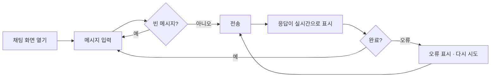
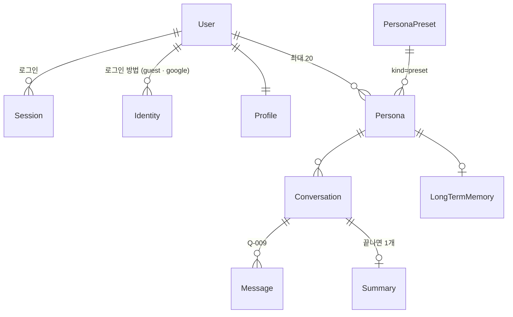

# AI Agent Chat — 기능 명세 (SPEC)

> **에이전트 읽기 규칙**: 이 파일은 세션마다 전체를 읽지 않습니다.  
> 작업할 기능 ID의 **§4.2 기능 상세** 블록과, 그 블록이 참조하는 화면·데이터·API 항목만 읽습니다.

| 항목 | 내용 |
|---|---|
| 문서 버전 | v1.25 |
| 상태 | 승인됨 (MVP 범위) |
| 작성자 | kimtaesung98 |
| 최종 수정일 | 2026-11-13 |

---

## 목차

1. [프로젝트 개요](#1-프로젝트-개요)
2. [범위](#2-범위)
3. [사용자와 페르소나](#3-사용자와-페르소나)
4. [기능 요구사항](#4-기능-요구사항)
5. [비기능 요구사항](#5-비기능-요구사항)
6. [화면 및 사용자 흐름](#6-화면-및-사용자-흐름)
7. [데이터 모델](#7-데이터-모델)
8. [설계 결정 (ADR)](#8-설계-결정-adr)
9. [API 명세](#9-api-명세)
10. [외부 연동](#10-외부-연동)
11. [보안 및 개인정보](#11-보안-및-개인정보)
12. [테스트 전략](#12-테스트-전략)
13. [배포 및 운영](#13-배포-및-운영)
14. [마일스톤](#14-마일스톤)
15. [리스크](#15-리스크)
16. [미결 사항](#16-미결-사항)
17. [용어집](#17-용어집)
18. [변경 이력](#18-변경-이력)

---

## 1. 프로젝트 개요

### 1.1 한 줄 요약
브라우저에서 AI 에이전트(Claude)와 **실시간 스트리밍으로 대화**할 수 있는 웹 서비스.

### 1.2 배경과 문제
- 현재 상황: AI API를 써 보려면 코드나 API 콘솔을 직접 다뤄야 한다.
- 문제점: 응답이 다 만들어질 때까지 기다리면 체감 속도가 느리고, 비개발자는 접근하기 어렵다.
- 해결하지 않으면 생기는 일: 팀 내부에서 AI 에이전트를 업무에 활용하기 어렵다.

### 1.3 목표
| 목표 | 성공 지표 | 목표값 |
|---|---|---|
| 응답이 즉시 보이기 시작 | 전송 → 첫 글자 표시까지 시간 (모의 모드 기준) | 1초 이내 |
| 설치 없이 사용 | 브라우저 외 필요한 프로그램 | 0개 |
| 키 없이 시연 가능 | API 키 없이 전체 흐름 동작 | 모의 모드 제공 |

### 1.4 비목표 (Non-goals)
- ~~모바일 앱은 만들지 않는다 (반응형 웹으로 대응)~~ → 사용자 결정으로 바뀜 (2026-11-11): 같은 Flutter 코드로 Android·iOS 앱을 만든다 (F-017). 앱스토어 출시는 아직 비목표
- 여러 AI 회사의 모델을 동시에 지원하지 않는다 (Claude + 모의 모드만)
- MVP에서는 회원가입·결제를 하지 않는다

---

## 2. 범위

### 2.1 MVP (최소 기능 제품)
- F-001 실시간 스트리밍 채팅
- F-002 대화 맥락 유지
- F-003 응답 중단
- F-004 오류 처리와 재시도

### 2.2 이후 단계
| 단계 | 포함 기능 ID |
|---|---|
| Phase 2 | F-006 도구 사용(Tool use), F-007 대화 기록 저장 |
| Phase 3 | F-008 사용자 로그인 |

### 2.3 전제 조건과 제약
- 전제: 사용자는 최신 브라우저(Chrome, Safari, Edge, Firefox 최신 2개 버전)를 쓴다.
- 제약: 서버는 Go(`server/`), 클라이언트는 Flutter(`app/`)다 (ARCHITECTURE.md §2, ADR-005·006). 처음 Node.js MVP는 F-013(전환 단계 4)에서 제거했다.

---

## 3. 사용자와 페르소나

### 3.1 사용자 유형
| 유형 | 설명 | 주요 권한 |
|---|---|---|
| 방문자 | 웹 페이지에서 에이전트와 대화하는 사람 | 대화 |
| 운영자 | 서버를 실행하고 API 키·모델을 설정하는 사람 | 환경변수 설정 |

### 3.2 페르소나
**김지은 / 32세 / 기획자**
- 목표: 기획서 초안 아이디어를 AI와 빠르게 주고받고 싶다.
- 불편한 점: 긴 답변을 기다리는 동안 화면이 멈춘 것처럼 보인다.
- 사용 환경: 회사 노트북 브라우저, 하루 여러 번

---

## 4. 기능 요구사항

### 4.1 기능 목록

| ID | 기능명 | 설명 | 우선순위 | 단계 |
|---|---|---|---|---|
| F-001 | 실시간 스트리밍 채팅 | 메시지를 보내면 응답이 생성되는 대로 화면에 표시 | P0 | MVP |
| F-002 | 대화 맥락 유지 | 이전 대화를 기억하고, 길어지면 오래된 턴을 정리, 새 대화 시작 | P0 | MVP |
| F-003 | 응답 중단 | 생성 중인 응답을 사용자가 멈출 수 있음 | P1 | MVP |
| F-004 | 오류 처리와 재시도 | AI API 오류를 사용자에게 알리고 다시 시도 | P1 | MVP |
| F-005 | 페르소나 설정 | 사용자가 화면에서 대화 상대 페르소나(역할·말투·지시)를 고르고 편집하고, 나에 대해 알려 주면 에이전트가 그 맥락으로 답함 | P1 | 전환 뒤 (2026-11-10 앞당김) |
| F-006 | 도구 사용 (Tool use) | 에이전트가 정의된 도구(예: 시간 조회)를 호출 | P2 | Phase 2 |
| F-007 | 대화 기록 저장 | 새로고침해도 대화가 남음 | P2 | Phase 2 |
| F-008 | 사용자 로그인 | 사용자별 대화 분리 | P2 | Phase 3 |
| F-009 | 서버 계약 테스트 | HTTP 수준 계약 테스트로 Node·Go 서버가 같은 API를 지키는지 검증 (ARCHITECTURE §10 단계 1) | P0 | 전환 |
| F-010 | Go 서버 | Node 서버와 같은 API를 Go로 구현 (ARCHITECTURE §10 단계 2) | P0 | 전환 |
| F-011 | Flutter 웹 클라이언트 | S-001 채팅 화면을 Flutter 웹으로 구현, Go 서버가 제공 (ARCHITECTURE §10 단계 3) | P0 | 전환 |
| F-013 | Node MVP 제거 | `src/`·`public/`·Node 테스트를 지우고 Go + Flutter만 남김 (ARCHITECTURE §10 단계 4) | P0 | 전환 |
| F-012 | 음성 대화 | 말로 묻고 음성으로 답을 듣는다. 말이 끝나면 자동 전송, 답은 문장 단위로 바로 읽기, 끼어들기 | P0 | 전환 뒤 (Q-004) |
| F-014 | 클라우드 배포 (AWS + Cloudflare) | 컨테이너 이미지로 AWS 서울 EC2에 올리고 Cloudflare Tunnel·Access로 HTTPS 주소에서 허용한 사람만 쓰게 함 (ADR-018·019) | P0 | 배포 |
| F-015 | Polly 음성 답 | 음성 답을 Amazon Polly 목소리로 읽음, 서버 `POST /api/tts` (ADR-020) | P1 | 배포 뒤 |
| F-016 | Transcribe 음성 인식 | 말을 Amazon Transcribe 스트리밍으로 인식, 서버 중계 WebSocket `/api/stt` (ADR-021) | P1 | 배포 뒤 |
| F-017 | 모바일 네이티브 앱 (Android·iOS) | 같은 Flutter 코드로 Android·iOS 앱 빌드, 텍스트·음성 대화 (ARCHITECTURE §10 단계 5, ADR-022). **대체됨 → F-025 (PWA)** | P0 | 모바일 |
| F-018 | 음성 전용 화면 | 버튼 없이 계속 이어지는 음성 대화 화면(어르신용): 큰 상태 원·큰 자막, 화면 누르기·말로 끊기, 대화 끝내기 (S-003) | P1 | 모바일 |
| F-021 | 켜면 바로 음성 대화 | 설정을 켜 두면 앱을 열자마자 지금 페르소나와 음성 대화 화면(S-003)으로 시작한다 (어르신용) | P1 | 모바일 |
| F-020 | 장기 기억 (기억 압축) | 최근 요약 5개 밖으로 밀린 오래된 요약을 페르소나마다 장기 기억 하나로 묶어 다음 대화에 함께 싣는다 | P1 | 모바일 |
| F-022 | 실시간 음성 대화 (ElevenLabs Agents) | 앱 음성 대화를 ElevenLabs Agents(WebRTC 실시간 음성)로 하고, 답은 ElevenLabs가 우리 서버를 Custom LLM으로 불러 Claude가 만든다. 안 되면 기기 음성(F-012)으로 (ADR-025). **대체됨 → F-024** | P0 | 모바일 |
| F-023 | 앱 화면 기반 · 로그인 화면 | 로그인(S-004, Google은 모의 · 이름만 적고 시작) → 첫 실행 대화 상대 고르기(S-005) → 채팅·음성, 설정(S-006)·지난 대화 기억(S-007)·글자 크기. 네이티브 앱의 화면 바탕 (`docs/SCREEN_PLAN.md`) | P1 | 모바일 |
| F-024 | 실시간 음성 대화 (OpenAI GPT Realtime) | 브라우저가 OpenAI Realtime과 WebRTC로 직접 대화한다(듣기·말 끝 판단·답·목소리를 모델 하나가). 서버는 페르소나·기억으로 지시문을 만들어 임시 키에 담아 준다 (ADR-026) | P0 | 전향 |
| F-025 | 웹앱(PWA) | 같은 Flutter 웹 빌드를 홈 화면에 설치하는 PWA로 낸다. 네이티브 Android·iOS 빌드와 기기 음성 엔진은 뺀다 (ADR-027) | P0 | 전향 |
| F-019 | 페르소나 지시 두 층 · 대화 요약 기억 | 추가 지시를 탑재 페르소나의 고정 **기본 지시**와 사용자의 **요구 사항**으로 나누고, 대화 세션이 끝나면 요약을 기기에 남겨 다음 대화의 맥락으로 쓴다 | P1 | 모바일 |
| F-026 | 사용자 계정 · 서버 데이터 저장소 | 사람마다 서버 계정(처음엔 이름만으로 만드는 게스트 계정)을 두고, 페르소나·프로필·설정·기억을 서버 DB에 그 사람 것으로만 저장한다. 기기에 있던 데이터는 처음 한 번 서버로 옮긴다 (ADR-028·029) | P0 | 서비스화 |
| F-027 | 페르소나 형식 v1 (앞뒤 공통 계약) | 페르소나를 버전 붙은 하나의 형식(탑재 프리셋 + 사용자 페르소나)으로 정하고, 앱·서버·DB가 같은 형식을 쓴다. 탑재 페르소나의 기본 지시는 서버 카탈로그가 가진다 (ADR-030) | P0 | 서비스화 |
| F-028 | 대화 · 요약 · 기억의 서버 처리 | 대화를 서버가 열고 닫는다. 끝나면 서버가 요약·장기 기억 묶기를 하고 저장한다. 채팅·음성 요청은 `conversationId`만 보내면 서버가 페르소나·기억을 붙인다 (ADR-031, Q-009) | P0 | 서비스화 |

### 4.2 기능 상세

#### F-001. 실시간 스트리밍 채팅
- **사용자 스토리**: 방문자로서, 나는 메시지를 보내면 답이 만들어지는 대로 바로 읽고 싶다. 왜냐하면 긴 답변을 멍하니 기다리고 싶지 않기 때문이다.
- **상세 동작**:
  1. 사용자가 입력창에 메시지를 쓰고 전송 버튼 또는 Enter를 누른다 (Shift+Enter는 줄바꿈).
  2. 사용자 메시지가 대화 영역에 즉시 표시되고, 입력창과 전송 버튼이 비활성화된다.
  3. 브라우저가 `POST /api/chat`으로 대화 내역을 보낸다.
  4. 서버는 AI 제공자(Claude 또는 모의 모드)의 응답을 SSE `delta` 이벤트로 조각조각 전달한다.
  5. 화면은 받은 조각을 순서대로 이어 붙여 에이전트 말풍선에 표시한다.
  6. `done` 이벤트를 받으면 입력창이 다시 활성화된다.
- **수용 기준 (Acceptance Criteria)**:
  - [ ] AC1. Given 서버가 실행 중, When 메시지를 전송, Then 응답 완료(`done`) 전에 `delta` 이벤트가 2개 이상 도착하고 화면에 순서대로 이어 붙여진다
  - [ ] AC2. Given 응답 스트리밍 완료, When `done` 이벤트 수신, Then 입력창과 전송 버튼이 다시 활성화된다
  - [ ] AC3. Given 빈 메시지 또는 공백만 있는 메시지, When 전송, Then 브라우저는 요청을 보내지 않고, 서버에 직접 보내도 400을 반환한다
  - [ ] AC4. Given `ANTHROPIC_API_KEY` 미설정, When 서버 시작, Then 모의 모드로 동작하며 시작 로그와 화면 상단에 현재 모드가 표시된다
  - [ ] AC5. Given 4,000자를 넘는 메시지, When 서버에 전송, Then 400을 반환한다
- **예외 처리**:
  - 잘못된 JSON, 형식이 틀린 messages → 400 + 오류 JSON
  - 스트리밍 중 AI 오류 → `error` 이벤트 (상세 처리는 F-004)
- **관련 항목**: 화면 S-001 · 데이터 `ChatMessage` · API API-001, API-002
- **Owner Folder**: `/server`, `/app` (처음 구현은 Node `/src`·`/public` — F-013에서 제거)

#### F-002. 대화 맥락 유지
- **사용자 스토리**: 방문자로서, 나는 앞에서 한 말을 에이전트가 기억하길 원한다. 왜냐하면 매번 처음부터 설명하고 싶지 않기 때문이다.
- **수용 기준**:
  - [ ] AC1. Given 이전 대화가 있음, When 새 메시지 전송, Then 이전 user/assistant 메시지가 순서대로 AI 제공자에 전달된다
  - [ ] AC2. Given 대화가 최근 20턴을 초과, When 전송, Then 서버는 가장 오래된 턴부터 잘라 최근 20턴만 전달한다
  - [ ] AC3. Given "새 대화" 버튼 클릭, Then 대화 영역과 내역이 비워진다
- **Owner Folder**: `/server`, `/app` (처음 구현은 Node `/src`·`/public` — F-013에서 제거)

#### F-003. 응답 중단
- **사용자 스토리**: 방문자로서, 나는 원하지 않는 방향의 답변을 중간에 멈추고 싶다.
- **수용 기준**:
  - [ ] AC1. Given 응답 스트리밍 중, When "중단" 클릭, Then 화면 갱신이 즉시 멈추고 입력창이 활성화된다
  - [ ] AC2. Given 클라이언트 연결 종료, Then 서버는 AI 제공자 요청을 취소한다
  - [ ] AC3. Given 중단된 응답, Then 그때까지 받은 내용은 대화에 남고 "중단됨" 표시가 붙는다
- **Owner Folder**: `/app` (화면 — Q-004 결정에 따라 Flutter에서 구현), `/server` (취소 전달)

#### F-004. 오류 처리와 재시도
- **사용자 스토리**: 방문자로서, 나는 오류가 나면 무엇이 잘못됐는지 알고 다시 시도하고 싶다.
- **수용 기준**:
  - [ ] AC1. Given AI API가 오류 응답(인증 실패, 과부하 등), When 스트리밍 중, Then `error` 이벤트로 사용자용 메시지가 전달되고 서버는 계속 동작한다
  - [ ] AC2. Given 오류 메시지 표시, When "다시 시도" 클릭, Then 마지막 사용자 메시지로 다시 요청한다
  - [ ] AC3. Given 오류, Then API 키 등 비밀값이 화면·응답에 노출되지 않는다
- **화면 (Flutter)**: 마지막 답이 오류일 때만 그 말풍선 아래에 "다시 시도" 버튼(높이 44px 이상)을 보인다. 누르면 실패한 질문과 오류 말풍선을 지우고 같은 질문을 글 모드로 다시 보낸다. 응답 중에는 버튼이 없다. 음성 대화 중에는 다시 말하면 된다
- **Owner Folder**: `/server` (오류 문장·비밀값 숨김), `/app` (오류 말풍선·다시 시도) — Q-004에 따라 Go + Flutter에서 구현

#### F-009. 서버 계약 테스트
> F-013 이후: Node 서버는 없다. 계약 테스트는 `server/`에서 `go test ./...`로 모의 모드 Go 서버에 실행한다. 아래 `npm` 명령은 완료 당시 기록이다

- **사용자 스토리**: 개발자로서, 나는 서버를 Go로 바꿔도 화면이 보는 API가 그대로인지 같은 테스트로 확인하고 싶다. 왜냐하면 전환 중에 동작이 몰래 바뀌면 안 되기 때문이다.
- **상세 동작**:
  1. `server/contract`의 Go 테스트가 `-base-url`로 받은 서버에 실제 HTTP 요청을 보낸다.
  2. 서버는 모의 모드로 떠 있어야 한다. 테스트는 `/api/config`로 모의 모드인지 먼저 확인하고, 아니면 실패한다 (실제 Claude 호출 방지).
  3. `npm run test:contract`가 Node 서버를 모의 모드로 띄워 계약 테스트를 실행하고 서버를 내린다.
- **수용 기준**:
  - [ ] AC1. Given `server/contract`, Then API-001·API-002 계약(SSE 이벤트 이름·`data` 형식·순서, 오류 JSON 형식, 상태 코드 400·404·405)과 F-001 AC1·AC3·AC4·AC5, F-002 AC1·AC2를 HTTP 시나리오로 검사하는 테스트가 있고, 테스트 이름에 해당 기능 ID와 AC 번호가 들어 있다
  - [ ] AC2. Given Node 서버, When `npm run test:contract` 실행, Then 계약 테스트가 모두 통과한다
  - [ ] AC3. Given 모의 모드가 아닌 서버, When 계약 테스트 실행, Then `/api/config` 확인 뒤 채팅 요청을 보내기 전에 실패한다
  - [ ] AC4. Given GitHub에 push 또는 PR, Then CI가 `npm test`와 계약 테스트를 실행한다
  - [ ] AC5. Given 네트워크 없음, Then 계약 테스트는 외부 네트워크 없이 통과한다 (Go 표준 라이브러리만 사용)
- **참고**: F-002 AC1·AC2는 모의 제공자가 답에 "이 대화의 N번째 질문"을 넣는 동작으로 확인한다. 이 문구는 모의 제공자 계약으로 보고 Go 모의 제공자도 똑같이 만든다.
- **관련 항목**: API API-001, API-002 · ARCHITECTURE.md §4.1, ADR-012
- **Owner Folder**: `/server`

#### F-010. Go 서버
- **사용자 스토리**: 운영자로서, 나는 지금 화면을 그대로 쓰면서 서버를 Go 단일 바이너리로 바꾸고 싶다. 왜냐하면 Flutter 클라이언트와 앞으로의 기능(음성 대화)을 Go 서버 위에 쌓기 위해서다.
- **상세 동작**:
  1. `server/cmd/chatd`가 환경변수(`PORT`, `ANTHROPIC_API_KEY`, `ANTHROPIC_MODEL`, `STATIC_DIR`)를 읽고, 키가 없으면 모의 제공자, 있으면 Claude 제공자로 서버를 띄운다.
  2. API-001·API-002, 입력 검증, 최근 20턴 정리, SSE 전송, 정적 파일 제공을 Node 서버와 같은 동작으로 처리한다.
  3. 클라이언트가 연결을 끊으면 요청 `context`가 취소되고 Claude 요청도 멈춘다.
- **수용 기준**:
  - [ ] AC1. Given Go 서버를 모의 모드로 실행, When 계약 테스트(F-009) 실행, Then 모두 통과한다 (`npm run test:contract:go`)
  - [ ] AC2. Given `server/`, When `go test ./...` 실행, Then 네트워크 없이 통과한다. Claude 제공자는 가짜 업스트림 서버로 테스트한다
  - [ ] AC3. Given `STATIC_DIR=../public`로 Go 서버 실행, When 브라우저로 접속, Then 기존 채팅 화면(S-001)이 Go 서버로 동작한다
  - [ ] AC4. Given 클라이언트가 스트리밍 중 연결을 끊음, Then 제공자에 취소가 전달되고 이후 이벤트를 쓰지 않는다
  - [ ] AC5. Given 업스트림 오류(인증 실패, 과부하 등), Then SSE `error` 이벤트로 Node와 같은 사용자용 문장이 전달되고, 업스트림 원문·API 키는 응답과 로그에 나오지 않는다
  - [ ] AC6. Given `CGO_ENABLED=0 go build ./cmd/chatd`, Then 빌드되고, ARCHITECTURE §3.3 의존 규칙을 검사하는 테스트가 통과한다
- **관련 항목**: API API-001, API-002 · ARCHITECTURE.md §3.2·§3.3·§4.2·§6.3·§7, ADR-005·007·008·013
- **Owner Folder**: `/server`

#### F-011. Flutter 웹 클라이언트
- **사용자 스토리**: 방문자로서, 나는 지금과 같은 채팅 화면을 Flutter 앱으로 쓰고 싶다. 왜냐하면 같은 코드로 웹과 (나중에) 모바일, 그리고 음성 대화를 붙이기 위해서다.
- **상세 동작**:
  1. `app/`의 Flutter 웹 앱이 S-001 화면(헤더 · 모드 배지 · 새 대화 · 대화 영역 · 입력창 · 전송)을 그린다.
  2. `POST /api/chat`을 같은 출처로 호출하고, 응답 조각을 받는 대로 말풍선에 이어 붙인다 (웹은 `fetch_client`, ADR-009).
  3. Go 서버가 `flutter build web` 결과를 정적 파일로 제공한다 (ADR-011, `STATIC_DIR`).
- **수용 기준**:
  - [ ] AC1. Given 위젯·단위 테스트, Then F-001 AC1·AC2·AC3·AC4와 F-002 AC1·AC3의 화면 쪽 동작, F-003 AC1·AC3을 검사하고 `flutter test`가 네트워크 없이 통과한다
  - [ ] AC2. Given Go 서버가 웹 빌드를 제공, When 브라우저에서 메시지 전송, Then 응답이 한 번에 몰려 오지 않고 조각조각 표시된다 (실시간 스트리밍)
  - [ ] AC3. Given `flutter analyze`, Then 경고 없이 통과하고, ARCHITECTURE §3.3 Flutter 의존 규칙(`chat`은 위젯 import 금지, `api`는 `chat`·`ui` import 금지)을 테스트가 검사한다
  - [ ] AC4. Given 응답 영역, Then 스트리밍 중인 말풍선이 `Semantics(liveRegion: true)`로 스크린 리더에 알려진다
  - [ ] AC5. Given CI, Then `flutter analyze`·`flutter test`·`flutter build web`이 실행된다
- **관련 항목**: 화면 S-001 · API API-001, API-002 · ARCHITECTURE.md §3.2·§3.3·§4.2, ADR-006·009·010·011
- **Owner Folder**: `/app`, `/server` (정적 파일 제공)

#### F-012. 음성 대화
> 상태: 승인 (사용자, 2026-11-07 — 음성은 `speech_to_text`·`flutter_tts` 패키지, ARCHITECTURE.md ADR-014·015)

- **사용자 스토리**: 방문자로서, 나는 타이핑 없이 말로 묻고 음성으로 답을 듣고 싶다. 사람과 대화하듯 끊김 없이 주고받고, 답이 길면 중간에 끼어들고 싶다.
- **상세 동작**:
  1. 입력창 옆 마이크 버튼으로 **음성 모드**를 켜고 끈다. 상태는 `듣는 중` · `생각 중` · `말하는 중` 세 가지로 화면에 보인다.
  2. 듣는 동안 인식 중인 문장을 입력창 자리에 보여 준다. 사용자가 말을 멈추면(인식 엔진이 최종 결과를 주면) **버튼 없이 자동 전송**한다.
  3. 응답 조각을 받는 대로 **문장 단위로 잘라, 첫 문장이 완성되면 바로 읽기 시작**한다. 답이 다 올 때까지 기다리지 않는다. 화면 말풍선에는 F-001과 같이 글자가 흘러나온다.
  4. 다 읽으면 **자동으로 다시 듣는다** — 손을 대지 않아도 대화가 이어진다.
  5. **끼어들기**: 읽는 중 사용자가 말하기 시작하거나 마이크 버튼을 누르면 읽기를 멈추고 응답 생성도 중단(F-003)한 뒤 듣기로 바뀐다. 그때까지 받은 답은 "중단됨"으로 내역에 남는다.
  5-1. **자기 답을 다시 듣지 않는다** (사용자, 2026-11-13 "자기 응답을 재귀로 입력으로 받는다"): 기기 음성 인식기는 스피커 소리도 듣는다. 생각·읽는 중, 그리고 읽기를 마치거나 끊은 뒤 3초 안에 시작된 말은 방금 읽은 답과 비교해, 답과 같은 낱말(한두 글자 잘못 알아들은 것 포함)을 빼고 사용자 말만 남긴다. 남은 것이 없거나 대부분이 답이면 보내지도 끼어들지도 않는다. 사용자 말이 섞여 있으면 바로 끼어들고 그 말만 보낸다. 그 뒤에 시작된 말은 답의 낱말을 따라 해도 그대로 보낸다. (실시간 음성 F-022는 WebRTC 에코 제거가 소리에서 지운다.)
  6. 음성 모드의 요청은 `mode: "voice"`로 보낸다. 서버는 **말하기용 답 지시**(마크다운 없이, 짧은 구어체 1~3문장, 더 원하면 이어서 말함)를 시스템 프롬프트로 붙인다 (API-001, ADR-015). 읽을 때는 마크다운 기호·코드 블록·URL을 빼고 읽는다.
  7. 브라우저가 음성 인식을 지원하지 않거나 마이크 권한이 거부되면 마이크 버튼에 이유를 안내하고, 텍스트 채팅은 그대로 동작한다.
- **수용 기준**:
  - [ ] AC1. Given 음성 모드, When 사용자가 말하고 멈춤, Then 버튼을 누르지 않아도 인식된 문장이 전송된다 (가짜 음성 엔진 단위 테스트)
  - [ ] AC2. Given 응답 스트리밍 중, When 첫 문장이 완성됨, Then `done` 전에 그 문장을 읽기 시작한다 (가짜 엔진 테스트: 첫 읽기 호출이 `done`보다 앞섬)
  - [ ] AC3. Given 문장 분리기, Then `. ? ! … 。`·줄바꿈 기준으로 자르되 소수점·약어에서는 자르지 않고, 마크다운 기호·코드 블록·URL은 읽을 문장에서 뺀다 (단위 테스트)
  - [ ] AC4. Given 답을 다 읽음, Then 자동으로 다시 듣기 시작한다. Given 음성 모드를 끔, Then 듣기·읽기·진행 중인 요청이 모두 멈춘다
  - [ ] AC5. Given 읽는 중, When 사용자가 말하기 시작하거나 마이크 버튼을 누름, Then 읽기를 멈추고 요청을 중단하고 듣기로 바뀌며, 받은 부분까지 "중단됨"으로 남는다 (가짜 엔진 테스트)
  - [ ] AC6. Given `mode: "voice"` 요청, Then 서버가 말하기용 시스템 프롬프트를 붙여 Claude에 보낸다 (가짜 업스트림 테스트로 `system` 확인). `mode`가 없거나 `"text"`면 지금과 같고, 그 밖의 값은 400 (계약 테스트 — Node·Go 모두)
  - [ ] AC7. Given 음성 인식 미지원 브라우저 또는 마이크 거부, Then 안내가 보이고 텍스트 채팅은 그대로 동작한다 (위젯 테스트)
  - [x] AC9. Given 읽는 중 들린 답 조각, When 다 읽은 뒤 확정됨, Then 질문으로 보내지 않는다. Given 답과 사용자 말이 섞여 들림, Then 사용자 말만 보내고(읽는 중이면 바로 끼어든다), Given 3초 뒤 답의 낱말을 따라 말함, Then 그대로 보낸다 (가짜 엔진·가짜 시계 단위 테스트)
  - [ ] AC8. 수동 확인: Chrome·Edge에서 실제 마이크로 한국어 3턴 이상을 손대지 않고 이어 가고, 읽는 중 말로 끼어들 수 있다
- **관련 항목**: 화면 S-001 · API API-001 · ARCHITECTURE.md §3.2·§3.3, ADR-014·015, R-A09·R-A10
- **Owner Folder**: `/app` (음성), `/server` (`mode` 처리)

#### F-013. Node MVP 제거
> 상태: 승인 (사용자, 2026-11-10 — Google 로그인 보류를 고르며 "다음 순서인 Node MVP 제거(§10 단계 4)를 먼저 진행"을 선택). ARCHITECTURE.md §10 단계 4

- **사용자 스토리**: 개발자로서, 나는 서버와 화면이 한 벌만 있기를 원한다. 왜냐하면 같은 규칙(검증·오류 문장·프롬프트)을 Node와 Go에 두 번 고치면 어긋나기 때문이다 (TD-001·TD-003).
- **상세 동작**:
  1. `src/`, `public/`, `tests/`, `scripts/`, `package.json`을 지운다. 서버는 Go `chatd`, 화면은 Flutter 웹 빌드만 남는다.
  2. 계약 테스트(`server/contract`)는 `-base-url`이 없으면 `chatd`를 빌드해 **API 키 없이**(모의 모드) 빈 포트에 직접 띄우고 실행한다. 그래서 `go test ./...`만으로 계약 테스트까지 돈다. `-base-url`을 주면 지금처럼 떠 있는 서버에 실행한다.
  3. CI에서 Node 작업을 빼고, Go 작업(`go test ./...` = 단위 + 계약)과 Flutter 작업만 남긴다.
  4. 루트·폴더 README, DFD, CLAUDE.md 실행 방법, ARCHITECTURE(ADR-001 "대체됨", 허용 목록, 모듈 맵, 기술 부채)를 새 구조로 고친다.
- **수용 기준**:
  - [ ] AC1. Given 저장소, Then `src/`·`public/`·`tests/`·`scripts/`·`package.json`이 없고, 코드에 Node 파일을 가리키는 주석이 없다
  - [ ] AC2. Given `server/`에서 `go test ./...`, Then 계약 테스트가 모의 모드 `chatd`를 직접 띄워 모두 통과한다 (네트워크·API 키 없이)
  - [ ] AC3. Given GitHub에 push 또는 PR, Then CI가 Node 없이 Go(정적 검사·테스트·빌드)와 Flutter(분석·테스트·웹 빌드)를 실행하고 초록이다
  - [ ] AC4. Given 문서, Then 실행·테스트 방법이 Go·Flutter 명령으로 바뀌고, DFD에 Node 폴더가 없다
- **관련 항목**: ARCHITECTURE.md §10 단계 4, ADR-001(대체됨), ADR-012, TD-001, TD-003
- **Owner Folder**: `/server` (계약 테스트 실행 방식), 루트 (문서·CI)

#### F-014. 클라우드 배포 (AWS + Cloudflare)
> 상태: 승인 (사용자, 2026-11-10 — "추천안 전체" 선택: EC2 + Cloudflare Access 배포 → Polly → Transcribe). ARCHITECTURE.md ADR-018·019

- **사용자 스토리**: 운영자로서, 나는 내 PC를 켜 두지 않아도 HTTPS 주소에서 에이전트와 대화하고 싶다. 허용한 사람만 들어와서 Claude·AWS 요금이 새지 않기를 원한다.
- **상세 동작**:
  1. 저장소 루트 `Dockerfile`이 Go `chatd`(cgo 없음)와 Flutter 웹 빌드(`app/build/web`, CI가 만든 것)를 비root 정적 이미지 하나로 묶는다. 이미지에는 키가 없다.
  2. 배포 워크플로(`.github/workflows/deploy.yml`, 수동 실행)가 GitHub OIDC로 AWS 역할을 받아(장기 키 없음) arm64 이미지를 ECR에 올리고, SSM Run Command로 EC2에서 `chatd`·`cloudflared` 컨테이너를 다시 띄운다.
  3. EC2(서울, t4g.small)는 보안 그룹 인바운드 규칙이 없고, 관리 접속은 SSM Session Manager다. `ANTHROPIC_API_KEY`와 Cloudflare Tunnel 토큰은 SSM Parameter Store(SecureString)에서 컨테이너를 띄울 때 읽는다.
  4. Cloudflare Tunnel이 도메인 주소를 `chatd`로 잇고, Cloudflare Access가 허용 목록 이메일만 들여보낸다.
  5. AWS·Cloudflare 리소스는 `deploy/provision.sh`(AWS CLI)와 `deploy/README.md`의 순서대로 만든다. 사용자가 로그인한 PC에서 실행한다.
- **수용 기준**:
  - [ ] AC1. Given `Dockerfile`, When CI가 이미지를 빌드, Then 비root·정적 바이너리이고, 그 컨테이너를 모의 모드로 띄워 계약 테스트(`go test ./contract -base-url=…`)가 통과한다 (CI)
  - [ ] AC2. Given 저장소·이미지·워크플로, Then AWS 액세스 키·API 키·터널 토큰이 없다. 배포는 OIDC 역할로만 한다 (검토 + 첫 배포 확인)
  - [ ] AC3. Given EC2, Then 보안 그룹 인바운드 규칙이 0개이고 SSM으로만 접속된다 (수동 확인)
  - [ ] AC4. Given 허용된 이메일로 HTTPS 주소 접속, Then 웹이 열리고 첫 응답 글자가 1초 안에 흐르기 시작하며, 1분 넘게 이어지는 답도 끊기지 않는다 (수동 확인, R-A05)
  - [ ] AC5. Given 허용 목록에 없는 이메일, Then Cloudflare Access에서 막혀 앱·API에 닿지 않는다 (수동 확인)
- **사용자가 할 일**: AWS 계정·Cloudflare 계정·도메인 준비, PC에서 AWS CLI 로그인 후 `deploy/provision.sh` 실행, SSM에 키 넣기, Cloudflare에서 Tunnel·Access 만들기 (`deploy/README.md`)
- **관련 항목**: ARCHITECTURE.md §6, ADR-011·018·019, R-A05 · Q-001 · Q-003
- **Owner Folder**: `/deploy`, 루트 (`Dockerfile`, CI)

#### F-015. Polly 음성 답
> 상태: 승인 (사용자, 2026-11-10 — "추천안 전체"). ARCHITECTURE.md ADR-020. 상세·수용 기준은 F-014 배포 뒤 착수할 때 확정한다

- **수용 기준 (초안)**: 첫 문장 음성이 `done` 전에 시작(F-012 AC2 유지) · 끼어들기 유지 · `POST /api/tts`는 가짜 Polly 업스트림으로 테스트 · AWS 권한이 없으면 `flutter_tts`로 대체 · 읽을 문장 외 내용은 서버 로그에 남기지 않음
- **Owner Folder**: `/server` (`internal/speech`, `/api/tts`), `/app` (`voice`)

#### F-016. Transcribe 음성 인식
> 상태: 승인 (사용자, 2026-11-10 — "추천안 전체", 서버 중계 방식). ARCHITECTURE.md ADR-021. 상세·수용 기준은 F-015 뒤 착수할 때 확정한다

- **수용 기준 (초안)**: 말하는 동안 미리 보기 · 말을 멈추면 자동 전송(F-012 AC1 유지) · Firefox에서도 동작 · 에이전트가 말하는 동안과 음성 모드가 꺼진 동안에는 소리를 보내지 않음 · `/api/stt`는 가짜 Transcribe 업스트림으로 테스트
- **Owner Folder**: `/server` (`internal/speech`, `/api/stt`), `/app` (`voice`)

#### F-017. 모바일 네이티브 앱 (Android·iOS)
> 상태: **대체됨 → F-025** (사용자 "웹, 즉 pwa를 하여 만들거야", 2026-11-13). `android/`·`ios/`는 F-025에서 지운다. 아래는 기록용
> 이전 상태: 승인 (사용자, 2026-11-11 — "웹서비스 동작을 완료했으니 모바일 네이티브 앱을 진행하자". AWS·Cloudflare 작업은 정지). ARCHITECTURE.md §10 단계 5, ADR-022

- **사용자 스토리**: 사용자로서, 나는 브라우저 대신 폰에 설치한 앱으로 에이전트와 글·목소리로 대화하고 싶다. 왜냐하면 폰에서는 앱이 마이크·스피커를 쓰기 편하고 바로 열 수 있기 때문이다.
- **상세 동작**:
  1. `app/android`·`app/ios`를 추가해 웹과 **같은 Dart 코드**로 빌드한다. 화면·컨트롤러·음성 진행은 웹과 같다.
  2. 서버 주소는 빌드할 때 `--dart-define=API_BASE_URL=...`로 넣고, 앱 사이드바의 "서버 주소"에서 바꿔 저장할 수 있다 (AC7, ADR-023). 비우면 Android 에뮬레이터는 `http://10.0.2.2:3000`, iOS 시뮬레이터는 `http://localhost:3000`(개발 컴퓨터의 `chatd`)을 부른다. 실제 폰은 같은 Wi-Fi의 개발 컴퓨터 주소(`http://192.168.x.x:3000`)를 넣는다. 키는 앱에 넣지 않는다.
  3. 모바일은 `package:http` 기본(dart:io) 클라이언트로 SSE를 받는다 (ADR-009). 조각마다 바로 화면에 보이고, 중단하면 연결을 끊는다.
  4. 음성은 OS 엔진(`speech_to_text`·`flutter_tts`, ADR-014). Android는 마이크·인터넷 권한과 음성 인식·합성 엔진 조회(queries)를, iOS는 마이크·음성 인식 사용 이유를 선언한다. 처음 마이크 버튼을 누르면 OS가 권한을 묻는다. iOS는 듣는 중에도 답을 스피커로 읽는다.
  5. 개발용 평문 HTTP는 Android debug·profile 빌드와 iOS 로컬 네트워크에서만 허용한다. Android release 빌드는 HTTPS 서버만 부른다 (ADR-022).
- **수용 기준**:
  - [ ] AC1. Given `app/`, When `flutter build apk --debug`(Android)·`flutter build ios --no-codesign`(Mac), Then 빌드가 성공하고 앱 이름은 "AI Agent Chat"이다 (Android: CI·클라우드 빌드, iOS: Mac에서 사용자)
  - [ ] AC2. Given `API_BASE_URL`, Then 있으면 그 주소, 없으면 웹은 같은 출처·Android 에뮬레이터는 `10.0.2.2:3000`·iOS 시뮬레이터는 `localhost:3000`을 부른다 (단위 테스트)
  - [ ] AC3. Given 모바일 HTTP 클라이언트, When 서버가 SSE를 조금씩 보냄, Then 응답이 끝나기 전에 첫 조각이 보이고, 중단하면 TCP 연결이 끊긴다 (로컬 소켓 서버 테스트)
  - [ ] AC4. Given 매니페스트·Info.plist, Then 마이크·음성 인식 권한과 한국어 사용 이유가 있고, 권한 거부·미지원 안내는 브라우저가 아닌 기기 설정을 가리킨다 (설정 파일 검사·단위 테스트)
  - [ ] AC5. Given Android release 매니페스트, Then 평문 HTTP 허용이 없다. iOS는 로컬 네트워크 예외만 둔다 (설정 파일 검사)
  - [ ] AC6. Given 실제 Android 폰·iPhone과 같은 Wi-Fi의 `chatd`, Then 텍스트 스트리밍·중단·다시 시도·페르소나가 웹과 같이 동작하고, 음성 4턴(듣기 → 자동 전송 → 읽기 → 끼어들기)이 된다 (수동 확인, 사용자)
  - [ ] AC7. Given 모바일 앱, When 사이드바 "서버 주소"에서 주소를 넣고 저장, Then 다음 요청부터 그 서버를 부르고, 앱을 다시 열어도 남는다. 틀린 주소는 안내하고 받지 않으며, 비우면 빌드 주소로 돌아간다. 웹에는 이 항목이 없다 (단위·위젯 테스트)
- **사용자가 할 일**: 실제 폰으로 AC6 확인. iOS는 Mac의 Xcode에서 Apple ID로 서명(개인 팀 무료)해 설치 — `app/README.md` "모바일 실행"
- **관련 항목**: ARCHITECTURE.md §6.3 `API_BASE_URL`, §10 단계 5, ADR-006·009·014·019·022, R-A12
- **Owner Folder**: `/app`

#### F-005. 페르소나 설정
> 상태: 승인 (사용자, 2026-11-10 — "사용자 편의 GUI"로 피그마 시안 A(페르소나 사이드바)·C(페르소나 편집)를 Flutter Material 3로 구현하기로 선택). 서버 쪽 형식은 ARCHITECTURE.md ADR-016(승인)

- **사용자 스토리**: 사용자로서, 나는 대화 상대의 역할과 말투를 고르고 나에 대해 알려 주어, 에이전트가 내 맥락에 맞는 말투와 내용으로 답하게 하고 싶다. 왜냐하면 매번 "나는 기획자고 짧게 답해 줘"라고 다시 말하고 싶지 않기 때문이다.
- **상세 동작**:
  1. 화면 왼쪽 **사이드바**(폭 900px 미만은 메뉴 버튼으로 여는 서랍)에 페르소나 목록이 있다. 기본 4개(기획 파트너 지은 · 영어 회화 코치 · 다정한 친구 · 노인복지사 미소)와 사용자가 만든 것. 앱을 고친 뒤 새로 생긴 기본 페르소나는 이미 저장한 기기에서도 목록 뒤에 붙는다. 선택한 페르소나는 강조되고, 상단 바에 이름과 역할·말투 요약이 보인다.
  2. 다른 페르소나를 고르면 **새 대화로 시작**한다. 응답 중에는 고를 수 없다.
  3. **페르소나 편집 화면**(S-002): 이름(필수, 40자), 역할(추천 칩 또는 직접 입력, 40자), 말투(추천 칩에서 여러 개, 최대 6개), 추가 지시(1,000자). 저장하면 바로 적용되고 목록·상단에 반영된다. 취소하면 바뀌지 않는다. "페르소나 만들기"는 빈 편집 화면으로 열고, 저장하면 목록에 추가되고 선택된다.
  4. **내 프로필**(나에 대해, 1,000자)은 사이드바 아래에서 편집한다. 모든 페르소나에 공통으로 쓰인다.
  5. 요청마다 선택한 페르소나와 내 프로필을 `persona`로 보낸다 (API-001). 서버가 정해진 틀로 시스템 프롬프트를 만든다. 음성 모드(F-012)면 말하기 지시를 뒤에 붙인다.
  6. 페르소나 목록·선택·내 프로필은 기기에 저장해 새로고침·앱 재실행 뒤에도 남는다 (Q-005 결정, ADR-023). 저장된 값이 깨졌으면 기본값으로 시작한다.
- **수용 기준**:
  - [ ] AC1. Given 페르소나 목록, When 다른 페르소나를 고름, Then 상단 이름이 바뀌고 대화가 비워지며 다음 요청의 `persona`에 그 페르소나가 실린다. 응답 중에는 고를 수 없다 (위젯·컨트롤러 테스트)
  - [ ] AC2. Given 편집 화면, When 이름·역할·말투·추가 지시를 바꾸고 저장, Then 목록·상단에 반영되고 다음 요청에 실린다. 취소하면 바뀌지 않는다. 이름이 비면 저장할 수 없다. 새로 만든 페르소나는 목록에 추가되고 선택된다 (위젯 테스트)
  - [ ] AC3. Given 내 프로필 입력, Then 다음 요청의 `persona.about`에 실린다 (컨트롤러 테스트)
  - [ ] AC4. Given `persona`가 있는 요청, Then 서버가 이름·역할·말투·추가 지시·사용자 정보를 담은 시스템 프롬프트를 제공자에 넘기고, `mode: "voice"`면 말하기 지시가 뒤에 붙는다 (Go·Node 단위 테스트)
  - [ ] AC5. Given `persona` 형식 오류(객체가 아님, 문자열이 아닌 필드, 길이 초과, 말투 7개 이상, 이름 없음), Then 400 `INVALID_INPUT`. `persona`를 생략하면 지금과 같다 (계약 테스트 — Node·Go 모두)
  - [ ] AC6. `persona` 내용은 서버 로그에 남기지 않는다 (§7.3)
  - [ ] AC7. 화면은 Material 3 위젯으로 그리고, 폭 900px 이상은 사이드바 고정, 미만은 서랍이다 (위젯 테스트로 두 폭 확인)
  - [ ] AC8. 수동 확인: 실제 Claude 모드에서 페르소나를 바꾸면 말투·역할이 바뀌고, 내 프로필 내용을 맥락으로 쓴다
- **관련 항목**: 화면 S-001 · S-002 · API API-001 · ARCHITECTURE.md ADR-015·016 · 피그마 시안 "AI 에이전트 채팅 — GUI 제안"
- **Owner Folder**: `/app` (화면·상태), `/server` (`persona` 처리)

#### F-008. 사용자 로그인 (Google)
> 상태: **보류 — Phase 3 그대로** (사용자 결정, 2026-11-10, Q-006). 사용자가 MVP HTML 디자인에서 "로그인은 구글"로 정해 아래 초안을 남겨 둔다. 착수할 때 ARCHITECTURE.md ADR-017(보류)을 다시 승인받는다

- **사용자 스토리**: 사용자로서, 나는 Google 계정으로 한 번에 로그인해서 내 이름으로 대화하고 싶다. 운영자로서, 나는 로그인한 사람만 Claude 사용량을 쓰게 하고 싶다 (R-001).
- **상세 동작 (MVP 범위)**:
  1. 첫 화면은 Google 로그인 버튼 하나다 (Google 브랜드 지침의 버튼). 로그인하면 첫 실행 화면(페르소나 고르기)으로, 이미 로그인했으면 바로 채팅으로 간다.
  2. 앱은 Google에서 받은 **ID 토큰**을 `POST /api/auth/google`로 서버에 보낸다. 서버는 Google 공개 키로 서명·발급자·대상(`GOOGLE_CLIENT_ID`)·만료를 확인하고, 이름·이메일·사진만 담은 **세션 쿠키**(HttpOnly, Secure, SameSite=Lax, 서명, 7일)를 준다. 서버는 사용자를 저장하지 않는다 (ADR-004 무상태 유지).
  3. `GOOGLE_CLIENT_ID`가 설정되면 `POST /api/chat`은 세션이 없을 때 401 `UNAUTHENTICATED`. 설정이 없으면 지금처럼 로그인 없이 동작한다 (모의 모드·테스트·로컬 시연).
  4. 서랍(사이드바) 아래 내 프로필에 Google 이름·사진, 그 아래 로그아웃. 로그아웃하면 쿠키를 지우고 로그인 화면으로 간다.
  5. 사용자별 대화 분리·저장은 F-007(대화 기록 저장)과 함께 한다. 이번 범위는 로그인과 사용량 보호까지다.
- **수용 기준 (초안)**:
  - [ ] AC1. Given 올바른 Google ID 토큰, When `POST /api/auth/google`, Then 세션 쿠키를 주고 `GET /api/me`가 이름·이메일·사진을 돌려준다 (가짜 공개 키로 Go 테스트)
  - [ ] AC2. Given 서명·발급자·대상·만료 중 하나라도 틀린 토큰, Then 401이고 쿠키를 주지 않는다
  - [ ] AC3. Given `GOOGLE_CLIENT_ID` 설정, When 세션 없이 `POST /api/chat`, Then 401 `UNAUTHENTICATED`. 설정이 없으면 지금 계약 테스트가 그대로 통과한다
  - [ ] AC4. Given 로그인 화면, When 로그인 성공, Then 페르소나 고르기(첫 실행) 또는 채팅으로 간다. 로그아웃하면 로그인 화면으로 돌아간다 (위젯 테스트, 가짜 로그인)
  - [ ] AC5. ID 토큰·쿠키 값·이메일은 서버 로그에 남기지 않는다 (§7.3)
  - [ ] AC6. 수동 확인: 실제 Google 계정으로 웹에서 로그인·로그아웃
- **사용자가 할 일**: Google Cloud 콘솔에서 OAuth 클라이언트 ID(웹) 만들기, 승인된 JavaScript 출처에 앱 주소 등록
- **관련 항목**: 화면 S-003 로그인 · MVP HTML 디자인 "AI 에이전트 채팅 MVP 디자인" · ARCHITECTURE.md ADR-017(제안) · Q-001 · Q-006
- **Owner Folder**: `/server` (토큰 확인·세션), `/app` (로그인 화면·상태)

<!-- F-006 · F-007은 Phase 2 착수 시 상세를 작성한다 -->

#### F-023. 앱 화면 기반 · 로그인 화면
> 상태: 승인 (사용자 요청 2026-11-12 — "로그인 화면 UI를 제작하자. 이외의 기능 등의 UI도 미리 web 수준에서 기획 제작하고 이후 네이티브 앱에서 만들 기반이 되는 화면을 제작해"). 화면 기획은 `docs/SCREEN_PLAN.md`. 서버 인증은 F-008(보류) 그대로 — 이번에는 화면과 기기 상태만

- **사용자 스토리**: 어르신 사용자로서, 나는 앱을 처음 켜면 큰 버튼으로 쉽게 들어가 이야기 상대를 고르고 바로 말로 대화하고 싶다. 설정은 한곳에서 크게 보고 싶다.
- **상세 동작**:
  1. 로그인 전이면 S-004 로그인: 앱 이름, 큰 버튼 두 개("Google 계정으로 시작하기", "이름만 적고 시작하기"). Google 로그인은 **모의**(`MockGoogleSignIn`, 화면에 한 줄 안내) — 진짜는 F-008에서 `GoogleSignIn` 구현만 바꾼다. 이름만 적기는 빈 이름을 막고 20자로 자른다.
  2. 로그인한 뒤 첫 실행이면 S-005: "○○님, 누구와 이야기하실래요?", 페르소나 큰 카드(노인복지사 미소 추천·기본 선택), "말로 이야기 시작하기"(F-021을 켜고 음성 화면) / "글자로 할게요"(채팅). 음성이 없으면 "시작하기" 하나.
  3. 첫 실행을 마쳤으면 채팅(S-001), F-021이 켜져 있으면 음성 화면(S-003)으로 시작한다.
  4. 서랍의 시작 방식·서버 주소 칸은 S-006 설정으로 옮긴다. 설정: 내 계정(이름·방법·로그아웃), 내 프로필, 켜면 바로 음성 대화, 지난 대화 기억(S-007), 글자 크기(보통·크게 1.2배·아주 크게 1.4배, 앱 전체), 서버 주소(앱만), 앱 정보(모드).
  5. 로그아웃은 한 번 더 묻고, 지금 대화를 정리(F-019)한 뒤 로그인 화면으로 간다. 페르소나·기억·첫 실행 여부는 남는다.
  6. 이름·로그인 방법·첫 실행 여부(`auth.v1`)와 글자 크기(`display.textSize`)는 기기에만 저장한다. 토큰·비밀번호는 저장하지 않는다.
- **수용 기준**:
  - [x] AC1. Given 로그인 전, Then 로그인 화면(큰 버튼 두 개 · 모의 안내). 로그인·첫 실행을 마쳤으면 바로 채팅 (위젯 테스트)
  - [x] AC2. Given Google로 시작, Then (모의) 계정으로 첫 실행 화면. 실패하면 안내 문장, 창을 닫으면 그대로 (단위·위젯 테스트)
  - [x] AC3. Given 이름만 적고 시작, Then 빈 이름은 안내하고, 적으면 첫 실행 화면 (단위·위젯 테스트)
  - [x] AC4. Given 첫 실행, Then 미소 추천·기본 선택. "말로"는 F-021을 켜고 음성 화면에서 듣는다, "글자로"는 고른 페르소나로 채팅 (위젯 테스트)
  - [x] AC5. Given 설정, Then 계정·시작 방식·기억·글자 크기·앱 정보가 한 화면에, 글자 크기를 바꾸면 앱 글자가 커진다 (위젯 테스트)
  - [x] AC6. 로그아웃은 확인 뒤 로그인 화면으로, 로그인·첫 실행·글자 크기가 다시 열어도 남는다 (위젯·저장 테스트)
  - [ ] AC7. 수동 확인: 실제 폰에서 어르신이 로그인 → 미소 선택 → 말로 대화까지 도움 없이 가는지 (사용자)
- **관련 항목**: 화면 S-004~S-007 · F-008 · F-021 · `docs/SCREEN_PLAN.md`
- **Owner Folder**: `/app`

#### F-019. 페르소나 지시 두 층 · 대화 요약 기억
> 상태: 승인 (사용자 요청 2026-11-11 — "추가 지시에서 기본적인 탑재 페르소나를 정의하는 기본과 사용자가 정의하는, 요구하는 사항을 넣는 기능을 추가하고, 각 대화 세션이 완료되면 이를 정리하는 요약본을 정의해 다음 세션의 기반이 되게"). 형식은 ARCHITECTURE.md ADR-024

- **사용자 스토리**: 사용자로서, 나는 노인복지사 미소 같은 탑재 페르소나의 기본 성격은 그대로 두고 내 요구(예: "아침마다 혈압약 챙겨 줘")만 덧붙이고 싶다. 또 어제 나눈 이야기를 에이전트가 기억하고 이어 가길 원한다. 왜냐하면 매번 처음부터 설명하면 대화가 맥락 없이 끊기기 때문이다.
- **상세 동작**:
  1. 페르소나 지시는 두 층이다. **기본 지시**(`persona.base`, 1,000자): 페르소나가 누구이고 어떻게 대화하는지. 탑재 페르소나 4개는 앱에 고정돼 있어 편집 화면에서 읽기만 하고(자물쇠 표시), 앱을 고치면 기기에 저장한 페르소나도 앱의 기본 지시로 맞춘다. 내가 만든 페르소나는 직접 쓴다. **내 요구 사항**(`persona.instructions`, 1,000자): 사용자가 덧붙이는 요청. 모든 페르소나에서 편집할 수 있다.
  2. 서버는 기본 지시 다음에 요구 사항을 넣고, 둘이 부딪히면 요구 사항을 따르되 안전에 관한 기본 지시(응급·사기 경계 등)는 지키라고 적는다. 기본 지시가 없으면(예전 앱) 지금까지와 같은 문구다.
  3. 예전에 저장한 탑재 페르소나는 지시가 `instructions`에 들어 있었다. 앱의 기본 지시와 같으면 비우고(기본 지시로 옮긴 것), 사용자가 고쳤으면 내 요구 사항으로 남긴다.
  4. **대화 세션** = 새 대화부터 다음 새 대화까지. 세션이 끝나면 앱이 `POST /api/summary`(API-003)로 요약을 받아 그 세션의 페르소나 기억에 넣는다. 끝나는 때: 새 대화 버튼, 다른 페르소나 고르기, 음성 화면 "대화 끝내기", 앱이 뒤로 감(앱을 닫아도 요약이 남게). 끝난 주고받기(질문 + 답)가 없거나 지난 정리 뒤로 바뀐 것이 없으면 요약하지 않는다. 같은 세션을 이어 가다 다시 끝내면 그 세션 요약을 새것으로 바꾼다.
  5. **요약본 형식**(세션 하나): 날짜, `summary`(무엇을 이야기했고 어떻게 끝났는지 2~4문장, 600자), `facts`(사용자에 대해 새로 알게 된 것, 최대 5개, 각 100자), `followUps`(다음에 이어 갈 것, 최대 3개, 각 100자), 주고받은 수. 민감 정보(비밀번호·주민등록번호·카드·계좌·전화번호·주소)는 적지 않게 지시한다.
  6. 요약은 **기기에만** 저장한다(`shared_preferences` 키 `memory.v1`, ADR-023). 페르소나마다 20개까지 남기고 넘치면 오래된 것부터 지운다. 대화 내용 자체는 여전히 저장하지 않는다 (F-007).
  7. 대화 요청마다 그 페르소나의 최근 요약 5개를 `memory`로 싣는다(오래된 것부터, 지금 세션 것은 뺌). 서버는 "지난 대화 기억"으로 페르소나 뒤, 말하기 지시 앞에 넣고, 묻지 않으면 요약을 그대로 읽어 주지 말고 지금 말이 다르면 지금 말을 따르라고 적는다.
  8. 편집 화면 아래 **지난 대화 기억**에 그 페르소나의 요약이 최근 것부터 보이고, 하나씩 또는 모두 지울 수 있다.
  9. 요약에 실패해도 대화에는 영향이 없다 (다음 정리 때 다시 시도).
- **수용 기준**:
  - [x] AC1. Given `persona.base`와 `persona.instructions`, Then 서버 시스템 프롬프트에 기본 지시가 먼저, 요구 사항이 뒤에 따로 실린다. `base`가 없으면 예전 문구 그대로. `base` 형식 오류는 400 (Go 단위·계약 테스트, Flutter API 테스트)
  - [x] AC2. Given 탑재 페르소나, Then 편집 화면에서 기본 지시는 읽기만 하고 저장해도 바뀌지 않으며 내 요구 사항만 바뀐다. 내가 만든 페르소나는 기본 지시도 쓴다. 예전 저장 값은 상세 동작 3대로 옮긴다 (단위·위젯 테스트)
  - [x] AC3. Given 끝난 주고받기가 있는 세션, When 새 대화·다른 페르소나·대화 끝내기, Then 그 세션 페르소나로 `POST /api/summary`를 부르고 요약을 기억에 넣는다. 답이 없거나 바뀐 것이 없으면 부르지 않고, 실패하면 넣지 않는다. API-003은 요약 시스템 프롬프트로 제공자를 부르고 JSON(`summary`·`facts`·`followUps`)으로 답하며 제한으로 자른다. 제공자 오류는 502 (단위·위젯·Go·계약 테스트)
  - [x] AC4. Given 기억이 있는 페르소나, Then 다음 대화 요청의 `memory`에 최근 5개가 오래된 것부터 실리고 다른 페르소나·지금 세션 것은 빠진다. 서버는 페르소나 뒤·말하기 지시 앞에 넣는다. `memory` 형식 오류는 400 (단위·Go·계약 테스트)
  - [x] AC5. 요약은 앱을 다시 열어도 남고, 저장 값이 깨졌으면 빈 기억으로 시작한다 (저장 테스트)
  - [x] AC6. Given 편집 화면, Then 그 페르소나의 요약이 보이고 하나·모두 지울 수 있다 (위젯 테스트)
  - [x] AC7. 요약·`memory`·대화 내용은 서버 로그에 남기지 않는다 (§7.3, httpapi 테스트)
  - [ ] AC8. 수동 확인: 실제 Claude 모드에서 노인복지사 미소와 대화 → 대화 끝내기 → 새로 말을 걸면 지난 이야기를 자연스럽게 이어 간다 (사용자)
- **관련 항목**: F-005 · F-018 · F-020 · API-001 · API-003 · S-002 · ARCHITECTURE.md ADR-016·023·024
- **Owner Folder**: `/app` (지시 두 층 화면, 세션·기억·저장), `/server` (`base`·`memory` 프롬프트, 요약 API)

#### F-022. 실시간 음성 대화 (ElevenLabs Agents)
> 상태: **대체됨 → F-024** (사용자 "openai gpt realtime을 사용할거야", 2026-11-13). 코드는 F-024 단계 4에서 지운다. 아래는 기록용
> 이전 상태: 승인 (사용자 "ElevenLabs Agents를 이용", 2026-11-12. Claude 연결 방식은 사용자가 "우리 서버 Custom LLM" 선택). 구조는 ADR-025

- **사용자 스토리**: 어르신 사용자로서, 나는 사람과 통화하듯 끊김 없이 말하고 듣고 싶다. 기기 음성 인식·합성은 말이 끝났는지 늦게 알아채고 목소리가 기계 같아서 대화가 자연스럽지 않다.
- **상세 동작**:
  1. 앱 음성 대화(S-003 음성 화면, 채팅 화면 마이크)는 서버 API-002가 `voiceAgent: "elevenlabs"`이고 이 기기가 Android·iOS면 ElevenLabs Agents 실시간 음성(WebRTC)으로 한다. 듣기·말이 끝났는지 판단·말하기·말로 끼어들기는 ElevenLabs가 한다.
  2. 앱은 서버에서 짧게 쓰는 대화 토큰만 받는다(API-005). ElevenLabs API 키·Anthropic 키는 서버 환경변수에만 있다.
  3. 연결할 때 앱은 API-001과 같은 `persona`(기본 지시 + 내 요구 사항)·`memory`·`longTerm`과 지금까지의 대화 `history`(최대 40개)를 ElevenLabs에 넘긴다(`custom_llm_extra_body`). 페르소나 이름은 동적 변수 `persona_name`으로 준다.
  4. ElevenLabs는 사용자 말이 끝날 때마다 우리 서버 `POST /v1/chat/completions`(API-006, OpenAI 형식, `Authorization: Bearer <ELEVENLABS_LLM_SECRET>`)를 부른다. 서버는 넘어온 값으로 시스템 프롬프트(페르소나 → 기억 → 음성 말투, ADR-015·016·024)를 만들고 Claude 답을 스트리밍한다. ElevenLabs 에이전트 설정의 시스템 프롬프트는 쓰지 않는다.
  5. 확정된 사용자 말과 에이전트 답은 채팅 내역에 남는다. 대화를 끝내면(대화 끝내기·새 대화·앱 뒤로) 지금처럼 요약해 기억에 넣는다(F-019·F-020).
  6. 웹, 서버 설정 없음, 토큰 실패, 연달아 3번 연결 실패면 기기 음성(F-012)으로 대화하고 한 번 알려 준다. 화면은 같다.
  7. 늘 듣기(F-018): 대화 중 끊기면 버튼 없이 다시 연결한다(1·2·4·8·16초). 앱이 뒤로 가면 마이크만 끄고 돌아오면 다시 켠다. 화면 누르기로 대화가 꺼지지 않는다.
- **수용 기준**:
  - [x] AC1. 서버는 `ELEVENLABS_API_KEY`·`ELEVENLABS_AGENT_ID`(함께)와 `ELEVENLABS_LLM_SECRET`(16자 이상)을 읽고, 잘못되면 기동을 멈추되 값은 오류·로그에 없다. Android 매니페스트에 WebRTC 권한이 있다 (Go 단위, Flutter 설정 테스트)
  - [x] AC2. API-005는 설정이 없으면 503 `VOICE_AGENT_OFF`, 있으면 토큰만(키 없이) 200, 업스트림 실패는 502. API-002가 `voiceAgent`를 알린다. 토큰은 로그에 없다 (Go 단위·httpapi·계약 테스트 — 가짜 ElevenLabs 서버)
  - [x] AC3. API-006은 system 메시지를 버리고 `elevenlabs_extra_body`로 서버 프롬프트를 만들어 OpenAI 형식 SSE 조각과 `data: [DONE]`으로 답한다. `stream: false`면 한 번에. 형식 오류는 API-001과 같은 400 (Go 단위·httpapi·계약 테스트)
  - [x] AC4. API-006은 Bearer 비밀값이 틀리면 401, 비밀값을 설정하지 않으면 404. 대화 본문·페르소나·비밀값은 로그에 없다. 앱 코드에 ElevenLabs 키·주소가 없다 (httpapi·계약·의존 규칙 테스트)
  - [x] AC5. 앱은 토큰으로 연결하며 페르소나·기억·대화 내역을 넘기고, 사용자 말·답을 내역에 남기며, 끝내면 끊고 요약한다. 제공자 오류는 사용자용 문장을 읽어 준다 (단위 테스트 — 가짜 에이전트, httpapi 테스트)
  - [x] AC6. 웹·서버 설정 없음·토큰 실패·연결 3번 실패면 기기 음성으로 대화한다 (단위 테스트)
  - [x] AC7. 대화 중 끊기면 다시 연결하고 대화 내역을 이어 넘긴다. 앱이 뒤로 가면 마이크만 끈다 (단위 테스트)
  - [ ] AC8. 수동 확인: ElevenLabs 에이전트를 만들고(Custom LLM = 공개 HTTPS chatd 주소) Android 폰에서 미소와 실시간으로 대화된다. 끼어들기·재연결·다음 대화 기억 확인 (사용자 — `docs/ELEVENLABS_SETUP.md`)
- **관련 항목**: F-012 · F-018 · F-019 · F-020 · API-002 · API-005 · API-006 · ADR-025
- **Owner Folder**: `/app`, `/server`

#### F-024. 실시간 음성 대화 (OpenAI GPT Realtime)
> 상태: 승인 (사용자 "개발 방향을 전향할거야. openai gpt realtime을 사용할거야", 2026-11-13). 구조는 ADR-026. F-022를 대체한다. 단계 6-① 구현(서버 API-007 + 웹 WebRTC). AC1~AC6은 가짜 OpenAI 서버·가짜 다리로 자동 테스트, AC7은 실제 폰 확인 남음

- **사용자 스토리**: 어르신 사용자로서, 나는 사람과 통화하듯 끊김 없이 말하고 듣고 싶다. 대화 상대는 내가 고른 페르소나와 지난 대화를 기억하는 사람이어야 한다.
- **상세 동작**:
  1. 음성 대화(S-003 음성 화면, 채팅 화면 마이크)는 브라우저가 OpenAI Realtime과 **WebRTC로 직접** 한다. 듣기·말이 끝났는지 판단·답 만들기·목소리·말로 끼어들기를 실시간 모델 하나가 한다 (말 → 말, 글자로 바꿔 다른 모델을 부르지 않는다).
  2. 연결 전에 앱은 `POST /api/voice/session`(API-007)에 API-001과 같은 `persona`(기본 지시 + 내 요구 사항)·`memory`·`longTerm`과 지금까지의 대화 `history`(최대 40개)를 보낸다.
  3. 서버는 지금 쓰는 틀(페르소나 → 기억 → 음성 말투, ADR-015·016·024)로 **지시문(instructions)** 을 만들고, `history`는 "지금까지의 대화"로 지시문 끝에 붙인다. 이 지시문과 목소리·말 끝 판단·입력 전사 설정을 담아 OpenAI에서 **임시 키(ephemeral client secret)** 를 받고, 앱에는 임시 키와 만료 시각만 준다. OpenAI API 키와 지시문 원문은 앱으로 가지 않는다.
  4. 앱은 마이크를 에코 제거·잡음 억제를 켜고 연결하고, 답 소리는 바로 재생한다. 사용자 말 전사와 답 전사 이벤트로 자막(S-003)과 채팅 내역을 채운다. 파형은 마이크 소리 크기로 그린다(F-018 3-1).
  5. 대화를 끝내면(대화 끝내기·새 대화·페르소나 바꾸기·앱 뒤로) 연결을 끊고, 전사로 지금처럼 요약해 기억에 넣는다(F-019·F-020).
  6. 늘 듣기(F-018): 대화 중 끊기면 버튼 없이 새 임시 키로 다시 연결하고 대화 내역을 이어 넘긴다(1·2·4·8·16초). 앱이 뒤로 가면 마이크를 끄고, 돌아오면 다시 연결한다.
  7. 서버 설정 없음·임시 키 실패·연결 3번 실패면 한 번 알리고 다른 방법으로 계속한다. 정리 단계(F-025) 전까지는 지금 있는 기기 음성(F-012)으로, 그 뒤로는 글 채팅으로. 마이크 권한이 없으면 다시 연결하지 않고 브라우저 설정을 안내한다.
  8. 키가 없는 모의 모드에서는 API-007이 503이고, 글 채팅은 지금처럼 모의 제공자로 동작한다.
- **수용 기준 (초안)**:
  - [x] AC1. 서버는 `OPENAI_API_KEY`와 `OPENAI_REALTIME_MODEL`(기본 `gpt-realtime`)·`OPENAI_REALTIME_VOICE`를 읽고, 값은 오류·로그에 없다 (Go 단위)
  - [x] AC2. API-007은 키가 없으면 503 `VOICE_AGENT_OFF`, 있으면 임시 키·만료 시각만(키 없이) 200, 업스트림 실패는 502 `VOICE_AGENT_ERROR`. 업스트림 요청의 지시문에 페르소나·기억·음성 말투·대화 내역이 들어간다. 키·임시 키·지시문·대화 본문은 로그에 없다 (Go 단위·httpapi·계약 테스트 — 가짜 OpenAI 서버)
  - [x] AC3. API-007의 `persona`·`memory`·`longTerm`·`history` 형식 오류는 API-001과 같은 400 (httpapi·계약 테스트)
  - [x] AC4. 앱 코드에 OpenAI 키·지시문 틀이 없고, 앱은 임시 키로만 연결한다 (의존 규칙·단위 테스트)
  - [x] AC5. 전사 이벤트로 사용자 말·답이 내역과 자막에 남고, 끝내면 연결을 끊고 요약한다 (단위 테스트 — 가짜 Realtime 연결)
  - [x] AC6. 끊기면 다시 연결하며 대화 내역을 이어 넘기고, 앱이 뒤로 가면 마이크를 끈다. 실패하면 한 번 알리고 글 채팅으로 계속한다 (단위 테스트)
  - [ ] AC7. 수동 확인: iPhone Safari·홈 화면 PWA와 Android Chrome에서 미소와 실시간으로 대화된다. 말로 끼어들기, 스피커로 나온 자기 답을 다시 듣지 않기, 다음 대화 기억 확인 (사용자)
- **관련 항목**: F-018 · F-019 · F-020 · F-025 · API-002 · API-007 · ADR-026 · Q-008
- **Owner Folder**: `/app`, `/server`

#### F-025. 웹앱 (PWA)
> 상태: 승인 (사용자 "웹, 즉 pwa를 하여 만들거야", 2026-11-13. 화면은 결정 카드에서 "Flutter 웹 그대로" 선택). 구조는 ADR-027. F-017을 대체한다. 단계 6-③ 구현(사용자 "좋아 부탁해", 2026-11-13): AC1~AC4. AC5(정리)는 6-④, AC6은 폰 확인

- **사용자 스토리**: 사용자로서, 나는 앱 스토어 없이 주소 하나로 폰 홈 화면에 앱을 깔고 바로 대화하고 싶다.
- **상세 동작**:
  1. 같은 Flutter 웹 빌드를 PWA로 낸다: 매니페스트(이름 "AI 말벗"(가칭)·아이콘·`standalone`·`lang: ko`·세로)와 서비스 워커(`web/sw.js`). 서비스 워커는 화면 파일만, 네트워크를 먼저 쓰고 끊겼을 때만 캐시로 연다 — `/api/*`와 다른 출처(음성 연결)는 손대지 않는다. Flutter 기본 서비스 워커(지원 중단, 스스로 지우고 새로 고침)는 등록하지 않는다(`web/flutter_bootstrap.js`).
  2. 홈 화면 추가 안내: Android Chrome은 설치 버튼, iPhone Safari는 "공유 → 홈 화면에 추가" 그림 안내. 이미 설치해 연 경우에는 보이지 않는다.
  3. 마이크는 HTTPS(또는 `localhost`)에서만 된다. 폰 시험은 터널 주소로, 공개 배포는 F-014를 다시 시작할 때(사용자 승인).
  4. 화면 꺼짐 막기는 웹 Wake Lock(F-018 AC8 그대로). 지원하지 않으면 한 번 안내한다.
  5. 마이크 권한 거부·다시 묻기 안내는 브라우저·홈 화면 앱 설정을 가리킨다.
  6. 페르소나·기억·설정은 지금처럼 기기 저장(`shared_preferences` 웹 = localStorage, ADR-023).
  7. `app/android`·`app/ios`, 기기 음성 엔진(`speech_to_text`·`flutter_tts`), 네이티브 화면 꺼짐 막기 채널, 서버 주소 설정 화면(웹은 같은 출처)을 지운다.
- **수용 기준 (초안)**:
  - [x] AC1. `flutter build web` 결과에 매니페스트(이름·아이콘 192·512·maskable·`standalone`·`lang: ko`)와 서비스 워커가 있다 (설정 파일 검사 테스트)
  - [x] AC2. 서비스 워커는 `/api/*`를 캐시하지 않고, 새 빌드를 올리면 다음 실행에 새 화면이 뜬다 (검사 테스트 + 수동)
  - [x] AC3. 홈 화면 추가 안내는 설치 전 브라우저에서만 보이고, iPhone Safari와 Android Chrome에 맞는 안내를 보여 준다 (위젯 테스트)
  - [x] AC4. 마이크 권한 거부·Wake Lock 미지원 안내가 브라우저 기준 문장이다 (위젯·단위 테스트)
  - [ ] AC5. `android/`·`ios/`, `speech_to_text`·`flutter_tts`·`elevenlabs_agents`가 저장소와 `pubspec.yaml`에 없고, `flutter analyze`·`flutter test`·`go test ./...`가 통과한다
  - [ ] AC6. 수동 확인: 터널 HTTPS 주소로 iPhone·Android에 홈 화면 설치 → 로그인·첫 실행·글 채팅·음성 대화(F-024 AC7)가 된다 (사용자)
- **관련 항목**: F-014 · F-018 · F-023 · F-024 · ADR-023 · ADR-027
- **Owner Folder**: `/app`

#### F-021. 켜면 바로 음성 대화
> 상태: 승인 (사용자 "추천대로 진행", 2026-11-11 — 다음 계획 2번, F-018 때 결정 대기였던 항목)

- **사용자 스토리**: 어르신 사용자로서, 나는 앱을 열면 아무것도 누르지 않고 미소와 바로 말로 이야기하고 싶다. 가족은 한 번만 설정해 두면 된다.
- **상세 동작**:
  1. 서랍(사이드바) 아래 스위치 "켜면 바로 음성 대화"(기본 꺼짐). 음성 엔진이 없는 빌드에서는 보이지 않는다.
  2. 켜 두면 앱을 열 때 채팅 화면 위에 음성 대화 화면(S-003)을 바로 열고 듣기 시작한다. 페르소나는 마지막에 고른 것(예: 노인복지사 미소)이다. "글자로 보기"·"대화 끝내기"로 채팅 화면에 돌아온다.
  3. 설정은 기기에 저장한다 (`start.voice`, ADR-023).
  4. 웹 브라우저는 사용자가 누르기 전에 소리 내기를 막을 수 있어 모바일 앱을 먼저 생각한 기능이다.
- **수용 기준**:
  - [x] AC1. Given 켜 둠, When 앱을 엶, Then 음성 대화 화면이 지금 페르소나로 열리고 듣는다. 꺼 두면 채팅 화면으로 시작한다 (위젯 테스트)
  - [x] AC2. 서랍에서 켤 수 있고, 음성 엔진이 없으면 스위치가 없다 (위젯 테스트)
  - [x] AC3. 설정이 앱을 다시 열어도 남는다 (저장 테스트)
  - [ ] AC4. 수동 확인: Android 폰에서 켜 두고 앱을 다시 열면 바로 듣는다 (사용자)
- **Owner Folder**: `/app`

#### F-020. 장기 기억 (기억 압축)
> 상태: 승인 (사용자 "추천대로 진행", 2026-11-11 — F-019 뒤 다음 계획 1번). 형식은 ADR-024

- **사용자 스토리**: 사용자로서, 나는 한 달 전에 나눈 이야기도 에이전트가 대강 기억하길 원한다. 왜냐하면 최근 요약 5개만 보내면 그보다 오래된 이야기는 잊히기 때문이다.
- **상세 동작**:
  1. 페르소나마다 **장기 기억** 하나: `summary`(지금까지의 흐름·관심사, 1,000자), `facts`(오래 기억할 사실, 최대 10개, 각 100자), 묶은 마지막 세션 시각.
  2. 세션 요약을 넣은 뒤 그 페르소나의 요약이 5개를 넘으면, 최근 5개 밖이고 아직 묶지 않은 요약(최대 20개)을 이전 장기 기억과 함께 `POST /api/consolidate`(API-004)로 보내 새 장기 기억으로 바꾼다. 페르소나마다 한 번에 하나, 실패하면 장기 기억은 그대로 두고 다음 정리 때 다시 묶는다.
  3. 대화 요청에 그 페르소나의 장기 기억을 `longTerm`으로 싣는다. 서버는 "지난 대화 기억" 머리에 최근 요약보다 먼저 넣는다.
  4. 편집 화면 "지난 대화 기억" 맨 위에 장기 기억과 묶은 날짜가 보인다. "모두 지우기"는 장기 기억도 지운다. 기기에만 저장한다 (`memory.v1`).
- **수용 기준**:
  - [x] AC1. API-004는 장기 기억 시스템 프롬프트로 제공자를 부르고 `summary`·`facts` JSON으로 답하며 제한으로 자른다. 형식 오류 400, 제공자 오류 502, 내용은 로그에 없다 (Go 단위·httpapi·계약 테스트, Flutter API 테스트)
  - [x] AC2. Given 요약이 5개를 넘음, Then 밖으로 밀린 묶지 않은 요약만 이전 장기 기억과 함께 묶는다. 5개 이하면 묶지 않고, 실패하면 바꾸지 않고 다음에 다시 묶는다 (단위 테스트)
  - [x] AC3. 다음 대화 요청에 그 페르소나의 `longTerm`이 실리고 다른 페르소나 것은 빠진다. 서버는 최근 요약보다 먼저 넣고, 형식 오류는 400 (단위·Go·계약 테스트)
  - [x] AC4. 장기 기억은 앱을 다시 열어도 남고, 편집 화면에 보이며 모두 지우기로 지워진다 (단위·위젯 테스트)
  - [ ] AC5. 수동 확인: 실제 Claude 모드에서 6번 넘게 대화를 끝낸 뒤 처음 이야기를 물으면 장기 기억으로 답한다 (사용자)
- **관련 항목**: F-019 · API-001 · API-004 · S-002 · ADR-024
- **Owner Folder**: `/app`, `/server`

#### F-026. 사용자 계정 · 서버 데이터 저장소
> 상태: **제안** (사용자 요청 2026-11-13 — "개개인의 사용을 위해 서비스 수준의 내부 데이터를 구축·가공하는 백엔드"). 이 블록과 ADR-028·029가 승인되면 ARCHITECTURE §10 단계 7로 만든다. 배포(F-014)는 정지 상태라 **로컬 우선**으로 설계한다

- **사용자 스토리**: 사용자로서, 나는 휴대폰 브라우저 저장소를 지우거나 다른 기기에서 열어도 내 대화 상대와 기억이 남길 원한다. 운영자로서, 나는 사람마다 데이터가 섞이지 않고, 지우라고 하면 한 번에 지울 수 있길 원한다.
- **상세 동작**:
  1. **계정**: "이름만 적고 시작하기"(S-004)가 서버에 **게스트 계정**을 만든다(`POST /api/auth/guest`). 계정은 서버가 만든 무작위 id를 가지며 이름(1~20자)만 받는다. Google 로그인(F-008)은 나중에 같은 계정에 **연결**한다 — 이번 범위가 아니다 (Q-010).
  2. **세션**: 서버가 32바이트 무작위 세션 토큰을 만들어 `HttpOnly`·`SameSite=Lax` 쿠키 `sid`로 준다(HTTPS면 `Secure`). DB에는 토큰의 SHA-256만 저장한다. 90일 동안 쓰지 않으면 끝나고, 쓸 때마다 연장한다. 로그아웃은 그 세션만 지운다.
  3. **격리**: 개인 데이터 API는 세션에서 꺼낸 사용자 id로만 DB를 찾는다. 남의 id를 넣으면 403이 아니라 **404**(있는지도 알리지 않음). 요청 본문의 사용자 id는 받지 않는다.
  4. **저장소**: 서버 DB(SQLite 파일, ADR-028)에 계정·세션·프로필·설정·페르소나(F-027)·대화·요약·장기 기억(F-028)을 둔다. `DATA_DIR`이 없으면 메모리 DB로 돌고(재시작하면 사라짐, 시작 로그에 경고), 계약 테스트·모의 시연은 지금처럼 파일 없이 된다.
  5. **프로필·설정**: 이름, 나에 대해(`about`, 1,000자 — 지금 `persona.about`을 여기로 옮김), 글자 크기, 켜면 바로 음성 대화, 마지막으로 고른 페르소나. 기기에는 화면 캐시만 남긴다.
  6. **기기 데이터 옮기기**: 지금 앱 사용자(`auth.v1` 있음)는 앱을 새로 열면 로그인 화면 없이 그 이름으로 게스트 계정을 만들고, `personas.v1`·`memory.v1`·프로필·설정을 `POST /api/import`로 **한 번** 올린다. 기기 id를 `clientId`로 같이 보내 두 번 올려도 겹치지 않는다. 다 되면 기기 키를 지우고 `migrated.v1`에 계정 id를 적는다. 실패하면 기기 데이터를 지우지 않고 다음에 다시 한다.
  7. **내 데이터 지우기**: 설정에서 "내 데이터 모두 지우기"(`DELETE /api/me`) → 확인 뒤 계정과 모든 데이터를 서버에서 지우고 로그인 화면으로.
  8. **보안 기본**: 상태를 바꾸는 요청은 `Content-Type: application/json`만 받고 `Origin`이 다르면 403(CSRF). 로그에는 사용자 id 앞 8자·경로·상태만, 토큰·이름·내용은 남기지 않는다.
- **수용 기준**:
  - [ ] AC1. Given 이름, When `POST /api/auth/guest`, Then 계정이 생기고 `sid` 쿠키(HttpOnly)를 받으며 `GET /api/me`가 이름을 돌려준다. 빈 이름은 400. DB에는 토큰 원문이 없다 (Go 단위·계약 테스트)
  - [ ] AC2. Given 쿠키 없음·끝난 세션·로그아웃한 세션, When 개인 데이터 API, Then 401 `UNAUTHENTICATED` (계약 테스트)
  - [ ] AC3. Given 사용자 A·B, When B가 A의 페르소나·대화·요약 id로 읽기·고치기·지우기, Then 모두 404이고 A의 데이터는 그대로 (계약 테스트)
  - [ ] AC4. `DATA_DIR`이 있으면 서버를 다시 켜도 데이터가 남고, 없으면 메모리 DB로 돈다. DB 형식은 시작할 때 번호 붙은 마이그레이션으로 맞춘다 (Go 테스트, 임시 폴더)
  - [ ] AC5. Given 기기에 `personas.v1`·`memory.v1`이 있는 앱, When 처음 서버 계정으로 열림, Then 같은 페르소나·요약·장기 기억이 서버에 생기고 두 번 올려도 늘지 않으며, 성공한 뒤에만 기기 키를 지운다 (단위·계약 테스트)
  - [ ] AC6. `DELETE /api/me` 뒤 그 계정의 모든 행이 없고 쿠키가 무효다 (Go 테스트)
  - [ ] AC7. 다른 `Origin`의 상태 변경 요청은 403, 로그에 토큰·이름·대화 내용이 없다 (httpapi 테스트)
  - [ ] AC8. 수동 확인: iPhone PWA에서 이름으로 시작 → 페르소나 고치기 → 홈 화면 앱을 지웠다 다시 설치해도 같은 브라우저 쿠키면 그대로, 다른 기기에서는 새 계정(Google 연결 전 한계)
- **관련 항목**: F-008 · F-023 · F-027 · F-028 · S-004 · S-006 · §7 · ADR-028·029
- **Owner Folder**: `/server` (`store`·`account`·API), `/app` (서버 저장소로 전환, 옮기기)

#### F-027. 페르소나 형식 v1 (앞뒤 공통 계약)
> 상태: **제안** (사용자 요청 2026-11-13 — "백엔드에 맞물리게 프론트의 페르소나 형식을 명료화"). 형식 원본은 §7.2 `Persona`·`PersonaPreset`, ADR-030

- **사용자 스토리**: 사용자로서, 나는 미소 같은 탑재 페르소나의 성격은 그대로 두고 내 요구만 덧붙이고, 내가 만든 페르소나는 처음부터 정하고 싶다. 개발자로서, 나는 앱·서버·DB가 한 가지 페르소나 형식만 알길 원한다.
- **상세 동작**:
  1. 페르소나는 두 종류다. **프리셋**(`PersonaPreset`): 서버 카탈로그에 있는 탑재 페르소나(지은·코치·친구·미소). 기본 지시(`base`)는 프리셋에만 있고 사용자가 고칠 수 없다. **사용자 페르소나**(`Persona`): 사람마다 가진 대화 상대. `kind: "preset"`이면 프리셋을 가리키고(`presetId`) 이름·말투·내 요구 사항만 자기 값을 가진다. `kind: "custom"`이면 기본 지시 대신 `instructions` 하나로 정한다.
  2. 형식에 `schema: 1`을 붙인다. 앱·서버는 모르는 필드를 버리고, 모르는 `schema`면 서버가 400을 준다. 바꿀 때는 판을 올리고 서버가 옛 판을 읽어 옮긴다.
  3. 서버가 진실 원천이다. 시스템 프롬프트를 만들 때 프리셋 `base`는 **서버 카탈로그에서** 찾는다 — 앱이 보낸 `base`는 쓰지 않는다(원칙 2). 프리셋을 고치면 모든 사람의 그 페르소나에 바로 반영된다.
  4. 고칠 때마다 `revision`이 1씩 오른다. `PUT`에 `revision`을 같이 보내고 다르면 409(두 기기에서 동시에 고친 경우) — 앱은 서버 값을 다시 받아 보여 준다.
  5. 사람마다 페르소나 최대 20개. 프리셋 페르소나는 처음 계정을 만들 때 4개를 넣는다(지울 수 있음, "탑재 페르소나 다시 넣기"로 복구).
  6. 앱 `Persona` 모델·편집 화면·저장은 이 형식을 그대로 쓴다. 지금의 `PersonaRequest`(API-001 `persona`)는 옛 앱·세션 없는 요청용으로 남긴다.
- **수용 기준**:
  - [ ] AC1. `GET /api/presets`가 카탈로그(§7.2)를 돌려주고, `GET/POST/PUT/DELETE /api/personas`가 §7.2 형식·제한으로 검증한다. 제한을 넘거나 `schema`가 틀리면 400 (Go 단위·계약 테스트)
  - [ ] AC2. Given `kind: "preset"` 페르소나, Then 시스템 프롬프트의 기본 지시는 카탈로그 값이고, 앱이 `base`를 보내도 무시한다 (Go 단위 테스트)
  - [ ] AC3. Given 옛 `revision`의 `PUT`, Then 409이고 저장 값은 그대로 (계약 테스트)
  - [ ] AC4. 앱 `Persona.fromJson`·`toJson`이 §7.2 예시와 같은 JSON을 주고받고, 모르는 필드는 버린다 (Flutter 단위 테스트 — 서버 테스트와 **같은 예시 파일** `server/contract/testdata/persona_v1.json`)
  - [ ] AC5. 편집 화면: 프리셋이면 기본 지시를 읽기만, 사용자 페르소나면 지시를 쓴다. 저장하면 서버에 `PUT`, 실패하면 이전 값으로 돌리고 안내 (위젯 테스트, 가짜 API)
- **관련 항목**: F-005 · F-019 · F-026 · S-002 · §7.2 · ADR-016·024·030
- **Owner Folder**: `/server` (`chat` 프리셋 카탈로그·검증, API), `/app` (`api/models.dart`, 편집 화면)

#### F-028. 대화 · 요약 · 기억의 서버 처리
> 상태: **제안** (F-026과 함께). 대화 원문 저장 범위는 **Q-009** 결정을 따른다

- **사용자 스토리**: 사용자로서, 나는 어느 기기에서 말을 걸어도 미소가 지난 이야기를 기억하길 원한다. 운영자로서, 나는 요약·기억 만들기를 앱이 아니라 서버가 맡아 기기 상태(앱을 닫음, 네트워크 끊김)와 관계없이 일정하게 돌길 원한다.
- **상세 동작**:
  1. 대화(`Conversation`)는 앱이 `POST /api/conversations`(`personaId`, `channel: text|voice`)로 연다. 끝내는 때는 F-019 상세 동작 4와 같다 — 앱은 `POST /api/conversations/{id}/end`만 부른다.
  2. 채팅(API-001)·음성 세션(API-007)은 `conversationId`를 보내면 서버가 그 사람의 페르소나·프로필·최근 요약 5개·장기 기억을 DB에서 붙인다. 앱은 `persona`·`memory`·`longTerm`을 보내지 않는다. `messages`·`history`는 지금처럼 앱이 보낸다(ADR-004 유지 — 원문을 DB에서 다시 읽지 않음).
  3. **원문 저장 (Q-009 추천안)**: 서버가 주고받은 메시지(글·음성 전사)를 그 대화에 남긴다. 30일이 지난 원문은 매일 지우고 요약·장기 기억만 남긴다. 사용자는 대화 하나 또는 전부를 지울 수 있다. Q-009가 "요약만"으로 정해지면 이 항목은 빼고, 끝낼 때 앱이 원문을 한 번 보내 요약만 남긴다.
  4. 끝내면 서버가 요약(API-003 로직)을 만들어 저장하고, 그 페르소나 요약이 5개를 넘으면 장기 기억 묶기(API-004 로직)를 이어서 한다. 같은 대화를 다시 끝내면 그 요약을 바꾼다. 실패하면 대화를 `ended`로 두고 다음 끝내기나 서버 시작 때 다시 한다.
  5. 기억 화면(S-007)은 `GET /api/personas/{id}/memory`로 읽고, 요약 하나·모두 지우기를 서버에 보낸다.
  6. API-003·004는 세션 없는 옛 앱용으로 당분간 남기고, 단계 7-⑥에서 지운다.
- **수용 기준**:
  - [ ] AC1. Given `conversationId`가 있는 API-001·007, Then 서버가 DB의 페르소나·프로필·최근 요약 5개·장기 기억으로 지금과 같은 시스템 프롬프트를 만든다. 남의 대화 id면 404 (Go·계약 테스트)
  - [ ] AC2. Given 끝난 주고받기가 있는 대화, When `/end`, Then 요약이 저장되고, 6번째 요약부터 장기 기억이 묶인다. 두 번 불러도 요약은 하나 (Go·계약 테스트, 모의 제공자)
  - [ ] AC3. (Q-009 추천안이면) 원문이 대화에 남고 30일 지난 원문은 지워지며 요약은 남는다. 대화 지우기는 원문·요약 모두 지운다 (Go 테스트, 시계 주입)
  - [ ] AC4. 앱: 새 대화·다른 페르소나·대화 끝내기·앱이 뒤로 감 → `/end` 한 번. 기억 화면이 서버 값을 보여 주고 지운다 (단위·위젯 테스트, 가짜 API)
  - [ ] AC5. 수동 확인: 폰에서 미소와 대화 → 끝내기 → 브라우저 저장소를 지우지 않은 채 다시 열어 말을 걸면 이어 가고, 서버 DB에 요약이 보인다 (사용자)
- **관련 항목**: F-007 · F-019 · F-020 · F-024 · F-026 · API-001·003·004·007 · ADR-024·031
- **Owner Folder**: `/server`, `/app`

#### F-018. 음성 전용 화면
> 상태: 승인 (사용자 요청 "음성 전용 화면 만들자", 2026-11-11). MVP HTML 디자인의 "음성 대화" 화면(S-003)을 Flutter로 구현.
> 개정 (사용자, 2026-11-11): "노인들은 토글·버튼·라디오식 UI가 불편하다. GPT 앱 같은 상시 대화가 필요하다" → 모드 버튼을 없애고, 화면 누르기·말로 끊기와 "대화 끝내기" 하나만 남김.
> 개정 (사용자, 2026-11-11): "해당 모드에서는 상시로 마이크를 듣는 것을 목표로" → 끊겨도 포기하지 않고 다시 듣기, 화면 꺼짐 막기, 앱이 돌아오면 다시 듣기
> 개정 (사용자, 2026-11-13): "음성 인식 시 파장이 움직이는 시각 효과를 넣자" → 상세 동작 3-1, AC11

- **사용자 스토리**: 어르신 사용자로서, 나는 버튼을 고르지 않고 사람과 통화하듯 말만 하면 대화가 계속 이어지길 원한다. 왜냐하면 토글·작은 버튼은 무엇을 눌러야 할지 헷갈리고, 잘못 누르면 대화가 끊기기 때문이다.
- **상세 동작**:
  1. 채팅 화면 상단 바의 "음성 전용 화면" 버튼으로 연다. 열면 음성 모드가 꺼져 있을 때 바로 듣기 시작한다 (F-012 흐름 그대로 — 자동 전송, 문장별 읽기, 다 읽으면 다시 듣기, 끼어들기).
  2. 위쪽에 지금 페르소나(아바타·이름)와 "음성" 배지. 요청은 지금 페르소나와 `mode: "voice"`로 보낸다 (F-005, F-012).
  3. 가운데 큰 원과 큰 글씨 상태 문구: `듣고 있어요` · `생각하고 있어요` · `말하고 있어요`. 큰 자막: 듣는 중엔 인식 중인 말, 생각 중엔 보낸 말, 말하는 중엔 지금 읽는 문장. 그 아래 지금 할 수 있는 일을 한 줄로 안내. 듣는 중·말하는 중엔 원이 천천히 커졌다 작아진다 (움직임 줄이기 설정이면 멈춤).
  3-1. 원 아래에 막대 파형이 물결처럼 흐른다. 듣는 중에는 마이크 소리가 클수록 막대가 높아져, 말이 마이크에 들어가는지 눈으로 알 수 있다 (기기 음성은 OS가 주는 소리 크기, 실시간 음성은 SDK가 소리 크기를 주지 않아 낮게 흐르기만 한다). 말하는 중에는 정해진 높이로 흐르고, 멈추면 낮은 막대로 멈춘다. 움직임 줄이기 설정이면 흐르지 않는다.
  4. **모드 버튼이 없다.** 화면 가운데 아무 데나 누르면: 생각·말하는 중 → 말을 끊고 듣기(끼어들기), 멈춘 상태 → 다시 듣기, 듣는 중 → 아무 일 없음(잘못 눌러 꺼지지 않음). 말로 끼어들기도 그대로 된다. 버튼은 위쪽 "글자로 보기"(음성은 켠 채 채팅 화면으로)와 아래쪽 큰 "대화 끝내기"(음성을 끄고 채팅 화면으로) 둘뿐이다.
  4-1. 말 사이 쉼을 2초까지 기다린 뒤 보낸다 (천천히 말하는 분을 위해, 이전 1.2초).
  5. 음성으로 주고받은 말은 채팅 내역에 그대로 남는다.
  6. **목표는 음성 모드인 동안 마이크가 늘 듣는 것**이다. 인식이 끊기면(네트워크·엔진 오류·마이크 잠깐 없음) 손대지 않아도 다시 듣는다 — 1초부터 2·4·8·16초로 늘리며 포기하지 않는다. 사용자가 풀어야 하는 권한 거부와 음성 인식 미지원만 멈추고 자막 자리에 이유를 보여 준다. 그때도 화면을 누르면 다시 시도하고, 글자로 보기로 텍스트 채팅을 계속할 수 있다 (F-012 AC7).
  7. 음성 대화 화면에 있는 동안 화면이 꺼지지 않는다 (꺼지면 OS가 마이크를 끊는다). 새 패키지 없이 웹은 Screen Wake Lock API, Android는 `FLAG_KEEP_SCREEN_ON`, iOS는 `isIdleTimerDisabled`를 네이티브 채널 `ai_agent_chat/screen`으로 쓴다. 화면을 나가면 푼다.
  8. 앱이 뒤로 가면(다른 앱·잠금) 마이크를 놓고, 돌아오면 음성 모드였을 때 버튼 없이 바로 다시 듣는다.
- **수용 기준**:
  - [x] AC1. Given 채팅 화면, When 음성 전용 화면을 엶, Then 듣기가 시작되고 지금 페르소나 이름이 보인다 (위젯 테스트)
  - [x] AC2. Given 음성 전용 화면, When 말하고 멈춤, Then 상태가 듣기 → 생각 → 읽기로 바뀌고 `mode: "voice"`와 지금 페르소나로 보내며, 다 읽으면 다시 듣는다 (위젯 테스트)
  - [x] AC3. Given 읽는 중, Then 자막에 지금 읽는 문장이 보이고, 끼어들거나 다 읽으면 비워진다 (단위·위젯 테스트)
  - [x] AC4. Given 말하는 중, When 화면을 누름, Then 끼어들어 듣기로 바뀌고 받은 답은 "중단됨"으로 남는다. Given 듣는 중, When 화면을 누름, Then 계속 듣는다 (단위·위젯 테스트)
  - [x] AC5. Given 음성 전용 화면, When 글자로 보기, Then 음성 모드는 켠 채 채팅 화면으로 돌아가 내역이 보인다. When 대화 끝내기, Then 음성 모드가 꺼지고 채팅 화면으로 돌아간다 (위젯 테스트)
  - [x] AC6. Given 인식이 끊김(몇 번이 되든), Then 손대지 않아도 점점 늦게 다시 듣고 멈추지 않는다. 권한 거부만 멈추고 안내한다. Given 음성 인식 미지원 또는 권한 거부, Then 이유가 보이고 텍스트 채팅은 그대로 동작하며, 화면을 누르면 다시 시도한다 (단위·위젯 테스트)
  - [x] AC7. Given 가로 모드처럼 낮은 화면, Then 넘치지 않는다 (위젯 테스트)
  - [x] AC8. Given 음성 대화 화면, Then 화면 꺼짐 막기를 켜고, 나가면 끈다 (위젯 테스트 — 채널 호출, 웹 빌드에서 Wake Lock 요청·해제 확인)
  - [x] AC9. Given 음성 모드, When 앱이 뒤로 갔다 돌아옴, Then 뒤에서는 마이크를 놓고 돌아오면 버튼 없이 다시 듣는다 (단위·위젯 테스트)
  - [x] AC11. Given 듣는 중, When 마이크 소리가 커짐, Then 파형이 높아지고 조용해지면 가라앉는다. When 대화가 멈춤, Then 파형도 멈춘다. 기기마다 다른 dB 범위를 0~1로 맞춘다 (단위·위젯 테스트)
  - [ ] AC10. 수동 확인: 실제 폰·Chrome에서 음성 대화 화면을 10분 이상 켜 두어도 화면이 꺼지지 않고 계속 듣고, 3턴 이상 손대지 않고 이어 가며, 말로 끼어들 수 있다 (사용자)
- **관련 항목**: 화면 S-003 · F-012 · F-005 · MVP HTML 디자인 "음성 대화"(Voice) 화면
- **Owner Folder**: `/app`

---

## 5. 비기능 요구사항

| 분류 | 요구사항 | 기준 |
|---|---|---|
| 성능 | 첫 글자 표시 | 모의 모드 1초 이내 |
| 확장성 | 동시 대화 | 시연 수준 (10명 내외) |
| 접근성 | 키보드만으로 사용 가능, 스트리밍 영역 `aria-live` | WCAG 2.1 AA 지향 |
| 호환성 | 지원 브라우저 | 최신 2개 버전 |
| 국제화 | 지원 언어 | 한국어 UI |
| 유지보수 | 외부 의존성 | ARCHITECTURE.md §2.2 허용 목록 안에서만 (현재 MVP는 0개) |

---

## 6. 화면 및 사용자 흐름

### 6.1 화면 목록
| ID | 화면명 | 설명 | 접근 권한 | 관련 기능 ID | 디자인 링크 |
|---|---|---|---|---|---|
| S-001 | 채팅 화면 | 페르소나 사이드바, 상단 바(페르소나 · 모드 배지), 대화 영역, 하단 입력창, 마이크 버튼 | 방문자 | F-001 ~ F-005, F-012 | 피그마 "AI 에이전트 채팅 — GUI 제안" 시안 A |
| S-003 | 음성 전용 화면 | 페르소나 · 글자로 보기, 상태 원 · 큰 상태 문구 · 큰 자막 · 안내 한 줄 (화면 누르기 = 끼어들기), 큰 대화 끝내기 버튼 | 방문자 | F-018, F-012 | MVP HTML 디자인 "음성 대화" 화면 |
| S-004 | 로그인 | 앱 이름 · 큰 버튼 두 개(Google 계정으로 시작 · 이름만 적고 시작) · 모의 안내 한 줄 | 방문자 | F-023, F-008 | `docs/SCREEN_PLAN.md` |
| S-005 | 첫 실행 — 대화 상대 고르기 | 인사 · 페르소나 큰 카드(미소 추천) · 말로 이야기 시작하기 / 글자로 할게요 | 로그인 | F-023, F-021 | 같은 문서 |
| S-006 | 설정 | 내 계정·로그아웃 · 내 프로필 · 켜면 바로 음성 대화 · 지난 대화 기억 · 글자 크기 · 서버 주소(앱) · 앱 정보 | 로그인 | F-023 | 같은 문서 |
| S-007 | 지난 대화 기억 | 페르소나 칩 · 장기 기억 · 세션 요약 보기·지우기 | 로그인 | F-023, F-019, F-020 | 같은 문서 |
| S-002 | 페르소나 편집 | 이름 · 역할 · 말투 · 추가 지시(기본 지시 + 내 요구 사항) 편집, 지난 대화 기억 보기·지우기, 저장 · 취소 | 방문자 | F-005, F-019 | 같은 파일 시안 C |

### 6.2 핵심 사용자 흐름


### 6.3 화면 상세
#### S-001. 채팅 화면
- 목적: 에이전트와 대화
- 주요 구성 요소: 헤더(서비스명 · 모드 배지), 대화 영역(사용자/에이전트 말풍선), 입력창, 전송 버튼
- 상태별 화면: 빈 상태(안내 문구) / 응답 중(입력 비활성, 커서 표시) / 오류(빨간 안내) / 정상
- 음성 모드 (F-012): 마이크 버튼 + 상태 표시(듣는 중 · 생각 중 · 말하는 중), 인식 중인 문장 미리 보기, 미지원·권한 거부 안내
- 페르소나 (F-005): 사이드바(페르소나 목록 · 페르소나 만들기 · 내 프로필), 상단 바에 선택한 페르소나 이름 · 요약 · 편집 버튼

#### S-003. 음성 전용 화면
- 목적: 글자 없이 말로만 대화 (F-018)
- 주요 구성 요소: 위쪽(페르소나 · 글자로 보기), 가운데 누르는 자리(상태 원 · 상태 문구 28px · 자막 22px · 안내), 아래(대화 끝내기 64px)
- 상태별 화면: 듣는 중(옅은 파란 원, 인식 중 말, "편하게 말씀하세요") / 생각 중(회색 원, 보낸 말, "잠시만 기다려 주세요") / 말하는 중(파란 원, 읽는 문장, "말씀하시거나 화면을 누르면 멈추고 들을게요") / 멈춤 · 사용 불가(회색 원, 이유, "화면을 누르면 다시 들어요")

#### S-002. 페르소나 편집
- 목적: 대화 상대의 성격을 정한다
- 주요 구성 요소: 이름 입력, 역할 선택 칩 + 직접 입력, 말투 선택 칩(여러 개), 추가 지시 입력, 저장 · 취소
- 상태: 이름이 비면 저장 비활성

---

## 7. 데이터 모델

> v1.25 (F-026~028 제안): 서버 DB를 도입한다. 아래 ERD·엔티티는 **목표**이고, 단계 7이 끝나기 전에는 MVP처럼 페르소나·기억이 기기에 있다.

### 7.1 ERD



- 모든 행은 `user_id`를 가진다(`PersonaPreset` 빼고). 조회는 언제나 `WHERE user_id = 세션 사용자`로 한다 (F-026 상세 동작 3).
- id는 서버가 만든 무작위 문자열(접두어 + 16바이트 base32, 예 `per_…`, `cnv_…`). 순서를 알 수 있는 숫자 id는 밖으로 내지 않는다.
- 시각은 UTC RFC 3339. 지우기는 실제로 지운다(소프트 삭제 없음).

### 7.2 엔티티 상세

#### ChatMessage
| 필드 | 타입 | 필수 | 설명 | 제약 |
|---|---|---|---|---|
| role | string | Y | 말한 주체 | `user` 또는 `assistant` |
| content | string | Y | 메시지 본문 | 1~4,000자, 공백만은 불가 |

#### User · Identity · Session (F-026)
| 엔티티 | 필드 | 설명 |
|---|---|---|
| User | `id`(`usr_…`), `createdAt` | 계정. 이름은 Profile에 |
| Identity | `userId`, `provider`(`guest`·`google`), `subject`(google이면 `sub`, guest는 비움), `createdAt` | `(provider, subject)` 하나에 계정 하나. F-008에서 google을 같은 계정에 붙인다 |
| Session | `tokenHash`(SHA-256), `userId`, `createdAt`, `lastSeenAt`, `expiresAt` | 원문 토큰은 쿠키에만. 90일 미사용이면 끝 |

#### Profile (F-026)
```json
{ "displayName": "김영희", "about": "72살, 무릎이 안 좋아요", "settings": { "textSize": "large", "voiceOnStart": true }, "lastPersonaId": "per_k3…", "updatedAt": "2026-11-13T09:00:00Z" }
```
- `displayName` 1~20자, `about` 0~1,000자, `textSize` `normal|large|xlarge`, 모르는 설정 키는 버린다.

#### PersonaPreset (F-027 — 서버 카탈로그, 읽기 전용)
```json
{ "id": "elder-care", "version": 2, "name": "노인복지사 미소", "role": "노인복지사",
  "tones": ["다정하게", "천천히", "존댓말"], "base": "어르신의 하루를 묻고 …", "recommended": true }
```
- 서버 `chat` 패키지 안 Go 값으로 둔다(DB 아님, 배포와 같이 바뀜). `version`은 문구를 바꿀 때 올린다.

#### Persona (F-027 — 형식 v1, 앱·서버·DB 공통 계약)
```json
{
  "schema": 1,
  "id": "per_k3n9q2…",
  "kind": "preset",
  "presetId": "elder-care",
  "name": "노인복지사 미소",
  "role": "노인복지사",
  "tones": ["다정하게", "천천히"],
  "instructions": "아침마다 혈압약 드셨는지 여쭤봐 줘",
  "revision": 3,
  "createdAt": "2026-11-13T09:00:00Z",
  "updatedAt": "2026-11-13T09:30:00Z"
}
```
| 필드 | 타입 | 필수 | 제약 · 뜻 |
|---|---|---|---|
| `schema` | int | Y | 지금은 `1`. 다르면 400 |
| `id` | string | 응답만 | 서버가 만든다. 만들 때 보내지 않음 |
| `kind` | string | Y | `preset`(탑재 프리셋 기반) · `custom`(사용자가 처음부터) |
| `presetId` | string | `preset`이면 Y | 카탈로그 id. `custom`이면 없어야 함 |
| `name` | string | Y | 1~40자 |
| `role` | string | N | 0~40자 |
| `tones` | string[] | N | 0~6개, 각 1~20자 |
| `instructions` | string | N | 0~1,000자. `preset`: 내 요구 사항(F-019 두 번째 층). `custom`: 페르소나 지시 전체 |
| `base` | string | 응답만 | `preset`이면 카탈로그 값을 읽기용으로 붙여 준다. 요청에 있으면 무시 |
| `revision` | int | 응답 · `PUT`에 Y | 고칠 때마다 +1, 다르면 409 |
| `clientId` | string | N | 기기 데이터 옮기기용(F-026 상세 동작 6), 사람마다 유일 |

- 프롬프트 매핑(서버 `chat.Persona`, ADR-016 틀 그대로): `preset` → `Base`=카탈로그 `base`, `Instructions`=`instructions` / `custom` → `Base`=`instructions`, `Instructions`=비움. `About`은 Profile의 `about`.
- 예시 파일 `server/contract/testdata/persona_v1.json`을 Go·Flutter 테스트가 함께 읽는다 (F-027 AC4).

#### Conversation · Message · Summary · LongTermMemory (F-028)
| 엔티티 | 필드 | 설명 |
|---|---|---|
| Conversation | `id`(`cnv_…`), `personaId`, `channel`(`text`·`voice`), `status`(`open`·`ended`·`summarized`), `startedAt`, `endedAt`, `turns` | 페르소나를 지우면 같이 지운다 |
| Message (Q-009) | `conversationId`, `seq`, `role`, `content`(ChatMessage 제약), `createdAt` | 30일 뒤 지움 |
| Summary | `id`(`sum_…`), `conversationId`(유일), `personaId`, `endedAt`, `summary`(600자), `facts`(5×100), `followUps`(3×100), `turns`, `folded`(장기 기억에 묶였는지) | 지금 앱 `SessionSummary`와 같은 모양, 페르소나마다 최근 20개 |
| LongTermMemory | `personaId`(유일), `summary`(1,000자), `facts`(10×100), `coversUntil`, `updatedAt` | 지금 앱 `LongTermMemory`와 같은 모양 |

### 7.3 데이터 보존 정책
- 서버 로그에는 메시지 본문·페르소나·프로필·요약·토큰을 남기지 않는다 (지금과 같음).
- (목표, F-026~028) 서버 DB에 저장하는 것: 계정·세션 해시·프로필·설정·페르소나·요약·장기 기억, 그리고 Q-009 결정에 따라 대화 원문(추천: 30일 보관 뒤 자동 삭제). 사용자는 대화·기억·계정을 스스로 지울 수 있다(F-026 상세 동작 7).
- 음성 오디오는 저장하지 않는다. 음성은 전사 글만 (Q-009).
- MVP(단계 7 전): 서버는 대화 내용을 저장하지 않는다.

---

## 8. 설계 결정 (ADR)

설계 결정(ADR)과 기술 스택은 [`ARCHITECTURE.md`](./ARCHITECTURE.md) §9 · §2에서 관리합니다. (v1.1에서 ADR-001~004를 이동)

---

## 9. API 명세

### 9.1 공통 규칙
- Base URL: `http://localhost:3000`
- 인증 방식: 없음 (MVP, 내부 시연용)
- 오류 형식:
```json
{
  "error": {
    "code": "INVALID_INPUT",
    "message": "메시지를 입력해 주세요."
  }
}
```

### 9.2 엔드포인트 목록
| ID | 메서드 | 경로 | 설명 | 인증 | 관련 기능 ID |
|---|---|---|---|---|---|
| API-001 | POST | `/api/chat` | 대화를 보내고 응답을 SSE로 스트리밍 | 없음 | F-001, F-002, F-005, F-012, F-019 |
| API-002 | GET | `/api/config` | 현재 모드(mock/anthropic)·모델 이름·실시간 음성 여부 | 없음 | F-001, F-022 |
| API-003 | POST | `/api/summary` | 끝난 대화 세션을 요약해 JSON으로 | 없음 | F-019 |
| API-004 | POST | `/api/consolidate` | 오래된 요약들을 장기 기억 하나로 묶어 JSON으로 | 없음 | F-020 |
| API-005 | POST | `/api/voice/token` | ElevenLabs 실시간 음성 대화 토큰 (키는 주지 않음) | 없음 | F-022 |
| API-006 | POST | `/v1/chat/completions` | ElevenLabs가 부르는 OpenAI 호환 Custom LLM (SSE) | Bearer `ELEVENLABS_LLM_SECRET` | F-022 |
| API-007 | POST | `/api/voice/session` | OpenAI Realtime 임시 키 (서버가 만든 지시문을 담아 발급, 키는 주지 않음) | 없음 | F-024 |
| API-010 | POST | `/api/auth/guest` | 이름으로 게스트 계정 + 세션 쿠키 (초안) | 없음 | F-026 |
| API-011 | GET · DELETE | `/api/me` | 내 계정·프로필 / 계정과 모든 데이터 지우기 (초안) | 세션 | F-026 |
| API-012 | POST | `/api/auth/logout` | 이 세션 끝내기 (초안) | 세션 | F-026 |
| API-013 | PUT | `/api/me/profile` | 이름·나에 대해·설정·마지막 페르소나 (초안) | 세션 | F-026 |
| API-014 | POST | `/api/import` | 기기 데이터 한 번 옮기기 — 페르소나·요약·장기 기억·프로필 (초안) | 세션 | F-026 |
| API-015 | GET | `/api/presets` | 탑재 프리셋 카탈로그 (초안) | 없음 | F-027 |
| API-016 | GET · POST · PUT · DELETE | `/api/personas`, `/api/personas/{id}` | 내 페르소나 목록·만들기·고치기(`revision`)·지우기 (초안) | 세션 | F-027 |
| API-017 | POST | `/api/conversations`, `/api/conversations/{id}/end` | 대화 열기 / 끝내기 → 서버가 요약·장기 기억 (초안) | 세션 | F-028 |
| API-018 | GET · DELETE | `/api/personas/{id}/memory`, `/api/summaries/{id}` | 그 페르소나의 기억 보기·모두 지우기 / 요약 하나 지우기 (초안) | 세션 | F-028 |

> API-010~018 상세(요청·응답·오류)는 단계 7-② 착수 때 이 표 아래에 쓴다. 공통: 세션 없으면 401 `UNAUTHENTICATED`, 남의 id는 404 `NOT_FOUND`, `revision` 충돌 409 `CONFLICT`, 다른 `Origin`의 상태 변경 403. API-001·007은 선택 필드 `conversationId`를 받는다(F-028).

> API-005·006은 F-024 단계 4에서 지운다 (ADR-026).

### 9.3 엔드포인트 상세
#### API-001. 채팅 스트리밍
- **요청**
```json
{
  "messages": [
    { "role": "user", "content": "안녕하세요" }
  ],
  "mode": "voice",
  "persona": {
    "name": "기획 파트너 지은",
    "role": "기획 파트너",
    "tones": ["차분하게", "존댓말"],
    "base": "답을 바로 주기보다 질문 한두 개로 생각을 먼저 끌어내 줘",
    "instructions": "목록은 세 개 이하로",
    "about": "32살 기획자예요"
  },
  "memory": [
    { "date": "2026-11-10", "summary": "출시 일정을 함께 정리했어요.", "facts": ["QA가 부족함"], "followUps": ["QA 일정 확인"] }
  ]
}
```
- `mode` (선택, F-012): `"text"`(기본, 생략과 같음) 또는 `"voice"`. `"voice"`면 서버가 말하기용 답 지시를 시스템 프롬프트로 붙인다. 그 밖의 값은 400 `INVALID_INPUT`
- `persona` (선택, F-005, ADR-016): 객체. `name`(필수, 1~40자), `role`(0~40자), `tones`(문자열 배열, 0~6개, 각 1~20자), `base`(0~1,000자, 기본 지시 — F-019), `instructions`(0~1,000자, 사용자의 요구 사항), `about`(0~1,000자, 사용자 정보). 길이는 UTF-16 코드 단위, 앞뒤 공백 제거 후. 모르는 필드는 무시. 형식이 틀리면 400 `INVALID_INPUT`. 서버가 정해진 틀로 시스템 프롬프트를 만들고, `mode: "voice"`면 말하기 지시를 뒤에 붙인다
- `memory` (선택, F-019, ADR-024): 지난 대화 세션 요약 배열, 오래된 것부터 0~5개. 항목은 `summary`(필수, 1~600자), `date`(0~20자), `facts`(0~5개, 각 1~100자), `followUps`(0~3개, 각 1~100자). 모르는 필드는 무시, 빈 배열은 생략과 같다. 형식이 틀리면 400 `INVALID_INPUT`. 서버는 페르소나 뒤·말하기 지시 앞에 "지난 대화 기억"으로 넣는다
- `longTerm` (선택, F-020): 객체 `summary`(필수, 1~1,000자)·`facts`(0~10개, 각 1~100자). 형식이 틀리면 400 `INVALID_INPUT`. "지난 대화 기억" 머리에 최근 요약보다 먼저 넣는다
- **응답 (200, `Content-Type: text/event-stream`)**
```
event: delta
data: {"text":"안녕"}

event: delta
data: {"text":"하세요!"}

event: done
data: {"stopReason":"end_turn"}
```
- **스트림 중 오류**
```
event: error
data: {"message":"AI 서비스에 일시적인 문제가 있어요. 잠시 후 다시 시도해 주세요."}
```
- **오류 코드**: 400 (형식 오류, 빈 메시지, 4,000자 초과), 404, 405

#### API-003. 대화 세션 요약 (F-019)
- **요청**: API-001과 같은 `messages`(마지막이 응답이어도 됨, 사용자 메시지가 하나는 있어야 함)와 선택 `persona`. 최근 40턴만 쓴다
```json
{ "messages": [ { "role": "user", "content": "오늘 산책 다녀왔어요" }, { "role": "assistant", "content": "잘하셨어요" } ],
  "persona": { "name": "노인복지사 미소", "role": "노인복지사" } }
```
- **응답 (200, `application/json`)**: 스트리밍하지 않는다. 길이는 `memory` 제한으로 잘라 그대로 다시 보낼 수 있다
```json
{ "summary": "사용자가 아침 산책을 다녀온 이야기를 했어요.", "facts": ["아침마다 산책함"], "followUps": ["무릎 상태 여쭤보기"] }
```
- 서버는 요약 전용 시스템 프롬프트로 대화를 한 덩어리 기록으로 넘기고, 모델 답에서 JSON을 읽는다(못 읽으면 답 전체를 `summary`로). 요약은 저장하지 않는다
- **오류 코드**: 400 (형식 오류), 405, 413, 502 `PROVIDER_ERROR` (제공자 오류·빈 요약, `message`는 화면용 문장)

#### API-004. 장기 기억 묶기 (F-020)
- **요청**: `sessions`(필수, API-001 `memory` 항목 모양, 오래된 것부터 1~20개), 선택 `longTerm`(이전 장기 기억)·`persona`
- **응답 (200, `application/json`)**: `{ "summary": "…", "facts": ["…"] }` — `longTerm` 제한으로 자른다. 저장하지 않는다
- **오류 코드**: 400, 405, 413, 502 `PROVIDER_ERROR`

#### API-005. 실시간 음성 대화 토큰 (F-022)
- **요청**: 본문 없음(`{}`)
- **응답 (200)**: `{ "conversationToken": "…" }` — `Cache-Control: no-store`. 서버가 `GET https://api.elevenlabs.io/v1/convai/conversation/token?agent_id=…`(`xi-api-key`)로 받아 그대로 준다. 저장·로그 없음
- **오류 코드**: 405, 502 `VOICE_AGENT_ERROR`(업스트림 실패), 503 `VOICE_AGENT_OFF`(설정 없음) — `message`는 화면용 문장

#### API-006. Custom LLM (F-022)
- ElevenLabs Agents가 사용자 말이 끝날 때마다 부른다. `ELEVENLABS_LLM_SECRET`이 없으면 404
- **요청**: OpenAI Chat Completions 형식. `Authorization: Bearer <ELEVENLABS_LLM_SECRET>`
```json
{ "model": "…", "stream": true,
  "messages": [ { "role": "system", "content": "(무시)" }, { "role": "assistant", "content": "안녕하세요" }, { "role": "user", "content": "오늘 날씨 어때요" } ],
  "elevenlabs_extra_body": { "persona": { "name": "노인복지사 미소", "base": "…" }, "memory": [ … ], "longTerm": { … }, "history": [ { "role": "user", "content": "…" } ] } }
```
- `system`·도구 메시지와 빈 메시지는 버리고, `history` 뒤에 `messages`를 붙여 최근 20턴을 쓴다(첫 사용자 말 앞의 인사는 뗀다). `persona`·`memory`·`longTerm`은 API-001과 같이 검증하고, 말투는 늘 `voice`
- **응답 (200, `text/event-stream`)**: `data: {"object":"chat.completion.chunk","choices":[{"index":0,"delta":{"content":"맑아요"},"finish_reason":null}],…}` 조각들, 마지막 `finish_reason: "stop"` 조각 뒤 `data: [DONE]`. 제공자 오류는 사용자용 문장을 `content`로 보내고 끝낸다. `stream: false`면 `chat.completion` JSON 하나
- **오류 코드**: 400 (API-001과 같은 코드), 401 `UNAUTHORIZED`, 404, 405, 413

#### API-007. 실시간 음성 세션 (F-024, 초안)
- **요청**: `{ "persona": { … }, "memory": [ … ], "longTerm": { … }, "history": [ { "role": "user", "content": "…" } ] }` — 형식·제한은 API-001과 같다. `history`는 최대 40개
- **동작**: 서버가 지시문을 만들어 OpenAI 임시 키 발급(`POST https://api.openai.com/v1/realtime/client_secrets`, 세션 설정에 `instructions`·`voice`·말 끝 판단·입력 전사)을 부른다. 정확한 필드는 착수 때 OpenAI 최신 문서로 확인한다
- **응답 (200)**: `{ "clientSecret": "…", "expiresAt": 1763030000, "model": "gpt-realtime" }` — `Cache-Control: no-store`. 저장·로그 없음
- **오류 코드**: 400(API-001과 같은 코드), 405, 413, 502 `VOICE_AGENT_ERROR`, 503 `VOICE_AGENT_OFF`
- API-002 `voiceAgent`는 `"openai"`(API-007 사용 가능) 또는 `"none"`

#### API-002. 설정 조회
- **응답 (200)**: `voiceAgent`는 `"elevenlabs"`(API-005 사용 가능) 또는 `"none"` (F-022)
```json
{ "provider": "mock", "model": "mock-echo", "voiceAgent": "none" }
```

---

## 10. 외부 연동

| 서비스 | 용도 | 연동 방식 | 비용 | 장애 시 대응 |
|---|---|---|---|---|
| Claude API (Anthropic) | 에이전트 응답 생성 | REST `POST /v1/messages`, `stream: true` | 토큰 사용량 기준 과금 | `error` 이벤트로 사용자 안내 (F-004), 모의 모드로 시연 지속 가능 |
| ElevenLabs Agents (F-022) | 실시간 음성 대화(인식·말 끝 판단·합성·끼어들기, WebRTC) | 서버: `GET /v1/convai/conversation/token`(`xi-api-key`). 앱: `elevenlabs_agents` 패키지(토큰으로 연결). ElevenLabs → 우리 서버 API-006(Custom LLM) | ElevenLabs 요금(대화 분당) + Claude 토큰 | 토큰·연결 실패 시 기기 음성(F-012)으로 계속 (F-022 AC6) |
| OpenAI Realtime (F-024) | 실시간 음성 대화(인식·말 끝 판단·답·합성·끼어들기, WebRTC) | 서버: 임시 키 발급(`OPENAI_API_KEY`, 표준 라이브러리). 브라우저: 임시 키로 WebRTC 연결 | 오디오 토큰 과금(분 단위, 착수 때 단가 확인) | 임시 키·연결 실패 시 글 채팅으로 계속 (F-024 AC6) |
| 기기 음성 엔진 (F-012) | 음성 인식(STT) · 음성 합성(TTS) | `speech_to_text` · `flutter_tts` 패키지 — 웹은 브라우저 Web Speech API, 모바일은 OS 엔진 (ADR-014) | 무료 | 미지원·권한 거부 시 텍스트 채팅으로 계속 (F-012 AC7) |

---

## 11. 보안 및 개인정보

- **인증/인가**: MVP 없음 — 내부 네트워크 시연용. (목표 F-026) 게스트 계정 + 서버 세션 쿠키, 개인 데이터 API는 세션 사용자 것만 보고 남의 것은 404 (ADR-029). 공개 배포 전 F-008 필요
- **수집하는 개인정보와 목적**: 서버는 수집·저장하지 않음. 앱은 페르소나·내 프로필과 끝난 대화의 **요약**(F-019)을 그 기기에만 저장한다 — 사용자가 편집 화면에서 지울 수 있다. 요약을 만들 때 대화 내용이 AI 제공자로 한 번 더 간다. 실시간 음성(F-022)을 쓰면 목소리와 대화 내용, 페르소나·기억이 ElevenLabs를 거친다(ElevenLabs 대화 기록 보존은 에이전트 설정에서 끈다 — `docs/ELEVENLABS_SETUP.md`). 실시간 음성(F-024)을 쓰면 목소리·대화 내용과 서버가 만든 지시문(페르소나·기억)이 OpenAI를 거친다 — OpenAI의 API 데이터 보존 정책을 배포 전에 확인한다
- **음성 (F-012)**: 앱과 서버는 음성을 녹음·전송·저장하지 않는다. 단, 브라우저 음성 인식은 브라우저 회사 서버에서 처리될 수 있다 (예: Chrome은 Google 서버). 공개 배포 전 안내 문구 필요 (ARCHITECTURE R-A10)
- **암호화**: 운영 배포 시 HTTPS 리버스 프록시 뒤에서 실행
- **비밀값 관리**: `ANTHROPIC_API_KEY`는 환경변수로만. 코드·저장소·로그·클라이언트 응답에 절대 포함 금지
- **관련 법규**: 개인정보 보호법 — F-026~028로 서버에 개인 데이터를 저장하면 공개 전 수집 항목·보관 기간(Q-009)·삭제 방법을 화면에 알린다
- **감사 로그**: 요청 시각·상태 코드만 기록, 메시지 본문 기록 금지

---

## 12. 테스트 전략

| 종류 | 범위 | 도구 | 기준 |
|---|---|---|---|
| 단위 테스트 (서버) | 입력 검증, 턴 정리, 페르소나·음성 프롬프트, 제공자(가짜 업스트림), HTTP 핸들러 | Go `testing`, `httptest` | 모든 분기 |
| 계약 테스트 | `chatd`를 모의 모드로 띄워 API-001·API-002를 HTTP 시나리오로 검사 (`go test ./...`에 포함) | Go `testing` (ARCHITECTURE.md ADR-012) | API-001·API-002 계약 |
| 단위·위젯 테스트 (앱) | 컨트롤러, SSE 파서, 화면, 의존 규칙 | `flutter_test` | 화면 관련 수용 기준 |
| 수동 확인 | 실제 Claude 모드, 실제 마이크 | 브라우저 (Chrome·Edge) | 자동화할 수 없는 수용 기준 |

---

## 13. 배포 및 운영

- **환경**: 로컬 (MVP)
- **실행**: `app/`에서 `flutter build web` → `server/`에서 `STATIC_DIR=../app/build/web go run ./cmd/chatd` (환경변수 `PORT`, `ANTHROPIC_API_KEY`, `ANTHROPIC_MODEL`, `STATIC_DIR`)
- **브랜치 전략**: GitHub Flow (기능별 브랜치 → PR → main)
- **롤백 절차**: 이전 커밋으로 되돌려 재실행
- **모니터링/알림**: 해당 없음 (MVP)
- **백업**: 해당 없음 (저장 데이터 없음)

---

## 14. 마일스톤

| 마일스톤 | 포함 기능 ID | 목표일 |
|---|---|---|
| M1 MVP | F-001 ~ F-004 | 2026-11-16 |
| M2 에이전트 기능 | F-005 ~ F-007 | 2026-12-14 |

---

## 15. 리스크

| ID | 리스크 | 가능성 | 영향도 | 대응 방안 |
|---|---|---|---|---|
| R-001 | API 사용량 증가로 비용 초과 | 중간 | 중간 | 메시지 길이·턴 수 제한(F-001, F-002), 공개 배포 전 로그인(F-008) |
| R-002 | API 키 유출 | 낮음 | 높음 | 환경변수만 사용, 응답·로그 노출 금지 (§11) |
| R-003 | AI 서비스 장애 | 중간 | 중간 | 오류 안내·재시도(F-004), 모의 모드 |

---

## 16. 미결 사항

| ID | 질문 | 관련 기능 ID | 담당자 | 결정 (날짜) |
|---|---|---|---|---|
| Q-001 | 공개 배포 여부와 시점 | F-008 | kimtaesung98 | |
| Q-002 | 기본 페르소나(시스템 프롬프트) 문구 | F-005 | kimtaesung98 | 사용자가 화면에서 고른다. 기본 3개(기획 파트너 지은 · 영어 회화 코치 · 다정한 친구)를 앱에 넣고, 시스템 프롬프트 틀은 서버가 정한다 (2026-11-10). 사용자 요청으로 노인복지사 미소(어르신 대상, 존댓말·천천히·쉽게, 의료·응급·사기 경계)를 4번째로 추가 (2026-11-11) |
| Q-005 | 페르소나·내 프로필을 새로고침 뒤에도 남길지, 어디에 둘지 (브라우저 저장소 패키지 추가 필요 — ARCHITECTURE §2.2) | F-005, F-007 | kimtaesung98 | 기기에 남긴다: `shared_preferences`(웹 localStorage, 앱 기기 저장소) — 사용자 선택 2026-11-11, ADR-023. 대화 내용은 저장하지 않음(F-007) |
| Q-006 | F-008 Google 로그인을 Phase 3에서 MVP로 앞당길지, 새 패키지(`google_sign_in`)를 허용할지 | F-008 | kimtaesung98 | 보류 — Phase 3 그대로 (사용자 결정, 2026-11-10). 로그인은 디자인에만 두고 Node MVP 제거(F-013)를 먼저 한다 |
| Q-003 | 호스팅 환경 (클라우드 컨테이너 / 사내 서버 등) | ARCHITECTURE §6 | kimtaesung98 | AWS 서울 EC2 + Cloudflare Tunnel·Access (사용자 "추천안 전체" 선택, 2026-11-10) — ADR-018·019, F-014 |
| Q-004 | 남은 MVP 기능 F-003·F-004를 현재 Node MVP에서 먼저 만들지, Go + Flutter 전환(ARCHITECTURE §10) 뒤에 만들지 | F-003, F-004 | kimtaesung98 | 전환 뒤에 만든다. F-003은 §10 단계 3(Flutter 웹)에서 구현. 음성 대화도 Flutter 전환 뒤에 만든다 (2026-11-04) |
| Q-008 | 실시간 음성은 GPT가 답한다(F-024). 글 채팅(API-001)·요약(API-003)·장기 기억(API-004)도 OpenAI로 옮길지, Claude로 둘지 — 같은 페르소나라도 음성과 글의 말투가 다를 수 있음 | F-024 | kimtaesung98 | 제안: 일단 Claude 유지(서버 `Provider` 인터페이스 뒤라 나중에 바꾸기 쉬움). 사용자 결정 대기 |
| Q-009 | 서버가 대화 **원문**(글·음성 전사)도 저장할지, 요약·장기 기억만 저장할지 — 원문이 있으면 다시 요약·대화 기록 보기(F-007)·품질 개선에 쓸 수 있지만 개인정보 부담이 커진다 | F-028, F-007 | kimtaesung98 | 제안: 원문을 30일 보관 뒤 자동 삭제, 요약·장기 기억은 남김, 사용자가 언제든 지움 |
| Q-010 | 서버 계정을 게스트(이름만)로 먼저 할지, Google 로그인(F-008, ADR-017 보류)을 같이 할지 — 게스트만이면 브라우저 저장소를 지우면 계정을 잃고 다른 기기와 이어지지 않는다 | F-026, F-008 | kimtaesung98 | 제안: 게스트 먼저(Q-006 결정과 같은 방향), Google은 같은 계정에 붙이는 다음 단계 |
| Q-007 | AWS 음성 서비스로 바꿀 범위와 순서 — 제안: F-014 클라우드 배포 → F-015 Polly TTS → F-016 Transcribe STT(서버 중계). 새 의존성 `aws-sdk-go-v2`·Go WebSocket·Flutter `record` 허용 여부 (ADR-020·021) | F-012 | kimtaesung98 | 추천안 전체: F-014 → F-015 → F-016, 새 의존성 허용 — 각 단계에서 추가 (사용자, 2026-11-10) |

---

## 17. 용어집

| 용어 | 정의 |
|---|---|
| 스트리밍 | 응답을 한 번에 보내지 않고 만들어지는 대로 조각 단위로 보내는 방식 |
| SSE | Server-Sent Events. 서버가 `event:`/`data:` 줄 형식으로 이벤트를 연속으로 보내는 텍스트 프로토콜 |
| 모의 모드 | 실제 AI 대신 정해진 문장을 조각내 흘려보내는 개발·시연용 제공자 |
| 턴 | 사용자 메시지 1개와 그에 대한 에이전트 응답 1개 |

---

## 18. 변경 이력

| 버전 | 날짜 | 작성자 | 변경 내용 |
|---|---|---|---|
| v1.0 | 2026-11-02 | kimtaesung98 | 최초 작성, MVP 범위 확정 |
| v1.1 | 2026-11-04 | kimtaesung98 | ADR을 ARCHITECTURE.md로 이동, 목표 스택(Go + Flutter) 반영, 계약 테스트 추가, Q-003·Q-004 추가 |
| v1.2 | 2026-11-04 | kimtaesung98 | F-009 서버 계약 테스트(전환 단계 1) 등록, Q-004 결정 기록 |
| v1.3 | 2026-11-05 | kimtaesung98 | F-010 Go 서버(전환 단계 2) 등록 |
| v1.4 | 2026-11-05 | kimtaesung98 | F-011 Flutter 웹 클라이언트(전환 단계 3) 등록, F-003 담당 폴더를 `/app`으로 |
| v1.5 | 2026-11-07 | kimtaesung98 | F-012 음성 대화 등록(사용자 승인), API-001 `mode` 필드, 기기 음성 엔진 연동·개인정보 항목 추가 |
| v1.6 | 2026-11-10 | kimtaesung98 | F-005를 사용자 페르소나 설정으로 바꿔 상세·수용 기준 작성(사용자 승인), S-002 화면, API-001 `persona` 필드, Q-002 결정, Q-005 추가 |
| v1.7 | 2026-11-10 | kimtaesung98 | F-004을 Go + Flutter에서 완료(다시 시도 화면 동작 추가). F-008 Google 로그인 상세·수용 기준 초안(제안), Q-006 추가 |
| v1.8 | 2026-11-10 | kimtaesung98 | F-008·Q-006 보류(사용자 결정). F-013 Node MVP 제거(전환 단계 4) 등록, 테스트 전략·실행 방법을 Go + Flutter로 |
| v1.9 | 2026-11-10 | kimtaesung98 | Q-003·Q-007 결정(추천안 전체), F-014 클라우드 배포 · F-015 Polly · F-016 Transcribe 등록 |
| v1.10 | 2026-11-11 | kimtaesung98 | §1.4 비목표 '모바일 앱 없음' 해제(사용자 결정), F-017 모바일 네이티브 앱 등록. Q-005 결정(기기 저장), F-005 상세 동작 6 갱신 |
| v1.11 | 2026-11-11 | kimtaesung98 | F-005 기본 페르소나에 노인복지사 미소 추가(사용자 요청), Q-002 갱신 |
| v1.12 | 2026-11-11 | kimtaesung98 | F-018 음성 전용 화면·S-003 등록(사용자 요청 "음성 전용 화면 만들자") |
| v1.13 | 2026-11-11 | kimtaesung98 | F-018 개정: 어르신용 상시 대화 — 모드 버튼 제거, 화면 누르기 끼어들기, 끊김 자동 복구, 쉼 2초 (사용자 피드백) |
| v1.14 | 2026-11-11 | kimtaesung98 | F-018 개정: 늘 듣기 — 끊김 무한 재시도, 화면 꺼짐 막기(AC8), 앱 복귀 시 다시 듣기(AC9), 수동 확인 AC10 (사용자 피드백) |
| v1.18 | 2026-11-12 | kimtaesung98 | F-022 실시간 음성 대화(ElevenLabs Agents, 우리 서버 Custom LLM) 등록(사용자 요청). API-002 `voiceAgent`, API-005 `/api/voice/token`, API-006 `/v1/chat/completions`, §10·§11 |
| v1.24 | 2026-11-13 | kimtaesung98 | F-025 단계 6-③ 구현: AC1~AC4 체크, 상세 동작 1(서비스 워커 방식) |
| v1.25 | 2026-11-13 | kimtaesung98 | 서비스화 제안(사용자 요청 "개개인의 사용을 위한 서비스 수준의 내부 데이터 백엔드 + 백엔드에 맞물리는 페르소나 형식"): F-026 계정·서버 저장소, F-027 페르소나 형식 v1, F-028 대화·요약·기억 서버 처리. §7 ERD·엔티티(Persona v1), API-010~018 초안, Q-009·Q-010 |
| v1.23 | 2026-11-13 | kimtaesung98 | F-024 단계 6-① 구현: AC1~AC6 체크, 상세 동작 7(정리 전에는 기기 음성으로, 마이크 거부 안내) |
| v1.22 | 2026-11-13 | kimtaesung98 | 개발 방향 전향(사용자 요청): F-024 OpenAI GPT Realtime 실시간 음성(F-022 대체), F-025 PWA(F-017 대체, 화면은 Flutter 웹 그대로). API-007 `/api/voice/session` 초안, Q-008 추가. 수용 기준은 초안 |
| v1.21 | 2026-11-13 | kimtaesung98 | F-012 개정: 자기 답을 다시 듣지 않기(상세 동작 5-1, AC9) (사용자 피드백) |
| v1.20 | 2026-11-13 | kimtaesung98 | F-018 개정: 음성 화면 소리 파형(상세 동작 3-1, AC11) (사용자 요청) |
| v1.19 | 2026-11-12 | kimtaesung98 | F-023 앱 화면 기반 · 로그인 화면 등록(사용자 요청). 화면 S-004~S-007, 화면 기획 `docs/SCREEN_PLAN.md`. Google 로그인은 모의, 서버 인증은 F-008 보류 그대로 |
| v1.17 | 2026-11-11 | kimtaesung98 | F-021 켜면 바로 음성 대화 등록(사용자 "추천대로 진행") |
| v1.16 | 2026-11-11 | kimtaesung98 | F-020 장기 기억 등록(사용자 "추천대로 진행"). API-001 `longTerm`, API-004 `/api/consolidate` |
| v1.15 | 2026-11-11 | kimtaesung98 | F-019 페르소나 지시 두 층(기본 지시 고정 + 내 요구 사항) · 대화 요약 기억 등록(사용자 요청). API-001 `persona.base`·`memory`, API-003 `/api/summary`, S-002·§11 갱신 |
