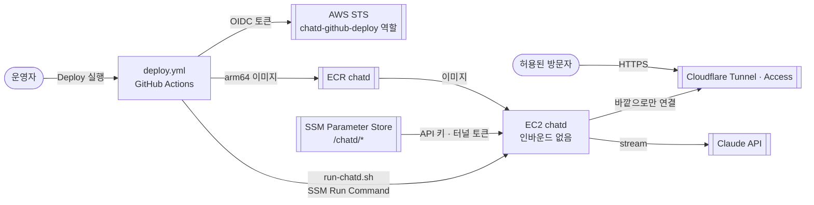

# deploy — Overview

> **담당 기능**: `SPEC.md`의 `F-014` (클라우드 배포 — AWS + Cloudflare).  
> (진행 상태는 `/README.md` Progress Tracker에서 관리)

이 폴더는 **`chatd` 이미지를 AWS 서울 EC2에 올리고 Cloudflare Tunnel·Access 뒤에서 돌리는 데 필요한 설정과 스크립트**를 담당합니다.
이미지 자체는 루트 `Dockerfile`, 배포 실행은 `.github/workflows/deploy.yml`이 맡습니다 (ARCHITECTURE.md ADR-018·019).

---

## Context — 상위 흐름과의 연결

```
루트(/) — Level 0 DFD
└─ [AI Agent Chat] 버블의 실행 환경
       │  입력: 운영자의 배포 실행(GitHub Actions), SSM의 비밀값(API 키 · 터널 토큰)
       ▼
deploy — Level 1 DFD (아래 상세)
       │  출력: EC2에서 도는 chatd · cloudflared 컨테이너, Cloudflare 주소로 들어온 요청
       ▼
방문자 브라우저 (Cloudflare Access 통과) · Claude API
```

---

## DFD — Level 1 (Main Processes)

> Decomposed from: `/` Level 0 — `AI Agent Chat` 버블 (운영 배포)



---

## Agent Control

**허용**
- 이 폴더의 스크립트·정책 JSON, 루트 `Dockerfile`·`.dockerignore`, `.github/workflows/deploy.yml` 수정
- IAM 정책은 필요한 동작·리소스만 (최소 권한)

**금지**
- AWS 액세스 키, `ANTHROPIC_API_KEY`, 터널 토큰을 파일·로그·출력·이미지에 넣기 — 비밀값은 SSM Parameter Store에만
- 보안 그룹에 인바운드 규칙 추가 (F-014 AC3). 들어오는 길은 Cloudflare Tunnel 하나
- 사용자 승인 없이 AWS·Cloudflare 리소스를 만들거나 지우기, 배포 워크플로 실행

**필수**
- 이미지 변경은 CI `image` 작업(이미지에 계약 테스트)을 통과해야 함
- 리소스 이름이 바뀌면 `provision.sh`, `run-chatd.sh`, 정책 JSON, 이 문서를 함께 고침

---

## 처음 한 번: 배포 준비 순서 (사용자)

키·토큰·비밀번호는 채팅이나 파일에 붙여 넣지 말고, 아래처럼 터미널에서 직접 넣으세요.

1. **AWS CLI 로그인** — PC에 AWS CLI v2를 설치하고 `aws login`(또는 `aws configure sso`)으로 로그인합니다. 루트 계정에는 MFA를 켜고, AWS Budgets에 월 40달러 알림을 걸어 둡니다.
2. **AWS 리소스 만들기** — 저장소 루트에서 `./deploy/provision.sh`. ECR, GitHub OIDC 배포 역할, EC2 역할, 인바운드 없는 보안 그룹, EC2(t4g.small)를 만들고 GitHub에 넣을 변수 4개와 비밀값 넣는 명령을 출력합니다.
3. **Cloudflare 도메인** — Cloudflare에 도메인을 추가(Free 요금제)하고, 도메인 등록 업체에서 네임서버를 Cloudflare가 알려 준 것으로 바꿉니다.
4. **Cloudflare Tunnel** — Zero Trust → Networks → Tunnels → Create a tunnel(Cloudflared), 이름 `chatd`. 설치 화면에 나오는 토큰을 복사해 2번이 출력한 `read -rs T && aws ssm put-parameter … /chatd/cloudflare-tunnel-token …` 명령으로 넣습니다. Public hostname: 예) `chat.<도메인>` → Service `HTTP` · `chatd:3000`.
5. **Cloudflare Access** — Zero Trust → Access → Applications → Add → Self-hosted, 도메인 `chat.<도메인>`. 정책 Allow · Include: Emails(허용할 이메일들). 로그인 방법은 One-time PIN(기본)이면 충분합니다.
6. **Claude API 키** — 2번이 출력한 `… /chatd/anthropic-api-key …` 명령으로 넣습니다. 넣지 않으면 모의 모드로 뜹니다.
7. **GitHub 설정** — 저장소 Settings → Environments에 `production`을 만들고(필요하면 승인자 지정), Settings → Secrets and variables → Actions → Variables에 2번이 출력한 `AWS_REGION`, `AWS_DEPLOY_ROLE_ARN`, `ECR_REPOSITORY_URI`, `EC2_INSTANCE_ID`를 넣습니다. 모두 비밀값이 아닙니다.
8. **배포** — Actions → Deploy → Run workflow. 끝나면 `chat.<도메인>`에 접속합니다.

## 배포 뒤 확인 (F-014 수동 수용 기준)

| AC | 확인 |
|---|---|
| AC3 | EC2 콘솔에서 `chatd-sg` 인바운드 규칙 0개, `aws ssm start-session --target <인스턴스>`로 접속됨 |
| AC4 | 허용된 이메일로 접속, 첫 글자가 1초 안에 흐름, "아주 길게 설명해 줘"처럼 1분 넘는 답도 끊기지 않음(524 없음) |
| AC5 | 허용 목록에 없는 이메일은 Access 화면에서 막힘 |

## 운영 메모

- **다시 배포**: Actions → Deploy. 같은 커밋도 다시 띄웁니다.
- **키 바꾸기**: SSM 값을 바꾼 뒤 Deploy를 다시 실행합니다 (컨테이너를 새로 띄울 때 읽음).
- **잠시 멈추기**: `aws ec2 stop-instances --instance-ids <인스턴스>` — 멈춘 동안 인스턴스 요금은 없고 디스크 요금만 조금 나옵니다.
- **로그 보기**: `aws ssm start-session --target <인스턴스>` 후 `sudo docker logs --tail 100 chatd`. 서버 로그에는 메시지 본문이 없습니다 (ARCHITECTURE §7).
