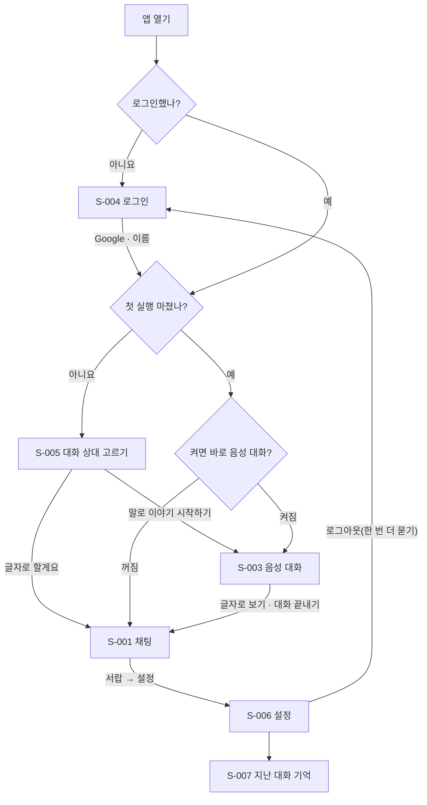
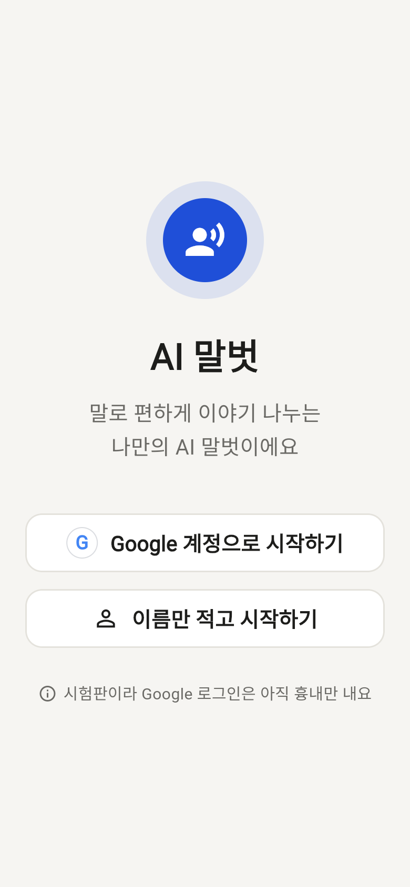
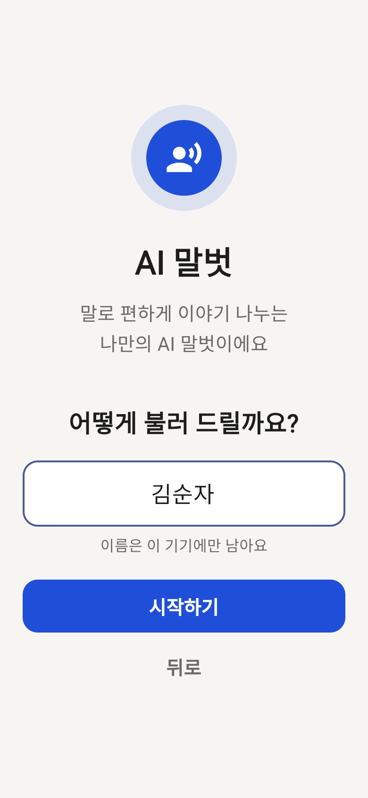
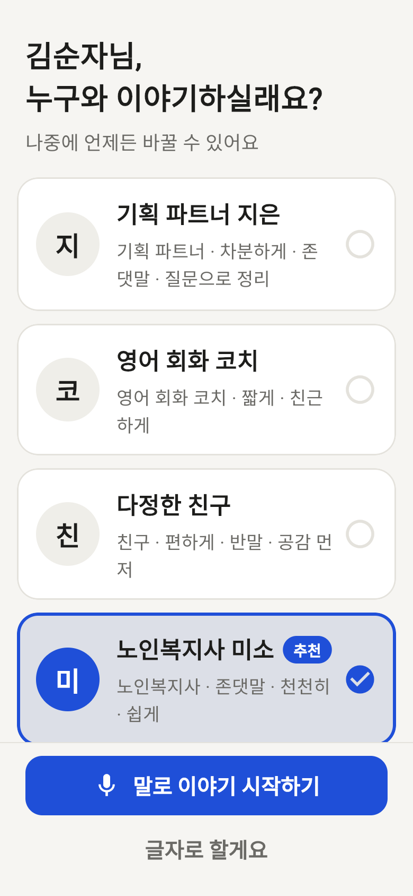
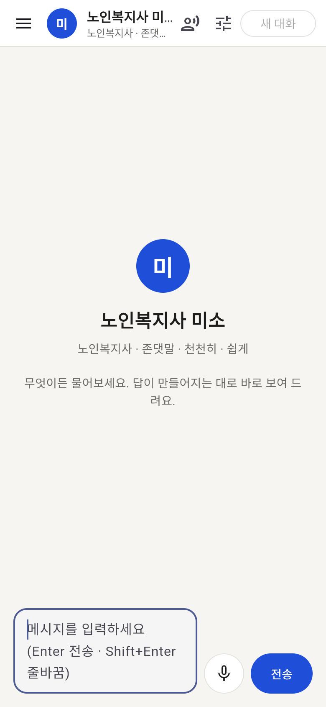
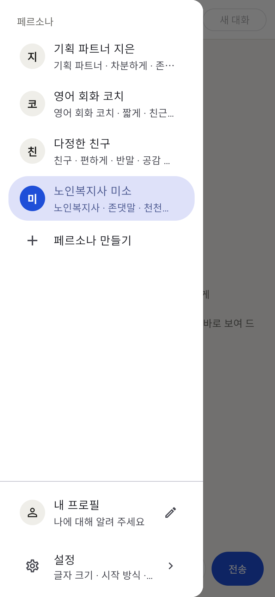
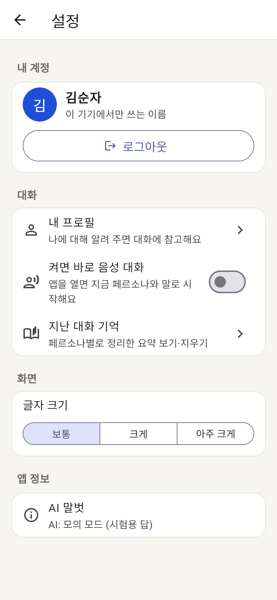
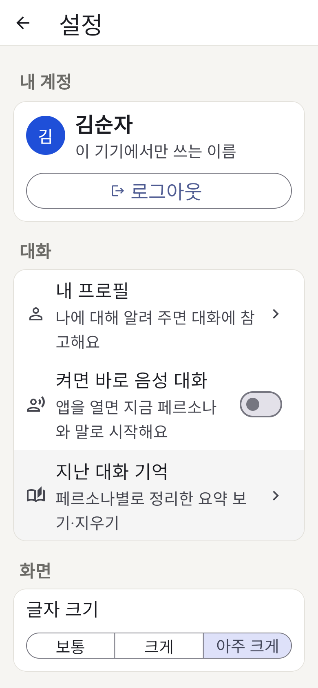
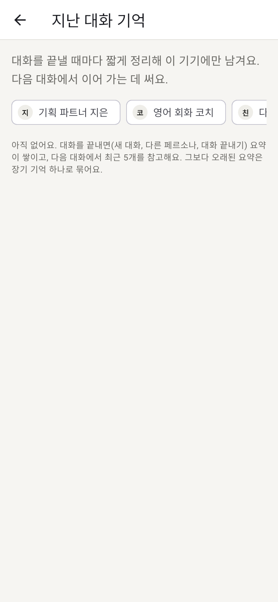

# 화면 기획 — 로그인부터 설정까지 (웹 기준, 네이티브 앱의 바탕)

> 기능 명세: `SPEC.md` F-023 (화면 S-004~S-007), 로그인 본 구현은 F-008(보류). 화면은 모두 같은 Flutter 코드라 웹·Android·iOS가 같다.
> 사용자: 어르신이 먼저다. 큰 글씨, 화면당 큰 버튼 하나 또는 둘, 손으로 고르는 것보다 말로 대화(음성이 기본).

## 1. 화면 목록

| ID | 화면 | 들어오는 길 | 핵심 동작 | 상태 |
|---|---|---|---|---|
| S-004 | 로그인 | 앱을 처음 켜거나 로그아웃 | Google 계정으로 시작 · 이름만 적고 시작 | ✅ UI (Google은 모의) |
| S-005 | 첫 실행 — 대화 상대 고르기 | 로그인 직후, 처음 한 번 | 큰 카드 하나 고르기(미소 추천) → "말로 이야기 시작하기" / "글자로 할게요" | ✅ |
| S-003 | 음성 대화 | 첫 실행 "말로", 켜면 바로 음성 대화(F-021), 채팅 상단 버튼 | 계속 듣기, 화면 누르면 끼어들기, 대화 끝내기 | ✅ (F-018) |
| S-001 | 채팅 | 첫 실행 "글자로", 음성 화면 "글자로 보기" | 글로 대화, 서랍에서 페르소나·내 프로필·설정 | ✅ (F-001~F-005) |
| S-002 | 페르소나 편집 | 채팅 상단 조절 버튼, 서랍 "페르소나 만들기" | 기본 지시(고정) + 내 요구 사항, 그 페르소나의 기억 | ✅ (F-005·F-019) |
| S-006 | 설정 | 서랍 "설정" | 내 계정·로그아웃, 내 프로필, 켜면 바로 음성 대화, 지난 대화 기억, 글자 크기, 서버 주소(앱만), 앱 정보 | ✅ |
| S-007 | 지난 대화 기억 | 설정 → 지난 대화 기억 | 페르소나 칩으로 바꿔 보며 장기 기억·세션 요약 보기·지우기 | ✅ |

## 2. 흐름

- 화면 바꾸기는 `ui/app_shell.dart` 한 곳이 로그인 상태(`AuthController`)를 보고 한다. 화면끼리 서로 이동시키지 않는다.
- "말로 이야기 시작하기"를 고르면 F-021 "켜면 바로 음성 대화"도 켠다 — 다음부터는 앱을 켜면 바로 듣는다. 설정에서 끌 수 있다.
- 로그아웃해도 페르소나·기억·첫 실행 여부는 기기에 남는다 (같은 기기에서 다시 들어오면 바로 대화).

## 3. 어르신용 원칙 (모든 화면)

| 원칙 | 적용 |
|---|---|
| 큰 버튼 | 주요 버튼 높이 64, 글자 20 (`ui/big_button.dart`). 로그인·첫 실행은 버튼 2개 이하 |
| 큰 글씨 | 제목 26~34, 본문 17~20. 설정 → 글자 크기 보통·크게(1.2배)·아주 크게(1.4배), 앱 전체에 적용 |
| 고르기는 카드로 | 라디오·토글 대신 누르는 큰 카드(체크 표시·두꺼운 테두리). 추천 표시 |
| 되돌리기 어려운 것은 묻기 | 로그아웃은 확인 대화상자 |
| 말이 기본 | 첫 실행 첫 버튼이 "말로 이야기 시작하기", 음성이 없으면 "시작하기" 하나 |
| 쉬운 말 | "모의"·"서버" 같은 말은 설정 아래쪽에만. 로그인 화면의 안내도 한 줄 |

## 4. 무엇이 모의인가 (지금 서버 인증 없음)

| 부분 | 지금 | 진짜로 만들 때 (F-008) |
|---|---|---|
| Google 로그인 | `MockGoogleSignIn` — 창 없이 "체험 사용자"로 로그인, 로그인 화면에 "흉내만 내요" 한 줄 | `google_sign_in` 패키지(ARCHITECTURE §2.2 허용 필요) → ID 토큰을 `POST /api/auth/google`, 서버 세션 쿠키·`GET /api/me` (ADR-017 보류) |
| 이름만 적고 시작 | 이름을 기기에만 저장 (`auth.v1`) | 그대로 두거나, 공개 배포(Q-001) 때 없앨지 결정 |
| 서버 보호 | 없음 — 로그인 안 해도 API는 열려 있음 | `GOOGLE_CLIENT_ID`가 있으면 `/api/chat` 401 (F-008 AC3) |
| Google 로고 | 글자 "G" | Google 브랜드 지침의 공식 버튼·로고 |

교체 지점은 `lib/chat/auth_controller.dart`의 `GoogleSignIn` 인터페이스 하나다. 화면은 바꾸지 않는다.

## 5. 저장 (기기, `shared_preferences`, ADR-023)

| 키 | 내용 |
|---|---|
| `auth.v1` | 이름·로그인 방법·이메일(Google)·모의 여부, 첫 실행 마침 여부. 토큰·비밀번호는 저장하지 않음 |
| `display.textSize` | 글자 크기 (`large`·`xlarge`, 보통이면 지움) |
| 기존 | `personas.v1`, `memory.v1`, `start.voice`, `server.address` |

## 6. 화면 캡처 (모의 모드 웹 빌드, 390×844)

| 로그인 | 이름 적기 | 대화 상대 고르기 | 채팅 |
|---|---|---|---|
|  |  |  |  |

| 서랍 | 설정 | 설정 (아주 크게) | 지난 대화 기억 |
|---|---|---|---|
|  |  |  |  |

## 7. 다음 후보 (네이티브 앱에서)

1. 진짜 Google 로그인 (F-008) — Android·iOS OAuth 클라이언트, 서버 세션. 공개 배포(Q-001) 전 필수
2. 음성으로 로그인·첫 실행 안내 — 화면을 읽어 주고 "미소요"라고 말해 고르기
3. 가족·보호자 연결 — 보호자가 설정(글자 크기·페르소나 요구 사항)을 대신 해 주기 (SPEC에 없음, 제안)
4. 앱 이름·아이콘 확정 — 지금 "AI 말벗"은 가칭 (`login_page.dart`의 `appDisplayName`)
