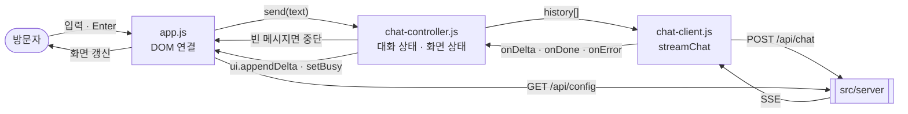

# public — Overview

> **담당 기능**: `SPEC.md`의 `F-001`, `F-002`, `F-003`, `F-004` 중 화면 부분 (S-001 채팅 화면)  
> (진행 상태는 `/README.md` Progress Tracker에서 관리)

이 폴더는 **브라우저에서 동작하는 채팅 화면**을 담당합니다. 빌드 도구 없이 그대로 제공되는 정적 파일입니다.  
화면 로직(`chat-controller.js`)과 DOM 연결(`app.js`)을 분리해, 화면 동작을 브라우저 없이도 테스트할 수 있게 했습니다.

---

## Context — 상위 흐름과의 연결

```
루트(/) — Level 0 DFD
└─ [AI Agent Chat] 버블 중 "방문자에게 보이는" 부분
       │  입력: 방문자의 키보드 입력, 서버의 SSE 스트림
       ▼
public — Level 1 DFD (아래 상세)
       │  출력: POST /api/chat 요청 (대화 내역), 화면 갱신
       ▼
src/server, 방문자
```

---

## DFD — Level 1 (Main Processes)

> Decomposed from: `/` Level 0 — `AI Agent Chat` 버블 (방문자와 만나는 부분)



| 파일 | 역할 |
|---|---|
| `index.html` | S-001 화면 구조 |
| `styles.css` | 화면 스타일 (라이트/다크) |
| `app.js` | DOM과 컨트롤러 연결만 담당 |
| `chat-controller.js` | 대화 내역·바쁨 상태 관리 (DOM 없음, 테스트 대상) |
| `chat-client.js` | `/api/chat` 호출과 SSE 파싱 (DOM 없음, 테스트 대상) |

---

## Tech Stack

- 브라우저 표준 API: `fetch`, `ReadableStream`, `TextDecoder`, ES Modules (상위 스택 외 추가분 없음)

---

## Agent Control

> 상위 규칙 참조: `/README.md` — Agent Control  
> 아래 규칙은 이 폴더에 추가 적용됩니다.

### 허용 (Allow)

- 접근성 개선 (ARIA 속성, 키보드 조작)

### 금지 (Prohibit)

- 빌드 도구·프레임워크·CDN 스크립트 도입 금지
- `chat-controller.js`, `chat-client.js`에서 `document`·`window` 직접 접근 금지 (테스트 가능성 유지)
- 응답 텍스트를 `innerHTML`로 넣기 금지 — 항상 `textContent` (XSS 방지)

### 필수 (Required)

- 스트리밍 영역에 `aria-live="polite"` 유지
- 작업 완료 시 `/README.md` Progress Tracker 업데이트
- 이 폴더 내 구조 변경 시 위 DFD와 루트 Level 0 DFD 동시 업데이트
