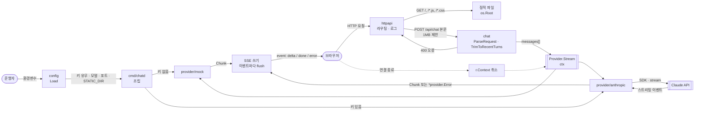

# server — Overview

> **담당 기능**: `SPEC.md`의 `F-009` (계약 테스트), `F-010` (Go 서버). 단계 4에서 Node 서버가 빠지면 F-001 ~ F-004 서버 부분을 모두 맡습니다.  
> (진행 상태는 `/README.md` Progress Tracker에서 관리)

이 폴더는 **Go 서버 `chatd`** 와 Node·Go 서버에 똑같이 실행하는 **HTTP 계약 테스트**(`contract/`)를 담당합니다.  
Go 서버는 Node 서버(`src/`)와 같은 API(SPEC.md §9)를 제공하며, 무상태입니다 (ARCHITECTURE.md ADR-004).

---

## Context — 상위 흐름과의 연결

```
루트(/) — Level 0 DFD
└─ [AI Agent Chat] 버블 (Go 서버로 구현한 경우)
       │  입력: 브라우저의 HTTP 요청 (POST /api/chat 의 messages[], GET 정적 파일), 운영자의 환경변수
       ▼
server — Level 1 DFD (아래 상세)
       │  출력: SSE 스트림 (delta · done · error), 오류 JSON(400/404/405/413), 정적 파일, Claude API 요청
       ▼
방문자 브라우저 · Claude API
```

---

## DFD — Level 1 (Main Processes)

> Decomposed from: `/` Level 0 — `AI Agent Chat` 버블 (Go 서버 구현)



| 폴더 | 역할 |
|---|---|
| `cmd/chatd` | 진입점: 설정 → 제공자 → HTTP 조립, 시작 로그(모드만), 종료 신호 처리 |
| `internal/config` | 환경변수 읽기·검증 (잘못된 `PORT`면 기동 중단) |
| `internal/chat` | 도메인: `Message`, 입력 검증, 최근 20턴 정리 (순수 함수) |
| `internal/provider` | `Provider` 인터페이스, `Chunk`, 사용자용 오류(`Error`, `UserMessage`) |
| `internal/provider/mock` | 모의 제공자 (Node와 같은 답 문구) |
| `internal/provider/anthropic` | Claude 어댑터 (공식 Go SDK — 이 폴더에서만 import) |
| `internal/httpapi` | 라우팅, 요청 파싱, SSE 쓰기, 정적 파일, 요청 로그(`log/slog` JSON) |
| `internal/archtest` | ARCHITECTURE.md §3.3 의존 규칙 검사 테스트 |
| `contract` | HTTP 계약 테스트 (Node·Go 서버 공통) |

**실행** (`server/`에서, 키가 없으면 모의 모드)
- `STATIC_DIR=../public go run ./cmd/chatd` → http://localhost:3000 에서 기존 채팅 화면
- 테스트: `go test ./...` (네트워크 없음, Claude는 가짜 업스트림)
- 계약 테스트 (루트에서): `npm run test:contract:go` (Go 서버) · `npm run test:contract` (Node 서버)
- 빌드: `CGO_ENABLED=0 go build ./cmd/chatd`

---

## Tech Stack

- Go 표준 라이브러리 (`net/http`, `log/slog`, `iter`, `os.Root`)
- `github.com/anthropics/anthropic-sdk-go/v2` — `internal/provider/anthropic`에서만 (ARCHITECTURE.md ADR-008)

---

## Agent Control

> 상위 규칙 참조: `/README.md` — Agent Control  
> 아래 규칙은 이 폴더에 추가 적용됩니다.

### 허용 (Allow)

- 계약 테스트에 새 시나리오 추가 — SPEC.md §9 API 명세나 기능 수용 기준에 근거가 있을 때만
- Claude 제공자 테스트는 `httptest` 가짜 업스트림으로 작성

### 금지 (Prohibit)

- `contract/`에서 서버 내부 코드(Node `src/`, Go `internal/`)를 import하거나 호출 — HTTP로만 검사
- 계약 테스트를 서버 하나에만 맞추기 (Node와 Go 모두 통과해야 하는 계약만 적음)
- 모의 모드 확인을 건너뛰거나, 실제 Claude API를 부르는 서버에 계약 테스트 실행
- `httpapi`에서 `provider/mock`·`provider/anthropic` import (조립은 `cmd/chatd`)
- SDK를 `internal/provider/anthropic` 밖에서 import, 웹 프레임워크(gin·echo·chi 등), cgo
- SDK 오류의 `Error()` 원문(요청 URL·응답 본문 포함)을 응답이나 로그에 쓰기 — 코드·상태만 기록
- 메시지 본문·API 키를 로그에 기록

### 필수 (Required)

- 작업 완료 시 `/README.md` Progress Tracker 업데이트
- 이 폴더 내 구조 변경 시 위 DFD와 상위 DFD 동시 업데이트
- 새 패키지를 만들면 ARCHITECTURE.md §3.2·§3.3과 `internal/archtest`의 허용 표를 함께 고침
- 계약을 바꾸면 SPEC.md §9와 ARCHITECTURE.md §4.1을 먼저 고치고 사용자 승인을 받음
- 사용자용 오류 문장·모의 응답 문구를 바꾸면 Node(`src/`)도 같이 바꿈 (계약 테스트로 확인)
- 푸시 전 `gofmt -l .`가 비어 있고 `go vet ./...` · `go test ./...`가 통과해야 함
