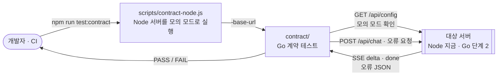

# server — Overview

> **담당 기능**: `SPEC.md`의 `F-009` (전환 단계 1). 단계 2에서 Go 서버가 이 폴더에 들어오면 F-001 ~ F-004 서버 부분을 넘겨받습니다.  
> (진행 상태는 `/README.md` Progress Tracker에서 관리)

이 폴더는 **목표 Go 서버의 자리**입니다. 지금은 Node·Go 서버에 똑같이 실행하는 **HTTP 계약 테스트**(`contract/`)만 있습니다 (ARCHITECTURE.md ADR-012).

---

## Context — 상위 흐름과의 연결

```
루트(/) — Level 0 DFD
└─ [AI Agent Chat] 버블 중 "브라우저와 주고받는" 경계 (API-001 · API-002)
       │  입력: 계약 테스트가 보내는 HTTP 요청 (브라우저와 같은 형식)
       ▼
server — Level 1 DFD (아래 상세)
       │  출력: 테스트 결과 (통과/실패). 시스템의 데이터 흐름은 바꾸지 않음
       ▼
개발자 · CI
```

---

## DFD — Level 1 (Main Processes)

> Decomposed from: `/` Level 0 — `AI Agent Chat` 버블 (방문자와 주고받는 경계를 검증)



| 파일 | 역할 |
|---|---|
| `go.mod` | Go 모듈 (`go 1.25`, 의존성 없음) |
| `contract/doc.go` | 패키지 설명, 실행 방법 |
| `contract/helpers_test.go` | `-base-url` 플래그, 모의 모드 확인, SSE 읽기, 계약 검사 도우미 |
| `contract/contract_test.go` | F-001 · F-002 · API-001 · API-002 시나리오 |

**실행**
- Node 서버에 대해: `npm run test:contract` (루트에서, Go 1.25 이상 필요)
- 이미 떠 있는 서버에 대해: `cd server && go test ./contract -count=1 -base-url=http://127.0.0.1:3000`
- `-base-url`이 없으면 계약 테스트는 건너뜁니다 (`go test ./...`가 서버 없이도 통과)

---

## Tech Stack

- Go 표준 라이브러리만: `testing`, `net/http`, `encoding/json`, `bufio` (ARCHITECTURE.md §2.2)

---

## Agent Control

> 상위 규칙 참조: `/README.md` — Agent Control  
> 아래 규칙은 이 폴더에 추가 적용됩니다.

### 허용 (Allow)

- 계약 테스트에 새 시나리오 추가 — SPEC.md §9 API 명세나 기능 수용 기준에 근거가 있을 때만

### 금지 (Prohibit)

- `contract/`에서 서버 내부 코드(Node `src/`, Go `internal/`)를 import하거나 호출 — HTTP로만 검사
- 계약 테스트를 서버 하나에만 맞추기 (Node와 Go 모두 통과해야 하는 계약만 적음)
- 모의 모드 확인을 건너뛰거나, 실제 Claude API를 부르는 서버에 계약 테스트 실행
- 표준 라이브러리 밖의 Go 모듈 추가 (단계 2의 `anthropic-sdk-go`는 `internal/provider/anthropic`에서만, ADR-008 승인 후)

### 필수 (Required)

- 작업 완료 시 `/README.md` Progress Tracker 업데이트
- 이 폴더 내 구조 변경 시 위 DFD와 상위 DFD 동시 업데이트
- 계약을 바꾸면 SPEC.md §9와 ARCHITECTURE.md §4.1을 먼저 고치고 사용자 승인을 받음
- 푸시 전 `gofmt -l .`가 비어 있고 `go vet ./...`가 통과해야 함
