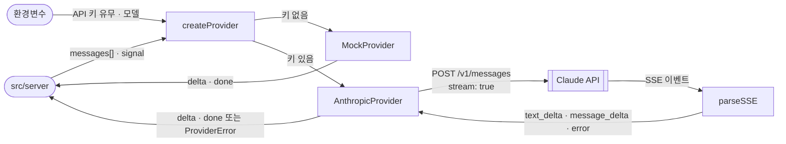

# agent — Overview

> **담당 기능**: `SPEC.md`의 `F-001`, `F-003`, `F-004`  
> (진행 상태는 `/README.md` Progress Tracker에서 관리)

이 폴더는 **AI 제공자(Claude · 모의 모드)를 하나의 스트리밍 인터페이스로 감싸는 일**을 담당합니다.  
서버는 어떤 제공자인지 몰라도 같은 방식으로 응답 조각을 받습니다 (SPEC.md ADR-003).

---

## Context — 상위 흐름과의 연결

```
루트(/) — Level 0 DFD
└─ [AI Agent Chat] 버블 중 "응답 생성" 부분
       │  입력: 검증된 대화 내역 messages[] + 취소 신호(AbortSignal)
       ▼
src/agent — Level 1 DFD (아래 상세)
       │  출력: { type: 'delta', text } … { type: 'done', stopReason }  또는 ProviderError
       ▼
src/server (SSE 응답)
```

---

## DFD — Level 1 (Main Processes)

> Decomposed from: `/` Level 0 — `AI Agent Chat` 버블 (Claude API와 주고받는 부분)



### 인터페이스 (모든 제공자가 지킴)

```js
provider.name     // 'mock' | 'anthropic'
provider.model    // 표시용 모델 이름
provider.stream(messages, { signal })  // async generator
  // yield { type: 'delta', text: string }   (1회 이상)
  // yield { type: 'done', stopReason: string }  (마지막 1회)
  // 실패 시 ProviderError throw (userMessage는 화면에 보여도 안전한 문장)
```

---

## Tech Stack

- 전역 `fetch`, `ReadableStream`, `TextDecoder` (Node.js 22 내장) — 상위 스택 외 추가분 없음

---

## Agent Control

> 상위 규칙 참조: `/README.md` — Agent Control  
> 아래 규칙은 이 폴더에 추가 적용됩니다.

### 허용 (Allow)

- 새 제공자 추가 (위 인터페이스를 지키는 경우)

### 금지 (Prohibit)

- 이 폴더에서 HTTP 응답(`res`)을 직접 다루기 금지 — 출력은 항상 위 인터페이스로만
- `ProviderError.userMessage`에 업스트림 원문 오류·API 키·요청 헤더 포함 금지
- 테스트에서 실제 Claude API 호출 금지 (가짜 업스트림 서버 사용)

### 필수 (Required)

- 모든 제공자는 `signal`이 중단되면 즉시 멈춰야 함 (F-003)
- 알 수 없는 SSE 이벤트 타입은 무시 (업스트림이 새 타입을 추가할 수 있음)
- 작업 완료 시 `/README.md` Progress Tracker 업데이트
- 이 폴더 내 구조 변경 시 위 DFD와 루트 Level 0 DFD 동시 업데이트
