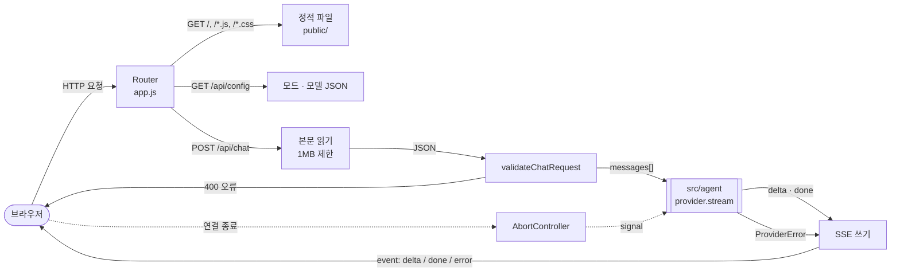

# server — Overview

> **담당 기능**: `SPEC.md`의 `F-001`, `F-002`, `F-003`, `F-004`  
> (진행 상태는 `/README.md` Progress Tracker에서 관리)

이 폴더는 **HTTP 요청을 받아 검증하고, AI 제공자의 응답 조각을 SSE로 브라우저에 흘려보내는 일**과 정적 파일 제공을 담당합니다.  
서버는 대화를 저장하지 않는 무상태 구조입니다 (SPEC.md ADR-004).

---

## Context — 상위 흐름과의 연결

```
루트(/) — Level 0 DFD
└─ [AI Agent Chat] 버블 중 "브라우저와 주고받는" 부분
       │  입력: 브라우저의 HTTP 요청 (POST /api/chat 의 messages[], GET 정적 파일)
       ▼
src/server — Level 1 DFD (아래 상세)
       │  출력: SSE 스트림 (delta · done · error), JSON 오류(400/404/405/413), 정적 파일
       ▼
방문자 브라우저
```

---

## DFD — Level 1 (Main Processes)

> Decomposed from: `/` Level 0 — `AI Agent Chat` 버블 (브라우저와 주고받는 부분)



---

## Tech Stack

- `node:http`, `node:fs/promises`, `node:path` (상위 스택 외 추가분 없음)

---

## Agent Control

> 상위 규칙 참조: `/README.md` — Agent Control  
> 아래 규칙은 이 폴더에 추가 적용됩니다.

### 허용 (Allow)

- 새 API 경로 추가 (SPEC.md §9에 먼저 정의된 경우)

### 금지 (Prohibit)

- AI 제공자별 분기 코드 금지 — 항상 `provider.stream()` 인터페이스만 사용
- 요청 본문·메시지 내용을 로그에 기록 금지 (메서드·경로·상태·소요 시간만)
- `public/` 바깥 파일을 정적 경로로 제공 금지 (경로 탈출 차단 유지)

### 필수 (Required)

- 입력 검증 규칙은 `validate.js` 한 곳에서만 정의 (SPEC.md §7.2 ChatMessage 제약과 일치)
- SSE 이벤트 이름은 SPEC.md API-001과 일치 (`delta`, `done`, `error`)
- 클라이언트 연결이 끊기면 제공자에 취소 신호 전달
- 작업 완료 시 `/README.md` Progress Tracker 업데이트
- 이 폴더 내 구조 변경 시 위 DFD와 루트 Level 0 DFD 동시 업데이트
