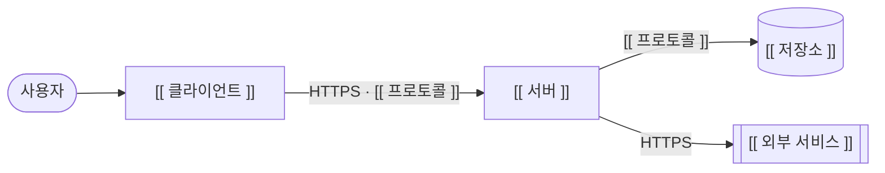
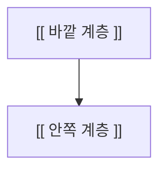
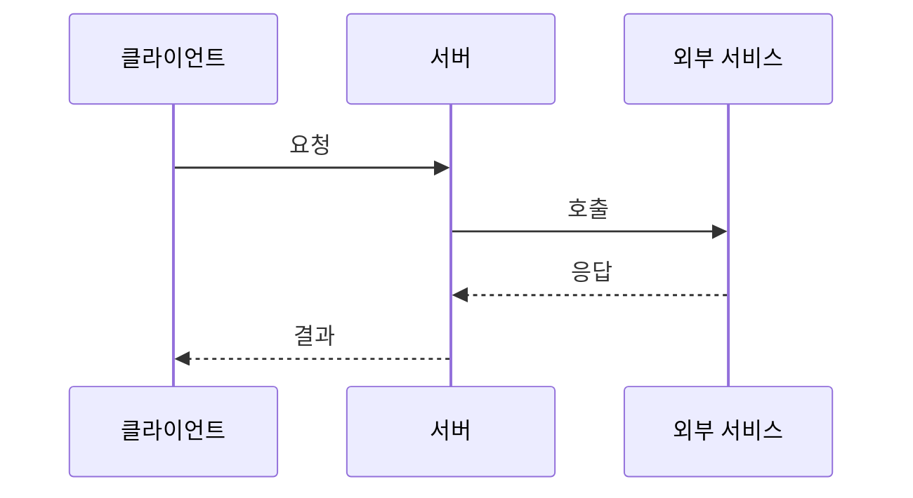
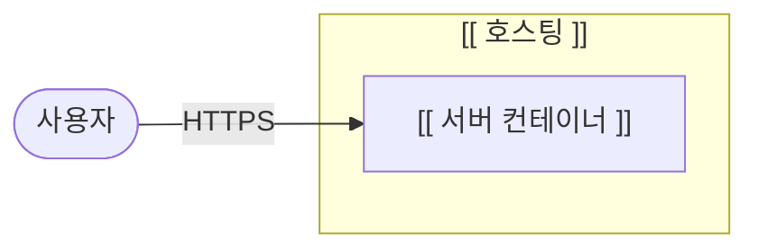

# [[ 프로젝트명 ]] — 아키텍처 명세 (ARCHITECTURE)

<!--
  이 템플릿은 프로젝트 루트에 ARCHITECTURE.md로 복사해 사용합니다.

  ┌─ Blueprint Framework에서 ARCHITECTURE.md의 역할 ─────────────────────────┐
  │ SPEC.md            → "무엇을 만드는가"        (기능 ID · 수용 기준)        │
  │ ARCHITECTURE.md    → "무엇으로, 어떤 구조로"  (기술 스택 · 모듈 경계 ·     │
  │                                                의존 규칙 · 배포 · ADR)     │
  │ 루트 README.md     → "얼마나 됐는가"          (Progress Tracker · Roadmap) │
  │ 폴더 README.md     → "폴더 안에서 어떻게 흐르나" (DFD · Agent Control)     │
  │                                                                           │
  │ DFD와의 차이                                                               │
  │  - DFD: 데이터가 어디서 들어와 어디로 나가는가 (폴더 단위, 동적)            │
  │  - ARCHITECTURE: 구성 요소가 무엇이고, 누가 누구에 의존하며, 어디서        │
  │    실행되는가 (시스템 단위, 정적 구조 + 핵심 시나리오)                       │
  │                                                                           │
  │ 중복 금지                                                                  │
  │  - 기능 정의·수용 기준 → SPEC.md      - 진행 상태 → 루트 Tracker            │
  │  - API 요청/응답 형식 → SPEC.md §9    - 폴더 내부 흐름 → 폴더 README DFD    │
  └───────────────────────────────────────────────────────────────────────────┘

  작성 규칙:
  - [[ ]] 안의 내용을 채우고, 이 주석들은 작성 후 지워도 됩니다.
  - 해당 없는 섹션은 지우지 말고 "해당 없음"이라고 적습니다.
  - 최소 작성 범위: §1 개요, §2 기술 스택, §3 모듈 맵·의존 규칙, §9 ADR.
-->

> **에이전트 읽기 규칙**: 이 파일은 세션마다 읽지 않습니다. 아래 작업을 할 때 **해당 절만** 읽습니다.
>
> | 이런 작업을 할 때 | 읽을 절 |
> |---|---|
> | 라이브러리·도구를 추가하거나 버전을 바꿀 때 | §2 기술 스택 |
> | 새 폴더·모듈을 만들거나, 다른 모듈의 코드를 불러올 때 | §3 시스템 구성 |
> | 모듈·서비스 사이의 인터페이스를 바꿀 때 | §4 인터페이스 계약 |
> | 설정·환경변수·배포 방식을 바꿀 때 | §6 배포 구성 |
> | 오류 처리·로깅·인증 같은 공통 처리를 건드릴 때 | §7 횡단 관심사 |
> | 기존 결정과 다른 방식을 쓰고 싶을 때 | §9 ADR (뒤집기 전에 사용자에게 제안) |

| 항목 | 내용 |
|---|---|
| 문서 버전 | v0.1 |
| 상태 | 초안 / 검토 중 / 승인됨 |
| 작성자 | [[ 이름 ]] |
| 최종 수정일 | YYYY-MM-DD |
| 관련 문서 | [`SPEC.md`](./SPEC.md) · [`README.md`](./README.md) |

---

## 목차

1. [개요](#1-개요)
2. [기술 스택](#2-기술-스택)
3. [시스템 구성](#3-시스템-구성)
4. [인터페이스 계약](#4-인터페이스-계약)
5. [런타임 시나리오](#5-런타임-시나리오)
6. [배포 구성](#6-배포-구성)
7. [횡단 관심사](#7-횡단-관심사)
8. [품질 속성 대응](#8-품질-속성-대응)
9. [설계 결정 기록 (ADR)](#9-설계-결정-기록-adr)
10. [진화 계획](#10-진화-계획)
11. [기술 부채와 아키텍처 리스크](#11-기술-부채와-아키텍처-리스크)
12. [변경 이력](#12-변경-이력)

---

## 1. 개요

### 1.1 아키텍처 한 줄 요약
<!-- 예: "Go API 서버 + Flutter 클라이언트, 서버는 무상태이며 AI 응답을 SSE로 중계" -->
[[ 아키텍처 스타일과 핵심 구성을 한 문장으로 ]]

### 1.2 아키텍처 원칙
<!-- 3~5개. 에이전트가 애매할 때 판단 기준으로 씁니다. 원칙끼리 충돌하면 위에 있는 것이 우선 -->
1. [[ 예: 계약 우선 — 클라이언트와 서버는 SPEC.md §9 API 계약으로만 연결된다 ]]
2. [[ 예: 의존성은 안쪽(도메인)으로만 향한다 ]]
3. [[ 예: 외부 서비스는 어댑터 뒤에 둔다 — 교체·모의 가능 ]]

### 1.3 품질 목표 (우선순위 순)
<!-- SPEC.md §5 비기능 요구사항 중 아키텍처를 결정하는 상위 3개. 상세 대응은 §8 -->
| 순위 | 품질 속성 | 목표 | SPEC 근거 |
|---|---|---|---|
| 1 | [[ 예: 응답성 ]] | [[ 예: 첫 응답 조각 1초 이내 ]] | SPEC §5 |
| 2 | | | |
| 3 | | | |

---

## 2. 기술 스택

<!--
  이 절이 기술 스택의 원본입니다. 루트 README.md의 Tech Stack은 이름만 적은 요약이며 여기를 링크합니다.
  상태: 사용 중 / 목표(아직 도입 전) / 검토 중 / 폐기 예정
  모든 행은 §9의 ADR 하나 이상을 근거로 가져야 합니다.
-->

### 2.1 구성 요소별 스택

| 영역 | 기술 | 버전 | 상태 | 근거 ADR |
|---|---|---|---|---|
| 클라이언트 | [[ ]] | [[ ]] | 사용 중 | ADR-001 |
| 서버 | | | | |
| 데이터 저장 | | | | |
| 외부 서비스 | | | | |
| 인프라·호스팅 | | | | |

### 2.2 허용 라이브러리 (Allowlist)

<!--
  에이전트가 새 의존성을 추가할 수 있는 범위입니다.
  여기 없는 라이브러리를 추가하려면 → 먼저 사용자에게 제안하고, 승인되면 이 표와 §9 ADR을 갱신합니다.
-->

| 영역 | 라이브러리 | 용도 | 비고 |
|---|---|---|---|
| [[ 서버 ]] | [[ ]] | [[ ]] | |

**금지:**
- [[ 예: ORM 금지 — SQL은 쿼리 파일로 관리 (ADR-00X) ]]

### 2.3 개발 도구

| 용도 | 도구 | 실행 명령 |
|---|---|---|
| 빌드 | | |
| 테스트 | | |
| 정적 분석·포맷 | | |
| CI | | |

---

## 3. 시스템 구성

### 3.1 구성도 (컨테이너 수준)

<!--
  실행 단위(앱, 서버, DB, 외부 서비스)와 그 사이의 통신 방식을 그립니다.
  루트 README Level 0 DFD의 외부 액터와 일치해야 합니다.
-->

### 3.2 모듈 맵

<!--
  코드 모듈(패키지)과 폴더의 대응, 각 모듈이 의존해도 되는 모듈을 정의합니다.
  모듈이 담당하는 기능 ID는 루트 README의 Sub-folder Map이 정의합니다 (여기에 중복하지 않음).
-->

| 모듈 | 폴더 | 책임 | 의존 가능 모듈 |
|---|---|---|---|
| [[ api ]] | `/[[ ]]` | [[ HTTP 처리 ]] | [[ domain, adapter ]] |
| [[ domain ]] | `/[[ ]]` | [[ 핵심 로직 ]] | (없음) |

### 3.3 의존 규칙

<!-- 에이전트가 import를 추가할 때 지키는 규칙. 가능하면 린트·테스트로 자동 검사 -->

- [[ 예: domain은 다른 어떤 모듈도 import하지 않는다 ]]
- [[ 예: 외부 서비스 SDK는 adapter 모듈에서만 import한다 ]]
- 검사 방법: [[ 예: go vet + 커스텀 import 검사 테스트 ]]

---

## 4. 인터페이스 계약

<!--
  모듈·서비스 사이의 경계에서 지켜야 할 약속입니다.
  외부 공개 API의 요청/응답 형식은 SPEC.md §9가 원본이며, 여기서는 그 계약을 "어떻게 지키는지"만 적습니다.
-->

### 4.1 외부 API 계약
- 원본: SPEC.md §9
- 버전 정책: [[ 예: /v1 경로 버전, 하위 호환 깨는 변경은 /v2 ]]
- 계약 검증: [[ 예: 계약 테스트가 서버 구현마다 같은 시나리오를 실행 ]]

### 4.2 내부 인터페이스
| 경계 | 인터페이스 | 정의 위치 | 규칙 |
|---|---|---|---|
| [[ 서버 ↔ AI 제공자 ]] | [[ Provider.Stream() ]] | `/[[ 파일 ]]` | [[ 취소 신호를 받으면 즉시 중단 ]] |

---

## 5. 런타임 시나리오

<!-- 아키텍처를 이해하는 데 꼭 필요한 흐름 1~3개만. 관련 기능 ID를 적습니다 -->

### 5.1 [[ 시나리오명 ]] (F-[[ 001 ]])

---

## 6. 배포 구성

### 6.1 환경
| 환경 | 용도 | 위치 | 배포 방식 |
|---|---|---|---|
| 로컬 | 개발 | 개발자 PC | [[ ]] |
| 스테이징 | | | |
| 운영 | | | |

### 6.2 배포도

### 6.3 설정과 환경변수
<!-- 비밀값 여부를 반드시 표시. 비밀값은 저장소·로그·클라이언트에 절대 포함 금지 -->
| 이름 | 필수 | 기본값 | 비밀값 | 설명 |
|---|---|---|---|---|
| [[ PORT ]] | N | [[ 8080 ]] | N | |

---

## 7. 횡단 관심사

<!-- 여러 모듈에 걸친 공통 처리 방식. "어디서, 어떤 방식으로" 처리하는지 한 곳에 정합니다 -->

| 관심사 | 처리 위치 | 방식 |
|---|---|---|
| 오류 처리 | [[ ]] | [[ 예: 도메인 오류 → HTTP 상태 매핑은 api 모듈에서만 ]] |
| 로깅·관측성 | | [[ 예: 구조화 로그(JSON), 요청 ID 전파, 본문 기록 금지 ]] |
| 설정·비밀값 | | [[ 예: 시작 시 한 번 읽어 검증, 실패 시 기동 중단 ]] |
| 인증·인가 | | [[ SPEC §11 구현 방식 ]] |
| 동시성·취소 | | [[ 예: 모든 외부 호출은 요청 context를 전달 ]] |
| 테스트 구조 | | [[ 예: 단위 / 계약 / E2E 계층과 각각의 위치. 기준은 SPEC §12 ]] |

---

## 8. 품질 속성 대응

<!-- SPEC.md §5의 비기능 요구사항이 아키텍처의 어떤 장치로 달성되는지 -->

| SPEC §5 요구사항 | 대응 장치 | 검증 방법 |
|---|---|---|
| [[ 응답 시간 ]] | [[ 스트리밍 중계, 버퍼링 금지 ]] | [[ 첫 조각 시간 측정 테스트 ]] |

---

## 9. 설계 결정 기록 (ADR)

<!--
  "왜 그렇게 정했는가"를 남겨 에이전트가 이미 내린 결정을 뒤집지 않게 합니다.
  상태: 제안 / 승인 / 대체됨(→ ADR-xxx) / 폐기
  결정을 바꿀 때는 기존 행을 지우지 않고 상태를 "대체됨"으로 바꾼 뒤 새 ADR을 추가합니다.
  새 ADR과 상태 변경은 사용자의 결정입니다. 에이전트는 "제안" 상태로만 추가할 수 있습니다.
-->

| ID | 결정 | 검토한 대안 | 이유 | 상태 | 날짜 |
|---|---|---|---|---|---|
| ADR-001 | [[ ]] | [[ ]] | [[ ]] | 승인 | YYYY-MM-DD |

---

## 10. 진화 계획

<!--
  현재 아키텍처와 목표 아키텍처가 다를 때만 작성합니다. 같으면 "해당 없음".
  각 단계는 독립적으로 배포 가능해야 하고, 완료 기준이 있어야 합니다.
  단계를 실제로 시작할 때는 SPEC.md에 기능 ID로 등록하고 Tracker로 관리합니다.
-->

| 단계 | 내용 | 완료 기준 | 관련 ADR |
|---|---|---|---|
| 1 | | | |

---

## 11. 기술 부채와 아키텍처 리스크

| ID | 내용 | 영향 | 대응 계획 |
|---|---|---|---|
| TD-001 | | | |

---

## 12. 변경 이력

| 버전 | 날짜 | 작성자 | 변경 내용 |
|---|---|---|---|
| v0.1 | YYYY-MM-DD | | 최초 작성 |
