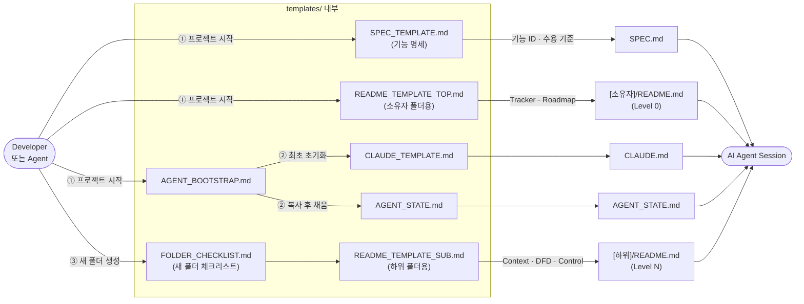

# templates — Overview

> **담당 범위**: 루트 Level 0 DFD의 `Blueprint Framework` 버블 중 **"문서 구조 제공(Template Provision)"** 프로세스

프로젝트에 복사해 사용하는 **Blueprint Framework 표준 템플릿과 가이드**를 보관합니다.  
새 프로젝트를 시작하거나 새 폴더를 만들 때 이 폴더의 파일을 복사해 사용하며, 에이전트가 일관된 문서 구조를 생성하도록 안내합니다.

---

## Context — 상위 흐름과의 연결

```
루트(/) — Level 0 DFD
└─ [Blueprint Framework] 버블
       │  입력: Developer의 새 프로젝트 시작 · 새 폴더 생성 요청
       ▼
templates/ — Level 1 DFD (아래 상세)
       │  출력: 프로젝트에 배치된 SPEC.md · README.md · CLAUDE.md · AGENT_STATE.md
       ▼
AI Agent Session
```

---

## DFD — Level 1 (Main Processes)

> Decomposed from: `/` Level 0 — `Blueprint Framework` 버블



---

## Tech Stack

- Markdown (CommonMark / GitHub Flavored Markdown)
- mermaid (다이어그램 렌더링)

---

## Agent Control

> 상위 규칙 참조: `/README.md` 핵심 원칙  
> 아래 규칙은 에이전트가 `templates/` 폴더를 수정할 때 **반드시** 따라야 합니다.

### 허용 (Allow)

- 플레이스홀더(`[[ ]]`) 구조를 유지하는 범위에서 내용 보완
- `FOLDER_CHECKLIST.md`에 체크 항목 추가
- 기술 스택별 특화 템플릿 파일 추가 (예: `README_TEMPLATE_REACT.md`)

### 금지 (Prohibit)

- `README_TEMPLATE_TOP.md` 섹션 순서 변경 금지 (Overview → DFD Level 0 → Tech Stack → Agent Control → Sub-folder Map → Progress Tracker → Next Roadmap)
- `README_TEMPLATE_SUB.md` 섹션 순서 변경 금지 (Overview → Context → DFD → Tech Stack → Agent Control)
- DFD 레벨 표시(`## DFD — Level [N]`) 헤더 형식 임의 변경 금지
- `Decomposed from:` 줄 삭제 금지
- Progress Tracker의 `ID` 열 삭제 금지 (SPEC.md와의 연결 고리)
- 플레이스홀더를 `[[ ]]` 이외의 표기로 작성 금지

### 필수 (Required)

- 템플릿 구조 변경 시 `BLUEPRINT.md`의 해당 절(§2 SPEC, §3 폴더 README, §5 Tracker)도 함께 업데이트
- 새 템플릿 파일 추가 시 아래 **파일 목록**과 루트 `README.md` 레포지토리 구조에 반영
- 템플릿 수정 사항은 루트 `CHANGELOG.md`에 기록
- DFD 수정 시 루트 `README.md`의 Level 0 DFD와 일관성 검토

---

<!--
  이 폴더(templates/)는 하위 폴더이므로 Progress Tracker와 Roadmap을 갖지 않습니다.
  아래는 이 폴더가 제공하는 파일 목록과 각 파일의 용도입니다.
-->

## 파일 목록

### 명세 (Specification)

| 파일 | 용도 | 프로젝트에서의 이름 |
|------|------|------|
| `SPEC_TEMPLATE.md` | 기능 ID · 사용자 스토리 · 수용 기준 · 데이터 · API 등 "무엇을 만드는가" 정의 | 루트 `SPEC.md` |

### 폴더 README 템플릿 (Folder README Templates)

| 파일 | 용도 | 사용 수준 |
|------|------|-----------|
| `README_TEMPLATE_TOP.md` | Progress Tracker·Roadmap을 소유하는 최상위 폴더용 | Level 0 (루트 또는 도메인 최상위) |
| `README_TEMPLATE_SUB.md` | Context·DFD·Agent Control만 갖는 하위 폴더용 | Level 1, 2, 3+ 모든 하위 |
| `FOLDER_CHECKLIST.md` | 새 폴더 생성 시 체크리스트 (유형 결정 → 항목 확인 → 상위 업데이트) | 폴더 생성 시마다 |
| `README_TEMPLATE.md` | ⛔ 폐기 예정 — 레벨 미지정 구버전 범용 템플릿. 신규 사용 금지 | — |

### 에이전트 세션 관리 (Agent Session Files)

| 파일 | 용도 | 수명 |
|------|------|------|
| `CLAUDE_TEMPLATE.md` | 루트 `CLAUDE.md` 원본 — 세션 프로토콜 · 핵심 규칙 (매 세션 자동 로딩) | **영구 유지** |
| `AGENT_BOOTSTRAP.md` | 최초 1회 초기화 지시 — CLAUDE.md · AGENT_STATE.md 생성 | **일회용** (실행 후 삭제) |
| `AGENT_STATE.md` | 루트 `AGENT_STATE.md` 원본 — 현재 집중 작업 · 누적 결정 · 세션 로그 | **영구 유지** (세션마다 갱신) |
| `AGENT_STATE_ARCHIVE.md` | 누적 요구사항 20행 초과 시 오래된 항목 보관 | **영구 유지** (자동 증가) |

### 가이드 (Guides)

| 파일 | 용도 |
|------|------|
| `FIRST_PROMPTS.md` | 프로젝트 유형별(React, Node API, Python, 풀스택) 첫 프롬프트 모음 |
| `MIGRATION_GUIDE.md` | 기존 코드베이스에 프레임워크를 점진적으로 적용하는 3단계 가이드 |
| `AGENT_SESSION_GUIDE.md` | 토큰·컨텍스트를 아끼는 세션 운용 전략 (한 세션 = 한 기능 ID) |
