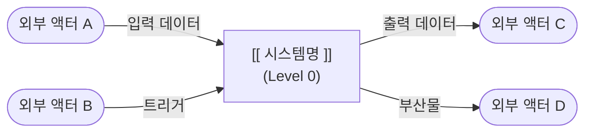

# [[ 프로젝트/모듈명 ]] — Overview

<!--
  이 템플릿은 Progress Tracker와 Roadmap을 '소유'하는 최상위 폴더 전용입니다. (DFD Level 0)
  하위 폴더는 이 파일을 참조하며, 자체 Tracker를 갖지 않습니다.
  사용 수준: 루트(/) 또는 독립적인 도메인/서비스의 최상위 폴더
-->

이 시스템은 **[[ 전체 책임을 1~2문장으로 ]]** 을 담당합니다.

> 📄 기능 명세: [`SPEC.md`](./SPEC.md) — 기능 ID(F-xxx)와 수용 기준은 SPEC.md가 정의합니다.  
> 📐 아키텍처: [`ARCHITECTURE.md`](./ARCHITECTURE.md) — 기술 스택, 모듈 구조, 설계 결정(ADR)은 ARCHITECTURE.md가 정의합니다.

---

## DFD — Level 0 (Context Diagram)

> 시스템 전체를 단일 버블로 표현합니다. 외부 액터와 시스템 경계만 나타냅니다.  
> 하위 폴더의 DFD는 이 버블을 순차적으로 분해(Decompose)합니다.

---

## Tech Stack

<!--
  이름만 적은 요약입니다. 버전·상태·선택 이유·허용 라이브러리는 ARCHITECTURE.md §2가 원본이므로
  여기에 버전을 적지 않습니다 (두 곳에 적으면 반드시 어긋납니다).
-->

> 원본: [`ARCHITECTURE.md`](./ARCHITECTURE.md) §2 기술 스택

- [[ 클라이언트: 언어 · 프레임워크 ]]
- [[ 서버: 언어 · 프레임워크 ]]
- [[ 저장소 · 인프라 · 외부 서비스 ]]

---

## Agent Control

<!--
  이 섹션의 규칙은 이 폴더 및 모든 하위 폴더에 기본 적용됩니다.
  하위 폴더의 Agent Control은 이 규칙을 '상속'하며 추가/강화할 수 있지만 완화할 수 없습니다.
-->

> 이 규칙은 전체 시스템에 적용되는 최상위 제약입니다. 하위 폴더는 이 규칙을 위반할 수 없습니다.

### 허용 (Allow)

- [[ 시스템 전반에서 허용되는 패턴 ]]

### 금지 (Prohibit)

- [[ 시스템 전반에서 금지되는 패턴 ]]
- SPEC.md에 없는 기능을 임의로 구현 금지 (먼저 사용자에게 제안)

### 필수 (Required)

- 기능 작업 전 SPEC.md에서 해당 기능 ID의 수용 기준 확인
- 의존성 추가·모듈 구조 변경 전 ARCHITECTURE.md 허용 목록(§2.2)·의존 규칙(§3.3) 확인
- 모든 하위 폴더 작업 완료 시 이 파일의 **Progress Tracker** 업데이트
- 작업할 폴더에 README.md가 없으면 `templates/README_TEMPLATE_SUB.md` 기반으로 생성
- 구조 변경 시 관련 레벨의 DFD를 하위→상위 순서로 업데이트

---

## Sub-folder Map

<!--
  이 시스템의 하위 폴더 구조와 각 폴더가 담당하는 기능 ID를 매핑합니다.
  DFD 레벨 = 이 README(Level 0)에서의 분해 깊이. README가 없는 중간 폴더는 레벨을 소비하지 않습니다.
  새 하위 폴더 README를 만들면 반드시 이 테이블에 행을 추가하세요.
-->

| 폴더 | DFD 레벨 | 담당 기능 ID | 설명 |
|------|----------|--------------|------|
| `/[[ 폴더명 ]]` | Level 1 | [[ F-001, F-002 ]] | [[ 한 줄 설명 ]] |

---

## Progress Tracker

<!--
  ⚠️ 진행도의 단일 정의 지점(Single Source of Truth)입니다.
  모든 하위 폴더는 이 테이블을 참조하며, 직접 Tracker를 갖지 않습니다.
  ID·Feature는 SPEC.md §4.1 기능 목록과 반드시 일치해야 합니다.

  에이전트는:
  - 작업을 시작할 때          → 해당 행을 🔄 In Progress로 변경
  - 수용 기준을 모두 통과하면  → ✅ Done + Last Updated 갱신
  - 새 기능 발견 시           → SPEC.md §4.1에 먼저 추가 후 같은 ID로 행 추가 (⏳ Pending)
  - Owner Folder는 실제 구현 위치 폴더 경로를 기재

  상태 이모지: ✅ Done | 🔄 In Progress | ⏳ Pending | ❌ Blocked
-->

| ID | Feature | Status | Owner Folder | Last Updated | Notes |
|----|---------|--------|--------------|--------------|-------|
| F-001 | [[ 기능명 A ]] | ⏳ Pending | `/[[ 폴더 ]]` | - | |
| F-002 | [[ 기능명 B ]] | ⏳ Pending | `/[[ 폴더 ]]` | - | |

---

## Next Roadmap

<!--
  ⚠️ 작업 방향성의 단일 정의 지점입니다.
  하위 폴더는 자체 Roadmap을 갖지 않으며, 이 목록을 보고 자신의 DFD를 구성합니다.
  완료된 항목은 삭제하고, 새 항목을 우선순위 순으로 추가하세요.
  각 항목에 기능 ID와 담당 하위 폴더 경로를 명시하세요.
-->

1. [[ F-001 작업 항목 ]] → `/[[ 담당 폴더 ]]`
2. [[ F-002 작업 항목 ]] → `/[[ 담당 폴더 ]]`
