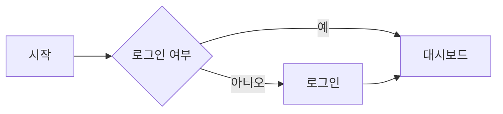
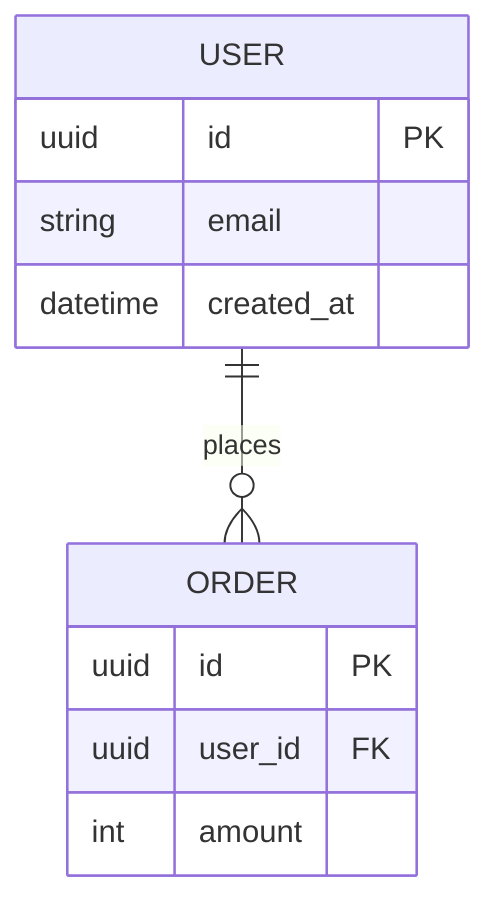

# [[ 프로젝트명 ]] — 기능 명세 (SPEC)

<!--
  이 템플릿은 프로젝트 루트에 SPEC.md로 복사해 사용합니다.

  ┌─ Blueprint Framework에서 SPEC.md의 역할 ─────────────────────────────┐
  │ SPEC.md            → "무엇을 만드는가"   (기능 ID · 수용 기준)         │
  │ ARCHITECTURE.md    → "무엇으로, 어떤 구조로" (스택 · 모듈 · ADR)       │
  │ 루트 README.md     → "얼마나 됐는가"     (Progress Tracker · Roadmap)  │
  │ 폴더 README.md     → "어떻게 흐르는가"   (DFD · Agent Control)         │
  │                                                                       │
  │ 문서들은 기능 ID(F-001)로 연결됩니다. 같은 정보를 두 곳에 쓰지 않습니다. │
  │  - 진행 상태는 SPEC에 적지 않습니다 → Tracker에만                        │
  │  - 기술 스택·구성도·설계 결정은 SPEC에 적지 않습니다 → ARCHITECTURE.md에만 │
  └───────────────────────────────────────────────────────────────────────┘

  작성 규칙:
  - [[ ]] 안의 내용을 채우고, 이 주석들은 작성 후 지워도 됩니다.
  - 해당 없는 섹션은 지우지 말고 "해당 없음"이라고 적습니다.
    (빠뜨린 것인지 의도적으로 뺀 것인지 구분하기 위해)
  - 최소 작성 범위: §1 개요, §2 범위, §4.1 기능 목록, MVP 기능의 §4.2 수용 기준.
-->

> **에이전트 읽기 규칙**: 이 파일은 세션마다 전체를 읽지 않습니다.  
> 작업할 기능 ID의 **§4.2 기능 상세** 블록과, 그 블록이 참조하는 화면·데이터·API 항목만 읽습니다.

| 항목 | 내용 |
|---|---|
| 문서 버전 | v0.1 |
| 상태 | 초안 / 검토 중 / 승인됨 |
| 작성자 | [[ 이름 ]] |
| 최종 수정일 | YYYY-MM-DD |

---

## 목차

1. [프로젝트 개요](#1-프로젝트-개요)
2. [범위](#2-범위)
3. [사용자와 페르소나](#3-사용자와-페르소나)
4. [기능 요구사항](#4-기능-요구사항)
5. [비기능 요구사항](#5-비기능-요구사항)
6. [화면 및 사용자 흐름](#6-화면-및-사용자-흐름)
7. [데이터 모델](#7-데이터-모델)
8. [설계 결정 (ADR)](#8-설계-결정-adr)
9. [API 명세](#9-api-명세)
10. [외부 연동](#10-외부-연동)
11. [보안 및 개인정보](#11-보안-및-개인정보)
12. [테스트 전략](#12-테스트-전략)
13. [배포 및 운영](#13-배포-및-운영)
14. [마일스톤](#14-마일스톤)
15. [리스크](#15-리스크)
16. [미결 사항](#16-미결-사항)
17. [용어집](#17-용어집)
18. [변경 이력](#18-변경-이력)

---

## 1. 프로젝트 개요

### 1.1 한 줄 요약
<!-- 이 프로젝트를 처음 듣는 사람에게 한 문장으로 설명한다면? -->
[[ 예: 소규모 헬스장이 회원 출석과 결제를 한 화면에서 관리할 수 있는 웹 서비스 ]]

### 1.2 배경과 문제
- 현재 상황:
- 문제점:
- 해결하지 않으면 생기는 일:

### 1.3 목표
<!-- 측정 가능한 형태로 -->
| 목표 | 성공 지표 | 목표값 |
|---|---|---|
| [[ 예: 출석 체크 시간 단축 ]] | [[ 평균 처리 시간 ]] | [[ 10초 이내 ]] |

### 1.4 비목표 (Non-goals)
<!-- 이번 프로젝트에서 의도적으로 하지 않는 것. 에이전트의 범위 확장을 막아 줍니다 -->
- [[ 예: 회계 프로그램 연동은 하지 않는다 ]]

---

## 2. 범위

### 2.1 MVP (최소 기능 제품)
<!-- 첫 출시에 반드시 있어야 하는 기능 ID만 -->
- F-001 [[ 기능명 ]]
- F-002 [[ 기능명 ]]

### 2.2 이후 단계
| 단계 | 포함 기능 ID |
|---|---|
| Phase 2 | |
| Phase 3 | |

### 2.3 전제 조건과 제약
- 전제: [[ 예: 사용자는 스마트폰을 보유하고 있다 ]]
- 제약: [[ 예: 예산, 출시일, 특정 클라우드만 사용 가능 ]]

---

## 3. 사용자와 페르소나

### 3.1 사용자 유형
| 유형 | 설명 | 주요 권한 |
|---|---|---|
| [[ 관리자 ]] | | |
| [[ 일반 사용자 ]] | | |

### 3.2 페르소나
<!-- 대표 사용자 1~3명 -->
**[[ 이름 / 나이 / 직업 ]]**
- 목표:
- 불편한 점:
- 사용 환경: [[ 기기, 장소, 빈도 ]]

---

## 4. 기능 요구사항

### 4.1 기능 목록

<!--
  ⚠️ 이 표의 ID와 기능명은 루트 README.md Progress Tracker의 ID·Feature와 반드시 일치해야 합니다.
  새 기능은 여기에 먼저 추가하고, 그다음 Tracker에 같은 ID로 행을 추가합니다.
  ID는 재사용하지 않습니다 (삭제된 기능의 ID도 비워 둡니다).
  우선순위: P0(필수) / P1(중요) / P2(있으면 좋음)
-->

| ID | 기능명 | 설명 | 우선순위 | 단계 |
|---|---|---|---|---|
| F-001 | [[ 기능명 ]] | | P0 | MVP |
| F-002 | [[ 기능명 ]] | | P1 | MVP |

### 4.2 기능 상세

<!-- 기능마다 아래 블록을 복사해서 사용. 에이전트는 이 블록 단위로 읽습니다 -->

#### F-001. [[ 기능명 ]]
- **사용자 스토리**: [[ 사용자 유형 ]]으로서, 나는 [[ 행동 ]]을 하고 싶다. 왜냐하면 [[ 이유 ]] 때문이다.
- **상세 동작**:
  1.
  2.
- **수용 기준 (Acceptance Criteria)**: <!-- 모두 통과해야 Tracker에서 ✅ Done -->
  - [ ] Given [[ 상황 ]], When [[ 행동 ]], Then [[ 결과 ]]
  - [ ]
- **예외 처리**:
  - [[ 예: 네트워크 오류 시 재시도 버튼 표시 ]]
- **관련 항목**: 화면 [[ S-001 ]] · 데이터 [[ 엔티티명 ]] · API [[ API-001 ]]
- **Owner Folder**: `/[[ 담당 폴더 ]]` <!-- Tracker의 Owner Folder와 동일 -->

---

## 5. 비기능 요구사항

| 분류 | 요구사항 | 기준 |
|---|---|---|
| 성능 | 응답 시간 | [[ 예: p95 < 500ms ]] |
| 확장성 | 동시 접속자 | [[ 예: 1,000명 ]] |
| 가용성 | 가동률 | [[ 예: 99.5% ]] |
| 접근성 | 웹 접근성 | [[ 예: WCAG 2.1 AA ]] |
| 호환성 | 지원 브라우저/OS | [[ 예: 최신 2개 버전 ]] |
| 국제화 | 지원 언어 | [[ 예: 한국어, 영어 ]] |
| 유지보수 | 코드 품질 | [[ 예: 테스트 커버리지 70% 이상 ]] |

---

## 6. 화면 및 사용자 흐름

### 6.1 화면 목록
| ID | 화면명 | 설명 | 접근 권한 | 관련 기능 ID | 디자인 링크 |
|---|---|---|---|---|---|
| S-001 | | | | F-001 | |

### 6.2 핵심 사용자 흐름
<!-- 사용자 관점의 흐름입니다. 시스템 내부 데이터 흐름은 폴더 README의 DFD에서 다룹니다 -->


### 6.3 화면 상세
#### S-001. [[ 화면명 ]]
- 목적:
- 주요 구성 요소:
- 상태별 화면: 로딩 / 빈 상태 / 오류 / 정상

---

## 7. 데이터 모델

### 7.1 ERD


### 7.2 엔티티 상세
#### [[ 엔티티명 ]]
| 필드 | 타입 | 필수 | 설명 | 제약 |
|---|---|---|---|---|
| id | UUID | Y | 기본키 | |

### 7.3 데이터 보존 정책
- [[ 예: 탈퇴 회원 데이터는 30일 후 영구 삭제 ]]

---

## 8. 설계 결정 (ADR)

<!-- 절 번호를 유지하기 위해 제목만 남깁니다 (v2.1부터 ADR은 ARCHITECTURE.md로 이동) -->

설계 결정(ADR)과 기술 스택은 [`ARCHITECTURE.md`](./ARCHITECTURE.md) §9 · §2에서 관리합니다.

---

## 9. API 명세

### 9.1 공통 규칙
- Base URL: [[ `https://api.example.com/v1` ]]
- 인증 방식: [[ 예: Bearer Token (JWT) ]]
- 오류 형식:
```json
{
  "error": {
    "code": "INVALID_INPUT",
    "message": "설명"
  }
}
```

### 9.2 엔드포인트 목록
| ID | 메서드 | 경로 | 설명 | 인증 | 관련 기능 ID |
|---|---|---|---|---|---|
| API-001 | GET | `/users/{id}` | 사용자 조회 | 필요 | F-001 |

### 9.3 엔드포인트 상세
#### API-001. [[ 이름 ]]
- **요청**
```json
{}
```
- **응답 (200)**
```json
{}
```
- **오류 코드**: 400, 401, 404

---

## 10. 외부 연동

<!-- 여기 추가된 외부 서비스는 루트 README.md Level 0 DFD의 외부 액터와 ARCHITECTURE.md §3.1 구성도에도 나타나야 합니다 -->

| 서비스 | 용도 | 연동 방식 | 비용 | 장애 시 대응 |
|---|---|---|---|---|
| [[ 예: 결제 PG ]] | | REST API | | |

---

## 11. 보안 및 개인정보

- **인증/인가**:
- **수집하는 개인정보와 목적**:
- **암호화**: 저장 시 / 전송 시
- **비밀값 관리**: [[ 예: 환경변수, 시크릿 매니저. 저장소에 커밋 금지 ]]
- **관련 법규**: [[ 예: 개인정보 보호법 ]]
- **감사 로그**:

---

## 12. 테스트 전략

<!-- 수용 기준은 가능한 한 자동화된 테스트로 옮깁니다 -->

| 종류 | 범위 | 도구 | 기준 |
|---|---|---|---|
| 단위 테스트 | | | |
| 통합 테스트 | | | |
| E2E 테스트 | 수용 기준 시나리오 | | |

---

## 13. 배포 및 운영

- **환경**: 개발 / 스테이징 / 운영
- **배포 방식**: [[ 예: main 브랜치 머지 시 자동 배포 ]]
- **브랜치 전략**: [[ 예: GitHub Flow ]]
- **롤백 절차**:
- **모니터링/알림**:
- **백업**:

---

## 14. 마일스톤

<!-- 날짜가 있는 큰 단위 목표입니다. 바로 다음 작업 순서는 루트 README.md Next Roadmap에서 관리합니다 -->

| 마일스톤 | 포함 기능 ID | 목표일 |
|---|---|---|
| M1 MVP | F-001, F-002 | |
| M2 | | |

---

## 15. 리스크

| ID | 리스크 | 가능성 | 영향도 | 대응 방안 |
|---|---|---|---|---|
| R-001 | | 높음/중간/낮음 | 높음/중간/낮음 | |

---

## 16. 미결 사항

<!--
  에이전트는 명세가 모호하면 추측해서 구현하지 않고, 여기에 질문을 추가한 뒤 사용자에게 묻습니다.
  결정되면 결정 내용과 날짜를 적습니다.
-->

| ID | 질문 | 관련 기능 ID | 담당자 | 결정 (날짜) |
|---|---|---|---|---|
| Q-001 | | | | |

---

## 17. 용어집

| 용어 | 정의 |
|---|---|
| | |

---

## 18. 변경 이력

| 버전 | 날짜 | 작성자 | 변경 내용 |
|---|---|---|---|
| v0.1 | YYYY-MM-DD | | 최초 작성 |
